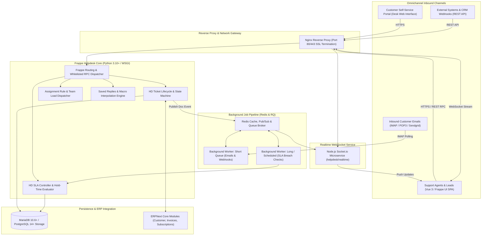
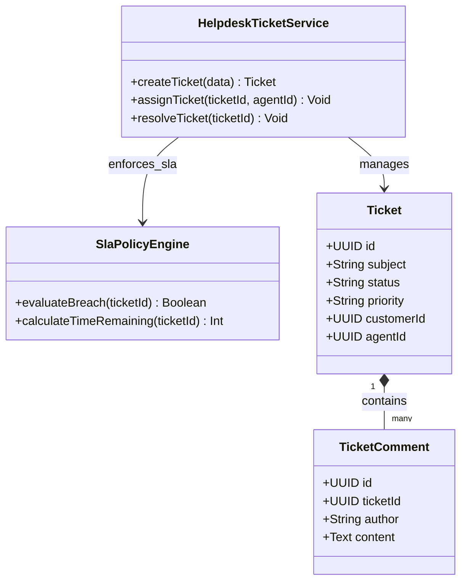
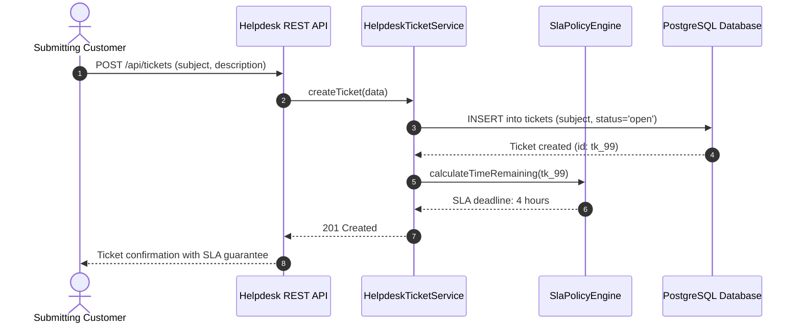

# helpdesk - Architecture & Technical Wiki

> **Modern Open-Source Omnichannel Helpdesk & Customer Support Platform Built on Frappe Framework**  
> GitHub: [frappe/helpdesk](https://github.com/frappe/helpdesk.git) | Stack: Python 3.10+, Frappe Framework v15, MariaDB / PostgreSQL, Redis, Socket.io Realtime, Vue.js 3, Tailwind CSS, Frappe UI | License: GNU AGPL v3

---

## 1. Executive Summary & Value Proposition

**Frappe Helpdesk** is an enterprise-grade, open-source customer service ticketing and omnichannel support suite engineered by Frappe Technologies. Built directly on top of the **Frappe Framework (v15)** and written in Python and Vue 3, Frappe Helpdesk delivers an exceptionally fast, reactive single-page application (SPA) designed to unify customer conversations, automated SLA workflows, team queues, and ERP records into a coherent operational cockpit.

Unlike monolithic legacy helpdesks that isolate support tickets from core business operations, Frappe Helpdesk bridges the gap between customer queries and commercial enterprise data. Through native integration with the Frappe/ERPNext ecosystem, support agents possess instant, contextual visibility into customer sales orders, delivery notes, billing statuses, and warranty agreements without switching tabs.

### Core Problems Solved
- **Customer Context Isolation**: Deeply connects support tickets (`HD Ticket`) with ERPNext Customer ledgers, purchase histories, and subscriptions.
- **SLA Drift & Complex Business Calendars**: Provides granular SLA policy enforcement with dynamic pause-on-hold calculations, holiday schedules (`HD Holiday`), and per-priority resolution thresholds.
- **Support Team Dispatch & Load Management**: Automatically routes inbound queries to teams (`HD Team`) and specialized agents (`HD Agent`) based on round-robin assignment rules, availability flags, and workload capacities.
- **Slow Dashboard Interactions**: Replaces traditional page-reloading admin desks with a high-performance Vue 3 SPA powered by Frappe UI, SQLite client caching, and Socket.io WebSocket event streams.
- **Post-Resolution Customer Feedback Loop**: Collects automated CSAT survey metrics (`HD Ticket Feedback Option`) directly via email reaction links and customer portal widgets.

---

## 2. High-Level System Architecture

Frappe Helpdesk leverages Frappe's metadata-driven DocType architecture. The backend runs on **Python/WSGI** (Gunicorn) with **Redis** for caching, session management, and Celery-style task queueing, alongside an independent **Node.js Socket.io** microservice managing real-time agent presence and UI updates.



### Architectural Lifecycle of an Incoming Ticket
1. **Email or Portal Ingestion**: An incoming email is retrieved by Frappe's background email queue or submitted via the customer portal (`api/v1/customer_portal`).
2. **Contact & Customer Linking**: Frappe Helpdesk parses the sender email:
   - Matches against `HD Customer` and standard Frappe `Contact` DocTypes.
   - If an existing ERPNext customer record exists, the ticket automatically binds to the customer’s commercial account.
3. **DocType Instantiation**: An `HD Ticket` record is created in MariaDB/PostgreSQL. During `before_insert` and `validate`, Frappe Helpdesk:
   - Evaluates matching `HDAssignmentRule` policies to route the ticket to the appropriate `HD Team` and `HDAgent`.
   - Binds the active `HD Service Level Agreement` matching the ticket's priority and customer tier.
4. **SLA Clock Initialization**: The `SLAController` calculates exact response and resolution deadlines (`response_by`, `resolution_by`), taking into account the assigned team's `HD Service Day` operating hours and `HD Holiday List`.
5. **Real-time Event Emission**: Frappe pushes a doc update event to Redis Pub/Sub. The Node.js Socket.io service intercepts the event and broadcasts it to active agent browser sessions without requiring manual list refreshes.

---

### 2.1 Core Domain & Service Class Architecture



---

## 3. Technology Stack & Key Dependencies

- **Language & Runtime**: Python 3.10+ (Backend), Node.js 20+ (Realtime & Frontend Build)
- **Application Framework**: Frappe Framework v15 (Metadata-driven MVC and ORM)
- **Database & Persistence**:
  - MariaDB 10.6+ (default Frappe database engine) or PostgreSQL 14+.
  - SQLite integration (`search_sqlite.py`) for high-speed local agent search indexing.
- **Real-Time Communication**:
  - Dedicated Node.js microservice (`realtime/index.js`) using `socket.io` and `ioredis`.
  - Redis Pub/Sub for cross-process synchronization between Python workers and WebSocket clients.
- **Task Queues & Scheduling**:
  - Python RQ (Redis Queue) with automated `short`, `default`, and `long` worker pools.
  - Native Frappe Cron scheduler (`frappe.utils.scheduler`).
- **Frontend Architecture**:
  - Vue.js 3 with Composition API.
  - `frappe-ui` component library, Tailwind CSS, Headless UI, and Feather/Lucide icons.
  - State Management: Pinia / Vue reactive stores.

---

## 4. Repository Layout & Key Modules

```
helpdesk/
├── helpdesk/
│   ├── api/                          # Whitelisted backend REST and RPC endpoints
│   │   ├── ticket.py                 # Bulk replies, agent assignments, ticket deletion
│   │   ├── doc.py                    # Generic document querying, mutations, and permissions
│   │   ├── dashboard.py              # Ticket volume, resolution rates, and SLA metrics
│   │   ├── customer.py               # Customer 360 profile and contact resolution
│   │   ├── saved_replies.py          # Canned response management and insertion
│   │   └── timeline.py               # Chronological activity stream aggregation
│   ├── helpdesk/doctype/             # Core DocType definitions (JSON schema + Python controllers)
│   │   ├── hd_ticket/                # Ticket model, validations, and SLA bindings
│   │   ├── hd_ticket_comment/        # Discussion comments and agent notes
│   │   ├── hd_ticket_activity/       # Granular system audit log (status changes, assignments)
│   │   ├── hd_service_level_agreement/# SLA policy rules, holidays, and priorities
│   │   ├── hd_agent/                 # Support agent profiles, capacities, and presence
│   │   ├── hd_team/                  # Support departments and team queues
│   │   ├── hd_customer/              # Customer profile records linked to ERPNext
│   │   └── hd_saved_reply/           # Templated canned responses with team permissions
│   ├── hooks.py                      # Frappe app configuration, event hooks, and cron jobs
│   ├── search_sqlite.py              # High-performance SQLite local full-text search engine
│   └── utils.py                      # Global security guards (@agent_only, @is_admin)
├── realtime/                         # Standalone Node.js Socket.io real-time server
│   ├── index.js                      # WebSocket listener and Redis event subscriber
│   └── package.json                  # Realtime server dependencies
├── desk/                             # Vue 3 Single Page Application (frontend source code)
│   ├── src/components/               # UI widgets (TicketZoom, Kanban, Timeline, SLA badges)
│   └── src/pages/                    # Application views (Inbox, Reports, Settings, KnowledgeBase)
├── pyproject.toml                    # Python packaging and dependency declarations
└── hooks.py                          # Application entry points and Frappe hook definitions
```

---

## 5. Core Features & Capabilities

### 5.1 Deep ERPNext Commercial Context
Because Frappe Helpdesk lives inside the Frappe bench, it enjoys zero-overhead access to ERPNext DocTypes:
- When an agent views a ticket raised by `john@acme.corp`, the ticket sidebar automatically surfaces Acme Corp's **open invoices**, **active subscriptions**, **recent shipments**, and **service contracts**.
- Agents can link tickets directly to warranty claims or bug tracking DocTypes without third-party webhooks or API synchronization latency.

### 5.2 Dynamic SLA Engine with Hold-Time Calculations
Frappe Helpdesk implements an enterprise SLA controller (`HD Service Level Agreement`):
- **Service Calendars & Holidays**: Operating hours are configured per day of the week (`HD Service Day`). Non-working hours and regional holidays (`HD Holiday List`) are excluded from SLA countdown clocks.
- **Hold-Time Clock Pausing**: When a ticket transitions to a status categorized as `On Hold` (e.g. *Waiting on Customer*), the SLA timer pauses. Upon resumption, `total_hold_time` is dynamically computed and added to `resolution_by`, preventing unfair agent SLA penalties.
- **Agreement Status Tracking**: Explicitly stamps `agreement_status` as *Fulfilled*, *First Response Failed*, or *Resolution Failed*, powering executive compliance reports.

### 5.3 Automated Team & Agent Load Balancing
Inbound tickets are systematically routed using assignment rules:
- **Team Routing**: Evaluates ticket type, source email address, or keyword criteria to assign the ticket to an `HD Team`.
- **Round-Robin Agent Distribution**: Sequentially cycles through active agents inside the target team.
- **Presence & Capacity Awareness**: Checks `HDAgent.availability` (*Available*, *Busy*, *Offline*) to avoid assigning new high-priority cases to absent personnel.

### 5.4 Unified Ticket Timeline & Internal Agent Collaboration
Conversations inside `HD Ticket` maintain a chronological activity stream:
- **Public Replies**: Communicated to the customer via email or portal.
- **Internal Comments (`HD Ticket Comment`)**: Pinned agent notes, teammate mentions (`@agent`), and emoji reactions.
- **Audit Activities (`HD Ticket Activity`)**: Automated entries recording priority changes, team reassignments, and SLA milestones.

### 5.5 Canned Responses & Dynamic Template Variables (`HDSavedReply`)
- Support agents access canned responses using keyboard shortcuts in the rich text editor.
- Responses support dynamic Jinja template syntax, interpolating customer names (`{{ doc.raised_by }}`), agent signatures, and ticket reference numbers automatically.
- Saved replies can be scoped globally, per `HD Team`, or kept private to an individual agent.

### 5.6 Automated Customer CSAT Feedback
- When a ticket reaches a closed status, Frappe Helpdesk dispatches a satisfaction survey email with one-click rating options (e.g. *Great*, *Okay*, *Poor*).
- Ratings and qualitative customer comments are recorded in `feedback_rating` and `feedback`, triggering automated escalation workflows if a negative rating is submitted.

---

## 6. Data Models & Schema Architecture

Frappe Helpdesk data models are declared as Frappe DocTypes with strict relational foreign keys and relational metadata.

```mermaid
erDiagram
    HD_TEAM ||--o{ HD_TEAM_MEMBER : "consists of"
    HD_AGENT ||--o{ HD_TEAM_MEMBER : "assigned to"
    
    HD_TEAM ||--o{ HD_TICKET : "handles"
    HD_AGENT ||--o{ HD_TICKET : "assigned to"
    HD_CUSTOMER ||--o{ HD_TICKET : "raises"
    
    HD_SERVICE_LEVEL_AGREEMENT ||--o{ HD_SERVICE_LEVEL_PRIORITY : "defines criteria"
    HD_SERVICE_LEVEL_AGREEMENT ||--o{ HD_TICKET : "governs SLA"
    
    HD_TICKET ||--o{ HD_TICKET_COMMENT : "contains discussions"
    HD_TICKET ||--o{ HD_TICKET_ACTIVITY : "logs audit changes"
    
    HD_SAVED_REPLY ||--o{ HD_SAVED_REPLY_TEAM : "scopes permissions"
    HD_TEAM ||--o{ HD_SAVED_REPLY_TEAM : "shares"

    HD_TICKET {
        string name PK "Auto-generated Ticket ID (e.g. HD-TCK-0012)"
        string subject
        string raised_by "Customer email / User link"
        string status FK "Link to HD Ticket Status"
        string priority FK "Link to HD Ticket Priority"
        string ticket_type FK "Link to HD Ticket Type"
        string agent_group FK "Link to HD Team"
        string customer FK "Link to HD Customer"
        string sla FK "Link to HD Service Level Agreement"
        datetime response_by
        datetime resolution_by
        string agreement_status "Fulfilled, First Response Failed, Resolution Failed"
        datetime on_hold_since
        float total_hold_time "Accumulated paused seconds"
        datetime first_responded_on
        string feedback_rating "Great, Okay, Poor"
        text feedback "Customer satisfaction comment"
        boolean is_merged
        string merged_with FK
        datetime creation
    }

    HD_AGENT {
        string name PK
        string user FK "Link to system User"
        string agent_name
        boolean is_active
        string availability "Available, Busy, Offline"
        datetime availability_changed_on
    }

    HD_TEAM {
        string name PK
        string team_name
        text description
        boolean is_active
    }

    HD_CUSTOMER {
        string name PK
        string customer_name
        string email UK
        string phone
        string customer FK "Link to ERPNext Customer master"
    }

    HD_SERVICE_LEVEL_AGREEMENT {
        string name PK
        string service_level
        string holiday_list FK "Link to HD Holiday List"
        date start_date
        date end_date
        boolean default_sla
        boolean enabled
        text condition_json
    }

    HD_SERVICE_LEVEL_PRIORITY {
        string name PK
        string parent FK "Link to HD Service Level Agreement"
        string priority FK "Link to HD Ticket Priority"
        float response_time "Target response in hours"
        float resolution_time "Target resolution in hours"
    }

    HD_TICKET_COMMENT {
        string name PK
        string reference_ticket FK "Link to HD Ticket"
        string commented_by FK "Link to User"
        longtext content "Rich text HTML comment"
        boolean is_pinned
        datetime creation
    }

    HD_TICKET_ACTIVITY {
        string name PK
        string ticket FK "Link to HD Ticket"
        string action_by FK
        string activity_type "Status Changed, Reassigned, Priority Updated"
        text details
        datetime creation
    }
```



### Core Schema Entity Details
1. **`HD Ticket`**:
   - `name`: Formatted identifier created by Frappe's `autoname` generator (e.g., `HD-TCK-.YYYY.-.#####`).
   - `total_hold_time`: Dynamically calculated cumulative hold duration subtracted from total resolution time to maintain SLA fidelity.
   - `is_merged` & `merged_with`: Explicit relational pointer for ticket consolidation.
2. **`HD Service Level Agreement` & `HD Service Level Priority`**:
   - Implements a parent-child DocType hierarchy where a single SLA policy contains multiple rows defining target response/resolution hours per priority level (`Urgent`, `High`, `Medium`, `Low`).
3. **`HD Customer`**:
   - Acts as a bridge entity connecting raw email addresses to enterprise ERPNext customer records.

---

### 6.1 Comprehensive Database Schema Specification

Generic relational helpdesk persistence schema tracking tickets, SLAs, and customer comments.

#### Table: `tickets`
Support requests submitted by clients.

| Column | Type | Constraints | Default | Description |
| :--- | :--- | :--- | :--- | :--- |
| `id` | `UUID` | `PRIMARY KEY` | `gen_random_uuid()` | Unique ticket identifier |
| `subject` | `VARCHAR(255)` | `NOT NULL` | - | Ticket title |
| `status` | `VARCHAR(50)` | `NOT NULL` | `'open'` | State (`open`, `in_progress`, `resolved`) |
| `priority` | `VARCHAR(50)` | `NOT NULL` | `'normal'` | Priority (`low`, `normal`, `high`) |
| `customer_id` | `UUID` | `NOT NULL` | - | Requesting user |
| `agent_id` | `UUID` | `NULLABLE` | `NULL` | Assigned agent |

*Indexes:* `idx_hd_status` (`(status)`), `idx_hd_customer` (`(customer_id)`).

---

## 7. API Architecture, Webhooks & Key Endpoints

Frappe Helpdesk exposes whitelisted Python functions accessible via the Frappe RPC gateway (`/api/method/<method_path>`).

### Key RPC Endpoints

| HTTP Method | Endpoint | Description |
|:---|:---|:---|
| `POST` | `/api/method/helpdesk.api.ticket.bulk_reply` | Send bulk replies and attach documents across multiple tickets |
| `POST` | `/api/method/helpdesk.api.ticket.assign_ticket_to_agent` | Reassign ticket ownership to a designated agent or self |
| `POST` | `/api/method/helpdesk.api.ticket.delete_ticket` | Admin-only forced deletion of ticket records |
| `GET` | `/api/method/helpdesk.api.doc.get_list` | Dynamic, filterable query builder retrieving tickets and metadata |
| `POST` | `/api/method/helpdesk.api.comment.add_comment` | Append a public message or internal staff comment to a ticket |
| `GET` | `/api/method/helpdesk.api.dashboard.get_ticket_stats` | Retrieve aggregate metrics (SLA compliance, open counts, response times) |
| `POST` | `/api/method/helpdesk.api.saved_replies.get_saved_replies` | Fetch team-scoped canned responses with keyword search |

### Sample Request: Bulk Agent Reply (`POST /api/method/helpdesk.api.ticket.bulk_reply`)
```json
{
  "ticket_ids": ["HD-TCK-2026-00104", "HD-TCK-2026-00105"],
  "message": "<p>We have deployed a hotfix resolving the OAuth token expiration bug. Please verify on your end.</p>",
  "attachments": ["4a89fb12e0"]
}
```

### Sample Response: Whitelisted RPC Result
```json
{
  "message": {
    "status": "success",
    "updated_tickets": 2,
    "timestamp": "2026-10-24T10:45:00.124562"
  }
}
```

---

### 7.5 End-to-End Operational Lifecycle Sequence



---

## 8. Strategic Value & Takeaways for MarketingStudio

### Reusable Architectural Patterns
1. **ERP/CRM Context Synthesis**:
   - Frappe Helpdesk’s greatest asset is eliminating silos between customer inquiries and operational data (invoices, subscriptions, product usage). MarketingStudio should directly embed customer CRM timelines, attribution touchpoints, and active marketing campaign tags into the customer conversation view.
2. **Hold-Time SLA Clock Pausing (`total_hold_time`)**:
   - Measuring SLA compliance purely by creation date punishes support agents when a customer takes days to supply necessary diagnostic files. MarketingStudio should implement Frappe's paused-clock pattern to pause SLA metrics whenever a deal or ticket is waiting on external input.
3. **Decoupled Real-Time Architecture (Python WSGI + Node.js Socket.io)**:
   - Offloading high-concurrency WebSocket subscriptions and presence heartbeats to an ultra-lightweight Node.js microservice (`realtime/`) while retaining clean Python business logic prevents the core web workers from getting blocked by long-lived client connections.
4. **Metadata-Driven Entity Schemas**:
   - Defining entities through declarative schemas allows rapid customization of fields, permission tiers, and form layouts without requiring risky low-level database operations.
