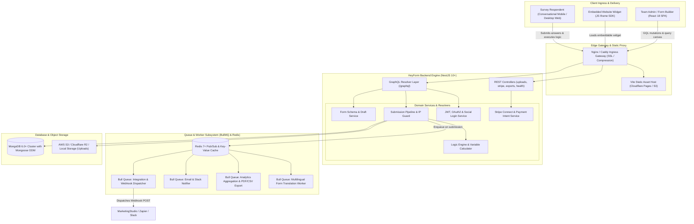
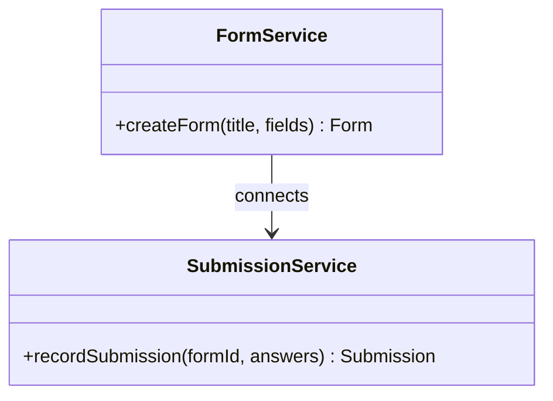
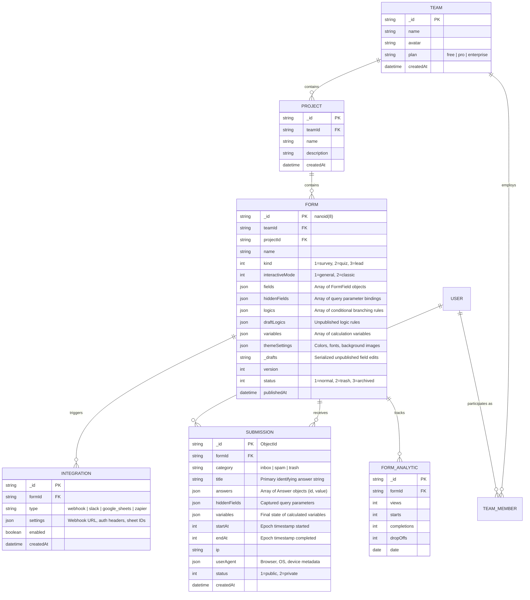
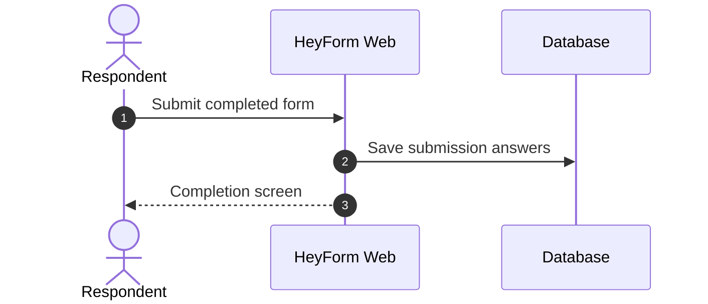

# heyform - Architecture & Technical Wiki

> **Conversational Open-Source Form Builder, Typeform Alternative & Multi-Tenant Feedback Engine**  
> GitHub: [heyform/heyform](https://github.com/heyform/heyform) | Stack: TypeScript, NestJS, GraphQL, MongoDB / Mongoose, Redis (Bull Queue), React 18, Vite, Tailwind CSS | License: AGPLv3 / Commercial

---

## 1. Executive Summary & Value Proposition

**HeyForm** is a modern, open-source conversational form builder and customer feedback engine engineered as a high-fidelity alternative to Typeform, Formkeep, and JotForm. Designed around the principle of interactive, one-question-at-a-time form rendering, HeyForm delivers high completion rates for lead generation, customer intake questionnaires, product evaluations, and event registrations.

Traditional static forms overwhelm respondents with expansive walls of inputs, leading to high bounce rates, poor mobile ergonomics, and incomplete submissions. HeyForm solves this by decoupling form definition from execution through a reactive NestJS + GraphQL architecture backed by MongoDB. Its conversational engine features smooth keyboard navigation (Enter to advance, keys A–Z for multiple choice, 1–10 for ratings), real-time conditional branching, mathematical variable calculations, and asynchronous webhook dispatching via Redis Bull queues.

### Core Problems Solved
- **Form Abandonment & Cognitive Overload**: Employs interactive conversational flows (`InteractiveModeEnum`) where users encounter one discrete question block per step with fluid animations and keyboard ergonomics.
- **Dynamic Branching & Algorithmic Scoring**: Provides visual logic builders (`Logic[]`) supporting complex boolean operators (`IS`, `IS_NOT`, `GREATER_THAN`) and internal runtime variables (`Variable[]`) for real-time quiz scoring, price calculators, and conditional redirects.
- **Enterprise Team & Workspace Isolation**: Organizes forms hierarchically under `Teams`, `Projects`, and `ProjectGroups`, with granular RBAC permissions (`owner`, `admin`, `member`) and audit trails.
- **Asynchronous Webhook & Integration Pipeline**: Offloads heavy webhook notifications, translation jobs, and third-party integrations (Stripe, Zapier, Google Sheets, Slack) to Redis-backed background queues, ensuring sub-100ms form submission response times.
- **Anti-Spam & Submission Throttling**: Combines IP rate-limiting (`SubmissionIpLimitModel`), Google reCAPTCHA v3 / Cloudflare Turnstile, honeypots, and single-submission email verification guards.

---

## 2. High-Level System Architecture

HeyForm is structured as an enterprise TypeScript monorepo powered by **pnpm workspaces**. The backend is built on **NestJS** utilizing a hybrid architecture of GraphQL resolvers for complex dashboard mutations and REST controllers for public assets, file uploads, and webhooks. The frontend (`packages/webapp`) is a **React 18** SPA compiled with **Vite**.



### Architectural Lifecycle of a Form Submission
1. **Form Schema Retrieval**: The client loads the published form via GraphQL query `form(id: $id)`. HeyForm returns the published JSON payload including `fields`, `themeSettings`, and compiled `logics`.
2. **Client-Side Conversational State Machine**: As the user answers questions, the local state engine updates the `answers` array, dynamically re-evaluates logic rules to calculate the next target question ID (`jumpTo`), and computes custom variables (e.g., cart subtotal or lead score).
3. **Submission Ingestion & Anti-Abuse Guard**: On final step completion, the client executes the `createSubmission` GraphQL mutation. The server checks `SubmissionIpLimitModel` to prevent brute-force flooding, validates required fields against `fields`, and writes a new `SubmissionModel` document to MongoDB.
4. **Queue Emission**: The server pushes a notification event to Redis Bull queues (`submission-notification.queue`, `integration.queue`).
5. **Downstream Integration Dispatch**: Worker processes pull jobs from the queue, format submission JSON payloads, compute HMAC signatures, and execute outbound HTTP POST requests to configured webhook URLs and third-party integrations.

---

### 2.1 Core Domain & Service Class Architecture



---

## 3. Technology Stack & Key Dependencies

- **Language & Runtime**: TypeScript 5.2+, Node.js 20+ LTS, pnpm workspaces.
- **Application Server**:
  - **NestJS 10+**: Modular backend architecture with dependency injection.
  - **Apollo Server / @nestjs/graphql**: Code-first and schema-first GraphQL API layer.
  - **Express**: Underlying HTTP adapter for streaming file uploads and CSV exports.
- **Database & Object Modeling**:
  - **MongoDB 6.0+**: Document-oriented persistence.
  - **Mongoose / @nestjs/mongoose**: ODM managing document validation, virtual properties (`isDraft`, `canPublish`), compound indexes, and lifecycle hooks.
- **Queue & Async Job Engine**:
  - **BullMQ / Bull** connected to **Redis 7+**: Distributed job scheduling with automatic retries, backoff strategies, and concurrency controls.
- **Frontend Architecture**:
  - **React 18** SPA with Hooks and Context API.
  - **Vite 5**: Sub-second Hot Module Replacement (HMR) and optimized rollup production bundles.
  - **Tailwind CSS & PostCSS**: Utility-first responsive styling.
  - `@heyform-inc/shared-types-enums` & `@heyform-inc/utils`: Shared schemas, type definitions, and helper packages across server and webapp.
- **File & Media Storage**: AWS S3 SDK (`@aws-sdk/client-s3`), Cloudflare R2, or local disk uploads with Sharp image processing.

---

## 4. Repository Layout & Key Modules

```
heyform/
├── packages/
│   ├── server/                       # NestJS Backend Application
│   │   ├── src/
│   │   │   ├── apps/                 # App integration modules (Slack, Google Drive, Notion)
│   │   │   ├── common/               # NestJS decorators, guards, filters, interceptors
│   │   │   ├── config/               # Environment configuration loaders
│   │   │   ├── controller/           # REST endpoints (exports, stripe, uploads, health)
│   │   │   ├── model/                # Mongoose schema definitions (form, submission, user, team)
│   │   │   ├── queue/                # Bull queue producers and consumers
│   │   │   ├── resolver/             # GraphQL resolvers (form, submission, team, auth)
│   │   │   ├── schedule/             # Cron tasks (retention purge, analytics rollups)
│   │   │   ├── service/              # Core business services
│   │   │   ├── app.module.ts         # Root NestJS module wiring
│   │   │   └── main.ts               # Server bootstrap entrypoint
│   │   ├── package.json
│   │   └── tsconfig.json
│   ├── shared-types-enums/           # Shared TypeScript interfaces, Enums, and AST types
│   ├── utils/                        # Nanoid generators, parsers, cryptographic helpers
│   └── webapp/                       # React 18 / Vite Frontend Application
│       ├── src/
│       │   ├── components/           # UI components, form builder canvas, block inspector
│       │   ├── pages/                # Dashboard, form settings, analytics, submission viewer
│       │   └── index.html            # SPA entrypoint template
│       ├── tailwind.config.js
│       └── vite.config.mts
├── docker-compose.test.yml           # Automated E2E testing stack
├── Dockerfile                        # Multi-stage production container build
└── package.json                      # pnpm monorepo workspace configuration
```

---

## 5. Core Features & Capabilities

### 5.1 Conversational One-Question-at-a-Time Presentation
HeyForm's signature capability is its conversational interaction model:
- **`InteractiveModeEnum.GENERAL`**: Full-screen, step-by-step presentation where answering an input smoothly scrolls the viewport to the next question.
- **Keyboard Ergonomics**: Every choice in Multiple Choice, Picture Choice, and Dropdowns maps to an alphabetical key (`A`, `B`, `C`). Rating scales map to number keys (`1` through `5` or `10`), allowing completion without a mouse.
- **Progress Tracking & Estimate**: Displays a non-intrusive progress bar showing completion percentage and estimated remaining time.

### 5.2 Dynamic Logic Jumps & Runtime Variable Calculations
HeyForm embeds an extensible rule engine into every form:
- **Conditional Branching (`Logic`)**: Evaluates answer conditions to route respondents down customized survey paths (e.g., if budget is over \$50,000, skip to the VIP Enterprise Booking Calendar).
- **Mathematical Variables (`Variable`)**: Supports accumulator variables that perform real-time math operations (`add`, `subtract`, `multiply`, `divide`) as questions are answered, enabling dynamic price quotes and quiz scoring.
- **Draft Logic Versioning**: Isolates unpublished logic edits (`draftLogics`) from live active surveys, allowing operators to test complex routing before hitting publish.

### 5.3 Multi-Tenant Workspace & Role-Based Collaboration
- **Three-Tier Organization Hierarchy**: Groups assets into `Team` -> `Project` -> `Form`.
- **Role Permissions**: Supports `Owner`, `Admin`, and `Member` roles with granular control over who can create forms, view sensitive submissions, or configure webhooks.
- **Brand Kits**: Defines shared typography, custom CSS themes, corporate hex palettes, and branded logos across all team forms.

### 5.4 Payment Collection via Stripe Connect
- **Embedded Stripe Payments**: Integrates natively with Stripe Elements, allowing form creators to charge respondents before submission completion.
- **Variable-Driven Pricing**: Connects payment amounts to calculated runtime variables (e.g., ticket quantity $\times$ unit price).
- **Payment Intent Webhook Controller**: Handles asynchronous webhook notifications from Stripe to verify charge success before marking submissions as verified.

---

## 6. Data Models & Schema Architecture

HeyForm leverages MongoDB's schema flexibility via Mongoose to store nested field configurations, logic trees, and polymorphic answer payloads.



### Core Schema Invariants
1. **Compact Nanoid Identifiers**: The `FormModel._id` uses an 8-character URL-safe string generated via `nanoid(8)`, ensuring clean public URLs (e.g., `heyform.com/f/8aK9pL2x`).
2. **Atomic Draft vs. Live Synchronization**: The virtual getter `canPublish` automatically computes whether `_drafts` differs from `fields` or `draftLogics` differs from `logics`, guarding against uncommitted schema leaks.
3. **Compound Tenant Indexing**: A compound index on `{ teamId: 1, projectId: 1 }` guarantees rapid scoping and tenant isolation during high-volume form listing operations.

---

### 6.1 Comprehensive Database Schema Specification

#### Table: `submissions`
| Column | Type | Constraints | Default | Description |
| :--- | :--- | :--- | :--- | :--- |
| `id` | `VARCHAR(24)` | `PRIMARY KEY` | - | Submission ID |
| `form_id` | `VARCHAR(24)` | `NOT NULL` | - | Form ID |
| `answers` | `JSON` | `NOT NULL` | `'{}'` | Answers |

---

## 7. API Architecture, Webhooks & Key Endpoints

HeyForm combines a GraphQL endpoint for rich dashboard interactions with dedicated REST controllers for high-throughput public submission ingestion and webhook integration.

### Key Endpoints

| Protocol | Method / Type | Endpoint | Description |
|:---|:---|:---|:---|
| GraphQL | `Query` | `form(id: String!)` | Fetches the public schema, fields, and styling for a form |
| GraphQL | `Mutation` | `createSubmission(input: CreateSubmissionInput!)` | Submits answers and triggers post-submission queues |
| GraphQL | `Query` | `submissions(formId: String!, page: Int!)` | Paginated submission list with filter by category |
| GraphQL | `Mutation` | `updateForm(id: String!, input: UpdateFormInput!)` | Updates form title, settings, and draft fields |
| REST | `POST` | `/api/upload` | Multipart file upload endpoint (uploads to S3/R2) |
| REST | `GET` | `/api/export/submissions/{formId}?format=csv` | Streams CSV export of all recorded submissions |
| REST | `POST` | `/api/payment-intent-webhook` | Inbound Stripe payment intent status listener |

### Sample GraphQL Submission Mutation (`createSubmission`)
```graphql
mutation SubmitLeadForm($input: CreateSubmissionInput!) {
  createSubmission(input: $input) {
    id
    title
    category
    createdAt
  }
}
```

#### Variables Payload:
```json
{
  "input": {
    "formId": "8aK9pL2x",
    "answers": [
      {
        "id": "fld_email_01",
        "value": "sarah.connor@skyline-analytics.io"
      },
      {
        "id": "fld_team_size",
        "value": "50-250 employees"
      },
      {
        "id": "fld_budget_rating",
        "value": 9
      }
    ],
    "hiddenFields": [
      { "id": "utm_source", "value": "linkedin_ads" },
      { "id": "campaign_id", "value": "cmp_q4_enterprise" }
    ],
    "startAt": 1729771100,
    "endAt": 1729771145
  }
}
```

### Sample Outbound Webhook Payload (`submission.created`)
```json
{
  "event": "submission.created",
  "form_id": "8aK9pL2x",
  "form_name": "Enterprise Marketing Intake",
  "submission_id": "6719b489f0291a823b102941",
  "created_at": 1729771145,
  "data": {
    "email": "sarah.connor@skyline-analytics.io",
    "team_size": "50-250 employees",
    "budget_rating": 9
  },
  "hidden_fields": {
    "utm_source": "linkedin_ads",
    "campaign_id": "cmp_q4_enterprise"
  },
  "metadata": {
    "time_spent_seconds": 45,
    "ip": "198.51.100.42",
    "device": "Macintosh"
  }
}
```

---

### 7.5 End-to-End Operational Lifecycle Sequence



---

## 8. Strategic Value & Takeaways for MarketingStudio

### Reusable Architectural Patterns
1. **Conversational Single-Field Focus UX**:
   - For MarketingStudio’s high-friction lead capture forms, moving from standard vertical HTML forms to HeyForm’s conversational one-question-at-a-time pattern with keyboard shortcuts will dramatically lift conversion rates on paid landing pages.
2. **Draft vs. Published Schema Separation (`_drafts` vs. `fields`)**:
   - HeyForm’s technique of storing the working form draft in a serialized `_drafts` string while keeping published fields clean allows marketing managers to iterate on form questions and logic trees without breaking live public campaign links until explicitly published.
3. **Queue-Backed Outbound Webhooks via BullMQ**:
   - By delegating webhook dispatching to a dedicated Bull queue (`integration-queue.ts`), HeyForm ensures that slow downstream recipient servers or temporary network drops never stall the submission response returned to the end user. MarketingStudio should mirror this exact queue pattern for CRM webhooks.
4. **Calculated Runtime Variables for Dynamic Routing**:
   - The concept of accumulator variables (`Variable[]`) that dynamically update as respondents select choices provides an ideal foundation for MarketingStudio's interactive ROI calculators, quote generators, and automated lead tier qualification engines.
