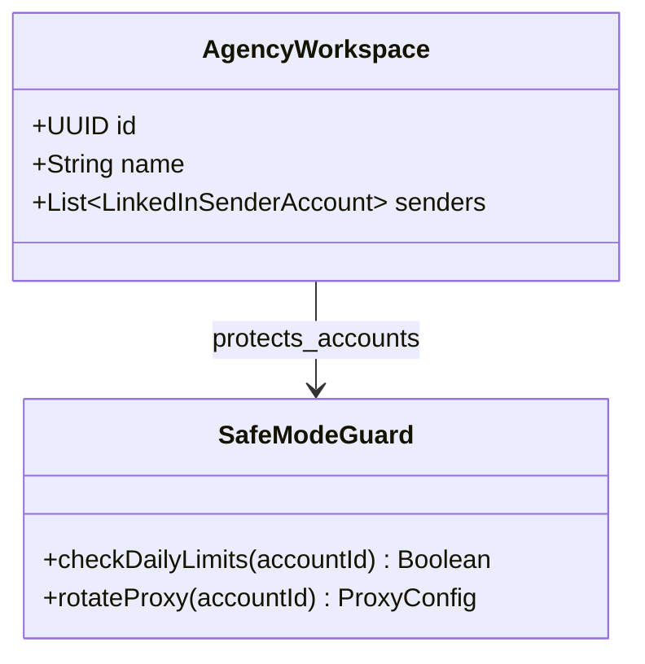
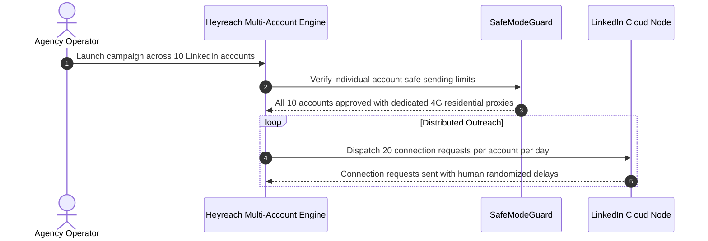

# HeyReach.io System and Functional Architecture

> Comprehensive technical and functional reference for HeyReach.io: the leading multi-account LinkedIn outreach automation platform engineered for outbound agencies, enterprise sales teams, and high-volume growth operations.

---

## 1. Executive Overview and Market Positioning

LinkedIn outreach has historically been restricted by strict platform limits: a single LinkedIn account can safely send approximately 80 to 100 connection requests per week before triggering anti-spam warnings or account restrictions. For growth agencies and scaling sales teams needing thousands of touchpoints per month, single-account automation tools (such as Expandi or Dux-Soup) hit a hard ceiling.

HeyReach broke this limitation by introducing a multi-account sender architecture. Instead of binding a campaign to one individual LinkedIn profile, HeyReach pools dozens or hundreds of LinkedIn sender profiles into a coordinated sending cluster, dynamically distributing connection requests and messages while providing a single unified inbox for conversation management.

### Core Value Proposition
- **Multi-Account Sender Clustering:** Connect 10, 50, or 200+ LinkedIn profiles to a single campaign, scaling outreach volume proportionally without violating individual account safety limits.
- **Dedicated Residential Proxy Isolation:** Automatic assignment of dedicated residential or 4G mobile proxies matched to each account's physical geographic location, eliminating login checkpoint flags.
- **Unified Master LinkedIn Inbox:** A single team inbox aggregating conversations across all connected LinkedIn accounts; team members can reply on behalf of any sender without accessing their private credentials.
- **Comprehensive LinkedIn Action Suite:** Profile views, post likes, skill endorsements, connection invites, free and paid InMails, direct message sequences, and automated request withdrawal.
- **Multi-Source Lead Scraping:** Directly scrapes Sales Navigator searches, post commenters/likers, event attendees, group members, and standard search URLs.
- **White-Label Agency Infrastructure:** Sub-account segregation, custom domain branding, and centralized client management.

---

## 2. Core Entities and Data Model

```
┌────────────────────────────────────────────────────────┐
│                   Agency Account                       │
│    (White-Label Portal, Master Billing, Global Rules)  │
└───────────────────────────┬────────────────────────────┘
                            │ 1:N
                            ▼
┌────────────────────────────────────────────────────────┐
│                  Client Workspace                      │
│     (Isolated Campaigns, Dedicated Proxies, Inboxes)   │
└───────────┬────────────────────────────────┬───────────┘
            │ 1:N                            │ 1:N
            ▼                                ▼
┌───────────────────────┐        ┌───────────────────────┐
│ LinkedIn Sender Pool  │        │   LinkedIn Campaign   │
│ (Cookie / Auth Token, │        │ (Multi-Step Cadence,  │
│  Proxy IP, Warmup)    │        │  Assigned Senders)    │
└───────────┬───────────┘        └───────────┬───────────┘
            │                                │
            │ Dynamic Load Balancing         │ Enrolls Leads
            └────────────────►┌──────────────▼──────────┐
                              │     Prospect Lead       │
                              │ (LinkedIn URL, Profile, │
                              │  Status, Timeline)      │
                              └──────────────┬──────────┘
                                             │ 1:N
                                             ▼
                              ┌─────────────────────────┐
                              │    Automated Action     │
                              │ ┌─────────────────────┐ │
                              │ │ View Profile        │ │
                              │ ├─────────────────────┤ │
                              │ │ Like Post / Endorse │ │
                              │ ├─────────────────────┤ │
                              │ │ Connection Request  │ │
                              │ ├─────────────────────┤ │
                              │ │ InMail / Message DM │ │
                              │ └─────────────────────┘ │
                              └──────────────┬──────────┘
                                             │ Generates
                                             ▼
                              ┌─────────────────────────┐
                              │   Unified Master Inbox  │
                              │ (Cross-Account Thread,  │
                              │  Team Assignment, CRM)  │
                              └─────────────────────────┘
```

### Entity Definitions
1. **Client Workspace:** Logical container isolating a specific client's campaigns, sender accounts, lead lists, and inbox threads from other clients.
2. **LinkedIn Sender:** Connected LinkedIn user account authenticated via session cookie or credentials, bound to a dedicated residential proxy with independent daily rate limit ceilings.
3. **Proxy Node:** Static residential or mobile IP address matched to the sender's physical country and city to ensure consistent geolocation headers.
4. **Campaign:** Orchestration cadence combining multi-step LinkedIn actions, delay intervals, assigned sender pools, and target prospect lists.
5. **Prospect Lead:** Individual buyer record extracted from LinkedIn search, enriched with profile metadata, current sequence state, and interaction logs.
6. **Unified Inbox Thread:** Centralized conversational view linking prospect messages to the corresponding sender account, enabling seamless team replies.

---

### 2.1 Core Domain and Service Class Architecture



---

### 2.2 Comprehensive Database Schema Specification

#### Table: `linkedin_accounts`
| Column | Type | Constraints | Default | Description |
| :--- | :--- | :--- | :--- | :--- |
| `id` | `UUID` | `PRIMARY KEY` | `gen_random_uuid()` | Sender ID |
| `profile_name` | `VARCHAR(255)` | `NOT NULL` | - | LinkedIn name |
| `daily_invite_limit`| `INTEGER` | `NOT NULL` | `25` | Daily limit |

---

## 3. Comprehensive Feature and Functional Breakdown

### 3.1 Multi-Account Architecture and Sender Rotation

HeyReach's primary engineering innovation is the safe orchestration of distributed LinkedIn identities.

#### 3.1.1 Sender Account Pooling
- **Cluster Sending:** Users assign multiple LinkedIn profiles (e.g., 5 account executives and 10 SDR profiles) to a single outbound campaign.
- **Smart Load Balancing:** The campaign engine dynamically assigns outbound actions to the next available, healthy sender account in the pool, ensuring even volume distribution.
- **Automatic Warmup Schedule:** Newly connected accounts are placed on an automated ramp-up schedule:
  - Week 1: 5 connection requests + 10 profile views per day.
  - Week 2: 10 connection requests + 20 profile views per day.
  - Week 3: 20 connection requests + 30 profile views per day.
  - Week 4+: Safe maximum capacity (25-30 requests per day).

#### 3.1.2 Dedicated Residential Proxy Management
- **Geographic IP Alignment:** HeyReach assigns dedicated residential proxies matching the country, region, and city of the connected LinkedIn user.
- **Session Persistence:** Senders maintain sticky IP sessions, preventing the suspicious IP-hopping that triggers LinkedIn security checkpoints.
- **Automated Reconnection:** If a session cookie expires, the system notifies the administrator or prompts seamless re-authentication via a lightweight browser extension.

---

### 3.2 LinkedIn Campaign Automation Suite

HeyReach provides an extensive library of automated LinkedIn actions executed with natural human behavioral patterns.

#### 3.2.1 LinkedIn Action Types
1. **View Profile:** Simulates a user visiting the prospect's profile, triggering a native notification ("John Doe viewed your profile"), which builds brand familiarity.
2. **Follow Profile:** Follows the prospect's public activity without requiring an accepted connection.
3. **Like / React to Recent Post:** Automatically interacts with the prospect's most recent post, signaling genuine engagement.
4. **Endorse Skills:** Endorses top listed skills on the prospect's profile to capture attention.
5. **Connection Request:** Sends an invitation with a personalized text note or as a blank invitation (which frequently yields higher acceptance rates).
6. **Free InMails (Open Profiles):** Automatically identifies "Open Profile" LinkedIn users and dispatches free InMails, allowing direct messaging without spending paid InMail credits.
7. **Paid InMails:** Sends official LinkedIn InMails to high-value prospects where connection requests have stalled.
8. **Direct Message Follow-Ups:** Multi-step follow-up messages sent once the connection request is accepted.
9. **Auto-Withdraw Pending Invites:** Automatically withdraws unanswered connection requests after a designated period (e.g., 14 to 30 days) to keep pending invitation counts below LinkedIn's warning threshold (under 500-1000 pending).

#### 3.2.2 Sequence Logic and Branching
- **Smart Delays:** Inter-action pauses configured in hours or days (e.g., View Profile -> wait 24 hours -> Like Post -> wait 2 hours -> Send Connection Request).
- **Conditional Branching:** Branch sequence execution based on connection status:
  - If Connected: Send Message 1 -> wait 3 days -> Send Message 2.
  - If Not Connected after 7 days: Check if Open Profile -> Send Free InMail -> Else: Withdraw invite.

---

### 3.3 Lead Extraction and Prospecting Engine

HeyReach features native scrapers capable of extracting leads directly from various LinkedIn environments.

#### 3.3.1 Ingestion Sources
- **LinkedIn Sales Navigator Searches:** Paste any complex Sales Navigator search URL (filtered by company size, seniority, function, geography) and HeyReach automatically extracts all profiles.
- **Sales Navigator Saved Lists:** Directly ingest curated account lists and lead lists.
- **LinkedIn Basic Search:** Extract leads from standard, free LinkedIn search results.
- **Post Engagement Scraper:** Paste the URL of any viral industry post; HeyReach scrapes all users who liked, celebrated, or commented on that post (capturing high-intent, active users).
- **LinkedIn Event Attendees:** Scrape registered attendees of competitor or industry virtual events.
- **LinkedIn Group Members:** Ingest active members of specific professional LinkedIn groups.
- **CSV Import:** Upload lists of target LinkedIn profile URLs with custom merge columns.

---

### 3.4 Unified Master LinkedIn Inbox

Managing multiple LinkedIn accounts usually requires repeatedly logging in and out of different browser profiles. HeyReach eliminates this friction.

#### 3.4.1 Master Multi-Account Inbox
- **Single Aggregated Interface:** View and manage incoming conversations from all connected sender accounts in one screen.
- **Seamless Replying:** Team members compose and send replies directly from the unified UI; HeyReach routes the message through the correct sender account using the appropriate session cookie.
- **Team Collaboration:** Tag teammates, leave private internal notes on leads, and assign specific threads to dedicated SDRs.
- **Conversation Statuses:** Mark threads as Interested, Meeting Booked, Not Interested, or Snoozed, updating global campaign analytics automatically.

---

### 3.5 Anti-Detection and Account Safety Safeguards

LinkedIn aggressively detects robotic activity. HeyReach enforces strict behavioral safeguards to protect sender profiles.

- **Human-Like Emulation:** Simulates human mouse movements, page scrolling, and natural typing speeds with randomized millisecond pauses.
- **Randomized Jitter:** Outbound actions are randomized within broad time intervals (e.g., 2 to 7 minutes between actions) rather than firing at predictable intervals.
- **Strict Daily Quotas:** Enforces conservative upper bounds per account:
  - Maximum 25-30 connection requests per day.
  - Maximum 40-50 direct messages per day.
  - Maximum 80 profile visits per day.
- **Automated Circuit Breakers:** If LinkedIn presents a verification challenge, PIN prompt, or rate limit warning, the system instantly pauses that specific sender and alerts the administrator, while all other pool accounts continue uninterrupted.

---

### 3.6 White-Label Agency and Enterprise Management

HeyReach is specifically engineered for multi-client B2B agencies.

- **White-Label Branding:** Host the platform on a custom domain (e.g., `app.youragency.com`) with custom logos, brand colors, and email notifications.
- **Client Sub-Accounts:** Segregate clients into completely independent workspaces with individual sender pools, campaigns, and lead data.
- **Global Organization Blocklist:** Workspace-wide exclusion lists preventing outreach to existing clients, competitors, or blacklisted domains across all sender accounts.

---

## 4. API, Webhooks, and CRM Integrations

### 4.1 Native CRM Integrations
- **HubSpot & Pipedrive:** Real-time bi-directional sync creating leads, logging message interactions, and updating deal stages upon positive response.
- **Clay Integration:** Seamless hand-off between Clay-enriched target lists and HeyReach multi-account sending campaigns.

### 4.2 Webhook Events
HeyReach dispatches real-time HTTP POST notifications:
- `lead_connected`: Fired when a prospect accepts a connection request.
- `message_sent`: Fired when an automated message or InMail is dispatched.
- `reply_received`: Fired when a prospect responds, delivering message content and profile URL.
- `tag_added`: Fired when a lead is tagged (e.g., Interested, Meeting Booked).
- `account_disconnected`: Fired if a LinkedIn session requires re-authentication.

---

### 3.1 End-to-End Operational Lifecycle Sequence



---

## 5. Architectural Comparison and Key Differentiators

| Capability | HeyReach.io | Single-Account Tools (e.g., Expandi, Dux-Soup) | Enterprise Suites (e.g., Salesloft) |
| :--- | :--- | :--- | :--- |
| **Sender Accounts** | Multi-account pooling (10 to 100+ accounts) | Strictly 1 account per seat | 1 account per user seat |
| **Weekly Connection Volume** | 1,000 to 5,000+ across sender pool | Capped at ~80 to 100 / week | Manual LinkedIn tasks only |
| **Proxy Infrastructure** | Built-in dedicated residential proxies | Shared proxies or BYO proxy | N/A (manual tasks) |
| **Inbox Consolidation** | Master unified inbox across all accounts | Single inbox only | Integrated email/call inbox |
| **Post & Event Scraper** | Built-in post liker/commenter & event scrapers| Basic search only | None |
| **Agency White-Labeling** | Native custom domain, branding & sub-accounts| Rare / basic | None |