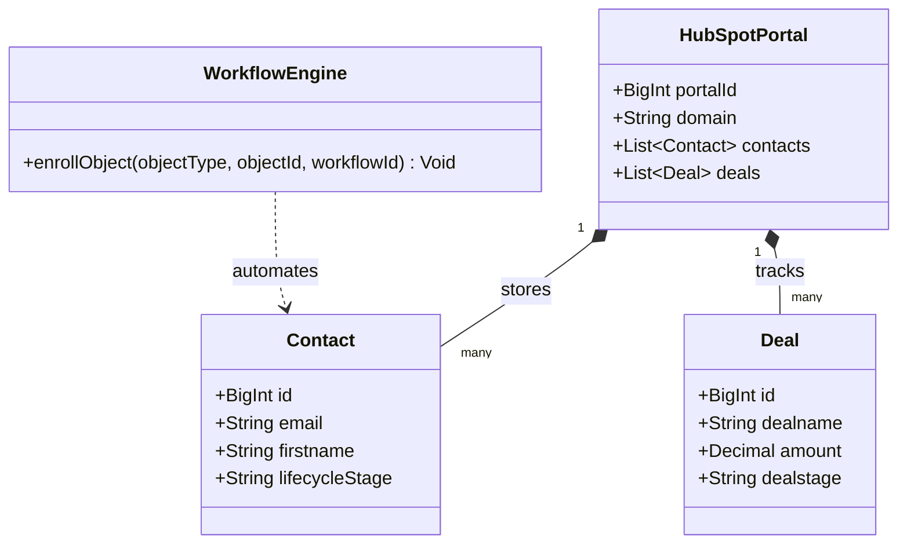
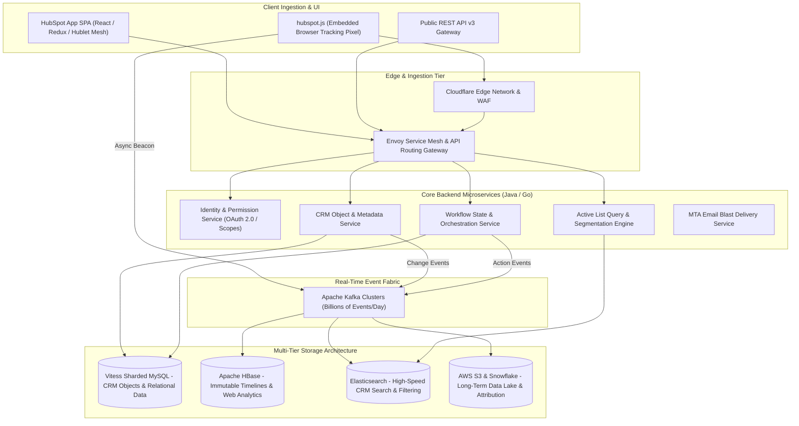
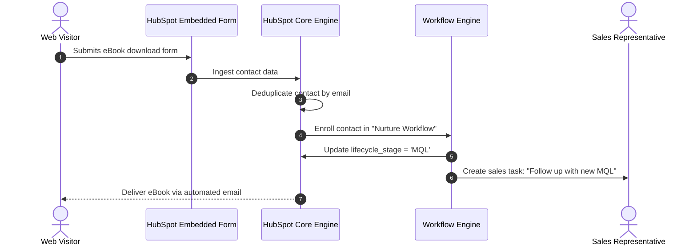

# HubSpot System and Functional Architecture

> Comprehensive technical and functional reverse-engineered reference for **HubSpot**: the global gold standard for inbound marketing automation, CRM platform architecture, dynamic custom objects, and multi-hub operational scaling.

---

## 1. Executive Overview and Market Positioning

**HubSpot** invented and scaled the inbound marketing movement. Over two decades, it transformed from a simple blog and email marketing tool into one of the world's most sophisticated cloud CRM platforms, powering over 200,000 global enterprises across five interconnected "Hubs":
- **Marketing Hub:** Lead capture, forms, email campaigns, ad tracking, social publishing, behavioral segmentation, and multi-touch revenue attribution.
- **Sales Hub:** Deal pipelines, sales cadences (sequences), meeting scheduling, CPQ (Configure, Price, Quote), and call tracking.
- **Service Hub:** Omnichannel support ticketing, customer portal, SLA enforcement, and CSAT/NPS survey telemetry.
- **Content Hub (CMS Hub):** Enterprise headless CMS, dynamic content modules, smart personalization, and serverless functions.
- **Operations Hub:** Programmable workflow data cleansing, webhooks, custom code actions (Node.js/Python), and multi-system data sync (Data Sync engine).

### Core Value Proposition
- **Unified Single Source of Truth:** A single underlying CRM database shared transparently across marketing, sales, customer service, and operations.
- **Dynamic Polymorphic Object Model:** Extensible custom objects with arbitrary properties, bi-directional associations, and granular property-level change histories.
- **Real-Time Active List Segmentation:** Dynamic query engine that continuously re-evaluates millions of contact records against hundreds of behavioral filters in real time.
- **Event-Driven Workflow Automation Engine:** Enterprise-grade DAG workflow engine orchestrating time delays, conditional if/then branching, custom webhook payloads, and CRM data mutations.

---

## 2. Core Entities and Reverse-Engineered Data Model

```
┌────────────────────────────────────────────────────────┐
│                   Portal (HubSpot Account)             │
│    (Account ID, Tier: Starter/Pro/Ent, Timezone, Currency)
└───────────────────────────┬────────────────────────────┘
                            │ 1:N
                            ▼
┌────────────────────────────────────────────────────────┐
│                   CRM Object Layer                     │
│  ┌──────────────┬──────────────┬──────────────┬──────┐ │
│  │   Contact    │   Company    │     Deal     │Ticket│ │
│  └──────┬───────┴──────┬───────┴──────┬───────┴──┬───┘ │
│         │              │              │          │     │
│         └──────────────┼──────────────┼──────────┘     │
│                        ▼              ▼                │
│                 Custom Objects (e.g. Subscriptions)    │
└───────────────────────────┬────────────────────────────┘
                            │ Associated Via
                            ▼
┌────────────────────────────────────────────────────────┐
│                 Association Engine (Graph)             │
│  (Polymorphic 1:N, N:N, Association Labels: e.g. Billing)
└───────────────────────────┬────────────────────────────┘
                            │ Enrolled In
                            ▼
┌────────────────────────────────────────────────────────┐
│                 Lists & Workflow Engine                │
│  ┌─────────────────────────────┬─────────────────────┐ │
│  │ Active Lists (Dynamic Query)│ Workflows (Exec DAG)│ │
│  └─────────────────────────────┴─────────────────────┘ │
└───────────────────────────┬────────────────────────────┘
                            │ Generates
                            ▼
┌────────────────────────────────────────────────────────┐
│                Unified Customer Timeline               │
│  (Pageviews, Form Fills, Emails Opened, Calls, Deals)  │
└────────────────────────────────────────────────────────┘
```

### Entity Hierarchy Breakdown
1. **Portal:** Tenant root defining feature licenses, API keys, installed Marketplace apps, and team access partitions.
2. **Standard CRM Objects (`contact`, `company`, `deal`, `ticket`):** Out-of-the-box business entities with pre-configured properties and state machines.
3. **Custom Objects:** User-defined enterprise entities (e.g., `Car`, `Policy`, `Subscription`, `Shipment`) created dynamically via the Custom Objects API, complete with custom properties, views, and associations.
4. **Associations & Association Labels:** A high-speed graph structure linking any record to any other record with typed labels (e.g., Contact "Jane Doe" is associated with Deal "Enterprise Renewal" as "Decision Maker").
5. **Timeline Events:** Immutable append-only time-series stream recording every digital interaction (marketing email opens, page visits via `hubspot.js`, form submissions, meetings booked).

---

### 2.1 Core Domain and Service Class Architecture



---

### 2.2 Comprehensive Database Schema Specification

HubSpot coordinates CRM records, multi-touch events, and deal pipelines within multi-tenant schemas.

#### Table: `contacts`
| Column | Type | Constraints | Default | Description |
| :--- | :--- | :--- | :--- | :--- |
| `id` | `BIGINT` | `PRIMARY KEY` | - | Contact record ID |
| `portal_id` | `BIGINT` | `NOT NULL` | - | Customer portal ID |
| `email` | `VARCHAR(255)` | `NOT NULL` | - | Email address |
| `firstname` | `VARCHAR(100)` | `NULLABLE` | `NULL` | First name |
| `lifecycle_stage`| `VARCHAR(50)` | `NOT NULL` | `'lead'` | Stage (`subscriber`, `lead`, `mql`, `sql`, `customer`) |

*Indexes:* `idx_hs_email` (`(email)`), `idx_hs_portal` (`(portal_id)`).

---

## 3. Reverse-Engineered System Architecture & Engineering Blueprint

HubSpot operates one of the most mature microservice architectures in the technology industry, running over **1,500 independent microservices** on Kubernetes.



### 3.1 Technology Stack & Storage Specialization
- **Backend Languages:** Java (Dropwizard / Spring Boot) for 90% of business logic microservices; Go for high-throughput edge routers and tracking ingestion daemons.
- **Frontend Architecture:** Modern React with HubSpot's proprietary **Canvas design system**, micro-frontends ("Hublets"), and server-side rendering for marketing websites.
- **Vitess (Sharded MySQL):** HubSpot was one of the early pioneers of **Vitess** (the database clustering system originally created by YouTube). Vitess shards relational CRM data across thousands of MySQL nodes, allowing HubSpot to scale past billions of contacts without sacrificing ACID transaction boundaries.
- **Apache HBase:** Petabyte-scale distributed NoSQL column-family store. Used to persist the immutable timeline of events (every web page visited, every email opened, every property value change) with extreme write throughput.
- **Elasticsearch:** Indexes all CRM properties in real time. Powers the instant search bars, saved CRM views, and complex list segmentation queries.
- **Apache Kafka:** The core operational spine. Every CRM mutation or web click emits a Kafka event that fans out to search indexers, workflow enrollment listeners, and attribution calculators.

---

## 4. Key Operational Mechanics & Deep Technical Differentiators

### 4.1 Real-Time Dynamic List Membership Engine
HubSpot's **Active Lists** are not static database tables; they are dynamic queries:
- When a marketer builds a list: `"Contacts who visited /pricing in the last 7 days AND whose Company revenue > $10M"`, HubSpot translates this into a composite Elasticsearch filter query.
- As new events flow through Kafka (e.g. contact visits `/pricing`), the list engine evaluates eligibility incrementally. Contacts enter and exit lists automatically within seconds, triggering workflow enrollments.

### 4.2 Programmable Workflows with Custom Code
In Operations Hub Enterprise, HubSpot allows developers to write arbitrary serverless code directly inside visual workflows:
- **Node.js (JavaScript) & Python 3 Execution:** Developers write code snippets that receive workflow event payloads, execute external API lookups (e.g. query Clearbit, verify VAT numbers), and return structured outputs that subsequent workflow steps can reference.

### 4.3 Multi-Touch Revenue Attribution Modeling
HubSpot connects top-of-funnel marketing clicks to closed CRM revenue:
- Evaluates the entire customer journey using multiple attribution models: First Touch, Last Touch, Linear (equal weight), U-Shaped (40% first, 40% lead create, 20% middle), and W-Shaped (30% first, 30% lead create, 30% deal create, 10% middle), calculating the precise dollar revenue generated by every individual blog post, email, or ad.

---

## 5. Integration Architecture and API Surface

- **CRM API v3:** Clean, fully standardized RESTful API with predictable URL schemes (`/crm/v3/objects/{objectType}`).
- **Batch Endpoints:** High-performance batch APIs allowing up to 100 records to be created, updated, or archived in a single HTTP POST call (`/crm/v3/objects/{objectType}/batch/create`).
- **Webhooks API:** Real-time webhook subscription engine with subscription groups, automatic retry policies, and signature verification via `X-HubSpot-Signature`.

---

### 3.1 End-to-End Operational Lifecycle Sequence



---

## 6. MarketingStudio Convergence & Architectural Takeaways

HubSpot is the North Star for CRM and marketing platform architecture:

1. **Adopt HubSpot's Association Engine**: Store relationships between Contacts, Deals, Invoices, and Conversations as a flexible association graph rather than rigid relational foreign keys.
2. **Implement Real-Time Dynamic Active Lists**: Emulate HubSpot's active list evaluation using PostgreSQL JSONB queries or Elasticsearch, ensuring contacts dynamically enroll in marketing sequences as their behaviors change.
3. **Incorporate Programmable Workflow Nodes**: Allow advanced users to inject custom JavaScript/Python code snippets into marketing automation journeys (inspired by Operations Hub).
4. **Build Multi-Touch Attribution**: Track UTM parameters and campaign touchpoints on every contact record to calculate exact marketing ROI on closed deals.