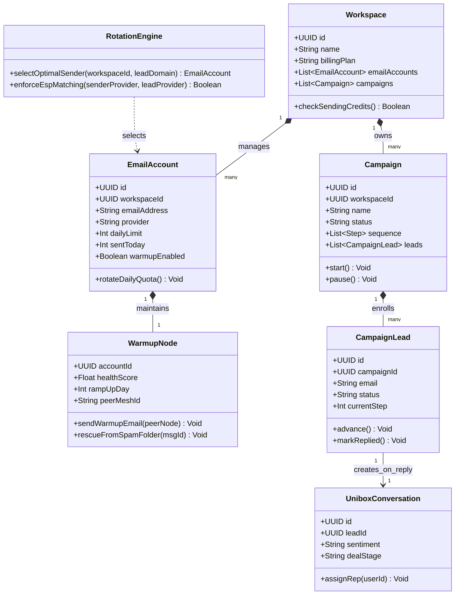
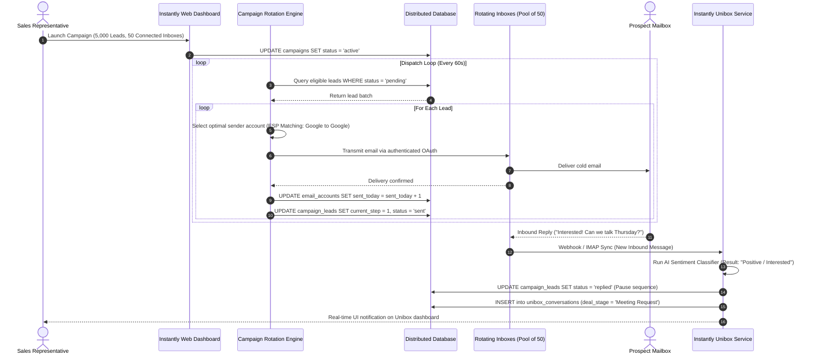

# Instantly.ai System and Functional Architecture

> Comprehensive technical and functional reference for Instantly.ai: the industry-standard high-volume cold email outreach platform, automated mailbox warmup pool, unified inbox (Unibox), and B2B lead intelligence engine.

---

## 1. Executive Overview and Market Positioning

Instantly.ai revolutionized the cold email marketing landscape by shifting the industry paradigm from single-inbox sending to distributed, multi-account horizontal scaling. Rather than sending thousands of cold emails from a single corporate domain (which triggers mailbox provider spam algorithms), Instantly orchestrates dozens, hundreds, or thousands of secondary domains and sender accounts, distributing sending volume safely while aggregating all replies into a centralized inbox.

### Core Value Proposition
- **Unlimited Mailbox Connection:** No per-seat or per-inbox pricing penalties; users connect unlimited Google Workspace, Microsoft 365, and custom SMTP/IMAP mailboxes.
- **Automated Peer-to-Peer Warmup Pool:** Proprietary network of hundreds of thousands of active inboxes continuously exchanging realistic, AI-generated emails to build and protect sender reputation.
- **Intelligent Rotation and Load Balancing:** Algorithmic distribution of campaign volume across inboxes with ESP-matching (Google-to-Google, Microsoft-to-Microsoft).
- **End-to-End Outreach Lifecycle:** Lead discovery (160M+ B2B contacts), campaign orchestration, multivariate A/Z testing, deliverability diagnostics, centralized Unibox triage, and deal pipeline management.

---

## 2. Core Entities and Data Model

```
┌────────────────────────────────────────────────────────┐
│                      Workspace                         │
│  (Team, Billing, Global Blacklists, Custom Domains)    │
└───────────┬────────────────────────────────┬───────────┘
            │ 1:N                            │ 1:N
            ▼                                ▼
┌───────────────────────┐        ┌───────────────────────┐
│     Email Account     │        │       Campaign        │
│ (IMAP/SMTP/OAuth,     │        │ (Schedule, Steps,     │
│  Warmup, DNS Status)  │        │  Settings, Leads)     │
└───────────┬───────────┘        └───────────┬───────────┘
            │                                │
            │ Assigned Senders (N:M)         │
            └────────────────►┌──────────────▼──────────┐
                              │     Campaign Lead       │
                              │ (Status, Variables,     │
                              │  Current Step, History) │
                              └──────────────┬──────────┘
                                             │ 1:N
                                             ▼
                              ┌─────────────────────────┐
                              │    Email Activity       │
                              │ (Sent, Opened, Clicked, │
                              │  Replied, Bounced)      │
                              └──────────────┬──────────┘
                                             │ 1:1
                                             ▼
                              ┌─────────────────────────┐
                              │    Unibox Conversation  │
                              │ (Sentiment, Deal Stage, │
                              │  Assigned Rep, Thread)  │
                              └─────────────────────────┘
```

### Entity Definitions
1. **Workspace:** Multi-tenant container isolating client campaigns, sender pools, billing, and team role-based access control (Admin, Manager, User).
2. **Email Account (Sender):** Represents an authenticated SMTP/IMAP or OAuth connection (Google Workspace / Microsoft 365) with independent warmup configurations, daily sending quotas, signature, and tracking domain bindings.
3. **Warmup Node:** Operational state within the Instantly warmup mesh; tracks sender health score, warmup ramp-up curves, spam recovery metrics, and peer exchange pairing.
4. **Campaign:** Master orchestration workflow containing sequence steps, variant splits (A/Z), sending schedules, assigned sender accounts, and target lead lists.
5. **Campaign Lead:** Contact record populated with custom merge variables, delivery status (Active, Paused, Completed, Unsubscribed, Bounced), current sequence step, and interaction timestamps.
6. **Unibox Thread:** Aggregated multi-message conversation thread linked to a specific lead and campaign, containing AI sentiment classification and CRM disposition tags.
7. **Deal / Opportunity:** CRM object mapping the commercial outcome of an interested lead through visual Kanban stages.

---

### 2.1 Core Domain and Service Class Architecture



---

### 2.2 Comprehensive Database Schema Specification

Instantly orchestrates distributed horizontal sending pools and Unibox triage within multi-tenant relational schemas.

#### Table: `workspaces`
Master workspace isolating campaign accounts, credits, and custom tracking domains.

| Column | Type | Constraints | Default | Description |
| :--- | :--- | :--- | :--- | :--- |
| `id` | `UUID` | `PRIMARY KEY` | `gen_random_uuid()` | Unique workspace identifier |
| `name` | `VARCHAR(255)` | `NOT NULL` | - | Commercial workspace label |
| `billing_plan` | `VARCHAR(50)` | `NOT NULL` | `'growth'` | Subscription tier (`growth`, `hypergrowth`, `enterprise`) |
| `daily_email_credits`| `INTEGER` | `NOT NULL` | `5000` | Global daily account sending cap |
| `created_at` | `TIMESTAMPTZ` | `NOT NULL` | `NOW()` | Registration timestamp |

*Indexes:* Primary key on `id`.

---

#### Table: `email_accounts`
Sender mailbox credentials authenticated via Google Workspace OAuth, Microsoft 365, or SMTP/IMAP.

| Column | Type | Constraints | Default | Description |
| :--- | :--- | :--- | :--- | :--- |
| `id` | `UUID` | `PRIMARY KEY` | `gen_random_uuid()` | Sender mailbox ID |
| `workspace_id` | `UUID` | `NOT NULL, FK -> workspaces(id)` | - | Parent workspace |
| `email_address` | `VARCHAR(255)` | `NOT NULL` | - | Mailbox email (e.g. `rep@domain-outreach.com`) |
| `provider` | `VARCHAR(50)` | `NOT NULL` | `'google'` | Provider (`google`, `microsoft`, `custom_smtp`) |
| `daily_limit` | `INTEGER` | `NOT NULL` | `30` | Maximum cold emails per 24 hours |
| `sent_today` | `INTEGER` | `NOT NULL` | `0` | Outbound volume sent today |
| `warmup_status` | `VARCHAR(50)` | `NOT NULL` | `'active'` | Warmup mesh state (`active`, `paused`, `disabled`) |
| `health_score` | `FLOAT` | `NOT NULL` | `98.5` | Inbox deliverability score (0.0 - 100.0) |

*Indexes:* `idx_email_acc_workspace` (`(workspace_id)`), `idx_email_acc_health` (`(health_score)`).

---

#### Table: `campaigns`
Multi-step drip campaigns, sequence schedules, and assigned sender account pools.

| Column | Type | Constraints | Default | Description |
| :--- | :--- | :--- | :--- | :--- |
| `id` | `UUID` | `PRIMARY KEY` | `gen_random_uuid()` | Campaign ID |
| `workspace_id` | `UUID` | `NOT NULL, FK -> workspaces(id)` | - | Tenant scope key |
| `name` | `VARCHAR(255)` | `NOT NULL` | - | Campaign title |
| `status` | `VARCHAR(50)` | `NOT NULL` | `'draft'` | State (`draft`, `active`, `paused`, `completed`) |
| `sequence` | `JSONB` | `NOT NULL` | `'[]'` | Ordered array of sequence steps and wait intervals |

*Indexes:* `idx_instantly_campaigns_status` (`(status)`).

---

## 3. Comprehensive Feature and Functional Breakdown

### 3.1 Account Management and Automated Deliverability Warmup

The warmup infrastructure is the technological cornerstone of Instantly. It maintains mailbox deliverability through a cooperative network of active mailboxes.

#### 3.1.1 Mailbox Connection Protocols
- **Google Workspace (OAuth & App Passwords):** Direct API integration or IMAP/SMTP with App Password support for high-volume sending.
- **Microsoft 365 / Exchange Online:** Modern OAuth2 integration supporting tenant permissions and shared mailboxes.
- **Custom IMAP / SMTP:** Generic integration for private mail servers, Zoho Mail, Amazon SES, Mailgun, and custom Postfix setups.
- **Bulk Account Import:** CSV upload of hundreds of mailbox credentials with automated IMAP/SMTP port testing and validation.

#### 3.1.2 Warmup Engine Mechanics
- **Peer-to-Peer Warmup Pool:** Connected mailboxes automatically send and receive structured messages amongst each other.
- **Gradual Ramp-Up Curve:** Configurable daily increase (default: 1-4 additional warmup emails per day) until the target ceiling is reached (typically 30-50 per day).
- **Reply Rate Emulation:** Configurable automated reply probability (default: 30-40%) ensuring bidirectional communication patterns that signal high sender trust to Google and Microsoft postmasters.
- **Spam Folder Auto-Rescue:** If a warmup email lands in the recipient mailbox's Spam or Promotions tab, the Instantly agent programmatically retrieves it, moves it to the Primary Inbox, marks it as read, stars it, and generates a contextual reply.
- **Contextual AI Content:** Warmup emails avoid lorem ipsum; they use AI language models to generate contextual business dialogues, varied subject lines, and varied body lengths.
- **Deliverability Health Score:** Quantitative 0-100% reputation metric updated every 24 hours based on inbox placement ratios across major ESPs.
- **Continuous Warmup Mode:** Warmup continues running alongside active cold campaigns to maintain positive sender engagement ratios.

#### 3.1.3 DNS and Domain Configuration Suite
- **SPF (Sender Policy Framework) Validator:** Checks TXT records to confirm authorized sending IPs.
- **DKIM (DomainKeys Identified Mail) Inspector:** Validates cryptographic domain signatures and key bit-length.
- **DMARC (Domain-based Message Authentication) Monitor:** Confirms policy configuration (`p=none`, `p=quarantine`, or `p=reject`) and reporting addresses.
- **Custom Tracking Domain (CTD):** SSL-secured CNAME setup (e.g., `track.domain.com`) isolating open and click tracking from Instantly's shared infrastructure, preventing domain reputation bleed.

---

### 3.2 Campaign Sequencing and Sending Engine

The campaign engine manages multi-step email sequences with horizontal sender rotation and deliverability protections.

#### 3.2.1 Sequence Builder
- **Multi-Step Scheduling:** Linear or branching sequences with arbitrary step counts.
- **Inter-Step Delays:** Configurable wait intervals defined in days, hours, or minutes.
- **Thread Continuity:** Follow-up emails sent as replies within the same email thread (`In-Reply-To` and `References` headers) or as fresh threads with distinct subject lines.
- **Stop Conditions:** Automatic sequence termination upon lead reply, link click, bounce, or explicit opt-out.

#### 3.2.2 Horizontal Inbox Rotation and ESP Matching
- **Mailbox Pooling:** Assigning 10 to 100+ sender accounts to a single campaign.
- **Smart Sending Distribution:** Emails are round-robined across all healthy assigned accounts, respecting individual daily limits (e.g., maximum 30 cold emails per account per day).
- **ESP Matching (Provider Matching):** System routes Google Workspace recipient emails through Google sender accounts, and Outlook/Office365 recipients through Microsoft sender accounts. This mimics internal network traffic and bypasses cross-provider anti-spam heuristics.
- **Jitter and Randomized Delays:** Sending pauses are randomized between 3 to 15 minutes per account to avoid burst patterns detected by mail server firewalls.

#### 3.2.3 Multivariate A/Z Testing
- **Unlimited Subject Line and Body Variants:** Users test up to 26 variants per sequence step simultaneously.
- **Automatic Optimization:** Option to automatically allocate traffic to the best-performing variant based on open rate or reply rate after a statistically significant sample size.
- **Manual Variant Weighting:** Custom percentage split allocation across different messaging angles.

#### 3.2.4 Personalization and Dynamic Syntax
- **Standard Merge Variables:** Automatic mapping of `{{firstName}}`, `{{lastName}}`, `{{companyName}}`, `{{title}}`, etc.
- **Spintax Support:** Nested randomized variations: `{Hi|Hello|Hey} {{firstName}}, {hope you are well|loved your recent post|quick question}`.
- **Conditional Liquid Syntax:** Logical statements (`......`) allowing tailored value propositions within a single campaign draft.
- **AI Prompt Personalization:** Embedded prompt variables that call LLMs on import to generate bespoke one-liner icebreakers based on scraped prospect data.

---

### 3.3 Unibox: Master Unified Inbox

Unibox centralizes all incoming replies from every connected domain into a single web interface, eliminating manual mailbox switching.

#### 3.3.1 Centralized Multi-Account Inbox
- **Aggregated Stream:** Live feed of incoming responses across hundreds of accounts.
- **Sub-Inboxes and Filters:** Filter by Campaign, Sender Account, Sentiment Label, Assigned Team Member, or Date Range.
- **Direct Replying:** Agents send replies directly from the Unibox; messages automatically route out through the exact sender account and thread that originated the conversation.

#### 3.3.2 AI Sentiment and Intent Categorization
Instantly processes incoming message text through AI classification models:
- **Interested:** Expresses interest, requests pricing, asks for details, or agrees to a call.
- **Meeting Booked:** Calendar event confirmed or scheduling link clicked.
- **Not Interested:** Declines offer, requests removal, or expresses dissatisfaction.
- **Out of Office (OOO):** Automated auto-reply detected; system automatically pauses the lead and reschedules follow-up after the return date.
- **Wrong Person:** Prospect forwards or redirects to another colleague.

#### 3.3.3 Operational Workflows
- **One-Click Quick Replies:** Pre-saved canned responses and snippets.
- **Lead Assignment:** Assign specific conversation threads to account executives or SDRs.
- **Snooze Functionality:** Temporarily remove threads from the active view until a scheduled follow-up date.

---

### 3.4 B2B Lead Finder and Contact Database

Instantly incorporates an integrated B2B database of over 160 million verified corporate contacts.

#### 3.4.1 Search and Filtering Taxonomy
- **Demographic / Job Filters:** Job Title, Seniority Level (C-Suite, VP, Director, Manager), Department/Function.
- **Firmographic Filters:** Industry (SIC and NAICS taxonomies), Employee Headcount ranges, Annual Revenue brackets.
- **Geographic Filters:** Country, State/Region, City, Postal Code radius.
- **Technographic Filters:** Specific technologies detected on the company domain (e.g., Salesforce, HubSpot, Shopify, React).
- **Lookalike Search:** Input an ideal customer domain to find companies with similar headcount, industry, and tech footprints.

#### 3.4.2 Verification and Enrichment Mechanics
- **Real-Time SMTP Verification on Export:** Before credits are deducted, the engine performs real-time syntax checking, MX record verification, and SMTP handshake testing.
- **Catch-All Email Detection:** Identifies mail servers configured to accept all incoming mail, flagging potential bounce risks.
- **Credit Deduction Model:** Free filtering and preview; credits are consumed only upon exporting verified leads directly into campaigns or CSV files.

---

### 3.5 CRM and Deal Pipeline Management

Built-in lightweight CRM to track leads from initial response to closed revenue.

#### 3.5.1 Kanban Opportunity Board
- **Customizable Deal Stages:** Typical pipeline stages: Lead Identified, Contacted, Positive Reply, Demo Scheduled, Proposal Sent, Closed Won, Closed Lost.
- **Drag-and-Drop Interface:** Easily shift prospect cards across stages with automated webhook triggers on stage change.
- **Deal Valuation:** Assign expected monetary contract value and projected close dates to calculate pipeline velocity.

#### 3.5.2 Activity History and Notes
- **Unified Timeline:** Complete log of every email sent, opened, clicked, and replied, combined with manual rep notes and call summaries.
- **Task Management:** Set reminders for manual follow-up calls or LinkedIn touchpoints.

---

### 3.6 Deliverability Safeguards and Domain Protection

Instantly enforces automated security gates to safeguard customer domain infrastructure.

- **Hard Bounce Auto-Pause:** If an account exceeds an unacceptable bounce threshold (typically > 3-5%), the campaign automatically pauses that sender to prevent spam blocklisting.
- **Global Suppression / Blocklist:** Workspace-wide blacklist containing domains, specific email addresses, and competitor URLs that are permanently excluded from all outbound campaigns.
- **Spam Word Flagging:** Built-in email body analyzer that scans drafts against known spam-trigger keywords and phrases, scoring the draft before launch.
- **Plaintext and HTML Sanitization:** Automatic stripping of bloated CSS, tracking scripts, and excessive HTML formatting that trigger spam filters.

---

## 4. API, Webhooks, and Integration Ecosystem

### 4.1 REST API Overview
Instantly provides a versioned REST API (`v1` and `v2`) utilizing Bearer token authentication.

#### Key API Resource Groups:
- `/api/v1/authenticate`: API token validation.
- `/api/v1/lead`: Create, update, list, delete, or search leads across campaigns.
- `/api/v1/campaign`: Programmatic campaign creation, pause/resume, and schedule updates.
- `/api/v1/account`: Fetch sender health, warmup status, and daily sent statistics.
- `/api/v1/analytics`: Retrieve aggregate delivery, open, click, and reply metrics.

### 4.2 Webhook Event Subscriptions
Instantly pushes real-time HTTP POST JSON payloads for operational events:
- `lead_added`: Triggered when a new prospect is enrolled.
- `email_sent`: Fired immediately upon successful SMTP transmission.
- `email_opened`: Triggered when tracking pixel is fetched (if tracking enabled).
- `link_clicked`: Fired when a prospect clicks a redirected link.
- `reply_received`: Fired with incoming email text, headers, and AI sentiment tags.
- `lead_status_changed`: Fired when a lead moves between stages or is marked Interested.
- `account_error`: Fired if IMAP/SMTP authentication fails or disconnects.

---

### 3.1 End-to-End Operational Lifecycle Sequence

The following sequence details how Instantly distributes cold email campaigns across rotating secondary inboxes and routes prospect replies into the centralized Unibox.



---

## 5. Architectural Comparison and Key Differentiators

| Capability | Instantly.ai | Traditional Cold Email (e.g., Mailchimp) | Legacy Sales Engagement (e.g., Salesloft) |
| :--- | :--- | :--- | :--- |
| **Pricing Model** | Flat workspace fee, unlimited sender accounts | Per-contact / subscriber volume | High per-seat license cost |
| **Sending Architecture** | Horizontal rotation across dozens of domains | Single domain, high-volume bulk blast | 1 mailbox per SDR seat |
| **Warmup System** | Automated peer-to-peer pool with spam rescue | None (prohibited by terms of service) | Third-party add-on required |
| **ESP Matching** | Automatic Google-to-Google & Microsoft-to-Microsoft | None | Manual assignment |
| **Lead Generation** | Built-in 160M+ verified B2B database | None | Third-party data provider required |
| **Unified Inbox** | Unibox with automated AI sentiment analysis | None | Basic team inbox |