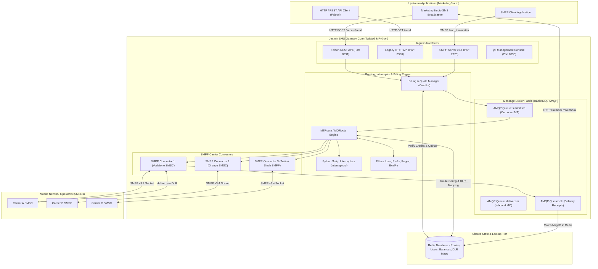
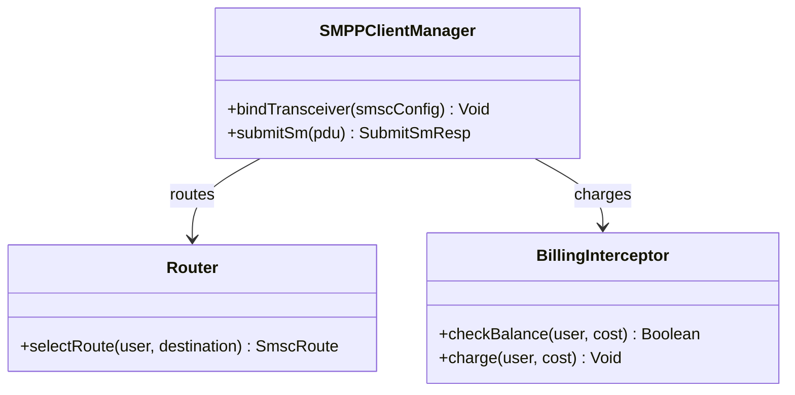
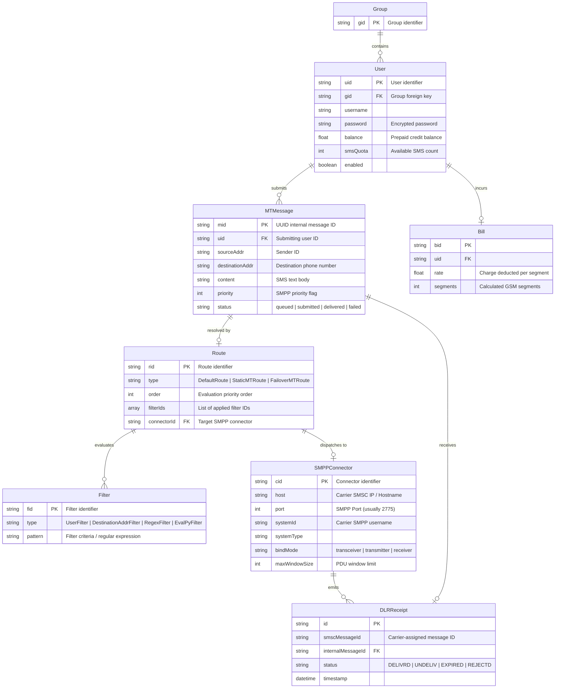
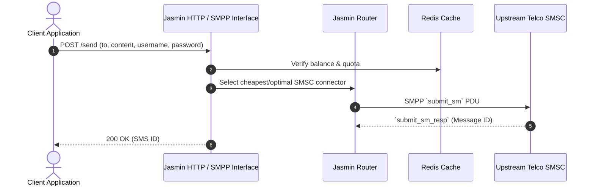

# jasmin - Architecture & Technical Wiki

> **Carrier-Grade Open-Source SMPP & SMS Messaging Gateway**  
> GitHub: [jookies/jasmin](https://github.com/jookies/jasmin.git) | Stack: Python 3.10+, Twisted, RabbitMQ (AMQP), Redis, Falcon REST API, SMPP v3.4 | License: Apache-2.0

---

## 1. Executive Summary & Value Proposition

**jasmin** is a carrier-grade, highly scalable open-source SMS gateway engineered in Python on top of the asynchronous **Twisted** networking engine and **RabbitMQ** message broker. Purpose-built for telecommunications operators, SMS aggregators, and high-velocity marketing platforms, Jasmin bridges high-level HTTP/REST applications with low-level telecom protocols. It speaks native **SMPP v3.4** (Short Message Peer-to-Peer), allowing businesses to terminate SMS traffic directly into mobile network operator (MNO) SMSCs with wire-speed throughput, dynamic routing, content filtering, and real-time billing quotas.

### Core Problems Solved
- **Telecom Protocol Bridging (SMPP to HTTP)**: Direct carrier connections require complex, stateful SMPP binds (Transceiver/Transmitter/Receiver) with binary PDU packing. Jasmin provides an asynchronous protocol bridge, exposing user-friendly HTTP and REST endpoints while maintaining persistent carrier SMPP links.
- **Dynamic Content & Prefix-Based Routing**: Features an advanced routing engine supporting static, round-robin, and failover routes evaluated against granular filters (destination prefixes, source IDs, regex patterns, user groups, time intervals, and custom Python scripts via `EvalPyFilter`).
- **Real-Time Prepaid Billing & Quota Ledger**: Includes a built-in crediting system that checks user balances, validates credit limits, deducts SMS segment rates in real time, and rejects transactions before hitting carrier networks.
- **Enterprise High-Availability & Message Durability**: Leverages RabbitMQ AMQP message queues (`submit.sm`, `deliver.sm`, `dlr`) so that message bursts are buffered safely on disk during upstream carrier throttling or network disconnections.

---

## 2. High-Level System Architecture

Jasmin's architecture is organized into asynchronous micro-daemons coordinated by an event-driven Twisted reactor, RabbitMQ message queues, and an in-memory Redis state database. Outbound MT (Mobile Terminated) messages flow from HTTP/SMPP inputs into RabbitMQ `submit.sm` queues, pass through the routing engine and interceptors, and are dispatched across active SMPP carrier connectors. Inbound MO (Mobile Originated) messages and delivery receipts (DLR) arrive over carrier SMPP sockets and are matched against Redis DLR lookup tables before being routed back to client webhooks.



---

### 2.1 Core Domain & Service Class Architecture



---

## 3. Technology Stack & Key Dependencies

- **Language & Runtime**: Python 3.10+, executing under the Twisted asynchronous event loop reactor (`Twisted~=23.10.0`).
- **Telecom Networking & Protocols**:
  - `smpp.pdu3` (v0.6+) and `smpp.twisted3` (v0.8+): Complete binary SMPP v3.4 Protocol Data Unit encoder, decoder, and stateful socket connector.
  - `python-messaging` (v0.5.13): GSM 03.38 character set encoding, concatenated SMS (UDH splitting), and UCS-2 Unicode translation.
- **Message Broker & Queues**: RabbitMQ 3.12+ accessed via asynchronous AMQP drivers (`txAMQP3~=0.9.4`), with Celery 5.4+ support for background jobs.
- **In-Memory Store & State**: Redis 7+ via `txredisapi` (Twisted non-blocking Redis client) for storing user credentials, routing tables, prepaid balances, and high-speed DLR message maps.
- **Web & REST Frameworks**: `falcon` (v3.1+) for the high-performance HTTP REST API, `treq` for asynchronous HTTP webhook callbacks to external systems.
- **Monitoring & Metrics**: `prometheus-client` (v0.21+) exposing gateway throughput and error metrics at `/metrics`.

---

## 4. Repository Layout & Key Modules

```
inspire/jasmin/
├── docker/                          # Production Dockerfile and entrypoint configurations
├── jasmin/
│   ├── bin/                         # Core execution daemon entry points
│   │   ├── jasmind.py               # Master gateway daemon (starts reactor, SMPP, CLI)
│   │   ├── deliversmd.py            # Deliver_sm processing daemon (MO routing)
│   │   ├── dlrd.py                  # Delivery receipt routing daemon
│   │   ├── dlrlookupd.py            # DLR lookup table reconciliation daemon
│   │   └── interceptord.py          # Python interceptor daemon for dynamic script hooks
│   ├── protocols/                   # Network protocol implementations
│   │   ├── cli/                     # jcli Telnet administration console (Port 8990)
│   │   ├── http/                    # Classic HTTP API server and query endpoints
│   │   │   └── endpoints/           # /send, /rate, /balance, /ping handlers
│   │   ├── rest/                    # Modern Falcon REST API (/secure/send, /secure/users)
│   │   │   ├── api.py               # REST resource definitions and serialization
│   │   │   └── tasks.py             # Background Celery task bridges
│   │   └── smpp/                    # SMPP v3.4 server and client connector factories
│   ├── routing/                     # Message routing, filtering, and billing modules
│   │   ├── Bills.py                 # Bill, Creditor, and quota deduction models
│   │   ├── Filters.py               # Filter classes: Connector, User, Group, Prefix, Regex, EvalPy
│   │   ├── Interceptors.py          # Scriptable message transformers
│   │   ├── Routes.py                # Route types: Default, Static, RoundRobin, Failover
│   │   └── RoutingTables.py         # In-memory MT and MO routing tables
│   ├── queues/                      # RabbitMQ AMQP message factories and consumer workers
│   └── redis/                       # Redis caching adapters for users, routes, and DLR maps
├── docker-compose.yml               # Multi-container stack (Jasmin, RabbitMQ, Redis)
└── requirements.txt                 # Pinned Python package dependencies
```

---

## 5. Core Features & Capabilities

### Carrier-Grade SMPP Connector Clustering
Jasmin manages multiple simultaneous SMPP v3.4 client connectors (`smppcc`):
- Connectors maintain persistent TCP sockets to carrier SMSCs with automated reconnection loops and configurable enquire_link intervals (heartbeats).
- Supports distinct session modes: `TRX` (Transceiver), `TX` (Transmitter), and `RX` (Receiver).
- Enforces per-connector window sizes (max unacknowledged `submit_sm` PDUs) to adhere to carrier SLA throughput limits.

### Advanced Multi-Tier Routing Tables (MT & MO)
Messages are evaluated against an ordered priority routing table:
- **MT (Mobile Terminated / Outbound)**: Routes messages originating from HTTP or local SMPP clients to the optimal carrier connector.
  - `StaticMTRoute`: Directs traffic matching specific filters to a fixed connector.
  - `RandomRoundrobinMTRoute`: Distributes traffic evenly across a group of connectors to balance loads across multiple carrier trunks.
  - `FailoverMTRoute`: Routes to primary connector; shifts to backup connector instantly if the primary link goes down.
- **MO (Mobile Originated / Inbound)**: Routes inbound SMS received from carriers to specific HTTP webhook URLs or internal client accounts.

### Programmable Python Interceptors (`EvalPyFilter`)
Beyond static regex and prefix filters, Jasmin allows operators to inject custom Python scripts directly into the routing pipeline:
- Interceptors can inspect sender IDs, message bodies, and carrier flags.
- Can dynamically modify message content on the fly (e.g., appending mandatory opt-out text), rewrite sender IDs, or reject spam before it reaches carrier infrastructure.

### Real-Time Billing & Quota Ledger (`Bills.py`)
Jasmin features an integrated prepaid billing engine:
- Users (`User`) belong to Groups (`Group`). Each user maintains a floating-point balance and an SMS quota counter.
- Prior to enqueuing an outbound SMS, the router calculates the bill using destination filters. If a user’s balance is below the required credit, Jasmin raises a `PrepaidBillingError` and rejects the request.

### High-Throughput Delivery Receipt (DLR) Matching
When an SMS is submitted to a carrier via `submit_sm`, the SMSC responds with a carrier-assigned message ID. Jasmin saves a bidirectional hash in Redis linking `(connector_id, carrier_msg_id) -> internal_msg_id`. When the carrier returns a `deliver_sm` DLR hours later, Jasmin reconciles the receipt in microseconds and fires an HTTP webhook callback to MarketingStudio.

---

## 6. Data Models & Schema Architecture

Jasmin does not use a traditional SQL relational database. Instead, it manages operational models in Python object memory, backed by Redis keyspaces and AMQP queues.



### Core Schema Entity Specifications
- **`User` & `Group`**: Identity and ACL boundaries. Users are assigned throughput rate limits (SMS per second), credit balances, and permissible connector groups.
- **`SMPPConnector` (`smppcc`)**: Stateful client configuration object managing socket connections, binary PDU encoders, and credential binds with telecom carriers.
- **`Route` & `Filter`**: Defines traffic steering rules. Routes evaluate filters using Boolean AND logic; the highest priority route matching a message determines the destination connector.
- **`DLRReceipt`**: Transient Redis hash mapping carrier message IDs back to internal MarketingStudio campaign identifiers for sub-second delivery status reconciliation.

---

### 6.1 Comprehensive Database Schema Specification

Jasmin SMS Gateway stores routing configurations and balances in Redis and logging stores.

#### Table: `smsc_routes`
| Column | Type | Constraints | Default | Description |
| :--- | :--- | :--- | :--- | :--- |
| `route_id` | `VARCHAR(50)` | `PRIMARY KEY` | - | Route ID |
| `smsc_connector`| `VARCHAR(50)` | `NOT NULL` | - | Bound upstream SMPC |
| `rate` | `DECIMAL(8, 4)` | `NOT NULL` | `0.0100` | Cost per SMS segment |

---

## 7. API Architecture, Webhooks & Key Endpoints

Jasmin exposes two HTTP programmatic interfaces: the legacy HTTP API (port 8990) and the modern Falcon REST API (port 8991).

### 1. Messaging: Outbound Send via Falcon REST API
- **POST** `/secure/send`
- **Headers**: `Authorization: Basic <base64_user:pass>`, `Content-Type: application/json`

**Request Payload:**
```json
{
  "to": "+15559876543",
  "from": "MktgStudio",
  "content": "Hi David, your marketing automation audit is ready: https://mktg.st/audit",
  "priority": 1,
  "dlr": "yes",
  "dlr_url": "https://api.marketingstudio.io/v1/webhooks/jasmin/dlr",
  "dlr_level": 3
}
```

**Response Payload (`200 OK`):**
```json
{
  "data": {
    "message_id": "9b1deb4d-3b7d-4bad-9bdd-2b0d7b3dcb6d",
    "status": "success",
    "rate": 0.012
  }
}
```

### 2. Messaging: Send SMS via Classic HTTP GET API
- **GET** `/send?username=marketing&password=secret&to=15559876543&from=MktgStudio&content=Hello+World&dlr=yes&dlr-url=https://api.marketingstudio.io/v1/dlr`

**Response Payload (`200 OK`):**
```
Success "9b1deb4d-3b7d-4bad-9bdd-2b0d7b3dcb6d"
```

### 3. Account Management: Check User Balance & Quota
- **GET** `/balance?username=marketing&password=secret`

**Response Payload (`200 OK`):**
```json
{
  "balance": 845.20,
  "sms_count": 70433
}
```

### 4. Carrier Delivery Receipt Webhook Callback (`dlr_url`)
Triggered asynchronously by Jasmin to MarketingStudio when the carrier SMSC returns a delivery receipt:
```
https://api.marketingstudio.io/v1/webhooks/jasmin/dlr?message_id=9b1deb4d-3b7d-4bad-9bdd-2b0d7b3dcb6d&message_status=DELIVRD&donedate=2026-10-24T12:05:30Z&err=000
```

---

### 7.5 End-to-End Operational Lifecycle Sequence



---

## 8. Strategic Value & Takeaways for MarketingStudio

### Reusable Architectural Patterns
1. **Asynchronous AMQP Message Buffering (RabbitMQ + Twisted)**:
   - *Problem*: High-volume marketing campaigns that dispatch 100,000+ SMS concurrently can overwhelm carrier SMSC rate limits, leading to connection drops and blocked binds.
   - *Solution*: Jasmin decouples HTTP ingest from carrier transmission by buffering messages in RabbitMQ `submit.sm` queues. The twisted reactor drains the queue at the exact PDU rate negotiated with the carrier. MarketingStudio must implement this buffering architecture when scaling to enterprise SMS volumes.

2. **Carrier-Level SMPP Protocol Termination**:
   - *Problem*: Third-party SMS aggregators charge substantial markups on top of raw carrier termination rates.
   - *Solution*: Jasmin implements complete SMPP v3.4 client and server stacks. By deploying Jasmin, MarketingStudio can bypass retail aggregators and connect directly to wholesale telecom providers (Tata, BICS, Sinch, Infobip) via direct SMPP binds, lowering SMS termination costs by up to 70%.

3. **Dynamic Scriptable Interceptors (`EvalPyFilter`)**:
   - *Problem*: Telecommunication compliance rules vary wildly across jurisdictions (e.g., French marketing curfews, US TCPA opt-out requirements).
   - *Solution*: Jasmin's interceptor architecture allows operators to hot-reload custom Python scripts to enforce dynamic compliance checks, number scrubbing, and message body alterations without restarting the gateway.

### Concrete Convergence Roadmap for MarketingStudio
- **Wholesale Carrier Backbone**: Deploy Jasmin as MarketingStudio's primary high-throughput telecom gateway, terminating direct SMPP links to tier-1 mobile network operators.
- **Dynamic Cost-Optimized Routing**: Configure Jasmin's routing tables to route domestic SMS over direct regional carrier links while routing international traffic through wholesale global aggregators.
- **Unified Delivery Receipt Loop**: Wire Jasmin's DLR callback webhooks directly into MarketingStudio's marketing attribution engine to calculate precise delivery and engagement rates across enterprise campaigns.
