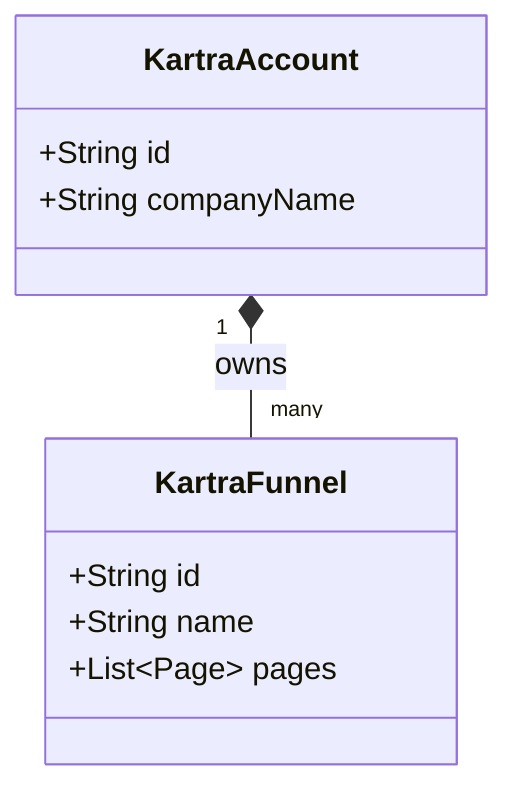
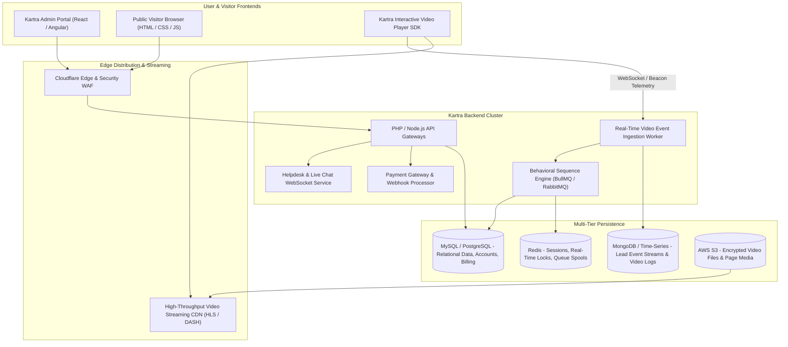
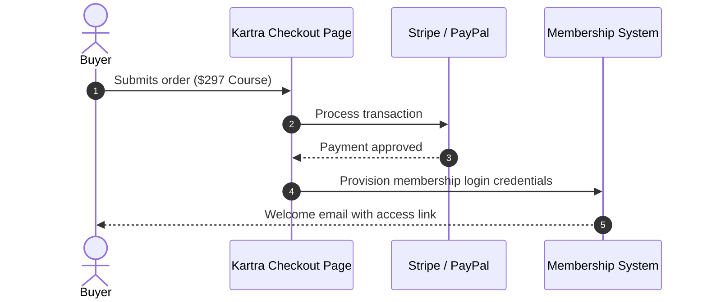

# Kartra System and Functional Architecture

> Comprehensive technical and functional reverse-engineered reference for **Kartra**: Genesis Digital's enterprise all-in-one business platform renowned for behavior-driven marketing automation, interactive video hosting, dynamic lead scoring, and done-for-you (DFY) campaign deployment.

---

## 1. Executive Overview and Market Positioning

**Kartra** was engineered by Genesis Digital (the creators of WebinarJam and EverWebinar) as an advanced, behavior-driven marketing and business management platform. Positioned between entry-level funnel builders (like ClickFunnels) and complex enterprise marketing clouds (like Infusionsoft / Keap and Ontraport), Kartra’s core differentiator is its **seamless internal interconnectedness**:
- When a prospect watches 75% of a sales video hosted on Kartra, Kartra’s video player directly tags the lead in the CRM.
- The tag automatically enrolls the lead in an email follow-up sequence.
- The email contains a personalized link that dynamically shows or hides pricing options on the sales page based on whether the lead has already purchased another product.
- If the customer encounters an issue, Kartra’s built-in Helpdesk pulls up the customer’s entire video watch history, email opens, and purchase receipts in a single side panel.

### Core Value Proposition
- **Behavior-Driven Video Hosting & Telemetry:** Proprietary video player tracking exact viewer drop-offs, executing automation tags at specific video timestamps, and rendering dynamic call-to-action buttons directly over video playback.
- **Dynamic Lead Scoring & Behavioral Tagging:** Automatic accumulation or deduction of lead score points based on email clicks, video completion, page visits, and refund requests.
- **Done-For-You (DFY) Campaign Porter:** Ability to import and export entire pre-configured marketing machines (pages, forms, products, email cadences, and tags) with a single import code.
- **Integrated Customer Helpdesk & Ticket System:** Built-in customer support ticketing, live chat, and canned responses sharing the same customer record as the marketing CRM.
- **High-Converting Checkout Engine:** Optimized checkout forms with 1-click order bumps, recurring subscription trials, downsell routing, and automated sales tax calculation.

---

## 2. Core Entities and Reverse-Engineered Data Model

```
┌────────────────────────────────────────────────────────┐
│                   Kartra Account Tenant                │
│    (Account ID, Custom Domain, Payment Integrations)   │
└───────────────────────────┬────────────────────────────┘
                            │ 1:N
                            ▼
┌────────────────────────────────────────────────────────┐
│                 Lead / Customer Profile                │
│   (Email, Contact Info, Lead Score, Custom Tags, Logs) │
└──────┬────────────────────┬────────────────────┬───────┘
       │ 1:N                │ 1:N                │ 1:N
       ▼                    ▼                    ▼
┌──────────────┐     ┌──────────────┐     ┌──────────────┐
│  Kartra Page │     │ Kartra Video │     │Kartra Product│
│  (Funnels,   │     │ (Timestamps, │     │(Checkout, Bump│
│  Lead Gates) │     │  In-Video CTA│     │ Upsell/Down) │
└──────┬───────┘     └──────┬───────┘     └──────────────┘
       │                    │
       │ Emits Behavioral   │ Emits Watch Events
       │ Pageviews          │ (e.g. 50%, 75%, 100%)
       ▼                    ▼
┌────────────────────────────────────────────────────────┐
│             Automation & Sequence Engine               │
│  (If Lead Reaches 18:30 in Video ➔ Apply Tag "Pitched" │
│   If Tag "Pitched" AND NOT Purchased ➔ Send Email Drip)│
└──────┬─────────────────────────────────────────────────┘
       │ Integrated With
       ▼
┌────────────────────────────────────────────────────────┐
│               Kartra Helpdesk & Tickets                │
│ (Agent Inboxes, Live Chat, Full Lead Purchase History) │
└────────────────────────────────────────────────────────┘
```

### Entity Hierarchy Breakdown
1. **Lead / Customer:** Central record enriched with **Lead Score** (numeric reputation integer), active **Tags**, enrolled **Lists**, active **Sequences**, and transaction history.
2. **Video Asset:** Encrypted video stream hosted on Kartra’s CDN. Associated with automation milestones (e.g. `at_seconds: 480 ➔ add_tag("watched_pricing")`).
3. **Funnel / Page:** Responsive web landing pages built with Kartra’s visual editor. Supports dynamic personalization tokens (e.g. `Hello {first_name}!`) and behavioral display rules.
4. **Product & Checkout:** Defines digital downloads, subscriptions, physical goods, coupon codes, and 1-click bump offers (`order_bump: {product_id, price}`).
5. **Sequence:** Sophisticated visual automation campaign with time delays, conditional split tests, and multi-channel triggers.
6. **Helpdesk:** Customer support channel featuring live chat, ticket dispatch, and private internal notes directly attached to the lead profile.

---

### 2.1 Core Domain and Service Class Architecture



---

### 2.2 Comprehensive Database Schema Specification

#### Table: `funnels`
| Column | Type | Constraints | Default | Description |
| :--- | :--- | :--- | :--- | :--- |
| `id` | `VARCHAR(64)` | `PRIMARY KEY` | - | Funnel ID |
| `name` | `VARCHAR(255)` | `NOT NULL` | - | Title |
| `status` | `VARCHAR(50)` | `NOT NULL` | `'active'` | Status |

---

## 3. Reverse-Engineered System Architecture & Engineering Blueprint



### 3.1 Technology Stack & Video Engine
- **Core Languages & Runtimes:** Hybrid PHP (PHP 8.1+) for transactional web controllers and customer checkouts; **Node.js** for real-time WebSocket communication, live chat, and video telemetry streaming.
- **Frontend Architecture:** Component-based SPA architecture utilizing React and TailwindCSS for modern sub-systems, alongside legacy Angular modules in older portal views.
- **Video Player & Streaming Infrastructure:**
  - Videos uploaded to S3 are transcoded into multi-bitrate **HLS (HTTP Live Streaming)** streams.
  - The proprietary `kartra-player.js` client tracks second-by-second playback. When the player reaches pre-configured time offsets (e.g. 15 minutes, 30 seconds), it dispatches an asynchronous beacon request to `VideoTelemetryWorker`, triggering backend automations instantaneously.
- **Database Architecture:**
  - **MySQL / PostgreSQL:** Enforces data integrity for financial transactions, subscriptions, products, coupons, and affiliate ledgers.
  - **MongoDB / NoSQL Store:** Stores unstructured behavioral logs, page visit paths, video watch heatmaps, and dynamic lead audit trails.

---

## 4. Key Operational Mechanics & Deep Technical Differentiators

### 4.1 Video-Triggered Behavioral Automation
Unlike generic video platforms (YouTube, Vimeo, or Wistia) where video playback is disconnected from marketing automation, Kartra’s video player is an active participant in the CRM:
- **Timestamp Tagging:** An admin configures: `"If lead watches past 12:45 (when the offer is presented), add tag 'saw_the_offer'"`.
- **In-Video Interactive Elements:** Marketers can inject clickable buttons, email opt-in forms, or limited-time coupon codes directly over the video at exact timestamps. If the viewer clicks the in-video button, the action is logged and the lead is redirected to the checkout page.

### 4.2 Dynamic Behavioral Lead Scoring
Kartra implements a continuous mathematical lead score:
```
Lead Score = Base + (Email Opens * 2) + (Email Clicks * 5) + (Video 100% Watched * 10) - (Inactive 30 Days * 15) - (Refund Request * 50)
```
When a lead’s score crosses a designated threshold (e.g. 100 points), Kartra automatically moves the prospect into a "Hot Lead" stage and alerts sales representatives.

### 4.3 Done-For-You (DFY) Campaign Marketplace
Kartra created a global ecosystem of portable marketing campaigns:
- Experienced direct-response marketers build complex multi-asset campaigns (e.g. "4-Day Flash Sale" consisting of 5 landing pages, 8 automated emails, 3 countdown timers, 2 order bump products, and 6 behavioral tags).
- Kartra packages this entire dependency graph into a single encrypted **Share Code**.
- Any other Kartra user can input the code, and Kartra’s deployment engine automatically instantiates all pages, clones the email copy, creates the required tags, and wires all relationships together in seconds.

---

## 5. Integration Architecture and API Surface

- **Kartra Inbound API:** Standardized RESTful endpoints allowing external applications to create leads, apply tags, trigger sequences, and verify purchases.
- **Outbound Webhooks:** Comprehensive webhook engine firing JSON payloads on events: `lead.created`, `lead.tagged`, `video.completed`, `product.purchased`, `refund.issued`, `ticket.created`.
- **Pre-Integrated Payment Gateways:** Direct API connectors for Stripe, PayPal, Authorize.Net, and Braintree.

---

### 3.1 End-to-End Operational Lifecycle Sequence



---

## 6. MarketingStudio Convergence & Architectural Takeaways

For **MarketingStudio**, Kartra provides vital lessons in behavior-driven automation and content interactivity:

1. **Implement Video-Triggered Automation**: When MarketingStudio users host promotional or educational videos, embed an interactive player that reports playback progress to the CRM, applying tags when viewers reach the pitch.
2. **Build a Shareable Campaign / Snapshot System**: Replicate Kartra’s DFY Campaign Porter (and GoHighLevel’s Snapshots), allowing agencies and creators to export complete marketing funnels with one click.
3. **Integrate Dynamic Behavioral Lead Scoring**: Continuously compute lead scores from email opens, landing page visits, video completions, and form submissions to bubble up high-intent buyers for sales reps.
4. **Unify Customer Support with Marketing CRM**: Ensure that customer support tickets and live chats (via Chatwoot) display the customer’s marketing engagement and purchase history in the agent’s sidebar.