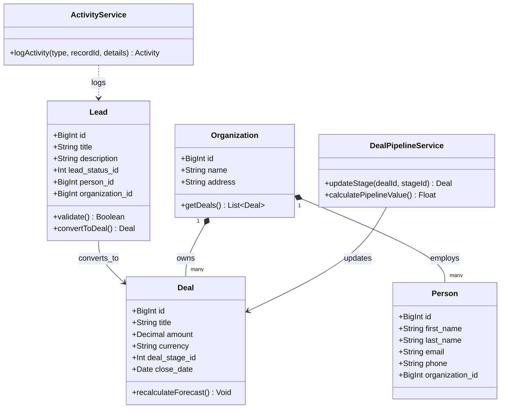
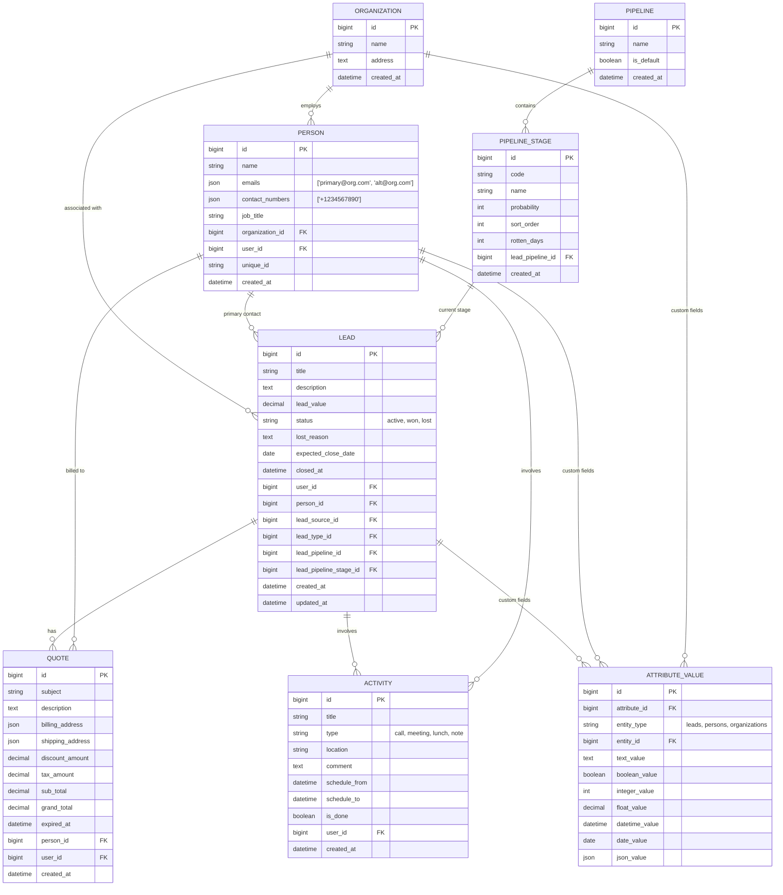
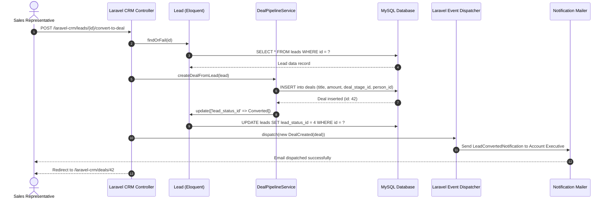

# laravel-crm (Krayin CRM) - Architecture & Technical Wiki

> **Enterprise Modular CRM Framework Engineered on Laravel 12, Polymorphic EAV & Realtime Reverb**  
> GitHub: [krayin/laravel-crm](https://github.com/krayin/laravel-crm.git) | Stack: PHP 8.3+, Laravel 12.0, MySQL 8.0, Laravel Reverb, Laravel Sanctum, Prettus L5 Repository, Vue.js, TailwindCSS | License: MIT

---

## 1. Executive Summary & Value Proposition

**laravel-crm** (commercially distributed as **Krayin CRM**) is an enterprise-grade, modular customer relationship management engine architected by Webkul atop the Laravel 12 framework. Tailored for small-to-medium businesses, digital marketing agencies, and enterprise sales teams, Krayin CRM introduces a cleanly decoupled, package-based software design (`packages/Webkul/`). Built around an extensible **Entity-Attribute-Value (EAV)** attribute storage mechanism, Krayin empowers businesses to dynamically provision custom schema attributes on Leads, Contacts, Organizations, and Products without performing risky database table alterations.

### Core Problems Solved
- **Monolithic CRM Rigidity**: Overcomes monolithic lock-in by segmenting business capabilities into independent, self-contained composer packages orchestrated via Konekt Concord.
- **Dynamic Field Storage (EAV)**: Allows administrators to create text, dropdown, boolean, date, and JSON attributes across any core entity with typed storage columns in `attribute_values`.
- **Sales Stagnation ("Rotten Leads")**: Employs automated lead rotting algorithms (`rotten_days`) on pipeline stages, highlighting stalled deals visually before revenue is forfeited.
- **Integrated Quotation-to-Close Engine**: Directly bridges sales leads with product inventories, automated tax calculations, multi-currency price conversions, and PDF quotation generation.
- **Modern Real-Time Collaboration**: Utilizes Laravel Reverb and Vue.js to broadcast pipeline updates, task completions, and incoming emails across distributed sales teams with minimal latency.

---

## 2. High-Level System Architecture

Krayin CRM is structured as a collection of domain-driven packages hosted inside `packages/Webkul/`. Each package bundles its own database migrations, Eloquent models, repositories, controllers, policies, routes, and Blade/Vue view components.

```mermaid
flowchart TD
    subgraph ClientLayer ["Client & Presentation Tier"]
        AdminPortal["Admin Web Console (Blade / Vue.js / TailwindCSS)"]
        KanbanBoard["Drag-and-Drop Pipeline Kanban (Vue 3 / Sortable)"]
        DataGridUI["Dynamic DataGrid & Saved Filters Component"]
    end

    subgraph HttpGateway ["Laravel 12 HTTP & Realtime Gateway"]
        RouteDispatcher["Laravel Routing & Pipeline Middleware"]
        AuthGuard["Sanctum Token & Session Authentication"]
        ReverbWS["Laravel Reverb Real-Time WebSocket Server"]
    end

    subgraph ModularDomain ["Webkul Modular Core Packages (packages/Webkul/)"]
        LeadModule["Webkul/Lead (Pipelines, Stages, Rotting Engine)"]
        ContactModule["Webkul/Contact (Persons & Organizations)"]
        AttrModule["Webkul/Attribute (Polymorphic EAV Storage Engine)"]
        QuoteModule["Webkul/Quote (PDF Quotations & Tax Engine)"]
        ActivityModule["Webkul/Activity (Calls, Meetings, Tasks, Notes)"]
        EmailModule["Webkul/Email (IMAP Threading & Outbound Mail)"]
        AutoModule["Webkul/Automation (Triggers & Automated Actions)"]
        GridModule["Webkul/DataGrid (Query Serialization & Excel/PDF Export)"]
    end

    subgraph ServiceRepository ["Data Access & Logic Tier"]
        RepoPattern["Prettus L5 Repository Layer & Concord Proxies"]
        EloquentORM["Laravel Eloquent ORM & Query Builder"]
        QueueJobs["Laravel Queue Worker (Database / Redis)"]
    end

    subgraph StorageTier ["Persistence & Communication Layer"]
        MySQL[(MySQL 8.0 Database)]
        ImapServer["External Mail Server (IMAP / SMTP via webklex)"]
        DiskStorage["Local / AWS S3 File Storage (PDF Quotes & Attachments)"]
    end

    AdminPortal -->|HTTP / AJAX Requests| RouteDispatcher
    KanbanBoard -->|PUT /admin/leads/stage/edit/{id}| RouteDispatcher
    DataGridUI -->|GET /admin/datagrid/look-up| RouteDispatcher

    RouteDispatcher --> AuthGuard
    AuthGuard --> LeadModule
    AuthGuard --> ContactModule
    AuthGuard --> QuoteModule
    AuthGuard --> ActivityModule

    LeadModule --> AttrModule
    ContactModule --> AttrModule
    QuoteModule --> AttrModule

    LeadModule --> RepoPattern
    ContactModule --> RepoPattern
    AttrModule --> RepoPattern
    QuoteModule --> RepoPattern
    ActivityModule --> RepoPattern

    RepoPattern --> EloquentORM
    EloquentORM --> MySQL
    QuoteModule --> DiskStorage

    AutoModule --> QueueJobs
    EmailModule --> ImapServer
    QueueJobs --> EmailModule
    QueueJobs --> ReverbWS
    ReverbWS -->|Live Stage Broadcasts| KanbanBoard
```

---

### 2.1 Core Domain & Service Class Architecture



---

## 3. Technology Stack & Key Dependencies

- **Language & Runtime**: PHP 8.3+ (modern typed properties, attributes, and fiber-ready architecture)
- **Application Framework**: Laravel 12.0 (`laravel/framework` ^12.0)
- **Modular Architecture Engine**: Konekt Concord 1.17 (`konekt/concord`) for package discovery, proxy resolution, and modular Eloquent model overriding
- **Data Access Pattern**: Prettus L5 Repository 3.0 (`prettus/l5-repository`) decoupling database queries from controllers
- **Database**: MySQL 8.0+ (InnoDB UTF8MB4 engine)
- **Real-Time WebSockets**: Laravel Reverb 1.12 (`laravel/reverb`) and Pusher PHP Server 7.3 (`pusher/pusher-php-server`)
- **API & Authentication**: Laravel Sanctum 4.0 (`laravel/sanctum`)
- **Email Protocol Handling**: `webklex/laravel-imap` ^6.0 for bi-directional IMAP mailbox reading and RFC email parsing
- **PDF Generation & Export**: DomPDF (`barryvdh/laravel-dompdf` ^3.1), mPDF (`mpdf/mpdf` ^8.2), and Maatwebsite Excel (`maatwebsite/excel` ^3.1)
- **Frontend Engine**: Vue.js, Blade templating, TailwindCSS, and TinyMCE rich text editor

---

## 4. Repository Layout & Key Modules

```
laravel-crm/
├── app/                              # Top-level application bootstrap and kernel
├── packages/
│   └── Webkul/                       # Core modular CRM domain packages
│       ├── Activity/                 # Activities, meetings, calls, notes, lunch events
│       │   └── src/Models/           # Activity.php, ActivityProxy.php, Traits/LogsActivity.php
│       ├── Admin/                    # Administrative dashboard, UI views, controllers, routes
│       │   └── src/Http/Controllers/ # LeadController, QuoteController, DashboardController
│       ├── Attribute/                # Polymorphic EAV attribute system
│       │   ├── src/Models/           # Attribute.php, AttributeOption.php, AttributeValue.php
│       │   └── src/Traits/           # CustomAttribute.php (attaches dynamic EAV to any model)
│       ├── Automation/               # Event-driven workflow rules, conditions, and actions
│       ├── Contact/                  # Contact management
│       │   └── src/Models/           # Person.php, Organization.php
│       ├── Core/                     # System configs, countries, states, currency converters
│       ├── DataGrid/                 # Tabular grid query builder, saved filters, column sorters
│       ├── Email/                    # Mail syncing, mailbox threads, IMAP listener jobs
│       ├── Lead/                     # Lead pipeline engine
│       │   └── src/Models/           # Lead.php, Pipeline.php, Stage.php, Source.php, Type.php
│       ├── Marketing/                # Campaigns, broadcast templates, link tracking
│       ├── Product/                  # Inventory catalog, SKUs, pricing tiers
│       ├── Quote/                    # Quote creation, item discounts, PDF rendering
│       │   └── src/Models/           # Quote.php, QuoteItem.php
│       └── WebForm/                  # Public web-to-lead embeddable forms
├── routes/                           # Global web and API routing
├── public/                           # Web document root and compiled Vite assets
├── composer.json                     # Dependency manifests and Concord module mappings
└── vite.config.js                    # Vite frontend bundling configuration
```

---

## 5. Core Features & Capabilities

### 5.1 Polymorphic Entity-Attribute-Value (EAV) Engine
Krayin CRM avoids rigid database column limitations by utilizing a typed EAV architecture located in `packages/Webkul/Attribute`. Any Eloquent model incorporating the `CustomAttribute` trait gains access to dynamic properties:
- The `attributes` table defines the field schema (code, name, type, validation rules).
- Field values are stored in `attribute_values` with typed storage columns (`text_value`, `boolean_value`, `integer_value`, `float_value`, `datetime_value`, `date_value`, `json_value`).
- When a Lead or Person is saved, the `CustomAttribute` trait automatically unpacks dynamic attributes from the HTTP request, sanitizes them against attribute validation rules, and executes bulk upserts into `attribute_values`.

### 5.2 Multi-Pipeline Sales Kanban with Stagnation Tracking (`rotten_days`)
Deals and leads are managed through interactive Kanban pipelines:
- **Multiple Custom Funnels**: Organizations can configure distinct pipelines (e.g., Enterprise Outbound, Self-Serve Inbound, Partner Channel) with isolated stage sequences.
- **Lead Rotting Algorithm**: Stages include a `rotten_days` threshold. The `Lead` model appends a dynamic accessor (`rotten_days`) that compares `updated_at` against the stage threshold. If a lead remains untouched longer than permitted, the Kanban card visually shifts to a warning state to prevent deal decay.
- **Stage Progression API**: Dragging cards across columns triggers `PUT /admin/leads/stage/edit/{id}`, updating the stage, resetting stage timer metrics, and dispatching Laravel Reverb events.

### 5.3 PDF Quotation Generation with Multi-Currency & Line-Item Tax
The `Webkul/Quote` package turns qualified leads into commercial transactions:
- Links directly to `Webkul/Product` items with customized unit prices and quantity selectors.
- Computes sub-totals, discount amounts (percentage or fixed), and line-item tax adjustments.
- Automatically compiles formatted PDF proposals using `barryvdh/laravel-dompdf` or `mpdf/mpdf` for one-click emailing to clients.

### 5.4 Dynamic DataGrid Query Serialization
The `Webkul/DataGrid` engine powers all tabular data views across the CRM:
- Enables column reordering, mass updates, and complex multi-column filters without writing manual SQL queries.
- Serializes user filter configurations into `saved_filters` (`admin.datagrid.saved_filters.store`), enabling sales reps to save custom segments (e.g., "High-Value SaaS Leads Stalled > 14 Days").

### 5.5 Event-Driven Workflow Automation Engine
The `Webkul/Automation` module provides a trigger-condition-action workflow system:
- **Triggers**: Entity created, stage changed, attribute updated, activity logged.
- **Conditions**: Lead value greater than threshold, lead source equals specific campaign, person job title contains "VP".
- **Actions**: Automatically assign lead to user, dispatch webhook, send automated email template, or schedule a follow-up task.

### 5.6 Automated Inbound IMAP Mailbox Threading
The `Webkul/Email` worker continuously polls configured IMAP mailboxes via `webklex/laravel-imap`. Incoming email messages are parsed, matched against `persons.emails`, and automatically attached to the relevant Lead and Person activity logs without manual forwarding.

---

## 6. Data Models & Schema Architecture

Krayin CRM organizes customer entities with relationships connecting Leads, Contacts (Persons and Organizations), Pipelines, Quotes, and dynamic EAV Attribute Values.



### Core Schema Entity Details
1. **Lead (`packages/Webkul/Lead/src/Models/Lead.php`)**:
   - `lead_pipeline_id` & `lead_pipeline_stage_id`: Direct relational link into configurable sales pipelines.
   - `lead_value`: Commercial deal size used in revenue forecasts.
   - `rotten_days`: Computed property evaluating whether the lead has exceeded the stage's inactivity threshold.
2. **Person (`packages/Webkul/Contact/src/Models/Person.php`)**:
   - Stores multiple email addresses and phone numbers in JSON format (`emails`, `contact_numbers`).
   - Links optionally to an `organization_id`.
3. **AttributeValue (`packages/Webkul/Attribute/src/Models/AttributeValue.php`)**:
   - Polymorphic bridge storing dynamic EAV data via `entity_type` and `entity_id` across strongly typed value columns.

---

### 6.1 Comprehensive Database Schema Specification

Laravel-CRM is structured using Laravel Eloquent ORM on MySQL with standard auto-incrementing integer keys and soft-delete capabilities.

#### Table: `leads`
Stores pre-sales prospect leads captured via manual entry, CSV import, or marketing integrations.

| Column | Type | Constraints | Default | Description |
| :--- | :--- | :--- | :--- | :--- |
| `id` | `BIGINT UNSIGNED`| `PRIMARY KEY AUTO_INCREMENT` | - | Unique lead identifier |
| `title` | `VARCHAR(255)` | `NOT NULL` | - | Descriptive title for the lead |
| `person_id` | `BIGINT UNSIGNED`| `NULLABLE, FK -> people(id)` | `NULL` | Linked contact individual |
| `organization_id`| `BIGINT UNSIGNED`| `NULLABLE, FK -> organizations(id)`| `NULL` | Prospective business organization |
| `lead_status_id`| `INTEGER UNSIGNED`| `NOT NULL` | `1` | FK to status reference table |
| `amount` | `DECIMAL(12, 2)`| `NULLABLE` | `NULL` | Potential deal size |
| `created_at` | `TIMESTAMP` | `NOT NULL` | `NOW()` | Eloquent timestamp |
| `updated_at` | `TIMESTAMP` | `NOT NULL` | `NOW()` | Eloquent timestamp |

*Indexes:* `idx_leads_person` (`(person_id)`), `idx_leads_org` (`(organization_id)`).

---

#### Table: `deals`
Active sales pipeline opportunities progressing toward closing.

| Column | Type | Constraints | Default | Description |
| :--- | :--- | :--- | :--- | :--- |
| `id` | `BIGINT UNSIGNED`| `PRIMARY KEY AUTO_INCREMENT` | - | Unique deal identifier |
| `title` | `VARCHAR(255)` | `NOT NULL` | - | Deal project title |
| `amount` | `DECIMAL(12, 2)`| `NOT NULL` | `0.00` | Commercial deal value |
| `deal_stage_id` | `INTEGER UNSIGNED`| `NOT NULL` | `1` | Current Kanban pipeline stage |
| `person_id` | `BIGINT UNSIGNED`| `NULLABLE, FK -> people(id)` | `NULL` | Primary point of contact |
| `organization_id`| `BIGINT UNSIGNED`| `NULLABLE, FK -> organizations(id)`| `NULL` | Corporate client reference |
| `close_date` | `DATE` | `NULLABLE` | `NULL` | Expected closing date |

*Indexes:* `idx_deals_stage` (`(deal_stage_id)`), `idx_deals_org` (`(organization_id)`).

---

## 7. API Architecture, Webhooks & Key Endpoints

Krayin CRM routes administrative and REST interactions through structured Laravel routes protected by session or Laravel Sanctum token guards.

### Key Endpoints

| HTTP Method | Endpoint | Description |
|:---|:---|:---|
| `GET` | `/admin/leads` | List leads with DataGrid filters and pagination |
| `POST` | `/admin/leads/create` | Store a new lead with standard and EAV attributes |
| `POST` | `/admin/leads/create-by-ai` | Endpoint for AI agent lead creation from unstructured text |
| `PUT` | `/admin/leads/stage/edit/{id}` | Update lead pipeline stage via Kanban drag-and-drop |
| `PUT` | `/admin/leads/attributes/edit/{id}`| Update dynamic EAV custom attributes |
| `GET` | `/admin/leads/get/{pipeline_id?}` | Retrieve pipeline stages and deal cards |
| `POST` | `/admin/quotes/create` | Generate a new commercial quote with line items |
| `POST` | `/admin/datagrid/saved-filters` | Persist user-defined tabular filter presets |

### Sample Payload: Lead Stage Update (`PUT /admin/leads/stage/edit/{id}`)
```json
{
  "lead_pipeline_stage_id": 4,
  "lead_pipeline_id": 1,
  "status": "active"
}
```

### Sample Response: Lead Stage Update
```json
{
  "success": true,
  "message": "Lead stage updated successfully.",
  "data": {
    "id": 84,
    "title": "Cloud Migration Deal",
    "lead_pipeline_stage_id": 4,
    "stage_name": "Negotiation",
    "lead_value": 35000.00,
    "rotten_days": 0,
    "updated_at": "2026-10-24T11:45:00Z"
  }
}
```

### Sample Payload: Lead Creation with EAV Attributes (`POST /admin/leads/create`)
```json
{
  "title": "Enterprise Cloud Architecture",
  "lead_value": 65000.00,
  "lead_pipeline_id": 1,
  "lead_pipeline_stage_id": 1,
  "person": {
    "name": "Sarah Connor",
    "emails": ["sarah@cyberdyne.org"],
    "contact_numbers": ["+14155550199"],
    "job_title": "CTO"
  },
  "attributes": {
    "industry_vertical": "Robotics & Defense",
    "preferred_deployment": "On-Premises Air-Gapped",
    "sla_urgency": "Urgent"
  }
}
```

---

### 7.5 End-to-End Operational Lifecycle Sequence

The following sequence diagram details the Eloquent model lifecycle when a lead is qualified, converted to a deal, and dispatched through notifications.



---

## 8. Strategic Value & Takeaways for MarketingStudio

### Reusable Architectural Patterns
1. **Concord-Powered Modular Package Architecture**:
   - Krayin’s separation into discrete packages (`Webkul/Lead`, `Webkul/Contact`, `Webkul/Attribute`, `Webkul/Quote`) provides a masterclass in maintainable domain-driven architecture. MarketingStudio should implement a modular package structure so features like Email Campaigns, Social Media Publishing, Form Capture, and CRM Pipelines can be developed, tested, and upgraded independently.
2. **Polymorphic EAV with Typed Storage Columns**:
   - Rather than forcing all dynamic attributes into loose strings or monolithic JSON blobs, Krayin’s `attribute_values` table uses distinct typed columns (`text_value`, `integer_value`, `float_value`, `datetime_value`, `json_value`). This ensures SQL indexing and range filtering remain performant while giving users infinite schema flexibility.
3. **Automated Stage Inactivity Detection (`rotten_days`)**:
   - The concept of "rotten leads" directly solves sales rep neglect. MarketingStudio can replicate this feature to alert marketing managers when leads generated from paid campaigns stall in an initial SDR stage without follow-up.
4. **Decoupled DataGrid Filter Serialization**:
   - Krayin’s `DataGrid` package abstracts filtering, sorting, column visibility, and export routines into reusable backend classes. Adopting this pattern allows MarketingStudio to deliver unified tabular data grids across all modules (Contacts, Deals, Marketing Campaigns, Tasks) with zero code duplication.
