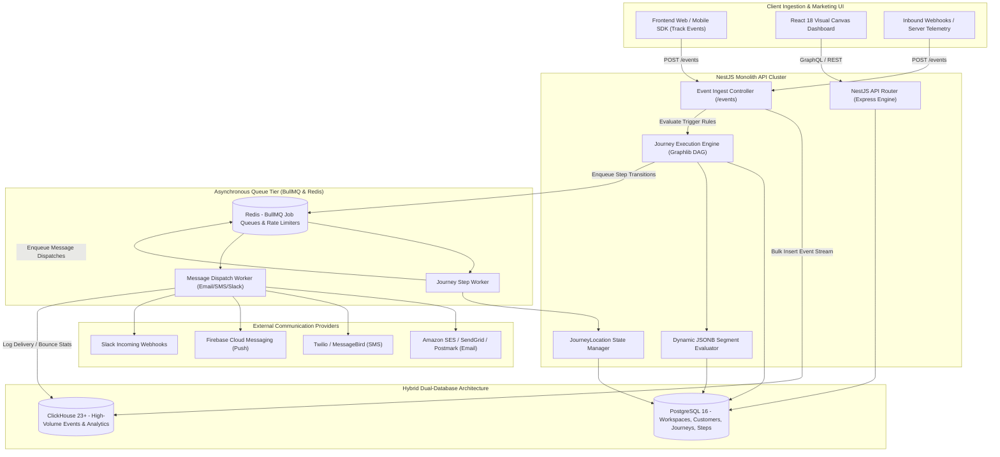
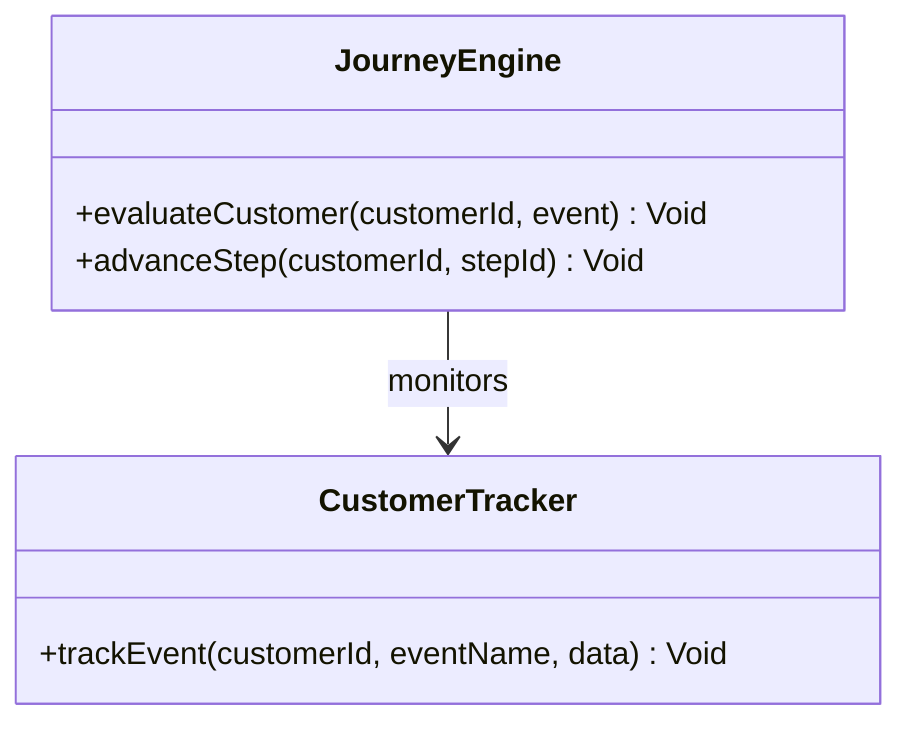
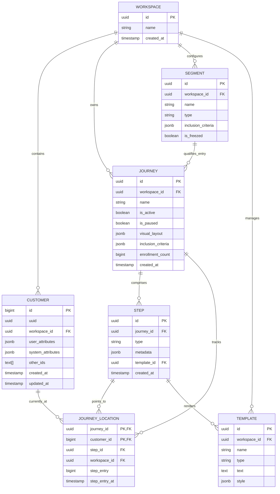
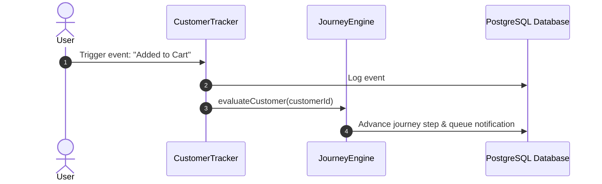

# laudspeaker - Architecture & Technical Wiki

> **Event-Driven Customer Engagement Platform, Visual DAG Journey Engine & Hybrid Postgres-ClickHouse Analytics**  
> GitHub: [laudspeaker/laudspeaker](https://github.com/laudspeaker/laudspeaker) | Stack: TypeScript, Node.js 18+, NestJS 10, TypeORM, PostgreSQL, ClickHouse 23+, BullMQ, Redis, React 18 | License: MIT

---

## 1. Executive Summary & Value Proposition

**Laudspeaker** is an open-source, event-driven customer journey and messaging platform engineered as a self-hostable alternative to commercial platforms such as Braze, Customer.io, and Iterable. Built with NestJS, TypeScript, and a dual-database architecture (PostgreSQL for transactional state and ClickHouse for high-throughput event analytics), Laudspeaker empowers product and growth marketing teams to trigger personalized multi-channel messaging (Email, SMS, Push, In-App Modals, Slack, and Webhooks) based on real-time user behaviors and lifecycle states.

The platform's standout capability is its **Visual Directed Acyclic Graph (DAG) Journey Builder**, powered by `@dagrejs/graphlib` and BullMQ asynchronous queues. It allows marketers to compose branch-heavy sequences that mix deterministic time delays, real-time event triggers (e.g., *User signed up, but did not complete onboarding within 48 hours*), multivariate A/B testing splits, dynamic segmentation filters, and external API webhooks.

### Core Problems Solved
- **Prohibitive SaaS Event & MTU Pricing**: Overcomes the soaring costs of SaaS vendors who bill per Monthly Tracked User (MTU) or event volume by utilizing ClickHouse to ingest and query billions of events at flat infrastructure cost.
- **Data Fragmentation Between Analytics & Messaging**: Unifies event stream ingestion (clicks, pageviews, purchases) directly with message dispatch triggers, eliminating synchronization lag between CDPs and messaging tools.
- **Complex Behavioral Journey Orchestration**: Supports multi-step, stateful user progression through journey graphs with atomic step pointers (`JourneyLocation`) and Temporal date calculations.
- **Channel Delivery Failures & Rate Limits**: Offloads message dispatch to Redis-backed BullMQ priority queues with automated backoff retries, rate limits, and fallback actions.
- **Rigid Customer Identity Schemas**: Employs flexible PostgreSQL JSONB columns (`user_attributes` and `system_attributes`) combined with deduplicating identity arrays (`other_ids: text[]`), accommodating unstructured product telemetry.

---

## 2. High-Level System Architecture

Laudspeaker employs a hybrid dual-store architecture:
1. **PostgreSQL 16 (TypeORM)**: Acts as the primary transactional ledger, holding organizational workspaces, customers, visual journey layouts, step locations, templates, and integration credentials.
2. **ClickHouse 23+**: High-velocity columnar database ingesting raw user telemetry events, journey transitions, and delivery log metrics.
3. **NestJS Modular Core & BullMQ Workers**: Processes inbound REST events, runs graph traversal algorithms via `@dagrejs/graphlib`, schedules delayed execution timers in Redis, and dispatches external HTTP/MTA jobs.



---

### 2.1 Core Domain & Service Class Architecture



---

## 3. Technology Stack & Key Dependencies

- **Language & Runtime**: TypeScript 5+, Node.js 18+ LTS.
- **Application Framework**: **NestJS 10** (`@nestjs/core`, `@nestjs/common`, `@nestjs/platform-express`).
- **ORM & Database Layer**:
  - **TypeORM 0.3+**: Object-Relational Mapper connecting PostgreSQL for transactional schemas.
  - **ClickHouse Client** (`@clickhouse/client` v1.4.0): Executes columnar analytics queries and event streaming.
- **Asynchronous Queue Engine**: **BullMQ** (`bullmq` v5+, `@nestjs/bullmq`) backed by Redis (`@liaoliaots/nestjs-redis`) for delayed jobs and retry loops.
- **Graph Traversal & Journey Planning**: `@dagrejs/graphlib` (topological sorting, cycle detection, edge pathfinding) and `@js-temporal/polyfill` (RFC-compliant timezone and duration calculations).
- **Frontend Architecture**: React 18, Vite, TailwindCSS, React Flow (interactive node-based journey graph canvas).
- **Communication Adapters**: `@aws-sdk/client-ses`, `@sendgrid/mail`, `nodemailer`, `twilio`, `@slack/web-api`.

---

## 4. Repository Layout & Key Modules

```
inspire/laudspeaker/
├── packages/
│   ├── server/                       # NestJS Backend API & Workers
│   │   ├── src/
│   │   │   ├── api/                  # Domain-driven NestJS modules
│   │   │   │   ├── customers/        # Customer profiles, JSONB attributes, identity merge
│   │   │   │   ├── events/           # ClickHouse event ingestion and triggers
│   │   │   │   ├── filter/           # Segment boolean expression parser
│   │   │   │   ├── journeys/         # DAG canvas builder, state machines, processors
│   │   │   │   │   ├── entities/     # Journey, JourneyLocation, JourneyChange
│   │   │   │   │   ├── processors/   # BullMQ step traversal workers
│   │   │   │   │   └── journeys.service.ts
│   │   │   │   ├── segments/         # Dynamic segment evaluator and caching
│   │   │   │   ├── steps/            # Canvas node definitions (delay, email, sms, if/else)
│   │   │   │   ├── templates/        # Multi-channel template definitions & renderers
│   │   │   │   └── webhooks/         # Outbound webhook runner
│   │   │   ├── app.module.ts         # Root module registering Postgres, ClickHouse, BullMQ
│   │   │   └── main.ts               # Application entrypoint
│   │   ├── package.json
│   │   └── tsconfig.json
│   ├── client/                       # React 18 SPA frontend
│   │   ├── src/
│   │   │   ├── components/           # React Flow journey canvas components
│   │   │   └── pages/                # Campaigns, Customers, Segments, Analytics
│   └── tests/                        # Integration and end-to-end tests
├── docker-compose.yml                # Development services (Postgres, ClickHouse, Redis)
└── render.yaml                       # Production cloud deployment blueprint
```

---

## 5. Core Features & Capabilities

### 5.1 Interactive Directed Acyclic Graph (DAG) Journey Engine
Laudspeaker allows growth marketers to drag and drop journey nodes onto a canvas:
- Nodes represent triggers, communication actions (`send-email`, `send-sms`), flow controls (`wait-delay`, `wait-until-event`), conditional splits (`branch-if-else`), and multivariate experiments (`a/b-test-split`).
- Uses `@dagrejs/graphlib` to validate the visual graph topology, prevent infinite loops, and compute valid transition paths.
- Step transitions are scheduled asynchronously as delayed BullMQ jobs. When a delay expires, the worker evaluates if the customer still satisfies the inclusion criteria before triggering the next node.

### 5.2 Atomic State Pointers (`JourneyLocation`)
Customer progression through a multi-week journey is modeled through the `JourneyLocation` entity:
- Uniquely keyed by `journey_id` and `customer_id`.
- Stores the active `step_id`, the precise entry timestamp (`stepEntryAt`), and an epoch counter (`stepEntry`).
- If an active journey is paused or updated by a marketer, existing customers remain frozen at their current `JourneyLocation` until the journey resumes, eliminating race conditions.

### 5.3 Flexible Customer 360 & JSONB Schemas
Customer profiles do not require rigid database column migrations:
- `user_attributes`: Freeform JSONB field storing custom properties (e.g., `subscription_tier: "enterprise"`, `mrr: 2500`).
- `system_attributes`: System-managed metadata (e.g., `last_seen`, `ip_country`, `email_bounced`).
- `other_ids: text[]`: Multi-value identifier array linking anonymous visitor cookies, OAuth sub IDs, and primary email addresses under a unified customer record.

### 5.4 Dual-Database Analytical Ingestion
By pairing ClickHouse with PostgreSQL:
- ClickHouse absorbs raw event webhooks at rates exceeding 50,000 events/second without degrading PostgreSQL transaction latency.
- Aggregated funnel reports, conversion rates, and email open/click attribution metrics are calculated via real-time ClickHouse SQL queries rather than running heavy scans on PostgreSQL.

---

## 6. Data Models & Schema Architecture

The relational schema links organizational workspaces, dynamic customers, visual journeys, and step location pointers.



### Key Field Descriptions
- `journey.visual_layout`: Complete serialized React Flow graph containing arrays of `{ id, type, position, data }` nodes and `{ id, source, target }` edges.
- `journey_location.step_entry`: Monotonically increasing epoch timestamp marking when the customer entered the current step, used to calculate exact BullMQ delay windows.
- `customer.other_ids`: String array of secondary identifiers (e.g., phone numbers, Google UUIDs) facilitating deterministic customer stitching.
- `template.type`: Message channel format (`"email"`, `"sms"`, `"slack"`, `"webhook"`, or `"modal"`).

---

### 6.1 Comprehensive Database Schema Specification

Laudspeaker tracks multi-channel steps and customer transitions in PostgreSQL.

#### Table: `journeys`
| Column | Type | Constraints | Default | Description |
| :--- | :--- | :--- | :--- | :--- |
| `id` | `UUID` | `PRIMARY KEY` | `gen_random_uuid()` | Journey ID |
| `name` | `VARCHAR(255)` | `NOT NULL` | - | Campaign name |
| `status` | `VARCHAR(50)` | `NOT NULL` | `'active'` | Status |

---

## 7. API Architecture, Webhooks & Key Endpoints

| HTTP Method | Endpoint | Purpose | Sample Payload |
| :--- | :--- | :--- | :--- |
| `POST` | `/events` | Ingest user action / telemetry event | `{"correlationKey": "email", "value": "user@co.com", "event": "Subscription Created", "payload": {"plan": "Pro"}}` |
| `POST` | `/customers` | Upsert customer profile | `{"id": "usr_9812", "email": "dave@saas.com", "attributes": {"tier": "gold"}}` |
| `POST` | `/journeys` | Save visual journey graph | `{"name": "Onboarding Drip", "visualLayout": {"nodes": [...], "edges": [...]}}` |
| `POST` | `/journeys/{id}/start` | Activate and publish journey | Path param: `id=3fa85f64-5717-4562-b3fc-2c963f66afa6` |
| `GET` | `/segments/{id}/customers` | List customers matching segment | Query: `?page=1&limit=50` |

---

### 7.5 End-to-End Operational Lifecycle Sequence



---

## 8. Strategic Value & Takeaways for MarketingStudio

### Architectural Patterns to Replicate
1. **Hybrid Postgres + ClickHouse Storage Topology**: Fast relational writes and joins belong in PostgreSQL, but high-velocity telemetry (event streams, email opens, link tracking clicks) degrades relational database performance. MarketingStudio should implement ClickHouse for its event bus and analytics reporting while keeping customer and journey configurations in PostgreSQL.
2. **Atomic Step Pointer (`JourneyLocation`) Model**: Laudspeaker's approach of tracking customer progress using a composite primary key (`journey_id` + `customer_id`) referencing the active `step_id` simplifies journey pause/resume states, multivariate A/B testing splits, and failure recoveries.
3. **Graphlib Topologically-Sorted Journey Execution**: Validating canvas layouts using `@dagrejs/graphlib` before activation guarantees that journeys are true Directed Acyclic Graphs without deadlocks or unresolvable cyclic loops.
4. **Delayed Queue Orchestration via BullMQ**: Using Redis-backed BullMQ delayed jobs to handle multi-day wait steps (e.g., *Wait 3 days before sending Step 2*) eliminates expensive cron polling loops across database tables.
