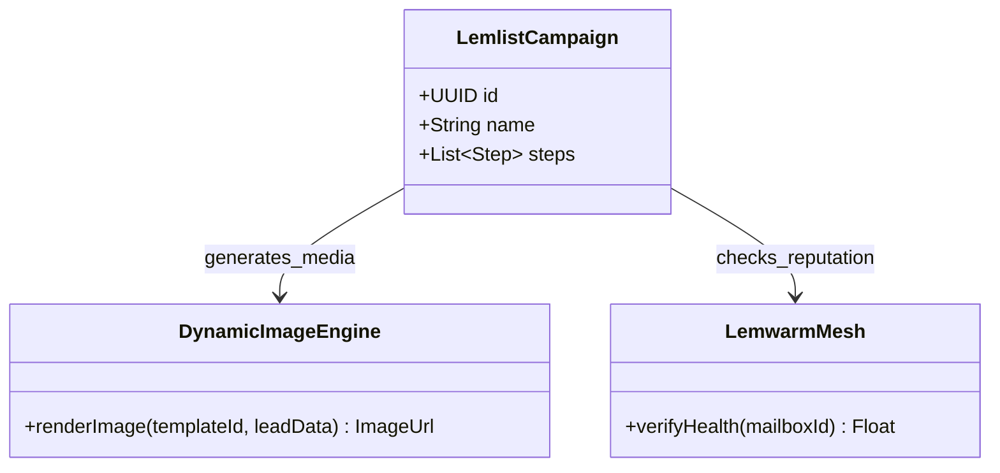
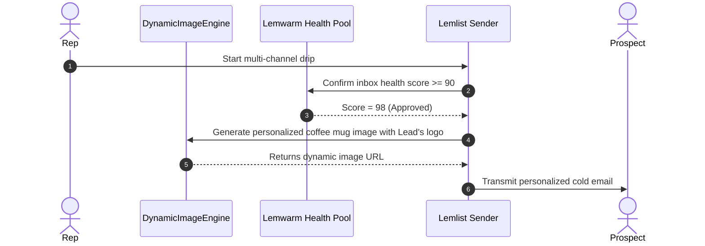

# Lemlist.com System and Functional Architecture

> Comprehensive technical and functional reference for Lemlist.com: the multichannel cold outreach platform celebrated for dynamic visual hyper-personalization, automated LinkedIn workflows, and the Lemwarm deliverability network.

---

## 1. Executive Overview and Market Positioning

Lemlist pioneered the concept of visual hyper-personalization in cold outbound marketing. While conventional sales engagement platforms relied strictly on static text with primitive merge tags (such as `{{firstName}}`), Lemlist introduced a dynamic image and video rendering engine capable of synthesizing custom visuals for every individual recipient.

Over time, Lemlist expanded beyond email into a synchronized multichannel platform, orchestrating cold emails, automated LinkedIn interactions (profile views, invites, messages, voice notes), cold calling integrations, and dedicated inbox warmup via its proprietary Lemwarm infrastructure.

### Core Value Proposition
- **Dynamic Visual Hyper-Personalization:** On-the-fly rendering of customized images (displaying the prospect's name, company logo, or website screenshot) and personalized video landing pages.
- **Multichannel Outreach Cadences:** Coordinated workflows linking Cold Email, automated LinkedIn touchpoints, phone calls (via Aircall/Ringover), and manual tasks.
- **Lemwarm Deliverability Engine:** Proprietary peer-to-peer deliverability warmup network comprising tens of thousands of active mailboxes to prevent spam classification.
- **Integrated B2B Database (450M+ Contacts):** Built-in prospect search and email discovery with real-time verification (Lemverify).
- **AI Campaign Generation:** Automated creation of complete multi-step outbound sequences based on product URL and ICP prompt inputs.

---

## 2. Core Entities and Data Model

```
┌────────────────────────────────────────────────────────┐
│                      Workspace                         │
│  (Team Members, Billing, Shared Assets, Custom Domain) │
└───────────┬────────────────────────────────┬───────────┘
            │ 1:N                            │ 1:N
            ▼                                ▼
┌───────────────────────┐        ┌───────────────────────┐
│     Connected Inboxes │        │       Campaign        │
│ (Google, M365, SMTP,  │        │ (Multichannel Steps,  │
│  Lemwarm State)       │        │  Dynamic Templates)   │
└───────────┬───────────┘        └───────────┬───────────┘
            │                                │
            │ Assigned Mailboxes             │ Enrolls
            └────────────────►┌──────────────▼──────────┐
                              │     Campaign Lead       │
                              │ (Attributes, Enriched,  │
                              │  Status, Timeline)      │
                              └──────────────┬──────────┘
                                             │ 1:N
                                             ▼
                              ┌─────────────────────────┐
                              │     Multichannel Step   │
                              │ ┌─────────────────────┐ │
                              │ │ Email Step (Visual) │ │
                              │ ├─────────────────────┤ │
                              │ │ LinkedIn Step       │ │
                              │ ├─────────────────────┤ │
                              │ │ Cold Call Task      │ │
                              │ └─────────────────────┘ │
                              └──────────────┬──────────┘
                                             │ Generates
                                             ▼
                              ┌─────────────────────────┐
                              │   Dynamic Media Render  │
                              │ (Image Canvas, Lemcal   │
                              │  Personalized Landing)  │
                              └─────────────────────────┘
```

### Entity Definitions
1. **Workspace:** Tenant environment managing team seats, client billing, global deliverability settings, and shared visual template libraries.
2. **Connected Inbox:** Authenticated email sender account with associated Lemwarm monitoring, daily sending quotas, and custom tracking domains.
3. **Campaign:** Multichannel cadence containing email drafts, personalized media assets, LinkedIn automation triggers, call tasks, and schedule constraints.
4. **Campaign Lead:** Prospective buyer containing standard contact attributes, enriched company firmographics, custom variables, and active step state.
5. **Multichannel Step:** Individual touchpoint within a campaign cadence (Email, LinkedIn profile view, LinkedIn invite, LinkedIn message, Voice Note, or Phone Call).
6. **Dynamic Media Asset:** Programmatic canvas combining background templates with dynamic text layers, logo overlays, or live website screenshot captures.

---

### 2.1 Core Domain and Service Class Architecture



---

### 2.2 Comprehensive Database Schema Specification

#### Table: `campaigns`
| Column | Type | Constraints | Default | Description |
| :--- | :--- | :--- | :--- | :--- |
| `id` | `VARCHAR(50)` | `PRIMARY KEY` | - | Campaign ID |
| `name` | `VARCHAR(255)` | `NOT NULL` | - | Campaign title |
| `status` | `VARCHAR(50)` | `NOT NULL` | `'active'` | Campaign state |

---

## 3. Comprehensive Feature and Functional Breakdown

### 3.1 Dynamic Visual Hyper-Personalization Engine

Lemlist's signature capability is the automatic creation of personalized visuals that drastically increase reply rates.

#### 3.1.1 Dynamic Image Personalization
- **Layer-Based Visual Editor:** In-browser graphic designer supporting background images, dynamic text boxes, company logo overlays, and prospect avatar insertions.
- **Dynamic Variable Injection:** Merge prospect variables (e.g., `{{firstName}}`, `{{companyName}}`) directly onto visual elements: for instance, rendering the prospect's name on a coffee mug, whiteboard, book cover, or billboard.
- **Website Screenshot Scraping:** Automatically captures a live screenshot of the prospect's company website and embeds it inside a laptop or tablet graphic within the email body.
- **Automated Fallbacks:** Configures graceful fallbacks if a company logo or website screenshot is unavailable, ensuring the visual remains clean and professional.

#### 3.1.2 Dynamic Video Landing Pages
- **Personalized Video Player:** Generates a custom landing page for each prospect featuring an animated video preview thumbnail with their name and logo.
- **Embedded Conversational Widget:** The landing page features a chat bubble and embedded calendar scheduler (Lemcal) allowing immediate meeting booking without navigating away.
- **Brand Consistency:** Custom subdomain hosting (e.g., `meet.yourcompany.com`) maintaining company branding and SSL security.

#### 3.1.3 Advanced Liquid Template Syntax
- **Conditional Logic:** Complex branching within email text based on lead attributes:
  ```liquid
  
    Since you lead an enterprise team of over {{lead.companySize}} people...
  
    As you scale your agile team at {{lead.companyName}}...
  
  ```
- **Spintax Variations:** Randomized synonymous variations to prevent identical text matching across bulk email sends.

---

### 3.2 Multichannel Outreach Cadences

Lemlist orchestrates touchpoints across multiple channels within a single automated timeline.

#### 3.2.1 Touchpoint Channels
1. **Cold Email:** Text and visual emails with custom tracking domains, personalized attachments, and automated reply threading.
2. **LinkedIn Profile Visit:** Automates a profile visit, triggering a notification to the prospect ("User viewed your profile").
3. **LinkedIn Connection Invite:** Sends a connection request with an optional personalized note or as a blank invite (which often has higher acceptance rates).
4. **LinkedIn Message:** Automatically sends a direct message once the connection request is accepted.
5. **LinkedIn Voice Note:** Pushes pre-recorded or personalized audio messages to the prospect's LinkedIn inbox.
6. **Phone Calling:** Native integration with VoIP providers (Aircall, Ringover) that enqueues call tasks with click-to-dial functionality.
7. **Manual Action Tasks:** Custom tasks for physical mail, conference meetings, or Twitter interactions.

#### 3.2.2 Conditional Branching Logic
Sequences can diverge dynamically based on prospect behavior:
- **Condition: If Email Opened:** Send follow-up email after 2 days; **Else:** Trigger LinkedIn profile view.
- **Condition: If LinkedIn Invite Accepted:** Send LinkedIn message; **Else:** Continue email cadence.
- **Condition: If Link Clicked:** Flag lead as High Priority and enqueue immediate phone call task.

---

### 3.3 Lemwarm: Automated Deliverability and Warmup

Lemwarm operates as an autonomous deliverability infrastructure to establish and safeguard sender reputation.

#### 3.3.1 Peer-to-Peer Warmup Network
- **Aged Mailbox Mesh:** A network of 20,000+ real, authenticated business domains continuously exchanging messages.
- **Contextual Conversations:** Uses AI to generate realistic business threads rather than gibberish, mimicking authentic human correspondence.
- **Inbox Auto-Rescue:** Automatically identifies warmup emails that land in Spam or Promotions folders, relocates them to the Primary Inbox, marks them as read, and stars them.

#### 3.3.2 Deliverability Diagnostics and Monitoring
- **Deliverability Score (0-100):** Real-time quantitative health metric reflecting domain reputation and spam risk.
- **Automated DNS Audit:** Continuous verification of SPF, DKIM, DMARC, and MX records with warning alerts upon configuration drift.
- **Warmup Schedule Curves:** Automated ramp-up schedules (e.g., starting at 2 warmup emails/day and increasing by 2/day up to 40/day).
- **Lemwarm After-Send:** Continues background warmup while active campaigns are running to maintain healthy send/receive ratios.

---

### 3.4 B2B Lead Database and Verification (Lemverify)

Lemlist incorporates native lead generation and email validation tools.

#### 3.4.1 Lead Search and Email Finder
- **450M+ B2B Contacts:** Searchable database with filters for job title, company size, industry, location, and technologies.
- **Waterfall Email Discovery:** Cascades through multiple data scrapers to discover verified corporate email addresses based on name and company domain.

#### 3.4.2 Lemverify Verification Engine
- **Pre-Send Verification:** Real-time 5-step validation (syntax check, domain check, MX record lookup, SMTP handshake, catch-all detection).
- **Bounce Prevention:** Automatically excludes invalid, disposable, or high-risk emails before campaign dispatch, keeping bounce rates well below the 2% safety threshold.

---

### 3.5 AI Campaign Generator and Writing Assistant

Lemlist includes generative AI tools to accelerate campaign creation.

- **Prompt-to-Campaign Creation:** Input a company website URL, target audience description, and value proposition; the AI analyzes the website and drafts an entire 4-step multichannel campaign with personalized subject lines and icebreakers.
- **Email Copy Scorer:** Evaluates email drafts on reading ease, length, spam trigger words, and call-to-action clarity before launch.

---

### 3.6 Centralized Inbox and Team Collaboration

- **Unified Lead Inbox:** Aggregates incoming responses from all connected mailboxes and team members into a single interface.
- **Sentiment Labeling:** Categorizes responses as Interested, Meeting Booked, Not Interested, or Out of Office.
- **CRM Two-Way Synchronization:** Real-time bi-directional sync with HubSpot, Salesforce, and Pipedrive, logging activities and updating deal stages automatically.
- **Lemcal Meeting Integration:** Native meeting booking system with round-robin host assignment and calendar sync.

---

### 3.1 End-to-End Operational Lifecycle Sequence



---

## 4. Architectural Comparison and Key Differentiators

| Capability | Lemlist.com | Traditional Cold Email (e.g., Woodpecker) | Enterprise Sales Engagement (e.g., Outreach) |
| :--- | :--- | :--- | :--- |
| **Dynamic Image Personalization** | Built-in native rendering engine | None | None (requires external tool) |
| **Personalized Video Pages** | Built-in with embedded booking widget | None | None |
| **Integrated Warmup (Lemwarm)** | Industry pioneer, 20,000+ active mailbox pool | Basic or third-party add-on | None |
| **Multichannel (LinkedIn + Voice)**| Native LinkedIn automation & voice notes | Email only | Email + Phone + Manual LinkedIn tasks |
| **Meeting Booking Integration** | Native Lemcal integration | Third-party (Calendly) | Third-party |