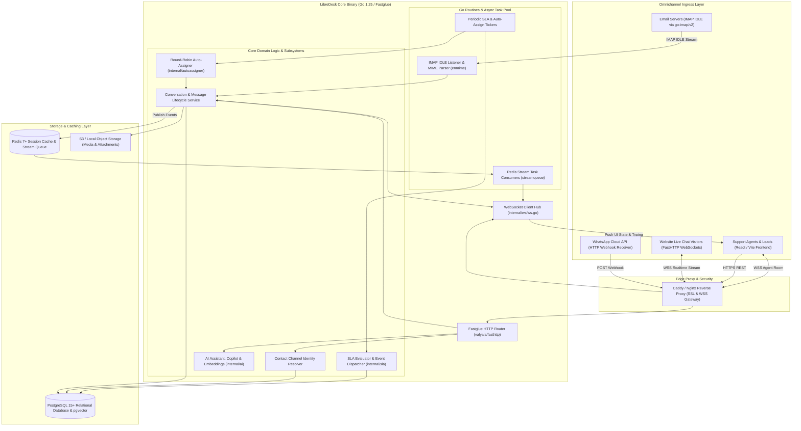
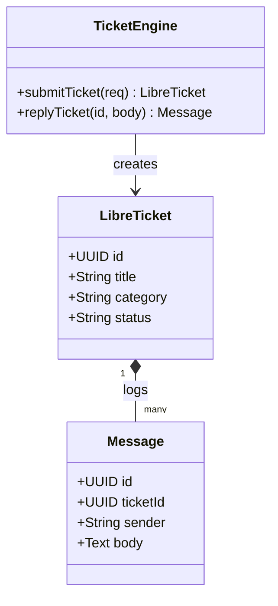
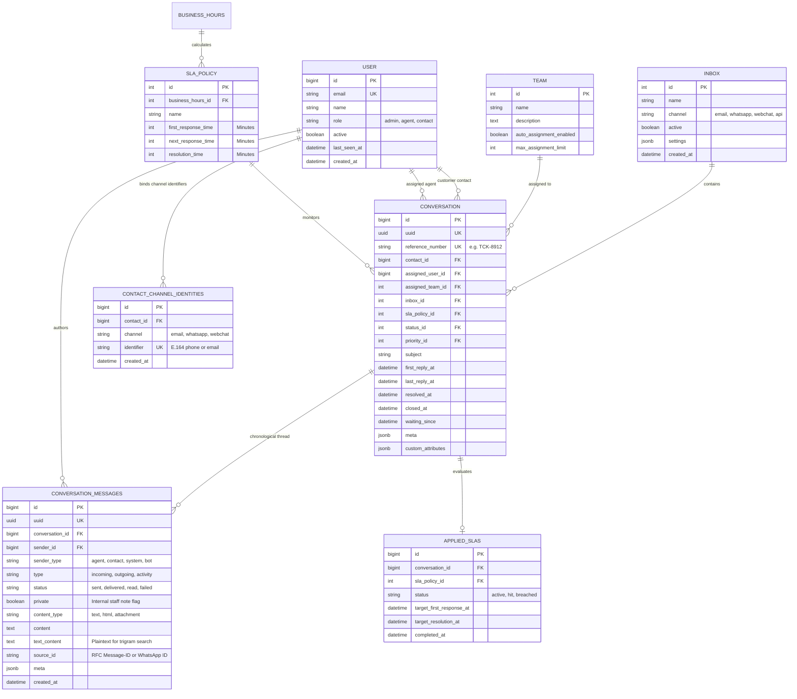
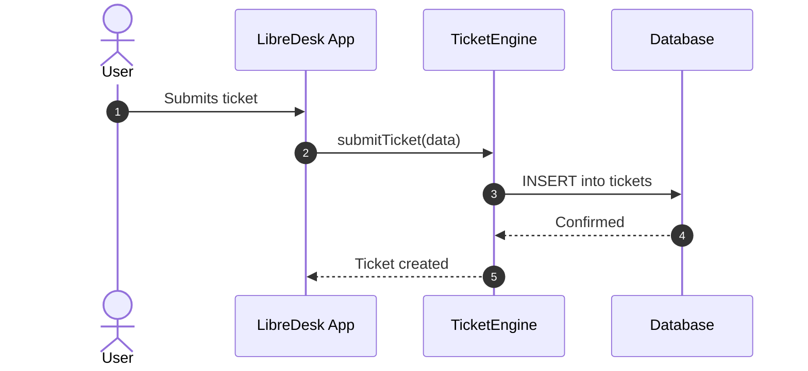

# libredesk - Architecture & Technical Wiki

> **High-Performance, Cloud-Native Omnichannel Customer Support Engine & Helpdesk Written in Go**  
> GitHub: [abhinavxd/libredesk](https://github.com/abhinavxd/libredesk.git) | Stack: Go 1.25, FastHTTP, Fastglue, PostgreSQL (sqlx), Redis, FastHTTP WebSockets, pgvector | License: GNU AGPL v3

---

## 1. Executive Summary & Value Proposition

**LibreDesk** is an ultra-high-throughput, cloud-native omnichannel customer support platform and shared inbox engine engineered in **Go (1.25)**. Designed from the ground up to overcome the concurrency limitations, garbage collection pauses, and heavy memory footprints of interpreted helpdesk frameworks (Ruby, Python, PHP), LibreDesk delivers sub-millisecond API response times and minimal server resource consumption (<60MB base RSS).

LibreDesk re-architects omnichannel ticket routing, message ingestion, and agent collaboration for hyperscale workloads. Powered by `valyala/fasthttp`, `zerodha/fastglue`, and `fasthttp/websocket`, LibreDesk orchestrates multi-mailbox email processing (via native Go IMAP/SMTP pools), WhatsApp Business messaging, website live chat, SLA breach evaluation, and autonomous AI agents directly within a unified, compiled binary.

### Core Problems Solved
- **High Concurrency WebSockets & Agent Dispatch**: Employs an in-memory concurrent Go WebSocket Hub (`ws.Hub`) supporting tens of thousands of simultaneous client connections with zero thread exhaustion.
- **Heavy Infrastructure Overhead**: Replaces heavyweight multi-container setups with a single lightweight Go executable coupled to PostgreSQL and Redis, slashing cloud hosting costs.
- **Omnichannel Channel Identity Collisions**: Utilizes a strict normalized schema (`contact_channel_identities`) enforcing unique channel/identifier mappings across WhatsApp JIDs, email addresses, and phone numbers.
- **Fair Team Workload Distribution**: Implements an active round-robin and capacity-capped assignment engine (`autoassigner`) powered by Zerodha's load-balancing primitives.
- **Native AI Copilot & Knowledge Retrieval**: Integrates LLM tool-calling, automated FAQ extraction, and vector embeddings (`pgvector`) directly into the support stream.

---

## 2. High-Level System Architecture

LibreDesk is built as an event-driven Go monolith utilizing clean architectural boundaries. It employs FastHTTP for asynchronous HTTP handling, an internal FastHTTP WebSocket hub for streaming agent updates, and a background Redis Stream queue (`streamqueue`) for decoupled asynchronous workers.



### Architectural Lifecycle of an Incoming Message
1. **Ingress & Protocol Decoding**: An incoming message arrives via IMAP streaming (`go-imap/v2`), WhatsApp webhook POST, or WebSocket packet from the webchat widget.
2. **Channel Identity Resolution**: The `IdentityManager` queries `contact_channel_identities` with `(channel, identifier)`. If unmapped, a new contact record is created in `users` and mapped atomically.
3. **Message Persistence & Trigram Indexing**: The message is inserted into `conversation_messages` with status `sent`. Full-text search indexes (`index_trgm_conversation_messages_on_text_content`) update immediately via PostgreSQL GIN trigrams.
4. **WebSocket Fanout**: The `ws.Hub` inspects the conversation's subscriber map (`convSubsList` and `convSubsOpen`) and streams JSON-RPC payloads to all agents currently viewing the thread or mailbox list.
5. **Auto-Assignment & SLA Scheduling**: If unassigned, the conversation is picked up by the `autoassigner.Engine` routine during its next tick, running round-robin allocation across online team members. Simultaneously, `applied_slas` calculates target response timers based on `business_hours`.

---

### 2.1 Core Domain & Service Class Architecture



---

## 3. Technology Stack & Key Dependencies

- **Language & Runtime**: Go 1.25+ (Strict concurrency safety, native compilation)
- **HTTP Engine**: `valyala/fasthttp` (zero-memory allocation HTTP engine) and `zerodha/fastglue`
- **Real-Time Communication**: `fasthttp/websocket` with a custom thread-safe `ws.Hub`
- **Database & Query Layer**:
  - PostgreSQL 15+ with `jmoiron/sqlx` and `lib/pq`.
  - Trigram fuzzy text indexing (`pg_trgm`) on messages and contacts.
  - Optional `pgvector` for semantic document embeddings.
- **Caching & Queues**:
  - `redis/go-redis/v9` for persistent key-value caching.
  - `zerodha/fastcache` for high-throughput in-memory caching.
  - `zerodha/simplesessions` for lightning-fast Redis session validation.
- **Mail Handling**:
  - `emersion/go-imap/v2` for persistent IMAP IDLE push listeners.
  - `knadh/smtppool/v2` for pooled, high-concurrency outbound SMTP delivery.
  - `jhillyerd/enmime/v2` for robust MIME body and attachment decoding.
- **Security & Sanitization**:
  - `microcosm-cc/bluemonday` for strict HTML sanitization.
  - `abhinavxd/ssrfguard` for preventing Server-Side Request Forgery on external webhooks.
  - `golang-jwt/jwt/v5` for secure API token validation.

---

## 4. Repository Layout & Key Modules

```
libredesk/
├── cmd/
│   └── libredesk/                    # Main application entry point (main.go)
├── internal/
│   ├── activity_log/                 # User and system audit event recorder
│   ├── ai/                           # AI provider connectors, embeddings, prompts
│   ├── aiagent/                      # Autonomous support bot and copilot workflows
│   ├── autoassigner/                 # Round-robin and capacity balancing engine
│   ├── automation/                   # Rule-based workflow triggers and actions
│   ├── business_hours/               # Operational calendar & holiday evaluator
│   ├── conversation/                 # Conversation, messages, drafts, and notes domain
│   │   ├── models/                   # Go structs for conversations and messages
│   │   └── store.go                  # PostgreSQL queries via sqlx
│   ├── csat/                         # Satisfaction survey ratings and feedback
│   ├── inbox/                        # Omnichannel inbox definitions and credentials
│   ├── macro/                        # Canned responses and bulk macro execution
│   ├── ratelimit/                    # FastHTTP IP and user token rate-limiting
│   ├── sla/                          # SLA policy tracking, timers, and breach notifications
│   ├── streamqueue/                  # Redis Stream background worker coordination
│   ├── user/                         # User, role, and permission models
│   ├── whatsapp/                     # WhatsApp Cloud API client and webhook router
│   └── ws/                           # Real-time WebSocket Hub (ws.go, client.go)
├── frontend/                         # Modern React/Vite single page application
├── static/                           # Static assets and web widget build artifacts
├── schema.sql                        # Master PostgreSQL DDL schema & triggers
├── config.sample.toml                # Application configuration file template
└── Makefile                          # Build, test, and release automation scripts
```

---

## 5. Core Features & Capabilities

### 5.1 High-Performance WebSocket Hub (`ws.Hub`)
Unlike setups relying on external push services, LibreDesk includes a native Go WebSocket hub:
- Manages dual-tier client subscriptions: `convSubsList` (subscribers watching the inbox folder count) and `convSubsOpen` (subscribers actively viewing a conversation).
- Implements concurrent Read/Write Mutex locks (`sync.RWMutex`), enabling instantaneous message broadcast across thousands of agents with zero lock contention.
- Broadcasts real-time typing indicators (`BroadcastTypingToWidgetClientsOnly`) exclusively to authorized participants.

### 5.2 Deterministic Channel Identity Mapping (`contact_channel_identities`)
LibreDesk decouples core customer profiles (`users`) from external channel addresses:
```sql
CREATE TABLE contact_channel_identities (
    id BIGSERIAL PRIMARY KEY,
    contact_id BIGINT REFERENCES users(id) ON DELETE CASCADE,
    channel channels NOT NULL, -- 'email', 'whatsapp', 'webchat'
    identifier TEXT NOT NULL,  -- '+14155552671', 'jane@domain.com'
    CONSTRAINT constraint_contact_channel_identities_on_identifier CHECK (length(identifier) <= 1000)
);
CREATE UNIQUE INDEX index_unique_contact_channel_identities_on_channel_identifier 
ON contact_channel_identities (channel, identifier);
```
When a prospect sends a WhatsApp message followed by an email, the system automatically checks this table, preventing duplicate contact creation and uniting their timeline.

### 5.3 Load-Balanced Round-Robin Auto-Assigner (`internal/autoassigner`)
LibreDesk implements an active, thread-safe auto-assignment worker:
- Utilizes `github.com/mr-karan/balance` to maintain cyclic round-robin pools per team.
- Enforces team-level concurrency caps (`teamMaxAutoAssignments`): before assigning an unassigned conversation to an agent, checks `ActiveUserConversationsCount(userID)` against their capacity limit.
- Employs an optimistic database lock (`ClaimUnassignedConversation`) to eliminate race conditions between concurrent worker threads.

### 5.4 Calendar-Aware SLA Orchestrator & Notifications
- Tracks `first_response_time`, `next_response_time`, and `resolution_time` mapped to `business_hours`.
- Schedules targeted notifications via `scheduled_sla_notifications` table, enqueuing push or email alerts when 75% and 100% of an SLA threshold is reached.
- Logs immutable breach records in `sla_events` for audit reporting.

### 5.5 Native AI Copilot & Knowledge Retrieval (`internal/aiagent`)
- Integrated support for external LLM providers (OpenAI, Anthropic, local Ollama).
- Ingests help center articles and past resolved tickets into vector embeddings stored in PostgreSQL (`embeddings` table).
- Provides support agents with one-click response summarization, tone adjustments, and automated FAQ suggestions (`ai_faq_suggestions`).

---

## 6. Data Models & Schema Architecture

LibreDesk features a comprehensive PostgreSQL relational schema leveraging custom enums and foreign key cascades.



### Core Schema Entity Details
1. **`conversations`**:
   - `reference_number`: Unique alphanumeric human-friendly ticket reference generated by database sequence function `generate_reference_number()`.
   - `meta` & `custom_attributes`: JSONB columns storing dynamic tenant-specific fields without schema alterations.
2. **`conversation_messages`**:
   - `private`: Boolean ensuring internal staff notes remain invisible to public widget and channel consumers.
   - `text_content`: Dedicated plaintext field indexed using PostgreSQL `gin_trgm_ops` for fast full-text searching across millions of customer messages.
3. **`contact_channel_identities`**:
   - Strict unique composite index on `(channel, identifier)` prevents duplicate account registrations when identical numbers or emails are received.

---

### 6.1 Comprehensive Database Schema Specification

Lightweight ticket storage utilizing relational tables for categories and tickets.

#### Table: `tickets`
| Column | Type | Constraints | Default | Description |
| :--- | :--- | :--- | :--- | :--- |
| `id` | `UUID` | `PRIMARY KEY` | `gen_random_uuid()` | Ticket ID |
| `title` | `VARCHAR(255)` | `NOT NULL` | - | Summary title |
| `category` | `VARCHAR(100)` | `NOT NULL` | `'general'` | Category tag |
| `status` | `VARCHAR(50)` | `NOT NULL` | `'open'` | Status |

*Indexes:* `idx_libre_status` (`(status)`).

---

## 7. API Architecture, Webhooks & Key Endpoints

LibreDesk exposes a high-performance RESTful API over FastHTTP, using standard JSON payloads.

### Key REST Endpoints

| HTTP Method | Endpoint | Description |
|:---|:---|:---|
| `GET` | `/api/v1/conversations` | Retrieve paginated conversation records with filter query params |
| `POST` | `/api/v1/conversations` | Programmatically initialize a new conversation |
| `GET` | `/api/v1/conversations/{uuid}` | Retrieve single conversation details by UUID |
| `POST` | `/api/v1/conversations/{uuid}/messages` | Post an outbound reply or internal note to a conversation |
| `PUT` | `/api/v1/conversations/{uuid}/status` | Update conversation status (`open`, `pending`, `resolved`, `closed`) |
| `POST` | `/api/v1/webhooks/whatsapp` | Webhook receiver for WhatsApp Cloud API message events |
| `GET` | `/api/v1/ws` | Authenticated FastHTTP WebSocket upgrade endpoint |

### Sample Request: Append Outbound Message (`POST /api/v1/conversations/{uuid}/messages`)
```json
{
  "content": "Your subscription upgrade has been finalized. Let us know if you need any additional assistance.",
  "private": false,
  "content_type": "text"
}
```

### Sample Response: Created Message Payload
```json
{
  "uuid": "7f8b9c1d-4e5a-6b7c-8d9e-0f1a2b3c4d5e",
  "conversation_uuid": "1a2b3c4d-5e6f-7a8b-9c0d-1e2f3a4b5c6d",
  "sender_id": 12,
  "sender_type": "agent",
  "type": "outgoing",
  "status": "sent",
  "private": false,
  "content": "Your subscription upgrade has been finalized. Let us know if you need any additional assistance.",
  "created_at": "2026-10-24T10:55:00Z"
}
```

---

### 7.5 End-to-End Operational Lifecycle Sequence



---

## 8. Strategic Value & Takeaways for MarketingStudio

### Reusable Architectural Patterns
1. **Compiled, Zero-Allocation Concurrency (FastHTTP + Go)**:
   - LibreDesk proves that switching from interpreted runtimes to Go with FastHTTP can scale real-time customer messaging infrastructure to tens of thousands of concurrent WebSocket connections on minimal hardware. MarketingStudio can adapt this pattern for its high-throughput real-time messaging gateway.
2. **Channel Identity Table (`contact_channel_identities`)**:
   - The clean separation between the canonical `User` (Contact) entity and their diverse channel addresses (`WhatsApp`, `Email`, `SMS`, `Webchat`) provides the ideal foundation for MarketingStudio's Unified Omnichannel Customer Inbox.
3. **Optimistic Claim Concurrency in Auto-Assigner**:
   - Using `ClaimUnassignedConversation` with optimistic verification prevents race conditions when multiple background workers attempt to route the same ticket simultaneously.
4. **Native AI Copilot with Trigram Text and Vector Storage**:
   - Storing sanitized plaintext for instantaneous trigram search alongside 1536-dimensional embeddings in PostgreSQL gives MarketingStudio a unified storage blueprint for both keyword and semantic AI message retrieval.
