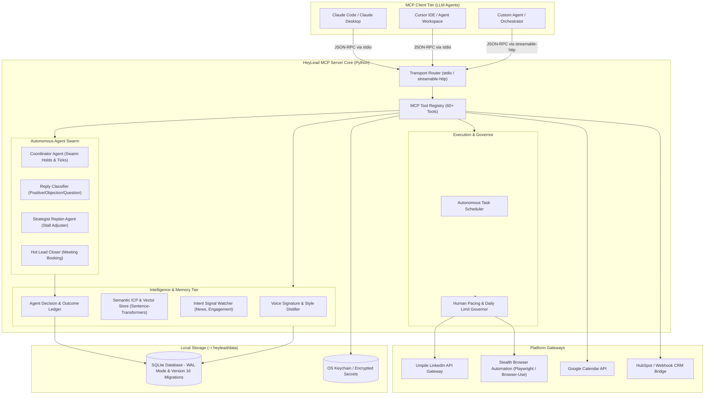
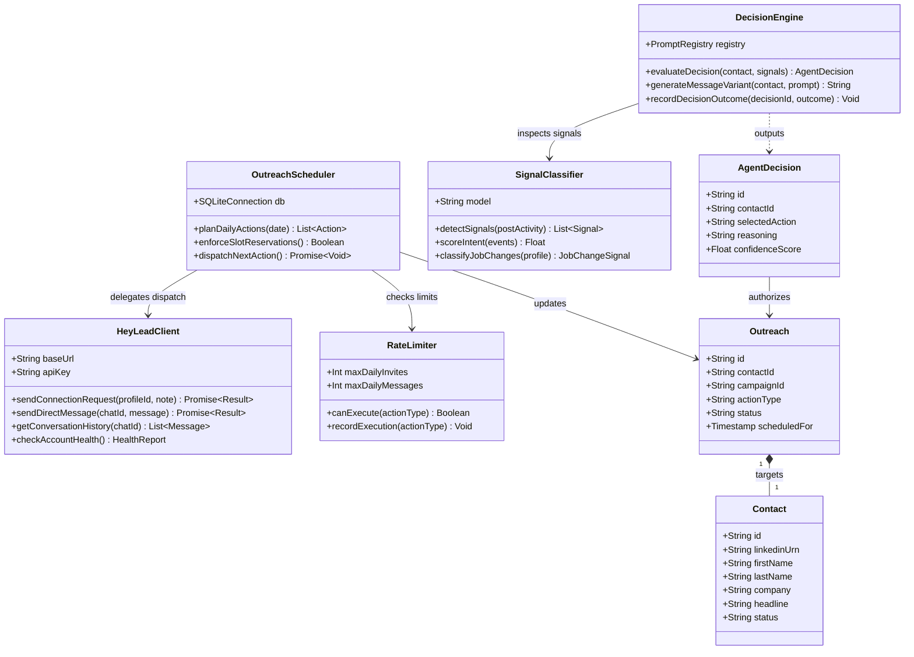
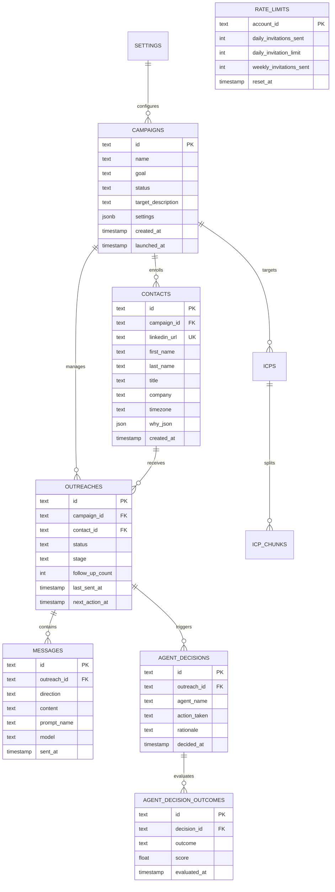
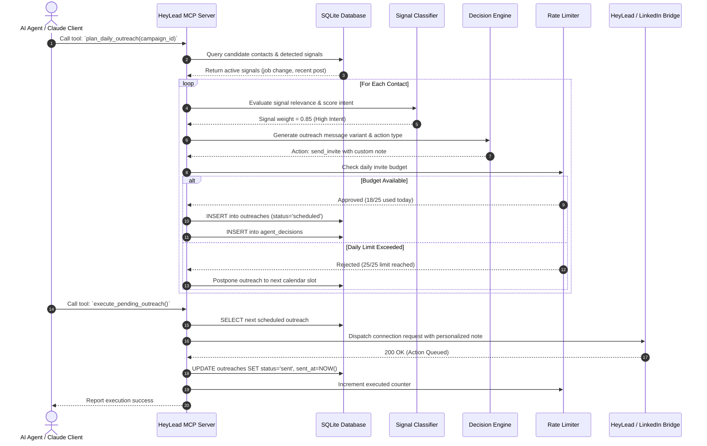

# linkedin-outreach-mcp - Architecture & Technical Wiki

> **Autonomous AI-Powered LinkedIn SDR & Social Selling Engine via Model Context Protocol (MCP)**  
> GitHub: [D4umak/linkedin-outreach-mcp](https://github.com/D4umak/linkedin-outreach-mcp) | Stack: Python 3.10+, MCP SDK 1.30+, SQLite (WAL), Unipile, Playwright, Sentence-Transformers | License: MIT

---

## 1. Executive Summary & Value Proposition

**linkedin-outreach-mcp** (packaged as `heylead`) is an enterprise-grade Model Context Protocol (MCP) server that empowers Large Language Models (Claude Code, Cursor, Gemini, OpenAI) to act as fully autonomous LinkedIn Sales Development Representatives (SDRs). Rather than presenting a rigid web UI or simple script, HeyLead exposes over 60 high-level MCP tools allowing AI agents to perform end-to-end social selling: generating buyer personas (ICPs), discovering and enriching prospects, crafting personalized connection requests in the user's authentic tone of voice, executing multi-touch nurture cadences, detecting intent signals, and autonomously negotiating meeting bookings.

Operating either via local `stdio` or remote `streamable-http`, the engine manages human-like pacing, rate-limit backoffs, session preservation, and multi-agent coordination.

### Core Problems Solved
- **Standardized AI-Native Tool Interface**: Eliminates custom API boilerplate by implementing the open Anthropic Model Context Protocol (MCP), enabling any LLM client to execute LinkedIn sales operations via typed tool calls.
- **Account Ban Prevention via Humanized Pacing**: Enforces strict daily limits (e.g. maximum 20 invitations/day on free tiers, 100/week), randomized inter-action jitter, and timezone-aware business hours (08:00 - 22:00 prospect time).
- **Tone-of-Voice Cloning**: Analyzes the operator's historical LinkedIn posts and published content to distill a personal writing style signature, avoiding generic AI-generated sales copy.
- **Signal-Led Outbound Triggering**: Monitors corporate job transitions, funding rounds, post comments, and profile visits to trigger context-aware outreach when prospect buying intent is highest.
- **Autonomous Multi-Agent Coordination**: Features specialized in-process agents (Reply Classifier, Strategist Replan Agent, Hot Lead Closer, and Coordinator) that record decision rationale in an auditable journal.

---

## 2. High-Level System Architecture

HeyLead can run as a local client-side tool via Standard I/O (`stdio`) or as a networked service via `streamable-http`. It manages persistent state through an embedded SQLite database configured with Write-Ahead Logging (WAL) and cross-process retry logic.



---

### 2.1 Core Domain & Service Class Architecture



---

## 3. Technology Stack & Key Dependencies

- **Language & Runtime**: Python >= 3.10 (tested up to Python 3.13)
- **Protocol Standard**: Model Context Protocol (`mcp>=1.30.0,<2.0.0`)
- **Transport Modes**: `stdio` (standard Unix pipe for CLI/desktop agents) and `streamable-http` (streaming HTTP server)
- **Database & Concurrency**: Embedded SQLite 3 with WAL (`PRAGMA journal_mode=WAL`), schema versioning (`PRAGMA user_version = 16`), and 12-stage exponential retry backoff with random jitter to prevent concurrency deadlocks
- **Security & Secret Storage**: `keyring>=24.0.0` (stores LLM keys and LinkedIn credentials in macOS Keychain, Windows Credential Vault, or Linux Secret Service) and `cryptography>=50.0.0`
- **Networking & CLI**: `httpx>=0.24.0`, `click>=8.3.3`, `tzdata>=2024.1` for IANA timezone windows
- **Optional ML & Crawling Modules**:
  - `sentence-transformers>=5.6.0` & `numpy`: Semantic vector search and RAG buyer persona chunking
  - `firecrawl-py`: Deep scraping of corporate websites for automatic ICP synthesis
  - `playwright>=1.40.0` & `browser-use>=0.12.0`: Stealth browser execution fallback

---

## 4. Repository Layout & Key Modules

```
linkedin-outreach-mcp/
├── .claude-plugin/                  # Claude plugin registration manifests
├── plugins/                         # Plugin metadata and capability descriptors
├── skills/                          # Reusable skill definitions
├── src/
│   └── heylead/                     # Primary Python package
│       ├── ai/                      # Tone analysis, persona generation, copy synthesizers
│       ├── cli/                     # CLI entry points (heylead, heylead-logs)
│       ├── collectors/              # Signal collectors (post engagement, profile tracking)
│       ├── db/                      # Persistence layer
│       │   ├── schema.py            # SQLite table definitions, indexes, schema migrations
│       │   ├── queries.py           # Core SQL query functions
│       │   └── agent_decisions_schema.py # Decision ledger and outcome tracking schema
│       ├── linkedin/                # Unipile API client, session manager, rate limits
│       ├── prompts/                 # System prompt templates and outreach playbooks
│       ├── scheduler/               # Autonomous task dispatchers and tick handlers
│       ├── services/                # Google Calendar, CRM sync, and external integrations
│       └── tools/                   # 60+ MCP Tool Implementations
│           ├── setup_profile.py     # Account setup and tone extraction
│           ├── generate_icp.py      # Buyer persona generator
│           ├── create_campaign.py   # Campaign creation and targeting builder
│           ├── campaign.py          # Lifecycle (launch, pause, resume, emergency_stop)
│           ├── generate_send.py     # Cold outreach and invite dispatch
│           ├── check_replies.py     # Inbound message parsing and sentiment classifier
│           ├── book_meeting.py      # Calendar scheduling
│           ├── signals.py           # Intent monitoring and watchlist manager
│           └── inspect.py           # Read-only audit digest of swarm actions
├── pyproject.toml                   # Build configuration and dependency pins
├── README.md                        # Documentation and MCP setup guide
└── server.json                      # MCP server catalog metadata
```

---

## 5. Core Features & Capabilities

### 5.1 Six Distinct Campaign Objectives & Playbooks
HeyLead tailors ICP criteria, qualification rules, and outreach styles across six strategic objectives:
1. **Sell a Product or Service**: Focuses on value propositions, enterprise pain points, and buyer authority.
2. **Find a Job**: Targets hiring managers and department leaders with tailored credential showcases.
3. **Hire People**: Source candidates against role specifications with personalized recruitment pitches.
4. **Find Partners or Investors**: Connects with strategic partners, angels, and VC leads.
5. **Find a Vendor**: Positions the user as a commercial buyer seeking service quotes.
6. **Research Interviews**: Recruits domain experts for user research, surveys, or product testing.

### 5.2 Voice Signature Analysis & Tone Matching
During initial configuration via `setup_profile()`, HeyLead scrapes the user's recent LinkedIn posts and articles. An LLM analyzer computes a multi-dimensional voice signature:
- Sentence length distribution, formality score, vocabulary preferences, and characteristic sign-offs.
- Injected as style guardrails in `generate_send` to ensure cold connection notes and follow-ups sound authentic.

### 5.3 Intent-Driven Warm Outreach & Watchlists
Rather than blasting cold lists, HeyLead monitors buying signals via `signals` and `manage_watchlist`:
- **Content Engagement**: Flags prospects who like or comment on specific industry posts or competitor announcements.
- **Profile Signals**: Detects title changes, company funding milestones, and open job requisitions.
- Translates detected signals into contextual openers (e.g., *"Noticed your recent post regarding Kubernetes migration..."*).

### 5.4 Autonomous Reply Handling & Intent Classification
The `check_replies` tool runs continuously to inspect inbound messages:
- Classifies sentiment into `positive`, `question`, `objection`, or `not_interested`.
- Hot leads (`positive`) can automatically trigger `book_meeting` to negotiate available calendar slots and dispatch Google Calendar invites.
- Negative or opt-out replies automatically apply `outreach_tombstones` to suppress future outreach.

### 5.5 Multi-Agent Swarm with Auditable Decision Journal
HeyLead implements four specialized agents:
- **Reply Agent**: Handles conversational nuances and drafts contextual replies.
- **Strategist Replan Agent**: Detects stalled campaigns and adjusts targeting angles or messaging cadences.
- **Hot Lead Closer**: Drives conversations toward calendar conversions.
- **Coordinator Agent**: Manages pacing and prevents multi-agent race conditions.
All agent choices are logged in `agent_decisions` and `agent_decision_outcomes` to support reinforcement analysis.

---

## 6. Data Models & Schema Architecture

HeyLead utilizes a relational SQLite schema (version 16) with strict unique constraints and foreign keys.



### Core Schema Definitions
- **`campaigns`**: Stores campaign objectives (`goal`), execution status (`draft`, `active`, `paused`, `completed`), targeting criteria, and autonomous agent flags (`enable_reply_agent`, `enable_coordinator_agent`).
- **`contacts`**: Enrolled prospects with extracted LinkedIn attributes, localized `timezone` for send scheduling, and `why_json` storing the exact qualification rationale.
- **`outreaches`**: State machine per prospect. Tracks sequence stages (`invited`, `connected`, `followup_1`, `replied`, `meeting_booked`, `closed_won`, `closed_lost`).
- **`messages`**: Log of all sent and received communications, recording the `direction` (`outbound`/`inbound`), generative `model`, prompt variant, and provider timestamp.
- **`agent_decisions` & `agent_decision_outcomes`**: Machine-readable ledger tracking autonomous choices made by the agent swarm, facilitating safety inspection via `inspect(action='journal')`.
- **`rate_limits`**: Enforces strict daily and weekly invitation/message budgets per connected LinkedIn account.

---

### 6.1 Comprehensive Database Schema Specification

The storage layer is built on SQLite with PRAGMA versioning (version 16) and transactional retry backoffs handling concurrent access across MCP tool calls.

#### Table: `contacts`
Stores LinkedIn prospect profiles enriched with targeting signals and fit evaluations.

| Column | Type | Constraints | Default | Description |
| :--- | :--- | :--- | :--- | :--- |
| `id` | `TEXT` | `PRIMARY KEY` | `uuid4` | Unique internal contact record ID |
| `linkedin_urn` | `TEXT` | `NOT NULL, UNIQUE` | - | Unique LinkedIn Member URN |
| `first_name` | `TEXT` | `NOT NULL` | `''` | Prospect given name |
| `last_name` | `TEXT` | `NOT NULL` | `''` | Prospect family name |
| `headline` | `TEXT` | `NULLABLE` | `NULL` | Public headline / current professional summary |
| `company` | `TEXT` | `NULLABLE` | `NULL` | Current employer name |
| `profile_json` | `TEXT` | `NULLABLE` | `NULL` | Raw JSON dump from profile scraper |
| `why_json` | `TEXT` | `NULLABLE` | `NULL` | AI scoring rationale explaining ICP alignment |
| `status` | `TEXT` | `NOT NULL` | `'new'` | Lifecycle state (`new`, `connecting`, `connected`, `messaged`) |
| `created_at` | `INTEGER` | `NOT NULL` | `unixepoch` | Record creation timestamp |

*Indexes:* `idx_contacts_urn` (`UNIQUE (linkedin_urn)`), `idx_contacts_status` (`(status)`).

---

#### Table: `outreaches`
Execution ledger for queued, active, and completed LinkedIn outreach actions.

| Column | Type | Constraints | Default | Description |
| :--- | :--- | :--- | :--- | :--- |
| `id` | `TEXT` | `PRIMARY KEY` | `uuid4` | Outreach interaction identifier |
| `contact_id` | `TEXT` | `NOT NULL, FK -> contacts(id)` | - | Recipient contact reference |
| `campaign_id` | `TEXT` | `NOT NULL` | - | Associated outreach campaign |
| `chat_id` | `TEXT` | `NULLABLE` | `NULL` | LinkedIn conversation thread ID |
| `decision_id` | `TEXT` | `NULLABLE` | `NULL` | AI decision record authorizing this step |
| `action_type` | `TEXT` | `NOT NULL` | `'invite'` | Action (`invite`, `message`, `inmail`, `view_profile`) |
| `status` | `TEXT` | `NOT NULL` | `'scheduled'` | Execution status (`scheduled`, `sent`, `failed`, `replied`) |
| `scheduled_for` | `INTEGER` | `NOT NULL` | - | Unix timestamp for scheduled dispatch |
| `sent_at` | `INTEGER` | `NULLABLE` | `NULL` | Unix timestamp of completed execution |

*Indexes:* `idx_outreaches_contact` (`(contact_id)`), `idx_outreaches_sched` (`(status, scheduled_for)`).

---

#### Table: `signals`
Stores real-time buying signals detected from prospect LinkedIn behavior.

| Column | Type | Constraints | Default | Description |
| :--- | :--- | :--- | :--- | :--- |
| `id` | `TEXT` | `PRIMARY KEY` | `uuid4` | Signal event identifier |
| `contact_id` | `TEXT` | `NOT NULL, FK -> contacts(id)` | - | Contact triggering the signal |
| `signal_type` | `TEXT` | `NOT NULL` | - | Type (`job_change`, `post_engagement`, `company_funding`) |
| `source_url` | `TEXT` | `NULLABLE` | `NULL` | Originating post or announcement URL |
| `score` | `REAL` | `NOT NULL` | `1.0` | Algorithmic signal strength weight |
| `detected_at` | `INTEGER` | `NOT NULL` | `unixepoch` | Detection timestamp |
| `status` | `TEXT` | `NOT NULL` | `'new'` | Processing status (`new`, `processed`, `ignored`) |

*Indexes:* `idx_signals_status_detected` (`(status, detected_at)`).

---

## 7. API Architecture, Webhooks & Key Endpoints

HeyLead communicates primarily via standard JSON-RPC 2.0 frames conforming to the Model Context Protocol (MCP).

### 7.1 Key MCP Tools & Parameter Schemas

#### `create_campaign`
Initializes a new outreach campaign in draft state:
```json
// JSON-RPC Request (tools/call)
{
  "method": "tools/call",
  "params": {
    "name": "create_campaign",
    "arguments": {
      "name": "Fintech Seed Founders Outreach",
      "goal": "sell_product",
      "target_description": "Founders and CTOs of Series Seed/A Fintech startups in the US and UK",
      "booking_link": "https://cal.com/alex/15min"
    }
  }
}
```

```json
// Tool Result
{
  "content": [
    {
      "type": "text",
      "text": "Campaign 'Fintech Seed Founders Outreach' created as draft (ID: cmp_91a03f).\n- Target: Series Seed/A Fintech Founders (US/UK)\n- Daily Pacing: 15-20 invites/day\n- Mode: Observe (Agents will propose actions without sending until launched)"
    }
  ]
}
```

#### `generate_and_send`
Autonomously drafts and dispatches the opening outreach message:
```json
// JSON-RPC Request
{
  "method": "tools/call",
  "params": {
    "name": "generate_and_send",
    "arguments": {
      "campaign_id": "cmp_91a03f",
      "outreach_id": "out_7721ab"
    }
  }
}
```

#### `check_replies`
Surfaces inbound conversations requiring response or meeting booking:
```json
// JSON-RPC Response Payload
{
  "replies_checked": 12,
  "new_messages": 2,
  "hot_leads": [
    {
      "contact_name": "Sarah Jenkins",
      "company": "PayFlow Technologies",
      "sentiment": "positive",
      "message": "Thanks for reaching out Alex. Yes, we are actually looking to upgrade our compliance stack this quarter. Do you have time Thursday at 2pm?",
      "recommended_action": "book_meeting"
    }
  ]
}
```

---

### 7.5 End-to-End Operational Lifecycle Sequence

The following sequence details how the MCP client invokes LinkedIn outreach tools, evaluates intent signals, runs AI decision reasoning, and controls rate limits.



---

## 8. Strategic Value & Takeaways for MarketingStudio

### Reusable Architectural Patterns
1. **Exposing Complex Sales Workflows as MCP Tools**:
   By packaging deep LinkedIn operations (prospecting, connection requests, messaging, calendar scheduling) as discrete MCP tools, MarketingStudio can allow AI agents in Claude, Cursor, or internal web dashboards to orchestrate multi-step outbound plays through natural language commands.
2. **Decision Ledger for Autonomous Agent Accountability**:
   The dual-table design (`agent_decisions` and `agent_decision_outcomes`) provides an essential blueprint for MarketingStudio's AI SDR governance. Storing *why* an agent decided to send a specific follow-up or skip a prospect allows operators to audit and debug automated actions easily.
3. **Voice Signature Distillation via Social Post Analysis**:
   MarketingStudio can implement HeyLead's style extractor to analyze a client company's executives' LinkedIn posts and generate personalized prompt system guardrails, ensuring outbound messaging sounds authentic to individual founders.
4. **Signal-Led Triggering Architecture**:
   Integrating post engagement monitoring and job change detection directly into outbound cadences transforms cold outbound into high-converting warm touchpoints.
