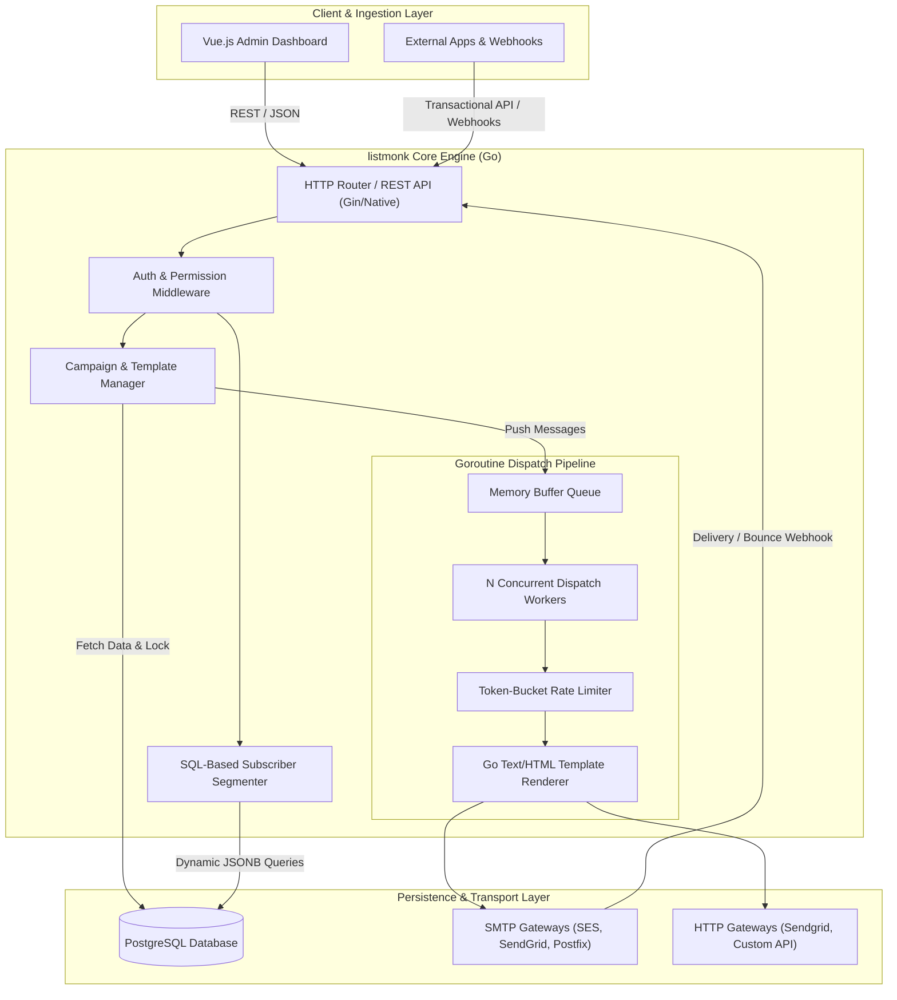
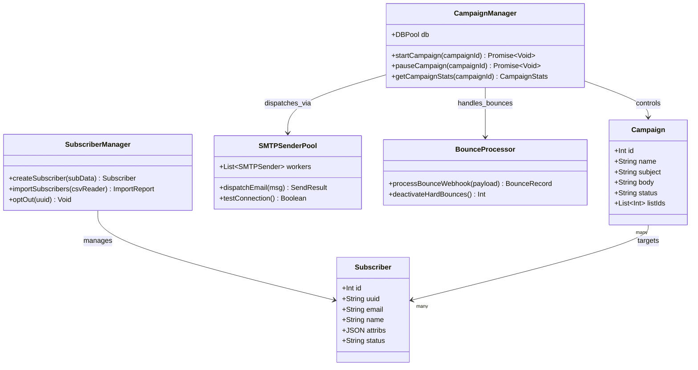
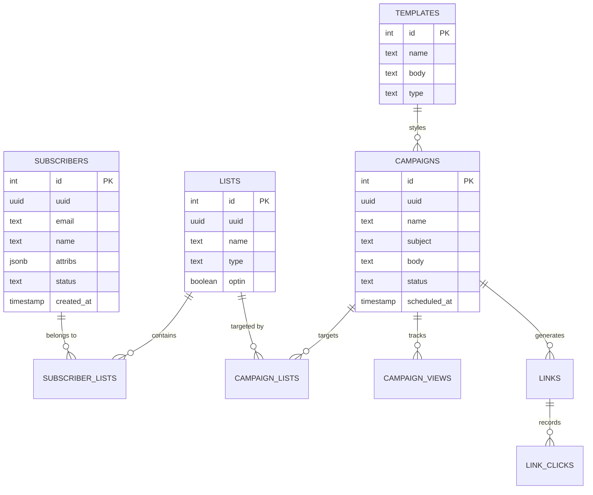
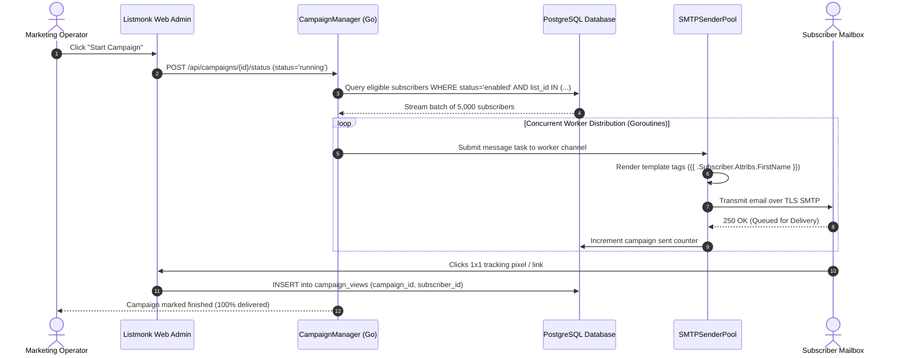

# listmonk - Architecture & Technical Wiki

> **High-Performance Self-Hosted Newsletter & Mailing List Manager**
> GitHub: [knadh/listmonk](https://github.com/knadh/listmonk.git) | Stack: Go, PostgreSQL, Vue.js | License: AGPL-3.0

---

## 1. Executive Summary & Value Proposition

**listmonk** is an ultra-fast, lightweight, standalone newsletter and mailing list manager written in Go with a PostgreSQL backend. Unlike resource-heavy PHP/Ruby mail marketing platforms, listmonk is capable of dispatching thousands of personalized emails per second on minimal CPU and RAM (often less than 50MB of memory under heavy load).

### Core Problems Solved
- **High-throughput bulk dispatch**: Handles multi-million subscriber distributions using multi-threaded goroutine workers without choking.
- **Complex subscriber segmentation**: Arbitrary JSON/JSONB attributes per subscriber with rich PostgreSQL indexing and native query filtering.
- **Transactional and Campaign Unification**: Manages traditional scheduled newsletter campaigns and instant transactional message routing via a unified HTTP API.
- **Privacy & GDPR Compliance**: Full unsubscribe tokens, subscriber data export, bounce categorization, and blocklist enforcement.

---

## 2. High-Level System Architecture

listmonk follows a clean modular Go architecture with an embedded HTTP server, an asynchronous goroutine worker pool for mail delivery, and direct PostgreSQL interaction via raw, optimized SQL queries using `pgx` and `sqlx`.



---

### 2.1 Core Domain & Service Class Architecture



---

## 3. Technology Stack & Key Dependencies

- **Runtime & Language**: Go 1.20+
- **Database**: PostgreSQL 13+ (heavily uses JSONB, GIN indexes, CTEs, and full-text search)
- **Frontend Dashboard**: Vue 3 with Vite, TailwindCSS
- **Key Go Libraries**:
  - `github.com/jackc/pgx`: High-performance PostgreSQL driver and connection pooling
  - `github.com/jmoiron/sqlx`: Ergonomic extensions for SQL queries
  - `github.com/knadh/koanf`: Configuration management (TOML, ENV, CLI flags)
  - `gopkg.in/gomail.v2` / native net/smtp: SMTP transport with TLS and connection pooling
- **Deployment**: Single statically compiled binary + standalone Docker image (< 30MB)

---

## 4. Repository Layout & Key Modules

```
listmonk/
├── cmd/
│   ├── init.go              # Database schema initialization & migrations
│   └── main.go              # Core server entrypoint and CLI flag parser
├── config.toml.sample       # Default configuration schema (DB, SMTP, Auth)
├── dev/                     # Docker dev environment scripts
├── docker-compose.yml       # Standard self-hosted compose file
├── frontend/                # Vue 3 administrative frontend source
│   ├── src/
│   │   ├── components/      # UI components (tables, editors, modals)
│   │   ├── views/           # Campaigns, Subscribers, Lists, Templates
│   │   └── api/             # Frontend API client
├── i18n/                    # Multi-language translation bundles
├── internal/
│   ├── bounce/              # POP3 / IMAP / Webhook bounce processors
│   ├── manager/             # Campaign state machine & worker runner
│   ├── messenger/           # SMTP & HTTP provider connectors
│   └── models/              # Go structs for DB entities
└── schema.sql               # Canonical PostgreSQL database schema
```

---

## 5. Core Features & Capabilities

1. **Campaign Management**:
   - Rich WYSIWYG, Markdown, and raw HTML editors.
   - Dynamic tag substitution (`{{ .Subscriber.Attributes.first_name }}`).
   - Multi-list target selection with exclusions.
2. **Subscriber Management**:
   - Opt-in flows (Single & Double Opt-in).
   - Dynamic attributes stored as PostgreSQL `jsonb` allowing arbitrary query expressions (e.g. `attributes->>'plan' = 'enterprise'`).
3. **High-Speed Transactional API**:
   - Single-call transactional endpoint `/api/tx` for password resets, order confirmations, and notifications using pre-compiled templates.
4. **Bounce & Feedback Loop Processing**:
   - Automated bounce mail parsing via IMAP/POP3 polling or HTTP webhooks from SendGrid, SES, and Mailgun.
   - Hard bounce vs. soft bounce scoring with automatic subscriber deactivation.

---

## 6. Data Models & Schema Architecture

listmonk's data model in `schema.sql` is relational and tuned for PostgreSQL performance:



---

### 6.1 Comprehensive Database Schema Specification

Listmonk runs on PostgreSQL utilizing JSONB attributes, raw SQL concurrency primitives, and unlogged analytics tables for high throughput.

#### Table: `campaigns`
Email marketing newsletters and sequence campaigns.

| Column | Type | Constraints | Default | Description |
| :--- | :--- | :--- | :--- | :--- |
| `id` | `SERIAL` | `PRIMARY KEY` | - | Unique campaign ID |
| `name` | `VARCHAR(255)` | `NOT NULL` | - | Administrative title |
| `subject` | `VARCHAR(255)` | `NOT NULL` | - | Email subject line |
| `body` | `TEXT` | `NOT NULL` | - | HTML/Markdown email content |
| `status` | `VARCHAR(50)` | `NOT NULL` | `'draft'` | State (`draft`, `scheduled`, `running`, `paused`, `finished`) |
| `sent` | `INTEGER` | `NOT NULL` | `0` | Total dispatched emails counter |
| `to_send` | `INTEGER` | `NOT NULL` | `0` | Target audience recipient count |
| `created_at` | `TIMESTAMPTZ` | `NOT NULL` | `NOW()` | Creation timestamp |

*Indexes:* `idx_campaigns_status` (`(status)`).

---

#### Table: `subscribers`
Recipient audience directory with extensible custom JSON attributes.

| Column | Type | Constraints | Default | Description |
| :--- | :--- | :--- | :--- | :--- |
| `id` | `SERIAL` | `PRIMARY KEY` | - | Subscriber ID |
| `uuid` | `UUID` | `NOT NULL, UNIQUE` | `gen_random_uuid()` | Public tracking token |
| `email` | `VARCHAR(255)` | `NOT NULL, UNIQUE` | - | Subscriber email address |
| `name` | `VARCHAR(255)` | `NOT NULL` | `''` | Full name |
| `attribs` | `JSONB` | `NOT NULL` | `'{}'` | Custom segmentation variables |
| `status` | `VARCHAR(50)` | `NOT NULL` | `'enabled'` | Subscription state (`enabled`, `unsubscribed`, `blocklisted`) |
| `created_at` | `TIMESTAMPTZ` | `NOT NULL` | `NOW()` | Registration timestamp |

*Indexes:* `idx_subscribers_email` (`UNIQUE (email)`), `idx_subscribers_attribs` (`USING gin (attribs)`).

---

## 7. API Architecture & Key Endpoints

listmonk exposes an authenticated JSON REST API protected by HTTP Basic Auth or API Tokens:

- `GET /api/subscribers`: Paginated subscriber search with SQL-like query filtering.
- `POST /api/subscribers`: Insert or upsert subscriber records with custom JSON attributes.
- `GET /api/lists`: List management and opt-in settings.
- `POST /api/campaigns`: Create, update, or preview campaigns.
- `PUT /api/campaigns/:id/status`: Transition campaign states (`scheduled`, `running`, `paused`, `cancelled`).
- `POST /api/tx`: Send transactional emails with custom template payload.

---


### 7.5 End-to-End Operational Lifecycle Sequence

The following sequence illustrates Listmonk's multi-threaded Go worker pipeline querying subscribers, rendering Go HTML templates, and distributing via SMTP.



---

## 8. Configuration & Deployment

Deployment is driven by Docker Compose:
- **Environment Variables**:
  - `LISTMONK_db__host`: PostgreSQL host
  - `LISTMONK_db__port`: 5432
  - `LISTMONK_db__user` / `LISTMONK_db__password` / `LISTMONK_db__database`: Credentials
  - `LISTMONK_app__address`: `0.0.0.0:9000`
- **Initial Setup**: Run `listmonk --install` to execute `schema.sql` and create the default admin account.

---

## 9. Strategic Value & Takeaways for MarketingStudio

### Reusable Architectural Patterns
1. **Goroutine Worker Pool Pattern**: Emulate listmonk's token-bucket rate limiter and buffered goroutines for MarketingStudio's bulk email and webhook dispatchers.
2. **PostgreSQL JSONB Dynamic Attributes**: Rather than migrating columns when users want custom lead traits, adopt listmonk's JSONB schema pattern with GIN indexing for fast filtering.
3. **Unified Transactional + Campaign Pipeline**: Combine broadcast campaigns and 1-to-1 system notifications through a shared template engine.
