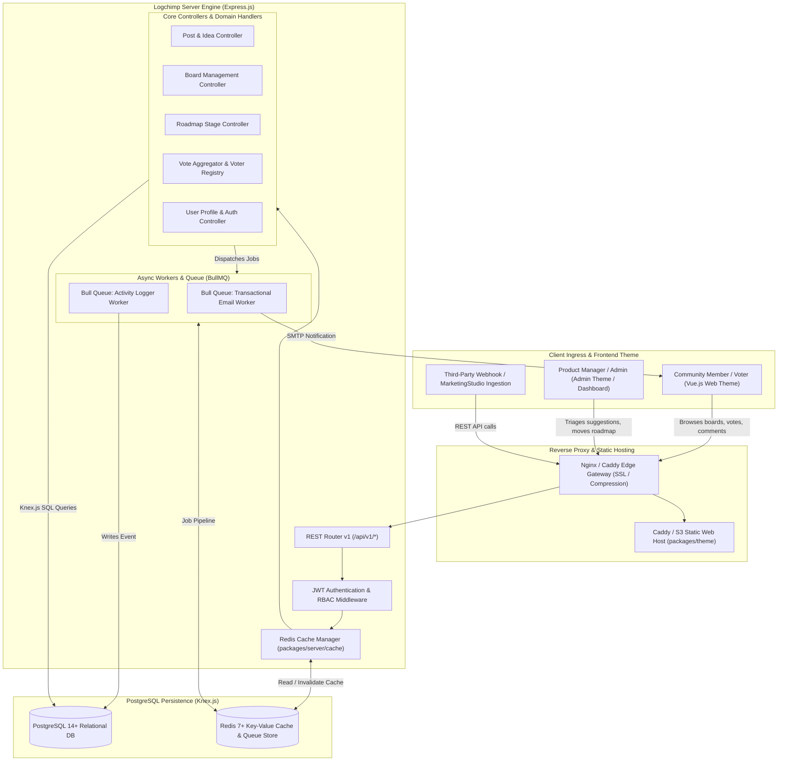
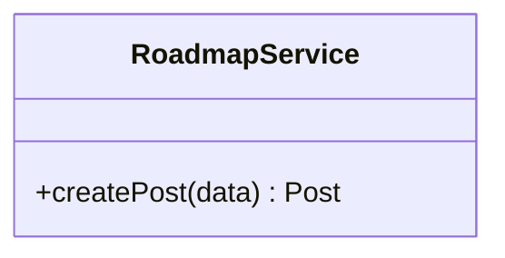
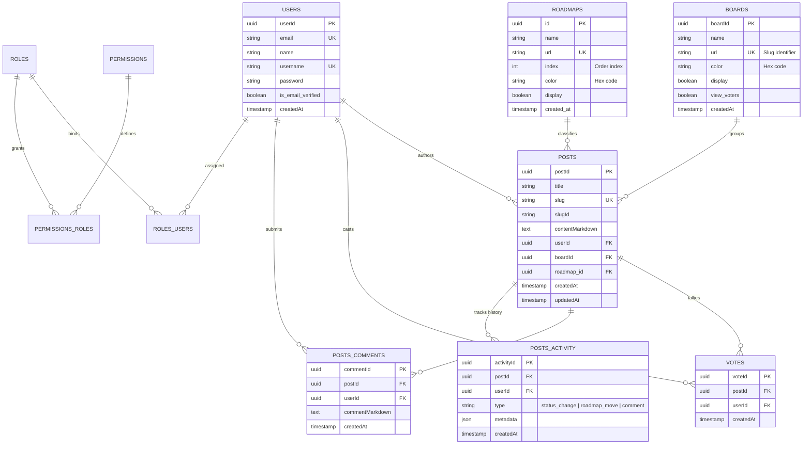
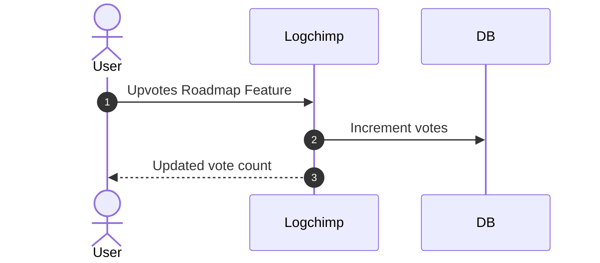

# logchimp - Architecture & Technical Wiki

> **Open-Source Product Feedback Management, Multi-Board Feature Tracking & Interactive Roadmap Engine**  
> GitHub: [logchimp/logchimp](https://github.com/logchimp/logchimp) | Stack: TypeScript, Node.js 20+, Express.js, Knex.js, PostgreSQL 14+, Redis 7+, BullMQ, Vue.js 3, Vite | License: Apache-2.0

---

## 1. Executive Summary & Value Proposition

**Logchimp** is an open-source product feedback management platform and interactive roadmap engine designed for modern software teams. Engineered as an extensible, developer-friendly alternative to Canny, Upvoty, and Aha!, Logchimp provides SaaS companies with a centralized hub to track user feedback, aggregate feature votes, categorize requests across multiple boards, and showcase product momentum through a dynamic public roadmap.

Customer feedback is notoriously difficult to organize when captured haphazardly across emails, intercom chats, and sales calls. Logchimp brings structure to product discovery by providing dedicated categorized boards (e.g., "Web App", "Integrations", "Mobile"), customizable roadmap columns, threaded user discussions, and granular role-based access control (RBAC). Its TypeScript-first Node.js architecture combines **Express.js** and **Knex.js** with PostgreSQL and Redis, delivering fast response times, rich Markdown formatting, and automated email notifications via Bull queue workers.

### Core Problems Solved
- **Feedback Categorization & Board Separation**: Eliminates one-dimensional feedback dumps by allowing teams to partition feature suggestions into distinct `Boards` with custom URLs, brand colors, and visibility toggles.
- **Visual Product Roadmap Transparency**: Seamlessly transitions user suggestions into customizable `Roadmaps` (e.g., "Under Review", "Planned", "In Progress", "Launched"), keeping customers informed and reducing support inquiries.
- **Granular Enterprise RBAC & Permissions**: Implements a complete relational role-based access control model (`roles`, `permissions`, `roles_users`, `permissions_roles`) to govern who can create boards, change roadmap statuses, or moderate discussions.
- **Activity Stream & Audit Trails**: Maintains an immutable timeline (`posts_activity`) documenting every status change, comment, and moderator intervention on a suggestion.
- **Scalable Caching & Asynchronous Queue Workers**: Uses Redis to cache frequently accessed board listings and offloads transactional notifications and analytics rollups to Bull background workers.

---

## 2. High-Level System Architecture

Logchimp operates as a modular TypeScript monorepo consisting of a Node.js REST API server (`packages/server`), a Vue.js frontend client (`packages/theme`), and shared TypeScript types (`packages/types`).



### Architectural Lifecycle of Feedback Processing
1. **Public Board Ingress**: The visitor opens `feedback.domain.com/boards/integrations`. The frontend queries `GET /api/v1/posts?boardId={id}`. The server checks Redis cache; on miss, Knex executes an optimized join across `posts`, `users`, and `votes`, caching the result.
2. **Post Creation & Slug Generation**: A user posts an idea via `POST /api/v1/posts`. The controller generates a unique human-friendly slug using `slug` and `slugId` (e.g. `hubspot-two-way-sync-9a81`), parses Markdown content, and commits the row inside a PostgreSQL transaction.
3. **Atomic Ballot Casting**: When another user upvotes via `POST /api/v1/posts/{slug}/votes`, Logchimp creates an entry in `votes`, fires an atomic tally increment, and invalidates the cached post record in Redis.
4. **Roadmap Transition**: A product manager moves the post to the "In Progress" roadmap stage (`PATCH /api/v1/posts/{slug}`). The controller updates `roadmap_id`, creates a record in `posts_activity`, and enqueues notification jobs.
5. **Background Fan-out**: Bull queue workers process the jobs asynchronously, emailing status update digests to all users who upvoted or commented on the post.

---

### 2.1 Core Domain & Service Class Architecture



---

## 3. Technology Stack & Key Dependencies

- **Language & Runtime**: TypeScript 5.4+, Node.js 20+ LTS, pnpm workspaces.
- **Backend Application Framework**:
  - **Express.js**: Fast, minimalist web framework for REST API routing.
  - **Knex.js**: SQL query builder managing migrations, connection pooling, and complex joins.
  - `express-validator`: Declarative request payload validation.
- **Database & Caching**:
  - **PostgreSQL 14+**: Relational database with UUID primary keys and transactional integrity.
  - **Redis 7+**: Key-value cache and distributed BullMQ task broker.
- **Queuing & Workers**:
  - **BullMQ / Bull**: Redis-backed queue system for email and webhook execution.
- **Frontend Architecture**:
  - **Vue.js 3** SPA with Vue Router and Pinia state management.
  - **Vite**: Modern frontend build tool and dev server.
  - Tailwind CSS for responsive component styling.
- **Email Engine**: Nodemailer with HTML email templates (`packages/email-templates`).

---

## 4. Repository Layout & Key Modules

```
logchimp/
├── packages/
│   ├── server/                       # Node.js Express REST Backend
│   │   ├── src/
│   │   │   ├── cache/                # Redis caching wrappers (board, post, settings)
│   │   │   ├── controllers/          # API Controllers (post, votes, auth, users)
│   │   │   ├── database/             # Knex configuration, migrations, seeds
│   │   │   │   ├── migrations/       # Sequential SQL migration files
│   │   │   │   └── config.ts         # Knex PostgreSQL connection pool
│   │   │   ├── middlewares/          # JWT, CORS, rate-limiting, and RBAC guards
│   │   │   ├── repository/           # Knex SQL repository queries
│   │   │   ├── routes/v1/            # Express REST route handlers
│   │   │   ├── worker/               # Bull background job workers
│   │   │   ├── app.ts                # Express application definition
│   │   │   └── index.ts              # Server startup & port binding
│   │   └── package.json
│   ├── theme/                        # Vue 3 User-Facing Frontend & Admin Client
│   │   ├── src/
│   │   │   ├── components/           # Reusable UI widgets (cards, voting buttons, modal)
│   │   │   ├── pages/                # Views (Roadmap, BoardView, PostDetail, Settings)
│   │   │   └── App.vue               # Root Vue component
│   │   ├── Caddyfile                 # Production web server configuration
│   │   └── vite.config.ts
│   ├── email-templates/              # Responsive HTML transactional emails
│   └── types/                        # Shared TypeScript interfaces & DTOs
├── docker/                           # Production Dockerfiles and compose setups
└── package.json                      # Monorepo root workspace configuration
```

---

## 5. Core Features & Capabilities

### 5.1 Multi-Board Architecture
Logchimp allows organizations to separate customer feedback across multiple functional domains:
- **Dedicated Board Slugs**: Each board occupies a unique URL path (e.g., `/boards/integrations`, `/boards/mobile-app`).
- **Access & Display Controls**: Boards can be toggled public or internal, with customizable accent colors and privacy options (`view_voters`).

### 5.2 Dynamic Visual Roadmaps
The roadmap subsystem provides an interactive Kanban-style overview of product progress:
- **Customizable Stages**: Teams define ordered roadmap columns (e.g., `Under Review`, `Planned`, `In Progress`, `Shipped`).
- **Color-Coded Status Pills**: Each stage features custom hex color badges displayed on post cards across the application.
- **Automated Roadmap View**: Displays aggregated post counts per stage, giving users instant visibility into upcoming releases.

### 5.3 Granular Role-Based Access Control (RBAC)
Logchimp includes an enterprise-grade permissions framework:
- **Roles**: System roles (`Owner`, `Admin`, `Member`, `Everyone`).
- **Permissions**: Granular action-level permissions mapped in `permissions` (e.g., `post:create`, `post:update`, `post:destroy`, `board:create`, `settings:read`).
- **Middleware Enforcement**: The `requirePermission("post:update")` middleware validates user capabilities prior to controller execution.

### 5.4 Activity Tracking & Historical Changelogs
- Every status update, roadmap movement, or moderation event is recorded in `posts_activity`.
- Provides an audit trail for teams and transparent progress updates for community voters.

---

## 6. Data Models & Schema Architecture

Logchimp enforces relational integrity using Knex migrations and PostgreSQL foreign keys.



### Core Schema Invariants
1. **Slug & SlugId Composite URLs**: Posts generate both a human-readable `slug` and a compact `slugId` (e.g. `slugId = "9a81"`), preventing collisions when users submit identically named suggestions.
2. **Strict Voter Uniqueness**: A composite unique index on `(postId, userId)` ensures that users can vote on an issue exactly once.
3. **Decoupled Roadmaps & Boards**: A `post` has independent foreign keys for `boardId` and `roadmap_id`. This allows an idea to belong to the "Integrations" board while simultaneously sitting in the "In Progress" roadmap stage.

---

### 6.1 Comprehensive Database Schema Specification

#### Table: `posts`
| Column | Type | Constraints | Default | Description |
| :--- | :--- | :--- | :--- | :--- |
| `id` | `UUID` | `PRIMARY KEY` | `gen_random_uuid()` | Post ID |
| `title` | `VARCHAR(255)` | `NOT NULL` | - | Feedback title |

---

## 7. API Architecture, Webhooks & Key Endpoints

Logchimp provides a versioned REST API (`/api/v1/*`) returning standardized JSON response envelopes.

### Key REST Endpoints

| HTTP Method | Endpoint | Description |
|:---|:---|:---|
| `GET` | `/api/v1/posts` | Paginated post listing with filters for board, roadmap, and search |
| `POST` | `/api/v1/posts` | Creates a new feature request post |
| `GET` | `/api/v1/posts/{slug}` | Retrieves post details, comment thread, and voter counts |
| `POST` | `/api/v1/posts/{slug}/votes` | Casts a vote on the specified post |
| `DELETE` | `/api/v1/posts/{slug}/votes` | Removes a previously cast vote |
| `GET` | `/api/v1/roadmaps` | Retrieves all configured roadmap stages and assigned posts |
| `GET` | `/api/v1/boards` | Lists all active feedback boards |

### Sample Request: Create Post (`POST /api/v1/posts`)
```json
{
  "title": "Two-Way HubSpot CRM Contact Sync",
  "boardId": "7b82f012-3a91-4c22-b5e0-192840192840",
  "contentMarkdown": "Please add native two-way sync with HubSpot so marketing qualification scores automatically sync to CRM deals."
}
```

### Sample Response: Created Post Payload
```json
{
  "post": {
    "postId": "9c12a048-11bc-4e2a-8401-209148019283",
    "title": "Two-Way HubSpot CRM Contact Sync",
    "slug": "two-way-hubspot-crm-contact-sync-4b10",
    "slugId": "4b10",
    "contentMarkdown": "Please add native two-way sync with HubSpot so marketing qualification scores automatically sync to CRM deals.",
    "boardId": "7b82f012-3a91-4c22-b5e0-192840192840",
    "roadmap_id": null,
    "votesCount": 1,
    "createdAt": "2026-10-24T12:00:00.000Z",
    "author": {
      "userId": "usr_99182",
      "name": "Jordan Reed",
      "username": "jordanreed"
    }
  }
}
```

---

### 7.5 End-to-End Operational Lifecycle Sequence



---

## 8. Strategic Value & Takeaways for MarketingStudio

### Reusable Architectural Patterns
1. **Multi-Board Partitioning for Product Lines**:
   - Logchimp’s model of partitioning feedback into distinct `Boards` with unique URLs and color schemes provides MarketingStudio with a pattern for handling feedback across different product lines (e.g. Lead Gen Tools vs. Email Automation vs. Dialers).
2. **Relational RBAC Middleware Pattern**:
   - The decoupled role and permission schema (`roles`, `permissions`, `permissions_roles`) allows MarketingStudio to enforce granular staff permissions across marketing campaigns, preventing junior marketers from modifying production webhooks or deleting lead data.
3. **Immutable Activity Stream for Transparent Governance**:
   - Tracking all post movements, status shifts, and comments inside an append-only `posts_activity` table gives MarketingStudio a ready-made pattern for compliance logging and auditability across marketing automation rules.
4. **Redis Cache-Aside for High-Traffic Public Portals**:
   - Implementing Logchimp’s Redis cache-aside strategy for public roadmaps ensures that sudden traffic spikes from product launches or newsletter campaigns do not degrade primary database performance.
