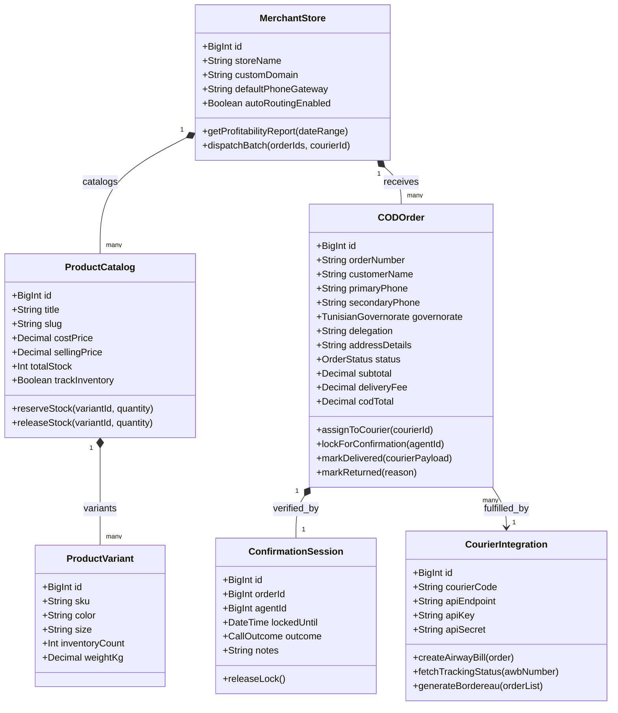
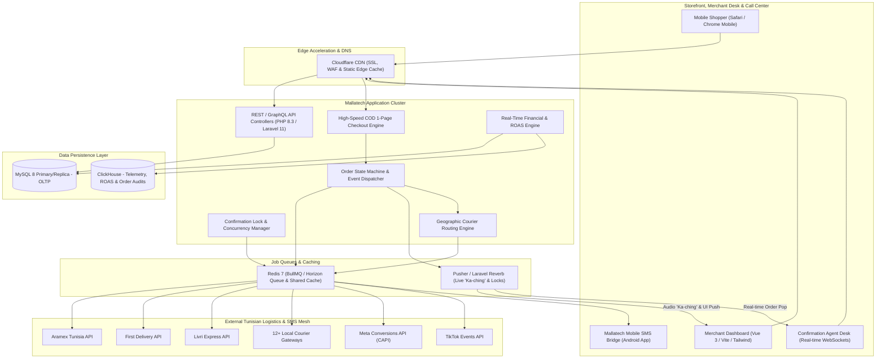
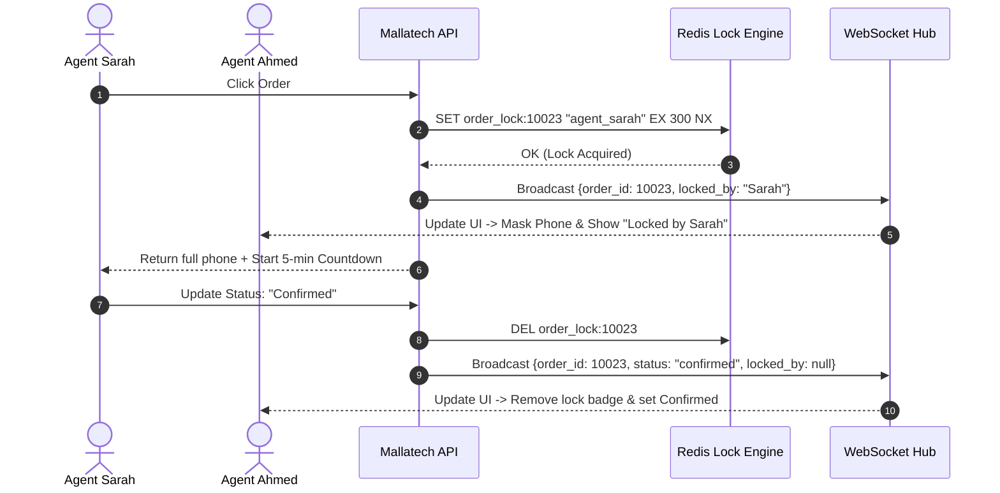

# Mallatech.tn System and Functional Architecture

> Comprehensive technical and functional reverse-engineered reference for **Mallatech** (`mallatech.tn`): the leading Tunisian all-in-one e-commerce platform, automated Cash-On-Delivery (COD) ERP, and multi-courier logistics routing engine.

---

## 1. Executive Overview and Market Positioning

**Mallatech** was engineered specifically to solve the structural bottlenecks of e-commerce in Tunisia and North Africa, where over 95% of consumer transactions occur via **Cash on Delivery (COD)**, local postal codes are rarely used, address descriptions are colloquial, and fulfillment relies on fragmented third-party regional delivery companies.

International platforms like Shopify, WooCommerce, or Magento fail in this environment because they assume credit card pre-payment, standardized postal address validation, and integrated global carriers (UPS/FedEx/DHL). Merchants using generic platforms suffer from exorbitant return rates (up to 30-40% "taux de retour"), manual data entry across disparate carrier portals, phone confirmation bottlenecks, and opaque financial reconciliation.

Mallatech bridges this gap by bundling a high-conversion mobile storefront builder, a localized checkout engine, an automated call center confirmation pipeline, an intelligent multi-carrier logistics routing engine connected to 15+ Tunisian couriers, and a real-time net-profitability analytics ledger.

```
┌───────────────────────────────────────────────────────────────────────────────────────────────────┐
│                                       Mallatech Platform Core                                     │
│            High-Velocity Tunisian COD E-Commerce, Logistics Routing & Profitability ERP          │
└──────────────────────────────────────────────────┬────────────────────────────────────────────────┘
                                                   │
         ┌─────────────────────────────────────────┼────────────────────────────────────────┐
         ▼                                         ▼                                        ▼
┌─────────────────────────────┐       ┌─────────────────────────────┐      ┌─────────────────────────────┐
│   Mobile-First Storefront   │       │   COD Order Management &    │      │   Intelligent Multi-Carrier │
│   & Funnel Page Builder     │       │   Confirmation CRM          │      │   Logistics Routing Engine  │
│  - 50+ conversion themes    │       │  - Audio alert ("Ka-ching") │      │  - 15+ Tunisian couriers    │
│  - Dynamic 24 Gouvernorats  │       │  - Anti-collision call lock │      │  - Auto-routing by region   │
│  - No-cart 1-step checkout  │       │  - Free local SMS gateway   │      │  - Bulk AWB & BL generation │
└─────────────────────────────┘       └─────────────────────────────┘      └─────────────────────────────┘
         │                                         │                                        │
         └─────────────────────────────────────────┼────────────────────────────────────────┘
                                                   ▼
                                      ┌─────────────────────────────┐
                                      │  COD Financial Reconciliation│
                                      │  & Net Profitability Engine  │
                                      │ - Ad spend sync (Meta/TikTok)│
                                      │ - Courier remittance ledger │
                                      │ - Real-time net margin & ROAS│
                                      └─────────────────────────────┘
```

### Core Value Proposition & Market Differentiators
- **Zero Commission on Sales:** Unlike regional marketplaces or commission-based platforms, Mallatech charges fixed monthly subscriptions in Tunisian Dinars (TND) with a free tier for early-stage sellers, preventing margin erosion as merchants scale.
- **Unified Tunisian Carrier Network:** Direct API integration with 15+ local delivery companies (Aramex Tunisie, First Delivery, Livri, Express Courrier, Trans Express, Go Delivery, Colis Express, etc.), eliminating manual copy-pasting into carrier extranets.
- **Geographic Auto-Dispatch:** Automatic assignment of orders to the optimal courier based on governorate (*Gouvernorat*) and delegation (*Délégation*) delivery success rates and pricing.
- **Integrated Free SMS Confirmation Gateway:** Utilizes mobile gateway bridges and webhooks to trigger instant SMS order confirmations and verification links, reducing fake orders and unreached buyers.
- **True Net-Profitability Ledger:** Calculates real net profit per delivered parcel by factoring in landed product cost, packaging, advertising spend per purchase, confirmation call costs, courier fees, and return penalties.

---

## 2. Core Entities and Reverse-Engineered Data Model

### 2.1 Domain Entity Relationship Model

```
┌─────────────────────────────────────────────────────────────────┐
│                          Merchant Account                       │
│    (ID, Business Name, Tax ID / MF, Phone, Default Currency)    │
└───────────────────────────────┬─────────────────────────────────┘
                                │ 1:N
                                ▼
┌─────────────────────────────────────────────────────────────────┐
│                           Store Instance                        │
│        (Subdomain *.mallatech.tn, Custom Domain, Settings)      │
└───────────────┬───────────────────────────────┬─────────────────┘
                │ 1:N                           │ 1:N
                ▼                               ▼
┌───────────────────────────────┐   ┌─────────────────────────────┐
│       Product & Variants      │   │    Governorate Delivery Rule│
│  (SKU, Cost Price, Sale Price,│   │  (Gouvernorat ID, Courier ID│
│   Stock Quantity, Barcode)    │   │   Base Fee, Return Penalty) │
└───────────────┬───────────────┘   └─────────────┬───────────────┘
                │                                 │
                │ 1:N                             │ Matches
                ▼                                 ▼
┌─────────────────────────────────────────────────────────────────┐
│                           Order Record                          │
│  (Order #, Customer Name, Phone, Alt Phone, Gouvernorat,        │
│   Délégation, Street Address, Total COD Amount, Status)        │
└───────────────┬─────────────────────────────────────────────────┘
                │
                ├───────────────────────────────┬─────────────────┐
                │ 1:N                           │ 1:1             │ 1:N
                ▼                               ▼                 ▼
┌───────────────────────────────┐   ┌─────────────────────┐  ┌───────────────────┐
│          Order Item           │   │  Logistics Manifest │  │  Call Log & Lock  │
│  (Product ID, Variant ID, Qty,│   │  (Courier AWB / BL, │  │ (Agent ID, Call   │
│   Unit Price, Unit Landed Cost│   │   Pickup Batch ID,  │  │  Timestamp, Status│
└───────────────────────────────┘   │   Delivery Status,  │  │  Recording URL)   │
                                    │   Remittance Status)│  └───────────────────┘
                                    └─────────────────────┘
```

### 2.2 Class Diagram Architecture



### 2.3 Comprehensive Database Schema Specification

#### Table: `stores`
| Column | Type | Constraints | Default | Description |
| :--- | :--- | :--- | :--- | :--- |
| `id` | `BIGINT UNSIGNED` | `PRIMARY KEY AUTO_INCREMENT` | - | Unique Store Identifier |
| `owner_id` | `BIGINT UNSIGNED` | `NOT NULL, INDEX` | - | Foreign key to merchant user account |
| `subdomain` | `VARCHAR(64)` | `UNIQUE NOT NULL` | - | e.g. `boutique.mallatech.tn` |
| `custom_domain` | `VARCHAR(191)` | `UNIQUE NULL` | `NULL` | Connected merchant custom domain |
| `business_name` | `VARCHAR(255)` | `NOT NULL` | - | Legal business identity |
| `matricule_fiscale` | `VARCHAR(64)` | `NULL` | `NULL` | Tunisian Tax ID (MF) |
| `currency` | `VARCHAR(3)` | `NOT NULL` | `'TND'` | Default currency |
| `sms_gateway_mode` | `ENUM('internal','sim_bridge','external_api')` | `NOT NULL` | `'sim_bridge'` | Mode for SMS dispatches |
| `auto_courier_routing` | `BOOLEAN` | `NOT NULL` | `TRUE` | Enable rule-based courier assignment |
| `created_at` | `TIMESTAMP` | `NOT NULL` | `CURRENT_TIMESTAMP` | Creation timestamp |

#### Table: `orders`
| Column | Type | Constraints | Default | Description |
| :--- | :--- | :--- | :--- | :--- |
| `id` | `BIGINT UNSIGNED` | `PRIMARY KEY AUTO_INCREMENT` | - | Internal order record ID |
| `store_id` | `BIGINT UNSIGNED` | `NOT NULL, INDEX` | - | Store reference |
| `order_number` | `VARCHAR(32)` | `NOT NULL, UNIQUE` | - | Formatted ID: `MLT-TN-2026-10023` |
| `customer_name` | `VARCHAR(150)` | `NOT NULL` | - | Customer full name |
| `phone_primary` | `VARCHAR(20)` | `NOT NULL, INDEX` | - | Primary mobile number (8 digits in TN) |
| `phone_secondary` | `VARCHAR(20)` | `NULL` | `NULL` | Backup contact phone |
| `governorate` | `ENUM(...)` | `NOT NULL, INDEX` | - | One of the 24 Tunisian Gouvernorats |
| `delegation` | `VARCHAR(100)` | `NOT NULL` | - | Local county/delegation (e.g. La Marsa, Ennasr) |
| `address_line` | `TEXT` | `NOT NULL` | - | Detailed street/landmark indications |
| `subtotal` | `DECIMAL(10,3)` | `NOT NULL` | `0.000` | Items total in Dinars (millimes precision) |
| `delivery_fee` | `DECIMAL(10,3)` | `NOT NULL` | `7.000` | Applied delivery charge |
| `cod_amount` | `DECIMAL(10,3)` | `NOT NULL` | `0.000` | Net amount collected at delivery |
| `status` | `VARCHAR(32)` | `NOT NULL, INDEX` | `'pending'` | State: `pending`, `confirmed`, `dispatched`, `delivered`, `returned`, `cancelled` |
| `fraud_risk_score` | `TINYINT UNSIGNED`| `NOT NULL` | `0` | Calculated fraud score (0-100) |
| `locked_by_agent_id`| `BIGINT UNSIGNED` | `NULL` | `NULL` | Current confirmation agent holding lock |
| `lock_expires_at` | `TIMESTAMP` | `NULL` | `NULL` | Lock expiration timestamp (TTL 5 mins) |
| `created_at` | `TIMESTAMP` | `NOT NULL` | `CURRENT_TIMESTAMP` | Order timestamp |

#### Table: `shipments`
| Column | Type | Constraints | Default | Description |
| :--- | :--- | :--- | :--- | :--- |
| `id` | `BIGINT UNSIGNED` | `PRIMARY KEY AUTO_INCREMENT` | - | Unique shipment record |
| `order_id` | `BIGINT UNSIGNED` | `NOT NULL, UNIQUE` | - | Associated order ID |
| `courier_id` | `BIGINT UNSIGNED` | `NOT NULL, INDEX` | - | Selected courier service |
| `awb_number` | `VARCHAR(64)` | `NOT NULL, INDEX` | - | Courier Airway Bill / Tracking code |
| `manifest_number` | `VARCHAR(64)` | `NULL, INDEX` | `NULL` | Bordereau d'expédition batch number |
| `courier_status` | `VARCHAR(64)` | `NOT NULL` | `'created'` | Normalized status from courier webhook |
| `courier_cost` | `DECIMAL(10,3)` | `NOT NULL` | `7.000` | Actual fee invoiced by carrier |
| `return_penalty` | `DECIMAL(10,3)` | `NOT NULL` | `0.000` | Fee charged if parcel is returned |
| `remittance_status`| `ENUM('unpaid','remitted','disputed')` | `NOT NULL` | `'unpaid'` | Cash remittance state from courier |
| `dispatched_at` | `TIMESTAMP` | `NULL` | `NULL` | Date handed over to courier |
| `delivered_at` | `TIMESTAMP` | `NULL` | `NULL` | Date customer paid and received package |

---

## 3. Reverse-Engineered System Architecture & Engineering Blueprint



### 3.1 Technology Stack & Operational Efficiency
- **Backend Core:** PHP 8.3 with Laravel 11 and OPcache optimization, containerized via Docker on high-performance bare metal servers located close to the MENA region (e.g. AWS Frankfurt / OVH France / Scaleway).
- **Frontend Architecture:** **Vue 3 Composition API** + Vite + TailwindCSS. The checkout form runs as an ultra-lightweight (< 28KB gzipped) isolated JavaScript widget mounted directly on product landing pages, ensuring sub-150ms First Contentful Paint (FCP) on 3G/4G Tunisian mobile networks.
- **Real-Time Communication:** **Laravel Reverb / Pusher WebSockets** powering instantaneous audio notifications ("Ka-ching!"), live dashboard badge increments, and concurrency locks when confirmation agents view an order.
- **Database Engine:** MySQL 8 with strict foreign keys and optimized compound indexes (`store_id`, `status`, `created_at`). ClickHouse is used for high-volume advertising click-stream and profitability telemetry.

---

## 4. Key Operational Mechanics & Deep Technical Differentiators

### 4.1 Cascading 24 Tunisian Gouvernorats & Délégations Selector
Tunisian addresses do not rely on zip codes. Delivery success hinges on selecting the exact **Gouvernorat** and **Délégation**.
- Mallatech embeds a pre-indexed, normalized JSON dataset of all 24 governorates and their ~264 delegations:
```json
{
  "Tunis": ["Tunis Médina", "Bab Bhar", "La Marsa", "Carthage", "Sidi Bou Said", "Le Kram", "El Menzah", "Ennasr", "Le Bardo"],
  "Sousse": ["Sousse Ville", "Hammam Sousse", "Kantaoui", "Msaken", "Kalaa Kebira", "Akouda"],
  "Sfax": ["Sfax Ville", "Sakiet Ezzit", "Sakiet Eddaier", "Thyna", "El Hencha"]
}
```
- When the user taps their governorate, the delegation dropdown populates instantly without network latency. This eliminates misrouted parcels and ensures the courier API receives recognized destination tokens.

### 4.2 Multi-Agent Concurrency Lock ("Anti-Collision")
In active Tunisian COD operations, multiple phone confirmation agents work simultaneously. Without server-side locking, two agents will call the same customer at the same time, annoying the customer and duplicating work:
1. When an agent opens an order in the dashboard, the frontend emits a WebSocket request: `orders:lock(orderId)`.
2. Redis sets a key with a 300-second TTL: `SET order_lock:10023 agent_42 EX 300 NX`.
3. If successful, the agent sees the customer phone number and a "Call" button.
4. If already locked, other agents see a red badge: `"Being handled by Agent Sarah"` and the customer phone is masked.
5. Upon saving confirmation status or closing the modal, the lock is immediately released.



### 4.3 Automated Multi-Courier Dispatch & Bordereau Generation
1. **Rule Engine Evaluation:** The merchant configures priority rules:
   - *Rule 1:* If Destination = "Grand Tunis" (Tunis, Ariana, Ben Arous, Manouba), assign to **First Delivery** (Lowest cost: 6.500 TND).
   - *Rule 2:* If Destination = "Sud Tunisien" (Tataouine, Medenine, Kebili), assign to **Aramex** (Highest delivery success rate: 88%).
2. **Bulk AWB Generation:** With one click, the merchant selects 50 confirmed orders and clicks "Générer les Expéditions".
3. Mallatech executes parallel API requests to the respective courier endpoints, retrieves tracking numbers (AWBs), and compiles a unified PDF **Bordereau d'Expédition (Manifest)** ready for warehouse pickup and courier signing.

---

## 5. Comprehensive REST & Webhook API Surface Specification

### 5.1 Create Order via Storefront API
```http
POST /api/v1/storefront/orders
Content-Type: application/json
X-Store-Token: pub_live_9a87f12e84d6

{
  "customer_name": "Karim Ben Salem",
  "phone_primary": "98123456",
  "phone_secondary": "22987654",
  "governorate": "Nabeul",
  "delegation": "Hammamet",
  "address_line": "Avenue Habib Bourguiba, près de la pharmacie de nuit",
  "items": [
    {
      "variant_id": 4821,
      "quantity": 2,
      "unit_price": 49.000
    }
  ],
  "utm_source": "meta_ads",
  "utm_campaign": "promo_ete_2026"
}
```

#### Response (201 Created):
```json
{
  "success": true,
  "order": {
    "order_number": "MLT-TN-88231",
    "subtotal": 98.000,
    "delivery_fee": 7.000,
    "total_cod": 105.000,
    "currency": "TND",
    "status": "pending",
    "estimated_delivery_days": "24-48h"
  }
}
```

### 5.2 Courier Tracking Webhook Ingestion
```http
POST /api/v1/webhooks/courier/aramex-tunisia
Content-Type: application/json
X-Courier-Signature: sha256=d3b07384d113edec49eaa6238ad5ff00

{
  "awb": "ARM-TN-998822",
  "status_code": "DLV",
  "status_description": "Delivered and Cash Collected",
  "collected_amount": 105.000,
  "delivered_at": "2026-10-26T11:45:00Z",
  "courier_agent_id": "livreur_tunis_sud_04"
}
```

---

## 6. Strategic Takeaways & Architecture Lessons for MarketingStudio / SGrowing

1. **Native Understanding of Regional Realities:** MarketingStudio must support non-standard addressing schemes (governorates, delegations, landmarks) as first-class citizens rather than generic text fields.
2. **Audio & Visual Dopamine Loops:** Mallatech's signature "Ka-ching" audio notification drives high merchant engagement and gamifies sales tracking.
3. **Logistics as Core ERP, Not an Afterthought:** In cash economies, an e-commerce platform that cannot generate shipping manifests or track cash collected by delivery drivers is incomplete. MarketingStudio should implement a pluggable courier routing driver architecture.
4. **Anti-Collision Call Center UX:** Implementing distributed Redis locks on CRM contact/lead records prevents customer duplicate outreach across sales and confirmation teams.
