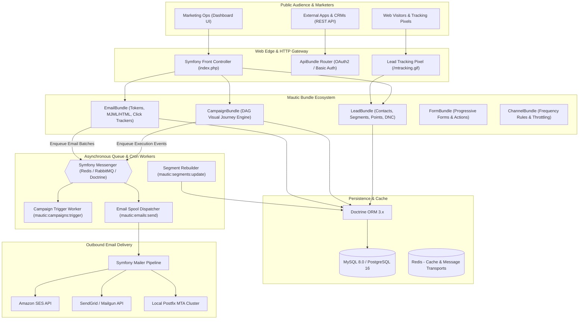
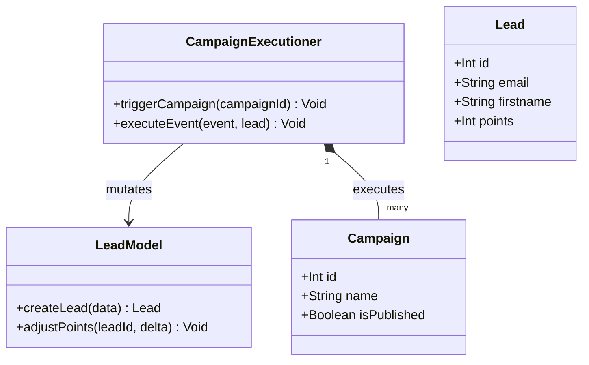
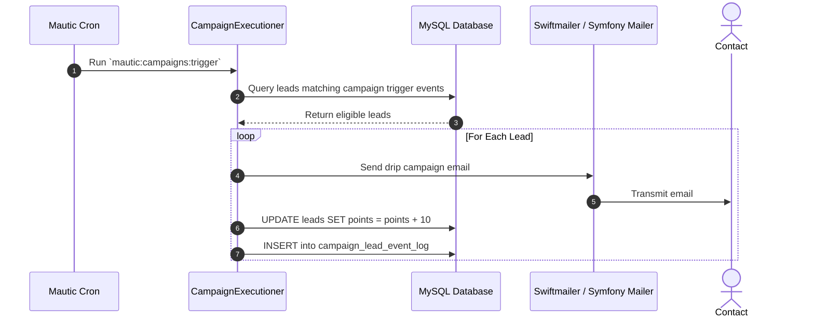

# mautic - Architecture & Technical Wiki

> **Open-Source Enterprise Marketing Automation, Dynamic Segmentation & Journey Orchestration Engine**  
> GitHub: [mautic/mautic](https://github.com/mautic/mautic) | Stack: PHP 8.2+, Symfony 7.4, Doctrine ORM, Symfony Messenger, MySQL 8 / PostgreSQL, Redis, Symfony Mailer | License: GPL-3.0

---

## 1. Executive Summary & Value Proposition

**Mautic** is the world's most widely adopted open-source marketing automation platform, providing enterprise marketing teams with an autonomous, self-hosted alternative to proprietary suites like HubSpot, Marketo, and ActiveCampaign. Built on PHP 8.2 and Symfony 7.4, Mautic unifies cross-channel customer journeys, real-time lead scoring, dynamic demographic and behavioral segmentation, progressive web forms, asset tracking, and omnichannel messaging (Email, SMS, Web Push, and Webhooks).

The platform's strength lies in its modular bundle architecture and its battle-tested, high-volume queue infrastructure powered by Symfony Messenger. Mautic enables marketing operations teams to track millions of anonymous web visitors, stitch identities upon form submission or email clicks, execute multi-branch campaign logic (Actions, Decisions, Conditions), and dispatch high-throughput email broadcasts without licensing costs or artificial subscriber paywalls.

### Core Problems Solved
- **Vendor Lock-in & Contact Monetization Penalties**: Eliminates exponential pricing tiers enforced by SaaS providers who charge per stored contact, enabling companies to manage millions of leads at VPS infrastructure cost.
- **Complex Multi-Branch Customer Journeys**: Replaces linear email drip campaigns with an interactive Directed Acyclic Graph (DAG) visual journey builder that reacts dynamically to recipient behavior (email opens, link clicks, page visits, point thresholds).
- **Stale Demographic Segmentation**: Features a dynamic segment builder that continuously evaluates complex boolean logic (e.g., `Country = 'US' AND Score > 100 AND LastActive < 30 days`) asynchronously in background worker processes.
- **Cross-Channel Communication Fatigue**: Enforces global and channel-level frequency capping (`FrequencyRule`), preventing contact fatigue by throttling messages per recipient across campaigns.
- **Bounce & Deliverability Governance**: Maintains an immutable Do-Not-Contact (`DoNotContact`) registry that automatically captures hard bounces, spam complaints, and manual unsubscribes across all dispatch channels.

---

## 2. High-Level System Architecture

Mautic is built around a decoupled Symfony architecture where frontend web requests and background asynchronous processing operate independently:
1. **HTTP Web Application**: Handles marketing dashboard interaction, landing page hosting, tracking pixel endpoints (`/mtracking.gif`), and public API routes (`/api`).
2. **Asynchronous Worker Tier (Symfony Messenger / Cron)**: High-throughput tasks (segment rebuilding, campaign event evaluation, bulk email dispatch, and webhook pushes) execute via CLI console commands or message queues (Redis, RabbitMQ, or Beanstalkd).
3. **MTA & Delivery Transport Layer**: Leverages Symfony Mailer with pluggable transport drivers for Amazon SES, SendGrid, Mailjet, Postmark, and custom Postfix SMTP clusters.



---

### 2.1 Core Domain & Service Class Architecture



---

## 3. Technology Stack & Key Dependencies

- **Language & Runtime**: PHP 8.2+ / PHP 8.3 (configured with OPcache, JIT enabled for high-throughput batch loops).
- **Core Framework**: **Symfony 7.4** (`symfony/framework-bundle`, `symfony/console`, `symfony/messenger`, `symfony/mailer`, `symfony/event-dispatcher`).
- **ORM & Database Abstraction**: **Doctrine ORM 3+** & Doctrine DBAL, with schema migrations managed via `doctrine/migrations`.
- **Primary Database**: MySQL 8.0+, MariaDB 10.11+, or PostgreSQL 16+.
- **Queue & Background Execution**:
  - Symfony Messenger utilizing Redis, RabbitMQ (AMQP), or Doctrine database queues.
  - Periodic background daemons (`bin/console mautic:*`).
- **Email Delivery Framework**: **Symfony Mailer** with official transport adapters for Amazon SES, Mailgun, SendGrid, Postmark, and generic SMTP.
- **Template & Rendering**: Twig template engine and GrapesJS drag-and-drop HTML builder.
- **API Architecture**: Native REST API with OAuth2 (`league/oauth2-server`) and API Platform integration.

---

## 4. Repository Layout & Key Modules

```
inspire/mautic/
├── app/
│   ├── bundles/                      # Modular domain architecture
│   │   ├── ApiBundle/                # REST API controllers & serializers
│   │   ├── CampaignBundle/           # Customer journey engine & execution workers
│   │   │   ├── Entity/               # Campaign, Event, LeadEventLog
│   │   │   ├── Executioner/          # Event dispatcher and DAG traversal algorithms
│   │   │   └── Command/              # CLI commands (trigger, execute, summarize)
│   │   ├── ChannelBundle/            # Multichannel routing & frequency capping
│   │   ├── EmailBundle/              # Email templates, click/open trackers, spools
│   │   │   ├── Entity/               # Email, Stat, EmailDraft, Copy
│   │   │   ├── Helper/               # Token replacement & Mailer bridge
│   │   │   └── MonitoredEmail/       # Inbound bounce & unsubscribe IMAP parser
│   │   ├── FormBundle/               # Web forms, field mapping, progressive profiling
│   │   ├── LeadBundle/               # Contacts, Segments, Points, Companies
│   │   │   ├── Entity/               # Lead, LeadList, ListLead, DoNotContact
│   │   │   ├── Segment/              # Boolean expression parser & query builder
│   │   │   └── Tracker/              # IP, device, and cookie identity stitcher
│   │   ├── MessengerBundle/          # Symfony Messenger queue configurations
│   │   └── WebhookBundle/            # Outbound webhook queues and retries
│   └── config/                       # Symfony dependency injection parameters
├── bin/
│   └── console                       # Symfony CLI runner for background workers
├── plugins/                          # Ecosystem plugins (HubSpot, Salesforce, Zapier)
├── themes/                           # Email & landing page templates
└── composer.json                     # PHP dependencies and bundle configurations
```

---

## 5. Core Features & Capabilities

### 5.1 Visual DAG Customer Journey Engine (`CampaignBundle`)
Mautic models customer journeys as Directed Acyclic Graphs (DAGs) composed of three distinct node types:
- **Decisions**: Evaluates recipient engagement actions, such as `Opens Email`, `Clicks URL`, `Submits Form`, or `Downloads Asset`.
- **Conditions**: Evaluates contact state at runtime, such as `Contact Field Value` (e.g., job title contains "Director"), `Device Type` (mobile vs. desktop), or `Segment Membership`.
- **Actions**: Executes automated operations, including `Send Email`, `Adjust Lead Score (+25 points)`, `Push to CRM Webhook`, `Change Contact Stage`, or `Send SMS`.
The traversal state of every contact is tracked with microsecond timestamps in `CampaignLeadEventLog`. If a contact opens an email, the positive branch triggers instantly; if no action occurs within a defined timeframe (e.g., 3 days), the timeout branch executes automatically.

### 5.2 Dynamic Real-Time Segmentation Engine (`LeadBundle`)
Segments in Mautic are dynamic SQL queries evaluated across contacts:
- Marketers define filter conditions with compound boolean operators (`AND` / `OR` groups), matching demographic data, purchase values, and historical tracking events.
- **Segment Batch Evaluation**: Rather than recalculating segments synchronously during page requests, background workers run `mautic:segments:update --batch-limit=1000`. The engine executes optimized SQL `INSERT ... SELECT` queries directly inserting qualified contact IDs into the `lead_lists_leads` pivot table, delivering high performance across multimillion-contact databases.

### 5.3 Automated Deliverability Governance & Do-Not-Contact (DNC) Registry
Mautic ensures sender domain reputation via automated suppression enforcement:
- Inbound IMAP monitoring (`MonitoredEmail/`) connects directly to feedback loops and bounce mailboxes, parsing RFC 3464 delivery status notifications (DSN) and RFC 8058 List-Unsubscribe headers.
- When an email hard-bounces (5xx) or a user unsubscribes, Mautic writes a record to `lead_donotcontact` specifying the `channel` (`email`) and `reason` (`1 = Bounced`, `2 = Unsubscribed`, `3 = Manual`).
- Every outbound email dispatch queries the DNC table; suppressed addresses are dropped before hitting the MTA, preventing reputation damage.

### 5.4 Cross-Channel Frequency Rules (`ChannelBundle`)
To prevent over-communicating with high-value prospects, Mautic implements configurable frequency limits:
- System-wide or per-segment rules limit message velocity (e.g., maximum 3 emails per 7-day period).
- If a campaign event fires while a contact is within a frequency cooldown window, the event pauses in `campaign_lead_event_log` with status `postponed` and automatically re-queues once the cooldown expires.

---

## 6. Data Models & Schema Architecture

The relational schema coordinates contacts, segments, DAG campaign nodes, and delivery audit logs.

```mermaid
erDiagram
    LEAD ||--o{ LIST_LEAD : "enrolled_in"
    LEAD_LIST ||--o{ LIST_LEAD : "contains"
    
    LEAD ||--o{ DO_NOT_CONTACT : "flagged_as"
    LEAD ||--o{ LEAD_EVENT_LOG : "executes"
    LEAD ||--o{ STAT : "generates"
    
    CAMPAIGN ||--o{ EVENT : "composed_of"
    CAMPAIGN ||--o{ LEAD_EVENT_LOG : "records"
    EVENT ||--o{ LEAD_EVENT_LOG : "triggers"
    
    EMAIL ||--o{ STAT : "tracked_by"
    EVENT ||--o{ EMAIL : "dispatches"

    LEAD {
        bigint id PK
        string email
        string firstname
        string lastname
        string company
        int points
        timestamp date_added
        timestamp date_last_active
    }

    LEAD_LIST {
        bigint id PK
        string name
        string alias
        text filters
        boolean is_published
        timestamp date_added
    }

    LIST_LEAD {
        bigint lead_id PK, FK
        bigint leadlist_id PK, FK
        timestamp date_added
        boolean manually_removed
    }

    CAMPAIGN {
        bigint id PK
        string name
        text description
        boolean is_published
        timestamp publish_up
        timestamp publish_down
    }

    EVENT {
        bigint id PK
        bigint campaign_id FK
        bigint parent_id FK
        string name
        string type
        string event_type
        text properties
        string trigger_mode
        int trigger_interval
    }

    LEAD_EVENT_LOG {
        bigint id PK
        bigint lead_id FK
        bigint campaign_id FK
        bigint event_id FK
        timestamp date_triggered
        boolean is_scheduled
        string status
    }

    EMAIL {
        bigint id PK
        string name
        string subject
        text body
        string from_address
        string from_name
        string template
    }

    STAT {
        bigint id PK
        bigint email_id FK
        bigint lead_id FK
        timestamp date_sent
        timestamp date_read
        boolean is_read
        int open_count
    }

    DO_NOT_CONTACT {
        bigint id PK
        bigint lead_id FK
        string channel
        int reason
        string comments
        timestamp date_added
    }
```

### Key Field Descriptions
- `event.event_type`: Categorizes node behavior (`"action"`, `"decision"`, or `"condition"`).
- `event.trigger_mode`: Controls execution timing (`"immediate"` or `"interval"` based on `trigger_interval`).
- `lead_event_log.status`: Execution state of a contact at an event node (`"triggered"`, `"postponed"`, or `"failed"`).
- `do_not_contact.reason`: Bitmask/integer specifying suppression cause (`1 = Bounced`, `2 = Unsubscribed`, `3 = Manual`).

---

### 6.1 Comprehensive Database Schema Specification

Mautic utilizes MySQL with Doctrine ORM to coordinate marketing automation.

#### Table: `leads`
Marketing contacts tracked with behavioral scoring points.

| Column | Type | Constraints | Default | Description |
| :--- | :--- | :--- | :--- | :--- |
| `id` | `INT UNSIGNED` | `PRIMARY KEY AUTO_INCREMENT` | - | Lead identifier |
| `email` | `VARCHAR(191)` | `NULLABLE` | `NULL` | Contact email |
| `firstname` | `VARCHAR(191)` | `NULLABLE` | `NULL` | First name |
| `points` | `INT` | `NOT NULL` | `0` | Lead score points |
| `date_added` | `DATETIME` | `NOT NULL` | - | Creation date |

*Indexes:* `idx_mautic_email` (`(email)`), `idx_mautic_points` (`(points)`).

---

## 7. API Architecture, Webhooks & Key Endpoints

Mautic exposes a RESTful API supporting OAuth2 and HTTP Basic Authentication.

| HTTP Method | Endpoint | Purpose | Sample Payload |
| :--- | :--- | :--- | :--- |
| `POST` | `/api/contacts/new` | Create contact with custom fields | `{"email": "vp@enterprise.com", "firstname": "Sarah", "points": 50}` |
| `GET` | `/api/segments` | List all dynamic marketing segments | Response: `{"total": 12, "lists": [{"id": 3, "name": "Hot Enterprise Leads"}]}` |
| `POST` | `/api/campaigns/{id}/contact/{leadId}/add` | Manually enroll contact in campaign | Path params: `id=5, leadId=1024` |
| `POST` | `/api/emails/{id}/send` | Trigger transactional email template | `{"tokens": {"{contactfield=firstname}": "Sarah"}}` |
| `GET` | `/api/contacts/{id}/dnc` | Check contact Do-Not-Contact status | Response: `{"dnc": [{"channel": "email", "reason": 1, "comments": "550 User unknown"}]}` |

---

### 7.5 End-to-End Operational Lifecycle Sequence



---

## 8. Strategic Value & Takeaways for MarketingStudio

### Architectural Patterns to Replicate
1. **Separation of Interactive Campaign Authoring & Asynchronous Traversal**: Mautic stores visual journeys as normalized node/edge records (`campaign_events`) while execution state is decoupled in `campaign_lead_event_log`. This prevents UI mutations from corrupting in-flight journey runs. MarketingStudio should implement a similar execution log architecture to pause, retry, or resume journey flows deterministically.
2. **Asynchronous Set-Based Segment Rebuilding**: Rather than evaluating contact segmentation on-the-fly, Mautic processes segments asynchronously using bulk SQL batch insertions (`INSERT INTO ... SELECT`). MarketingStudio can adopt this set-based database querying approach to segment hundreds of thousands of contacts in seconds without CPU saturation.
3. **Channel-Agnostic Suppression Architecture (`DoNotContact`)**: Mautic abstracts unsubscribes and bounces into a centralized `DoNotContact` entity keyed by `channel` (`email`, `sms`, `push`). MarketingStudio should unify its suppression lists across all delivery channels under a single governance model to guarantee compliance with global privacy regulations (CAN-SPAM, GDPR).
4. **Pluggable Multi-Transport Mailer Bridge**: By abstracting MTA transport through Symfony Mailer, Mautic enables users to switch between local Postfix clusters and commercial APIs (SES, SendGrid) without changing campaign code. MarketingStudio should build a unified provider interface with automatic failover capabilities.
