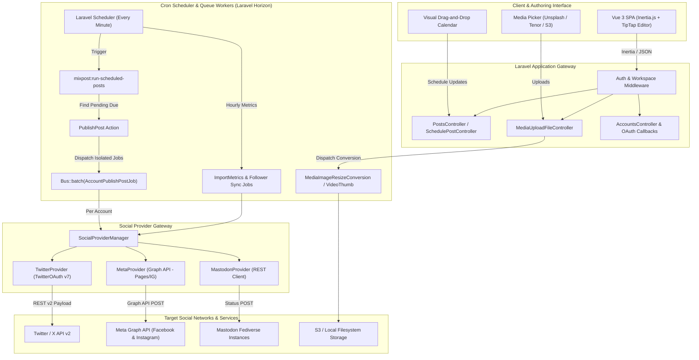
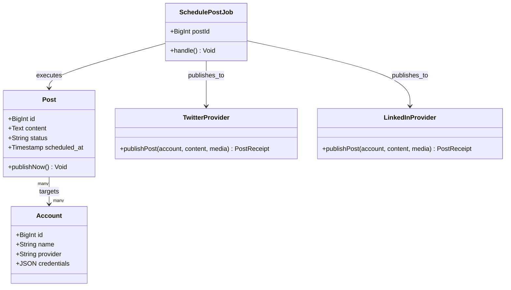
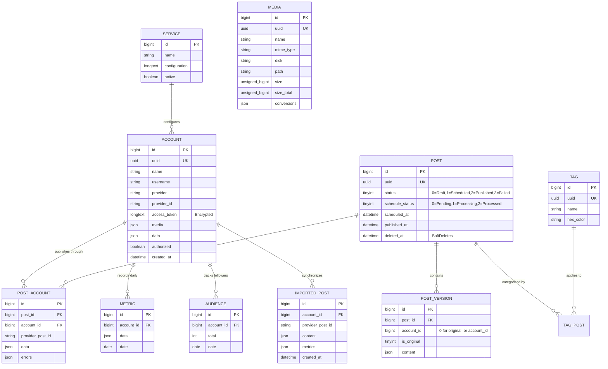
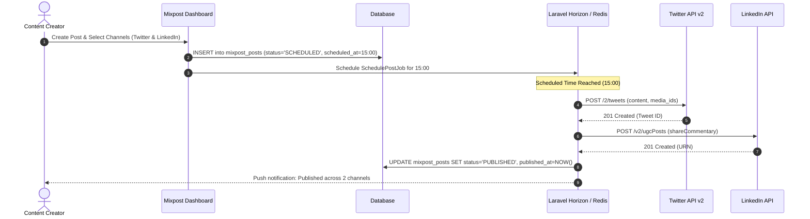

# mixpost - Architecture & Technical Wiki

> **Self-Hosted Social Media Management & Publishing Engine Built as an Embeddable Laravel & Inertia.js Package**  
> GitHub: [inovector/mixpost](https://github.com/inovector/mixpost) | Stack: PHP 8.2+, Laravel 10/11/12, Inertia.js v1/v2, Vue 3, Tailwind CSS v4, MySQL/PostgreSQL, Redis / Laravel Horizon, Intervention Image, PHP-FFmpeg | License: MIT

---

## 1. Executive Summary & Value Proposition

**Mixpost** is an open-source, self-hosted social media management and multi-platform publishing platform designed to run either as a standalone application or as an embeddable Laravel package (`inovector/mixpost`). Built for creators, agencies, and businesses looking to escape the prohibitive per-account recurring subscription costs of proprietary SaaS platforms (such as Buffer, Hootsuite, and Sprout Social), Mixpost provides total data sovereignty, unmetered account connections, and direct API control.

Mixpost solves the fundamental friction in modern content distribution: authoring a single core campaign narrative while tailoring platform-specific nuances (character lengths, hashtags, aspect ratios, and media formats) across heterogeneous social networks including Twitter/X, Facebook Pages, Instagram, and Mastodon.

### Core Problems Solved
- **Prohibitive SaaS Per-Seat & Per-Account Pricing**: Eliminates escalating monthly fees by hosting on existing Laravel/PHP infrastructure, allowing unlimited workspaces, social accounts, and scheduled publications.
- **Data Sovereignty & Token Security**: Stores API secrets and client tokens locally within encrypted database columns (`EncryptArrayObject`), preventing credential exposure to third-party aggregator clouds.
- **Format Divergence Across Social APIs**: Resolves the disparity between rigid network schemas through a clean "Original vs. Variant" versioning model (`mixpost_post_versions`), enabling cross-posting without compromising platform-specific styling.
- **Batch Publishing Fault Isolation**: Employs Laravel's asynchronous `Bus::batch()` with `allowFailures()` semantics, guaranteeing that an API outage or credential revocation on one network does not abort concurrent delivery to others.
- **Asynchronous Media Processing & Thumbnailing**: Offloads heavy graphic resizing (`Intervention/Image`) and video poster frame generation (`php-ffmpeg`) to background queue workers before dispatching to destination APIs.

---

## 2. High-Level System Architecture

Mixpost operates as an event-driven, queue-centric publisher. Requests flow from a modern Vue 3 + Inertia.js single-page application into Laravel route controllers, which interface with Eloquent ORM models and dispatch queued background jobs monitored by Laravel Horizon.



---

### 2.1 Core Domain & Service Class Architecture



---

## 3. Technology Stack & Key Dependencies

| Layer | Component | Version / Description |
| :--- | :--- | :--- |
| **Language & Runtime** | PHP | `^8.2` (Strict Types, Enums, Readonly Properties) |
| **Framework Core** | Laravel Framework | `^10.47`, `^11.0`, or `^12.0` (Modular Package structure) |
| **Frontend Runtime** | Inertia.js + Vue 3 | `@inertiajs/vue3: ^1.0.2`, `vue: ^3.5.13` (Zero client-side API layer) |
| **Styling & Assets** | Tailwind CSS v4 + Vite | `tailwindcss: ^4.1.3`, `@tailwindcss/vite: ^4.1.3`, `vite: ^5.4.9` |
| **Rich Text Engine** | TipTap Core | `@tiptap/vue-3: ^2.7.2` (Multi-line editor, mentions, links) |
| **Queue & Monitoring** | Laravel Horizon + Redis | `laravel/horizon: ^5.0`, Redis Queue backend |
| **Database & Cache** | MySQL / PostgreSQL / SQLite | Multi-engine Eloquent migrations, JSON column support |
| **Image Manipulation** | Intervention Image | `intervention/image: ^2.7` (GD / Imagick drivers) |
| **Video Processing** | PHP-FFmpeg | `php-ffmpeg/php-ffmpeg: ^1.0` (Frame extraction, aspect checks) |
| **Social API Clients** | Inovector TwitterOAuth | `inovector/twitteroauth: ^7.0` (X API v1.1 & v2 endpoints) |
| **HTTP Client** | GuzzleHTTP | `guzzlehttp/guzzle: ^7.8` (Async streaming, webhook delivery) |
| **Testing Suite** | Pest PHP | `pestphp/pest: ^2.34|^3.0`, `orchestra/testbench: ^9.2|^10.0` |

---

## 4. Repository Layout & Key Modules

```
inspire/mixpost/
├── config/
│   └── mixpost.php                    # Package configuration, disks, route prefixes, horizon tag
├── database/
│   ├── factories/                     # Model factories for Pest/PHPUnit testing
│   └── migrations/
│       └── create_mixpost_tables.php  # Single consolidated database migration (12 tables)
├── resources/
│   ├── js/                            # Vue 3 Inertia frontend components
│   │   ├── Components/                # TipTap editor, media modals, calendar widgets
│   │   ├── Pages/                     # Posts, Accounts, Calendar, Media, Analytics, Settings
│   │   └── app.js                     # Inertia application entrypoint
│   └── views/
│       └── app.blade.php              # Root HTML blade template hosting the Inertia mount
├── routes/
│   └── web.php                        # Inertia UI routes and JSON API controller bindings
├── src/
│   ├── Actions/                       # Single-purpose domain action classes
│   │   ├── AccountPublishPost.php     # Executes single provider publish call and parses errors
│   │   ├── PublishPost.php            # Batches account jobs onto Horizon queue
│   │   └── UpdateOrCreateAccount.php  # Persists authenticated OAuth tokens to DB
│   ├── Commands/                      # Artisan console commands
│   │   ├── RunScheduledPosts.php      # Scans database for due scheduled posts
│   │   ├── ImportAccountAudience.php  # Pulls follower counts across providers
│   │   └── ProcessMetrics.php         # Computes impressions, clicks, and engagement
│   ├── Enums/                         # Strongly-typed state enumerations
│   │   ├── PostStatus.php             # DRAFT, SCHEDULED, PUBLISHED, FAILED
│   │   └── PostScheduleStatus.php     # PENDING, PROCESSING, PROCESSED
│   ├── Http/
│   │   └── Controllers/               # REST & Inertia controllers
│   │       ├── AccountsController.php # Social profile linking and disconnection
│   │       ├── CalendarController.php # Date-filtered calendar view data
│   │       ├── PostsController.php    # Multi-version post creation and updates
│   │       └── MediaController.php    # File uploads, S3 sync, and external downloads
│   ├── Jobs/
│   │   └── AccountPublishPostJob.php  # Horizon worker job executing AccountPublishPost
│   ├── MediaConversions/              # Media transformers
│   │   ├── MediaImageResizeConversion.php # Thumbnails & optimized delivery sizes
│   │   └── MediaVideoThumbConversion.php  # Video frame extraction via FFmpeg
│   ├── Models/                        # Eloquent ORM entity models
│   │   ├── Account.php                # Connected social account with EncryptArrayObject
│   │   ├── Post.php                   # Core post record with status & scheduling
│   │   ├── PostVersion.php            # Per-account content and option overrides
│   │   ├── Media.php                  # Stored asset metadata and derived conversions
│   │   └── Metric.php                 # Historical analytics snapshots
│   ├── SocialProviders/               # Provider abstraction adapters
│   │   ├── Mastodon/                  # Mastodon OAuth and status publishing
│   │   ├── Meta/                      # Facebook Pages & Instagram Graph API
│   │   └── Twitter/                   # Twitter/X API v1.1 Media + v2 Tweet creation
│   ├── Support/
│   │   ├── PostContentParser.php      # Formats HTML TipTap tags into network plain text
│   │   └── SocialProviderResponse.php # Standardized response & error wrapper
│   ├── MixpostServiceProvider.php     # Laravel package bootstrapper and command binder
│   └── SocialProviderManager.php      # Factory manager instantiating provider drivers
```

---

## 5. Core Features & Capabilities

### 5.1 Social Account Connection & OAuth Token Lifecycle
Mixpost centralizes social connectivity through `SocialProviderManager.php`. Third-party app credentials (client IDs, consumer keys, and app secrets) are configured in `mixpost_services` via the dashboard UI or environment variables.
- **OAuth 1.0a (Twitter/X)**: Mixpost leverages `TwitterProvider` using `inovector/twitteroauth` to execute 3-legged PIN or callback flows, storing oauth token secrets inside `mixpost_accounts.access_token`.
- **OAuth 2.0 with Granular Scopes (Meta & Mastodon)**: Mixpost initiates authorization flows requesting explicit publishing and metrics scopes (`pages_manage_posts`, `pages_read_engagement`, `instagram_basic`, `instagram_content_publish`). Long-lived page tokens are exchanged automatically upon callback.
- **Encryption at Rest**: The `Account` Eloquent model casts the `access_token` column to `EncryptArrayObject::class`. Laravel's native AES-256-CBC authenticated encryption secures access keys, refresh tokens, and secret pairings in the database, decrypting them strictly in-memory during job execution.

### 5.2 Multi-Platform Post Composer & Account-Specific Versions
Content authoring centers on the TipTap-powered composer. Unlike rudimentary schedulers that force identical text across networks, Mixpost separates posts into versions:
1. **The "Original" Version (`is_original = 1`)**: Serves as the default copy, media list, and formatting master.
2. **Account Overrides (`mixpost_post_versions.account_id = {id}`)**: Authors can branch any connected account into a distinct tab. The child version inherits copy from the original until customized.
3. **Format Transformation**: `PostContentParser` automatically strips TipTap's HTML paragraph and div wrappers into sanitized newline structures (`\n`), decodes HTML entities, and validates character boundaries using `twitter-text` (280 UTF-8 count) or standard multi-byte string functions.

### 5.3 Asynchronous Media Transcoding & Conversions
Media assets uploaded through `MediaUploadFileController` are written to disk (Local or AWS S3) and recorded in `mixpost_media`.
- **Image Conversions**: `MediaImageResizeConversion` utilizes Intervention Image to create high-density thumbnails (`thumb`, `medium`) while stripping camera EXIF metadata to protect user privacy.
- **Video Poster Extraction**: When an MP4 or MOV is uploaded, `MediaVideoThumbConversion` triggers `FFMpeg::open()`, advances to the 1-second mark, extracts a still frame, and stores it as the video preview thumbnail.
- **Stock Media & GIF Hubs**: Built-in endpoints allow instant proxy search and download of Unsplash stock photography and Tenor animated GIFs, fetching assets server-side to bypass client CORS restrictions.

### 5.4 Calendar Scheduling & Horizon Batch Queue
Post scheduling is executed with minute-level precision without holding long-lived sleep threads:
- **Scheduler Heartbeat**: A cron job invokes `php artisan mixpost:run-scheduled-posts` every minute. It queries `mixpost_posts` where `status = SCHEDULED`, `schedule_status = PENDING`, and `scheduled_at <= now()`.
- **Batched Execution**: The `PublishPost` action transitions `schedule_status` to `PROCESSING` and compiles an array of `AccountPublishPostJob` instances—one per target account.
- **Failure Isolation**: Jobs run within `Bus::batch($jobs)->allowFailures()`. If Twitter returns a rate-limit 429 error or Facebook rejects an image ratio, those errors are recorded in `mixpost_post_accounts.errors`, while Mastodon delivery succeeds unimpeded. The batch's `finally()` callback marks the root post as `PUBLISHED` or `FAILED` based on whether errors occurred.

### 5.5 Analytics Ingestion & Performance Dashboards
Mixpost features periodic background synchronization for post analytics and audience growth:
- **Metrics Fetching**: Scheduled artisan commands (`mixpost:import-account-data` and `mixpost:process-metrics`) query platform metrics endpoints.
- **Normalized Data Lake**: Raw reactions, impressions, reach, retweets, and comments are stored as JSON payloads in `mixpost_metrics` and `mixpost_facebook_insights` indexed by `account_id` and `date`.
- **Chart.js Visualization**: The dashboard aggregates daily snapshots into interactive engagement and follower growth trends using Chart.js with zooming and date filtering.

---

## 6. Data Models & Schema Architecture

Mixpost encapsulates its complete domain model within 12 purpose-built tables managed through `create_mixpost_tables.php`.



### Core Schema Definitions

#### `mixpost_accounts`
- `id` (BIGINT, PK): Auto-increment primary key.
- `uuid` (UUID, Unique): Public immutable identifier.
- `name` (VARCHAR): Display name of the profile or page.
- `username` (VARCHAR, Nullable): Handle (e.g. `@marketingstudio`).
- `provider` (VARCHAR): Integration driver (`twitter`, `facebook_page`, `mastodon`).
- `provider_id` (VARCHAR): Remote platform account ID.
- `access_token` (LONGTEXT): AES-256 encrypted serialized token credentials.
- `authorized` (BOOLEAN): Connection health state.
- Composite Index: `UNIQUE(provider, provider_id)`.

#### `mixpost_posts`
- `id` (BIGINT, PK): Post entity identifier.
- `status` (TINYINT): Post state machine (`0` = Draft, `1` = Scheduled, `2` = Published, `3` = Failed).
- `schedule_status` (TINYINT): Worker queue state (`0` = Pending, `1` = Processing, `2` = Processed).
- `scheduled_at` (DATETIME, Nullable): Target publication timestamp in UTC.
- `published_at` (DATETIME, Nullable): Timestamp of successful delivery.

#### `mixpost_post_versions`
- `id` (BIGINT, PK): Identifier.
- `post_id` (BIGINT, FK): Cascades on post delete.
- `account_id` (BIGINT): Specific target account ID, or `0` for original.
- `is_original` (TINYINT): Boolean flag denoting master fallback copy.
- `content` (JSON): Structured blocks containing TipTap raw body and media attachment IDs:
  ```json
  [
    {
      "body": "<div>Announcing our new feature! 🚀</div>",
      "media": [12, 15]
    }
  ]
  ```

---

### 6.1 Comprehensive Database Schema Specification

Mixpost utilizes MySQL or PostgreSQL with Laravel Horizon queuing.

#### Table: `mixpost_posts`
Scheduled and published social media posts.

| Column | Type | Constraints | Default | Description |
| :--- | :--- | :--- | :--- | :--- |
| `id` | `BIGINT UNSIGNED`| `PRIMARY KEY AUTO_INCREMENT` | - | Post identifier |
| `status` | `VARCHAR(50)` | `NOT NULL` | `'DRAFT'` | State (`DRAFT`, `SCHEDULED`, `PUBLISHING`, `PUBLISHED`, `FAILED`) |
| `scheduled_at` | `TIMESTAMP` | `NULLABLE` | `NULL` | Scheduled publication time |
| `published_at` | `TIMESTAMP` | `NULLABLE` | `NULL` | Actual publication time |
| `created_at` | `TIMESTAMP` | `NOT NULL` | `NOW()` | Creation timestamp |

*Indexes:* `idx_mixpost_status_sched` (`(status, scheduled_at)`).

---

#### Table: `mixpost_accounts`
Social media account credentials and OAuth tokens.

| Column | Type | Constraints | Default | Description |
| :--- | :--- | :--- | :--- | :--- |
| `id` | `BIGINT UNSIGNED`| `PRIMARY KEY AUTO_INCREMENT` | - | Account identifier |
| `name` | `VARCHAR(255)` | `NOT NULL` | - | Profile handle / account name |
| `provider` | `VARCHAR(50)` | `NOT NULL` | - | Platform (`twitter`, `facebook`, `linkedin`, `instagram`) |
| `data` | `JSON` | `NOT NULL` | - | Encrypted OAuth access & refresh tokens |

*Indexes:* `idx_mixpost_provider` (`(provider)`).

---

## 7. API Architecture, Webhooks & Key Endpoints

Mixpost provides clean RESTful routes designed for Inertia SPA requests and headless automation.

### Key REST Endpoints

| Method | Endpoint | Description |
| :--- | :--- | :--- |
| `GET` | `/mixpost/posts` | Paginated listing of drafts, scheduled, and published posts |
| `POST` | `/mixpost/posts` | Create new post with versions, schedule timestamp, and accounts |
| `PUT` | `/mixpost/posts/{post}` | Update post content, accounts, or schedule time |
| `POST` | `/mixpost/posts/{post}/schedule` | Explicitly schedule or transition a post to queue |
| `POST` | `/mixpost/posts/{post}/duplicate` | Duplicate an existing post with its media and versions |
| `DELETE` | `/mixpost/posts` | Bulk soft-delete posts by array of IDs |
| `GET` | `/mixpost/calendar` | Retrieve scheduled posts mapped across a monthly/weekly range |
| `POST` | `/mixpost/media/upload` | Multipart file upload returning `Media` record and conversions |
| `GET` | `/mixpost/services` | List third-party social provider configurations |
| `PUT` | `/mixpost/services/{service}` | Update API keys and consumer secrets for a provider |

### Sample Payload: Post Creation & Scheduling
`POST /mixpost/posts`
```json
{
  "status": 1,
  "date": "2026-11-01",
  "time": "14:30",
  "accounts": [1, 4],
  "tags": [2],
  "versions": [
    {
      "account_id": 0,
      "is_original": true,
      "content": [
        {
          "body": "We are thrilled to unveil our v2.0 update! Check out what is new in the dashboard. #SaaS #Growth",
          "media": [108]
        }
      ]
    },
    {
      "account_id": 1,
      "is_original": false,
      "content": [
        {
          "body": "Big news! v2.0 is live. Thread below with the full breakdown 🧵👇",
          "media": [108]
        }
      ]
    }
  ]
}
```

---

### 7.5 End-to-End Operational Lifecycle Sequence



---

## 8. Strategic Value & Takeaways for MarketingStudio

Mixpost offers an exceptionally clean, battle-tested blueprint for MarketingStudio's social publishing engine.

### Reusable Architectural Patterns
1. **Fallback-Driven Versioning Engine**: The `PostVersion` model structure (`is_original` vs `account_id`) solves the multi-platform content dilemma cleanly. MarketingStudio should adopt this exact pattern: authors write once in the master slot, and only generate distinct records when they want platform-specific customizations (such as shorter tweets or platform-specific hashtag blocks).
2. **Batch Queue with Failure Isolation**: Leveraging `Bus::batch()->allowFailures()` guarantees that if an expired token causes one provider to fail, it does not abort publishing to the remaining accounts. MarketingStudio can replicate this either via Laravel's batch engine or equivalent BullMQ flow-child groups.
3. **Transparent Credential Encryption (`EncryptArrayObject`)**: Rather than handling custom crypto wrappers inside controllers, casting credential columns to custom Eloquent cast classes keeps encryption completely transparent to business logic, preventing unintentional plaintext leakage in logs or API dumps.
4. **Decoupled Minute-Precision Scheduling**: Rather than calculating delay timers when posts are created (which break when posts are rescheduled or server clocks shift), querying due posts every minute with `status = SCHEDULED` and `scheduled_at <= now()` provides maximum resilience against queue restarts and schedule modifications.
