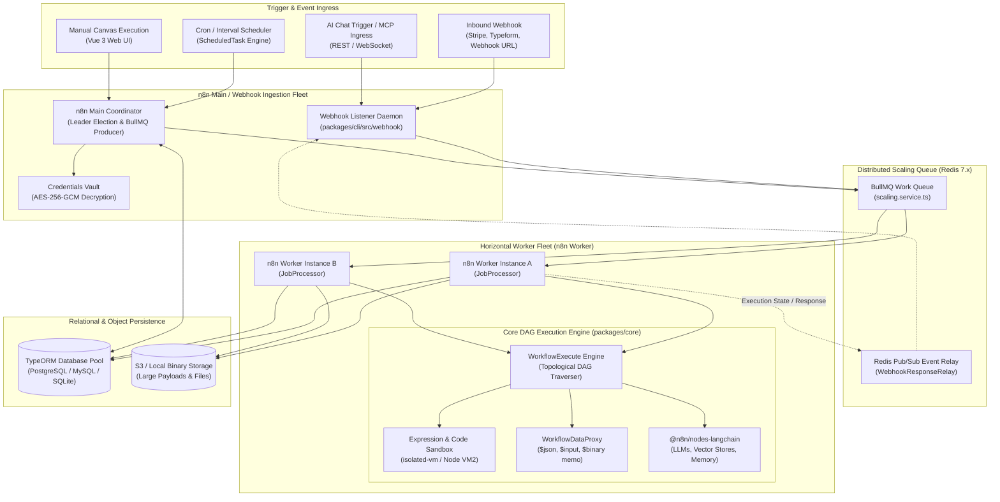
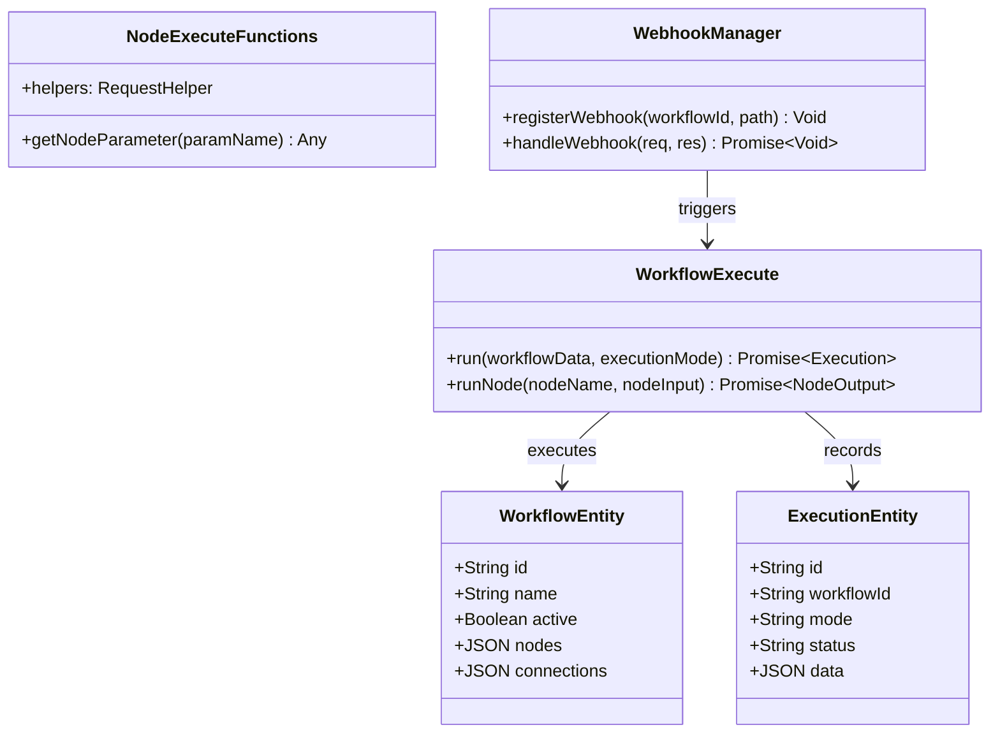
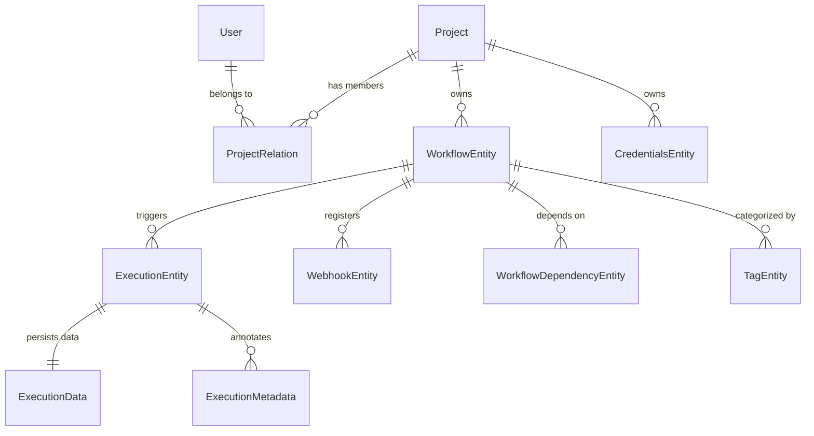
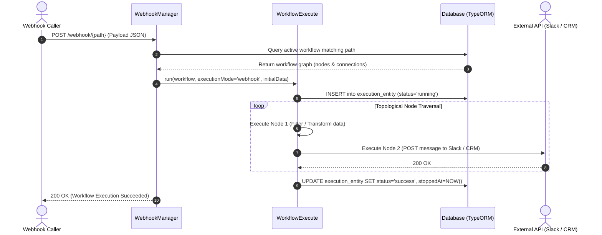

# n8n - Architecture & Technical Wiki

> **Fair-Code Multi-Tenant Workflow Automation Engine, Directed Acyclic Graph (DAG) Execution Pipeline & Autonomous AI Agent Orchestration Platform**  
> GitHub: [n8n-io/n8n](https://github.com/n8n-io/n8n.git) | Stack: TypeScript, Node.js, Vue 3, TypeORM, PostgreSQL / SQLite / MySQL, BullMQ, Redis, LangChain | License: Sustainable Use License v1.0 (Fair-Code) / Enterprise EE

---

## 1. Executive Summary & Value Proposition

**n8n** is an enterprise-grade, fair-code workflow automation and systems integration engine designed to connect heterogeneous APIs, operational databases, SaaS platforms, and artificial intelligence agents. Built as a high-performance modular TypeScript monorepo, n8n provides an interactive visual node canvas backed by a deterministic Directed Acyclic Graph (DAG) execution engine.

In modern enterprise automation and RevOps infrastructure, organizations are crippled by per-task SaaS subscription models (e.g., Zapier, Make), opaque third-party cloud data residency, and rigid integration logic. n8n solves these operational barriers by offering complete self-hosted control, raw code-level execution flexibility (sandboxed Node.js and Python), zero telemetry leakage, and native support for LangChain-driven autonomous agent graphs.

### Core Problems Solved
- **Prohibitive SaaS Per-Task Pricing**: Replaces volume-metered pricing models with self-hosted, unconstrained task execution running on customer-owned infrastructure.
- **Enterprise Data Sovereignty & Security**: Keeps proprietary customer records, PII, and credentials within private VPCs and on-premise clusters with AES-256 encrypted credential vaults.
- **Complex Branching, Looping & Data Transformation**: Provides native JavaScript/Python scripting, JMESPath queries, paired-item tracking, dynamic merging, and loop constructs on arbitrary JSON arrays.
- **Distributed Cluster Horizontal Scaling**: Features multi-main coordinator failover and BullMQ/Redis worker fleets capable of orchestrating tens of thousands of concurrent webhook events and scheduled cron jobs.
- **Hybrid Deterministic & Generative AI Pipelines**: Bridges structured REST/GraphQL APIs with probabilistic LLMs, RAG vector search, vector embeddings, and autonomous conversational agents via `@n8n/nodes-langchain`.

---

## 2. High-Level System Architecture

n8n decouples workflow definition, trigger ingress, queue coordination, DAG resolution, and execution persistence across distinct runtime processes.



### Execution Flow Architecture
1. **Trigger Phase**: Inbound HTTP webhooks arrive at the lightweight `WebhookServer` process or timer scheduler fires within the elected `MainCoordinator`.
2. **Payload Dispatch**: The trigger parses parameters, validates secrets, and pushes a typed `JobData` envelope into the Redis BullMQ queue.
3. **Queue Distribution & Worker Pickup**: Available `n8n Worker` daemons claim the job, hydrate credentials from the database via AES-256 decryption, and initialize an instance of `WorkflowExecute`.
4. **DAG Topological Resolution**: `WorkflowExecute` traverses nodes sequentially and in parallel branches according to connection rules, routing JSON item arrays through `WorkflowDataProxy`.
5. **State & Relay Completion**: Finished run data is persisted to `execution_entity` and `execution_data`, while binary artifacts stream to S3/local disk. In webhook-response mode, completion events publish across Redis Pub/Sub to resolve synchronous HTTP client calls.

---

### 2.1 Core Domain & Service Class Architecture



---

## 3. Technology Stack & Key Dependencies

| Layer | Technology | Purpose & Implementation Details |
|---|---|---|
| **Monorepo & Build** | Turborepo, pnpm workspaces, TypeScript 5.x | Orchestrates builds across `@n8n/*` modular packages and microservices |
| **Backend Runtime** | Node.js (v20+ / v22 LTS) | Core service runtime leveraging async event loop and native crypto |
| **HTTP Framework** | Express 4 / Koa / Custom routing | Serves REST endpoints, webhook listeners, and WebSocket streaming |
| **Frontend Framework** | Vue 3, Pinia, VueFlow, Tailwind CSS | Reactive canvas node editor, live execution timeline, dynamic form inputs |
| **ORM & Database** | TypeORM 0.3.x, PostgreSQL / MySQL / SQLite | Schema management, migrations, multi-dialect enterprise persistence |
| **Queue & Scaling** | Redis 7.x, BullMQ | Horizontal worker queue, job outcome tracking, distributed locks |
| **Sandboxing** | `isolated-vm` / Node `vm` | Memory-bounded, CPU-restricted execution of custom JavaScript/Python code |
| **AI Orchestration** | LangChain.js, OpenAI, Anthropic, Ollama | Conversational agent nodes, vector embeddings, RAG chains, memory buffers |
| **Binary Storage** | Local FS / S3-compatible Blob Storage | Large file processing, PDF generation, email attachment streaming |

---

## 4. Repository Layout & Key Modules

```text
inspire/n8n/
├── packages/
│   ├── @n8n/
│   │   ├── db/                      # Database entities, TypeORM connection pool & migrations
│   │   │   └── src/entities/        # WorkflowEntity, ExecutionEntity, CredentialsEntity, etc.
│   │   ├── config/                  # Global configuration, scaling configs, license tiers
│   │   ├── di/                      # Dependency Injection container and service decorators
│   │   ├── expression-runtime/      # Sandboxed expression evaluation and idle scaling pool
│   │   ├── nodes-langchain/         # Native LangChain AI components, tools, memory, agents
│   │   ├── task-runner/             # Dedicated subprocess/container task execution runners
│   │   └── permissions/             # RBAC and team workspace authorization policies
│   ├── cli/                         # Core n8n daemon, webhook receiver, worker & REST APIs
│   │   ├── src/
│   │   │   ├── scaling/             # ScalingService, BullMQ queue managers, leader election
│   │   │   ├── executions/          # ExecutionCrashService, active run persistence
│   │   │   ├── webhook/             # High-throughput webhook ingress router and handlers
│   │   │   └── commands/            # CLI entrypoints: start, worker, webhook, license
│   ├── core/                        # Engine core runtime
│   │   └── src/execution-engine/    # WorkflowExecute DAG resolver, node runner, suspension
│   ├── workflow/                    # Abstract workflow definitions, interfaces, expressions
│   │   ├── src/workflow.ts          # Graph traversal, node connection validators
│   │   └── src/workflow-data-proxy.ts # Reactive $json, $node, $binary expression proxies
│   ├── nodes-base/                  # 400+ built-in node integrations (HTTP, Stripe, Postgres)
│   └── frontend/                    # Vue 3 visual canvas, canvas nodes, settings, auth UI
```

---

## 5. Core Features & Capabilities

### 5.1 Deterministic DAG Execution & Paired-Item Semantics
The execution heart of n8n (`WorkflowExecute`) executes workflows as Directed Acyclic Graphs. Nodes ingest arrays of items (`INodeExecutionData[]`) containing JSON payloads and binary metadata. Unlike simple sequential runners, n8n retains "Paired Item" lineage: downstream nodes know exactly which input item in node $N-1$ generated an output item in node $N$. This eliminates data misalignment during batch transforms, list splitting, and API pagination loops.

### 5.2 Multi-Mode Scaling Architecture (Single, Worker & Webhook Fleet)
n8n supports three operational deployment topologies configured via `EXECUTIONS_MODE`:
1. **Regular Mode**: Single container running Web UI, webhook ingress, and in-memory execution loop.
2. **Scaling Worker Mode**: Multiple stateless worker containers subscribing to BullMQ Redis queues, pulling pending executions while `n8n Main` acts as coordinator and editor.
3. **Dedicated Webhook Listeners**: Isolated, lightweight stateless HTTP containers receiving inbound webhooks, writing immediately to BullMQ, and returning instant HTTP 200/202 acknowledgments or awaiting Redis pub/sub completion.

### 5.3 Workflow Expressions & Secure Sandboxing Pool
Dynamic node parameters are evaluated via double curly syntax `{{ $json.customer_id }}`. The expression runtime uses an `IdleScalingPool` of sandboxed isolates (`isolated-vm`), preventing malicious workflows from hijacking host environment variables, filesystem sockets, or escaping the Node process memory space.

### 5.4 LangChain Autonomous AI Nodes & Conversational Graphs
n8n natively packages `@n8n/nodes-langchain`, allowing visual assembly of multi-step AI agents. Users wire together LLM providers (Anthropic, OpenAI, Ollama), Tool calling nodes (custom HTTP endpoints, database lookups, code snippets), Vector Stores (Qdrant, Pinecone, pgvector), and Windowed Conversation Memory to construct self-healing agentic workflows.

### 5.5 Enterprise Credential Encryption & External Vaults
All connection credentials (API keys, OAuth2 refresh tokens, private SSH keys) are stored in `credentials_entity` encrypted via AES-256-GCM using an encryption key unique to the n8n installation. Enterprise configurations support dynamic external secrets retrieval directly from HashiCorp Vault, AWS Secrets Manager, and Azure Key Vault.

---

## 6. Data Models & Schema Architecture

n8n utilizes TypeORM across PostgreSQL, MySQL, and SQLite. The primary entities govern workflows, active and archived executions, encrypted credentials, webhook routes, and enterprise RBAC projects.



### Core Schema Entity Definitions

#### `WorkflowEntity` (`workflow_entity`)
- `id` (`varchar(36)`, PK): Unique UUID identifying the workflow.
- `name` (`varchar(128)`): Display name of the workflow.
- `active` (`boolean`): Indicates whether triggers and pollers are registered.
- `nodes` (`json` / `text`): Serialized JSON array of node definitions, parameters, and canvas UI coordinates.
- `connections` (`json` / `text`): Graph adjacency list defining inputs and outputs between nodes.
- `settings` (`json`): Retry policies, error workflow handlers, execution timeouts, and save execution flags.
- `versionId` (`varchar(36)`): Optimistic locking hash for concurrent editor synchronization.

#### `ExecutionEntity` (`execution_entity`)
- `id` (`integer` / `varchar`, PK): Auto-increment or unique execution ID.
- `status` (`enum`): `waiting`, `running`, `success`, `error`, `crashed`, `canceled`.
- `mode` (`varchar(32)`): Trigger type: `manual`, `trigger`, `webhook`, `poll`, `retry`, `evaluation`.
- `workflowId` (`varchar(36)`, FK): Reference to parent `WorkflowEntity`.
- `startedAt` (`timestamp`): Execution start timestamp.
- `stoppedAt` (`timestamp`): Completion timestamp.
- `waitTill` (`timestamp`, nullable): Resume timestamp for wait/delay nodes.

#### `ExecutionData` (`execution_data`)
- `executionId` (`integer`, PK, FK): Foreign key link to `execution_entity`.
- `data` (`mediumtext` / `longtext`): Full serialized execution history, per-node input/output item arrays, and error stack traces.
- `workflowData` (`json`): Snapshot of the workflow graph state at the time of execution.

#### `CredentialsEntity` (`credentials_entity`)
- `id` (`varchar(36)`, PK): Unique credential identifier.
- `name` (`varchar(128)`): Credential label.
- `type` (`varchar(64)`): Credential provider type (e.g., `hubspotOAuth2Api`, `postgres`).
- `data` (`text`): AES-256-GCM ciphertext containing secret keys and credentials.

---

### 6.1 Comprehensive Database Schema Specification

n8n manages workflow topologies, credentials, and execution logs in PostgreSQL or SQLite.

#### Table: `workflow_entity`
Stores executable visual workflow definitions and node connections.

| Column | Type | Constraints | Default | Description |
| :--- | :--- | :--- | :--- | :--- |
| `id` | `VARCHAR(255)` | `PRIMARY KEY` | - | Unique workflow ID |
| `name` | `VARCHAR(255)` | `NOT NULL` | - | Workflow title |
| `active` | `BOOLEAN` | `NOT NULL` | `false` | Active webhook listener flag |
| `nodes` | `JSON` | `NOT NULL` | `'[]'` | Configured node definitions |
| `connections`| `JSON` | `NOT NULL` | `'{}'` | Directed graph edge connections |
| `createdAt` | `DATETIME` | `NOT NULL` | `NOW()` | Creation timestamp |

*Indexes:* Primary key on `id`.

---

#### Table: `execution_entity`
Stores historical run outputs and error states for workflow executions.

| Column | Type | Constraints | Default | Description |
| :--- | :--- | :--- | :--- | :--- |
| `id` | `VARCHAR(255)` | `PRIMARY KEY` | - | Execution run ID |
| `workflowId` | `VARCHAR(255)` | `NOT NULL, FK -> workflow_entity(id)` | - | Associated workflow |
| `status` | `VARCHAR(50)` | `NOT NULL` | `'running'` | Execution state (`running`, `success`, `error`) |
| `mode` | `VARCHAR(50)` | `NOT NULL` | `'webhook'` | Trigger mode (`webhook`, `manual`, `trigger`) |
| `startedAt` | `DATETIME` | `NOT NULL` | `NOW()` | Start timestamp |
| `stoppedAt` | `DATETIME` | `NULLABLE` | `NULL` | Completion timestamp |

*Indexes:* `idx_execution_workflow` (`(workflowId)`), `idx_execution_status` (`(status)`).

---

## 7. API Architecture, Webhooks & Key Endpoints

n8n exposes public REST APIs, authenticated editor endpoints, and dynamic webhook ingestion endpoints.

### Key API Endpoints

| Method | Endpoint | Description | Auth Required |
|---|---|---|---|
| `GET` | `/api/v1/workflows` | List workflows with pagination, tags, and project scoping | API Key / Session |
| `POST` | `/api/v1/workflows` | Create a new workflow graph definition | API Key / Session |
| `POST` | `/api/v1/workflows/:id/activate` | Activate triggers and register webhooks | API Key / Session |
| `POST` | `/api/v1/executions` | Trigger manual workflow run with custom input payload | API Key / Session |
| `GET` | `/api/v1/executions/:id` | Fetch full execution run output, node metrics, and logs | API Key / Session |
| `POST` | `/webhook/:path` | Production webhook trigger endpoint | Public / Webhook Auth |
| `POST` | `/webhook-test/:path` | Test/draft webhook trigger for canvas live debugging | Session |

### Inbound Webhook Execution Sample
```http
POST /webhook/marketing-lead-ingress HTTP/1.1
Host: n8n.internal.net
Content-Type: application/json
X-Webhook-Secret: 7f8a9b2c3d4e5f6a

{
  "event": "lead.created",
  "data": {
    "email": "sarah.connor@cyberdyne.io",
    "name": "Sarah Connor",
    "company": "Cyberdyne Systems",
    "intent_score": 92,
    "source": "outbound_campaign"
  }
}
```

### Workflow Execution Response
```json
{
  "executionId": "104928",
  "status": "success",
  "startedAt": "2026-10-24T12:00:00.120Z",
  "stoppedAt": "2026-10-24T12:00:01.450Z",
  "data": {
    "resultData": {
      "runData": {
        "CRM Router": [
          {
            "json": {
              "assigned_owner": "rep_michael_k",
              "tier": "enterprise",
              "action_taken": "slack_notification_dispatched"
            }
          }
        ]
      }
    }
  }
}
```

---

### 7.5 End-to-End Operational Lifecycle Sequence

The following sequence shows how n8n receives an inbound webhook, initializes node execution contexts, runs nodes topologically, and records results.



---

## 8. Strategic Value & Takeaways for MarketingStudio

### Reusable Architectural Patterns
1. **Isolated-VM Dynamic Expressions & Sandboxing**: MarketingStudio can adopt n8n's expression proxy model (`WorkflowDataProxy`), enabling users to author fluid string templates and calculations without security exposure.
2. **Decoupled Webhook Ingress Fleet**: Separating lightweight HTTP webhook ingestion daemons from heavy execution workers ensures MarketingStudio never drops lead capture webhooks during massive outbound campaign spikes.
3. **Paired-Item Execution Semantics**: Adopting item-level lineage across multi-step marketing operations prevents batch data distortion when mapping lead enrichment arrays, CRM updates, and email deliveries.

### Convergence Blueprint for MarketingStudio
- **Unified Campaign Orchestration**: Embed n8n as the foundational automation runtime for MarketingStudio, allowing marketing operators to visually orchestrate lead enrichment, qualification, and routing.
- **AI Agent Automation**: Utilize n8n's LangChain integration layer to deploy intelligent SDR agents that read incoming emails, query internal marketing knowledge bases, and trigger tailored follow-up sequences.
- **Deterministic System Glue**: Connect MarketingStudio's CRM, telephony, document signing, and SEO modules directly into n8n node libraries for end-to-end operational visibility.
