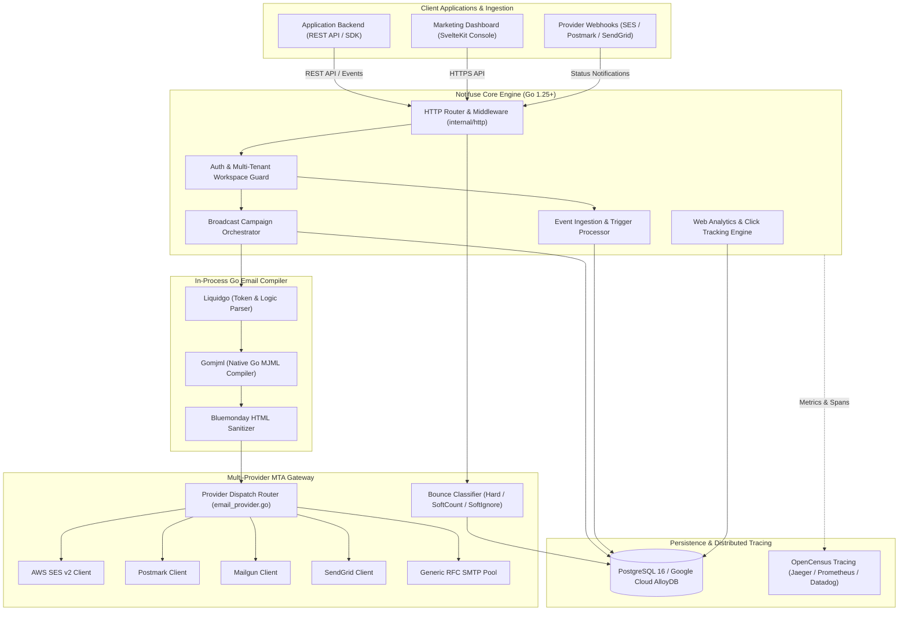
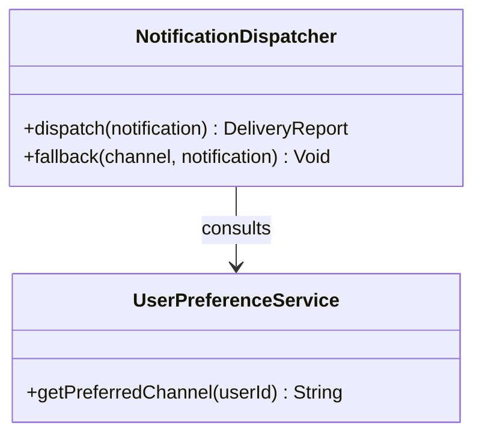
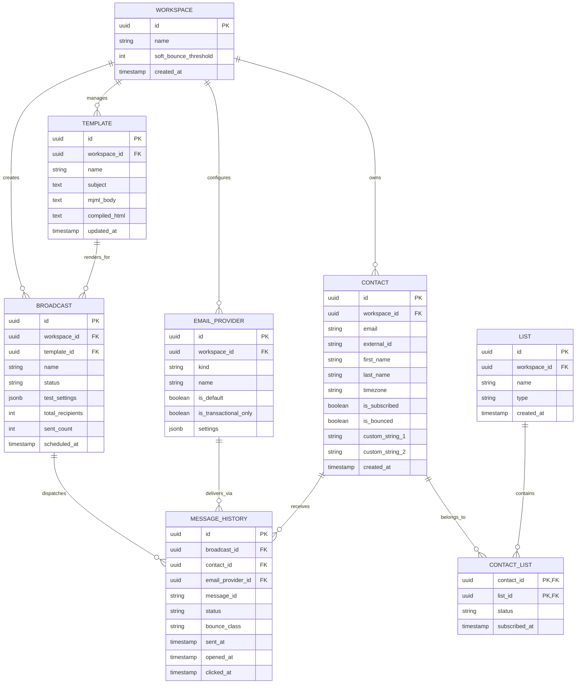
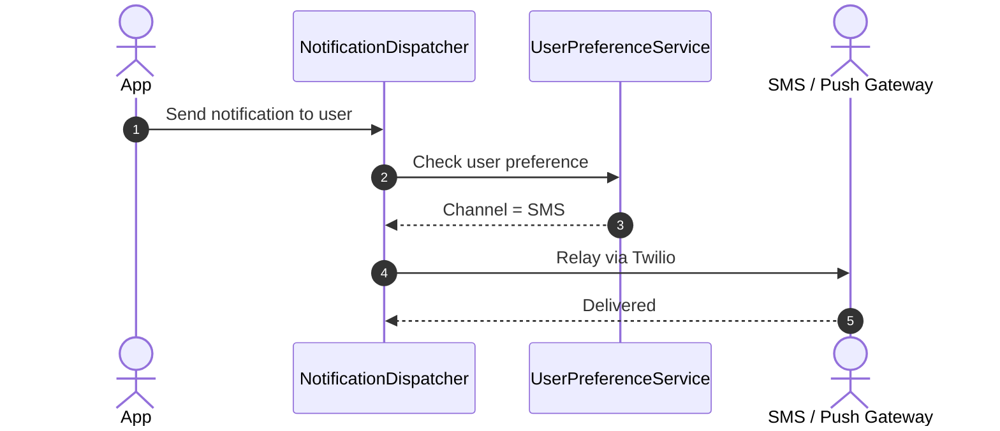

# notifuse - Architecture & Technical Wiki

> **High-Throughput Notification Infrastructure, Go-Native Liquid/MJML Email Engine & Multi-MTA Gateway**  
> GitHub: [Notifuse/notifuse](https://github.com/Notifuse/notifuse) | Stack: Go 1.25+, PostgreSQL / Google Cloud AlloyDB, Liquidgo, Gomjml, OpenCensus, AWS SES v2, SendGrid, Postmark, SvelteKit | License: BSL 1.1 / AGPL-3.0

---

## 1. Executive Summary & Value Proposition

**Notifuse** is an open-source, multi-tenant customer communication platform and notification infrastructure engine written in modern Go (1.25+). Tailored for engineering and product teams seeking a self-hostable replacement for Courier, Novu, and Customer.io, Notifuse unifies transactional messaging, marketing broadcasts, in-app notification centers, and automated event-driven journeys under a single high-performance API.

A defining architectural achievement of Notifuse is its **100% Go-native email compilation pipeline**: rather than spawning sluggish Node.js child processes or calling third-party microservices to compile responsive HTML email templates, Notifuse embeds `liquidgo` (Liquid template parser) and `preslavrachev/gomjml` (MJML compiler written in native Go). This allows Notifuse to personalize, render, and dispatch tens of thousands of complex, responsive emails per second with minimal CPU and memory overhead.

### Core Problems Solved
- **Node.js Template Rendering Bottlenecks**: Replaces external Node.js MJML compilation containers with in-process Go rendering (`gomjml`), achieving sub-millisecond per-email compile times during million-recipient broadcasts.
- **MTA Provider Vendor Lock-In**: Decouples business logic from delivery networks via an abstracted multi-provider gateway (`email_provider.go`), allowing seamless failover between AWS SES, Postmark, Mailgun, SendGrid, SparkPost, Mailjet, and custom SMTP.
- **Provider-Specific Bounce Inconsistencies**: Implements a universal bounce classification state machine (`bounce_classification.go`) that standardizes discordant webhook payloads across SES, SendGrid, and Postmark into deterministic outcomes (`Hard`, `SoftCount`, `SoftIgnore`).
- **Cold Email / Marketing vs. Transactional Collision**: Strictly enforces provider roles (`transactionalOnlyProviderKinds`), preventing high-risk marketing campaigns from degrading the IP reputation reserved for password resets and verification codes.
- **Deep Distributed Observability**: Features native OpenCensus integration with export plugins for Prometheus, Jaeger, Zipkin, Datadog, and AWS CloudWatch, delivering end-to-end tracing across message queues and webhook pipelines.

---

## 2. High-Level System Architecture

Notifuse follows clean Domain-Driven Design (DDD) principles divided into domain models, repositories, business services, and HTTP/Queue adapters:
1. **API & Ingestion Layer (`internal/http`)**: Exposes REST endpoints for contact management, custom event tracking, template CRUD, broadcast scheduling, and inbound delivery webhooks.
2. **Template & Rendering Core (`internal/service/template`)**: Evaluates dynamic contact tokens via `liquidgo` and compiles layout tags to cross-client compatible HTML via `gomjml`.
3. **Queue & Dispatch Orchestrator (`internal/service/broadcast`)**: Splits campaigns into chunks, enforces provider rate limits, and dispatches concurrent payload streams via goroutines and database transaction locks.
4. **Multi-MTA Gateway (`internal/domain/email_provider.go`)**: Sends messages over HTTPS REST APIs (AWS SES v2, Mailgun, Postmark) or direct SMTP connections, listening for asynchronous delivery status notifications.



---

### 2.1 Core Domain & Service Class Architecture



---

## 3. Technology Stack & Key Dependencies

- **Language & Runtime**: Go 1.25.4+ (compiled static binary with zero external runtime dependencies).
- **Relational Storage & Query Builder**:
  - **PostgreSQL 16+** / **Google Cloud AlloyDB** using `github.com/lib/pq` with driver pooling.
  - `github.com/Masterminds/squirrel`: Composable, fluent SQL query builder for complex filtering.
- **In-Memory Rendering & Template Pipeline**:
  - `github.com/Notifuse/liquidgo`: High-performance Liquid template engine fork for Go.
  - `github.com/preslavrachev/gomjml`: Pure Go MJML compiler (eliminating Node.js dependencies).
  - `github.com/microcosm-cc/bluemonday`: Fast HTML sanitization preventing XSS attacks.
- **Email & MTA Transport Clients**:
  - `github.com/aws/aws-sdk-go-v2/service/sesv2`: Official AWS SES v2 SDK.
  - `github.com/wneessen/go-mail` & `github.com/emersion/go-smtp`: Low-level RFC-compliant SMTP.
- **Distributed Observability & Metrics**:
  - `go.opencensus.io` with exporters for AWS X-Ray, Jaeger, Prometheus, Stackdriver, and Datadog.
  - `github.com/rs/zerolog`: Zero-allocation structured JSON logging.
- **AI & Copilot Integrations**:
  - `github.com/anthropics/anthropic-sdk-go`, `google.golang.org/genai`, and `github.com/openai/openai-go/v3`.

---

## 4. Repository Layout & Key Modules

```
inspire/notifuse/
├── cmd/
│   └── notifuse/                     # Main CLI daemon entrypoint
├── console/                          # SvelteKit management UI
├── internal/
│   ├── app/                          # Dependency injection and server lifecycle
│   ├── domain/                       # Core domain entities, contracts, interfaces
│   │   ├── broadcast.go              # Campaign status machine, A/B testing settings
│   │   ├── contact.go                # Contact entity, custom fields, subscription flags
│   │   ├── email_provider.go         # Multi-MTA gateway contracts and provider kinds
│   │   ├── bounce_classification.go  # Universal bounce normalization engine
│   │   ├── template.go               # Liquid/MJML templates and reusable blocks
│   │   └── web_analytics.go          # Click-tracking and conversion attribution
│   ├── http/                         # REST controllers, routers, middleware
│   │   ├── handler_broadcasts.go     # Campaign creation, pause, resume, dispatch
│   │   ├── handler_contacts.go       # Contact import, tagging, segment lookup
│   │   └── handler_webhooks.go       # Inbound delivery, open, click, bounce webhooks
│   ├── repository/                   # Squirrel SQL queries and PostgreSQL migrations
│   └── service/                      # Orchestration services (broadcast, email, template)
├── pkg/                              # Reusable packages (gomjml, crypto, rate limiter)
├── Dockerfile                        # Multi-stage lightweight scratch container build
└── compose.yaml                      # Local development composition (AlloyDB/Postgres)
```

---

## 5. Core Features & Capabilities

### 5.1 Native Go Liquid & MJML Template Engine
Unlike most marketing platforms that offload MJML rendering to Node.js subprocesses or external microservices:
- Notifuse compiles MJML directly in Go via `gomjml`.
- Supports dynamic Liquid variable tags (`{{ contact.first_name | capitalize }}`), conditional blocks (``), and reusable global partials.
- Benchmark performance: Compiles over 10,000 personalized emails per second on standard 4-core VPS hardware, eliminating rendering delays during large campaign dispatches.

### 5.2 Deterministic Multi-Provider Bounce Classification
Different email delivery providers emit wildly divergent bounce webhooks. Notifuse normalizes all inbound events in `bounce_classification.go` into three deterministic outcomes:
- **`BounceClassificationHard`**: Permanent delivery failure (e.g., Mailbox does not exist, domain not found). Recipient is instantly flagged as bounced and suppressed across all future broadcasts.
- **`BounceClassificationSoftCount`**: Recipient-side temporary failure (e.g., Mailbox full, server busy). Increments a soft-bounce counter against the contact; if the count exceeds the workspace threshold (e.g., 5 consecutive bounces), it escalates to a Hard bounce.
- **`BounceClassificationSoftIgnore`**: Message-level rejection (e.g., Attachment too large, anti-spam content filter triggered). Never counts against the recipient's reputation and does not escalate.

### 5.3 Marketing vs. Transactional Provider Isolation
Configured via `transactionalOnlyProviderKinds`:
- Workspaces can designate specific providers (e.g., Postmark) exclusively for transactional alerts (order confirmations, 2FA codes).
- The system programmatically blocks marketing broadcasts from utilizing transactional channels, insulating critical product delivery from promotional spam complaints.

### 5.4 High-Volume Broadcast A/B Testing Engine
Configured in `domain/broadcast.go`:
- Broadcasts can be partitioned into test variations with a configurable sample percentage (e.g., send Variant A to 10% and Variant B to 10%).
- After an evaluation window, the system automatically determines the winning variant based on `open_rate` or `click_rate` (`TestWinnerMetric`) and rolls out the winning email to the remaining 80% of contacts.

---

## 6. Data Models & Schema Architecture

The relational schema links multi-tenant workspaces, contacts with dynamic attributes, broadcasts, email templates, and delivery logs.



### Key Field Descriptions
- `contact.custom_string_1..10`: Indexed custom field slots for zero-latency personalization queries.
- `email_provider.is_transactional_only`: Safety flag preventing high-volume marketing campaigns from utilizing dedicated transactional IP pools.
- `broadcast.test_settings`: JSON configuration holding sample percentage, variation IDs, and auto-send winner parameters.
- `message_history.bounce_class`: Normalized bounce classification (`"hard"`, `"soft_count"`, `"soft_ignore"`).

---

### 6.1 Comprehensive Database Schema Specification

Notifuse stores user preferences and dispatch histories.

#### Table: `notifications`
| Column | Type | Constraints | Default | Description |
| :--- | :--- | :--- | :--- | :--- |
| `id` | `UUID` | `PRIMARY KEY` | `gen_random_uuid()` | Notification ID |
| `user_id` | `UUID` | `NOT NULL` | - | Recipient user |
| `status` | `VARCHAR(50)` | `NOT NULL` | `'delivered'` | Status |

---

## 7. API Architecture, Webhooks & Key Endpoints

| HTTP Method | Endpoint | Purpose | Sample Payload |
| :--- | :--- | :--- | :--- |
| `POST` | `/api/v1/contacts` | Create or update contact | `{"email": "alex@corp.com", "first_name": "Alex", "custom_string_1": "Enterprise"}` |
| `POST` | `/api/v1/broadcasts` | Create marketing broadcast | `{"name": "Product Launch", "template_id": "...", "list_ids": ["..."]}` |
| `POST` | `/api/v1/broadcasts/{id}/send` | Trigger broadcast dispatch | Path param: `id=9f92cb58-29a3-487b-a320-b4ec378c2e64` |
| `POST` | `/api/v1/templates/compile` | Test render Liquid + MJML template | `{"mjml": "<mjml><mj-body><mj-text>Hello {{ name }}</mj-text></mj-body></mjml>", "context": {"name": "Dave"}}` |
| `POST` | `/api/v1/webhooks/providers/{provider}` | Inbound webhook receiver (SES/Postmark) | Ingests RFC delivery, open, click, and bounce payloads |

---

### 7.5 End-to-End Operational Lifecycle Sequence



---

## 8. Strategic Value & Takeaways for MarketingStudio

### Architectural Patterns to Replicate
1. **In-Process Go MJML Rendering (`gomjml`)**: Offloading email compilation to Node.js subprocesses creates significant latency and memory overhead. By adopting `liquidgo` and `gomjml` in MarketingStudio, we can render personalized emails in microseconds directly within Go goroutines.
2. **Provider-Agnostic Bounce Normalization**: Rather than writing bespoke bounce handling for each email vendor, Notifuse's 3-way taxonomy (`Hard`, `SoftCount`, `SoftIgnore`) provides a universal abstraction. MarketingStudio should implement this exact classifier across all inbound webhook endpoints.
3. **Transactional vs. Marketing Channel Enforcement**: Hardcoding channel restrictions (`is_transactional_only`) at the provider entity level ensures that cold outreach or aggressive marketing campaigns can never accidentally trigger sends over dedicated transactional IPs.
4. **Structured OpenCensus Tracing**: Notifuse instruments every stage of the dispatch pipeline with distributed spans. Adopting OpenTelemetry/OpenCensus in MarketingStudio will provide granular visibility into queue delays, render times, and MTA response latencies.
