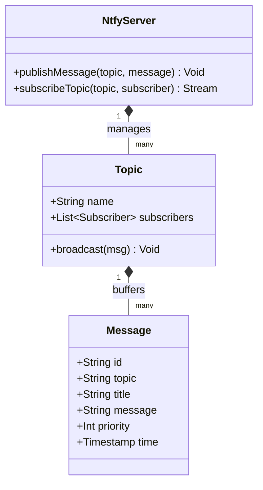
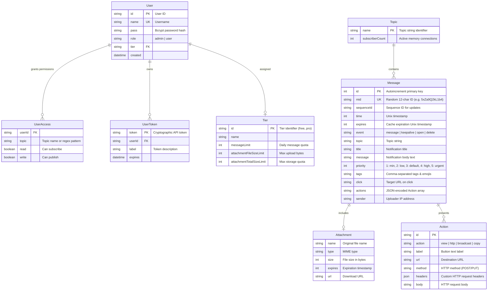
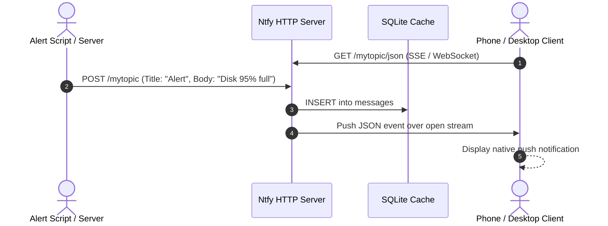

# ntfy - Architecture & Technical Wiki

> **High-Performance HTTP-Based Pub-Sub Notification Engine & Mobile Push Gateway**  
> GitHub: [binwiederhier/ntfy](https://github.com/binwiederhier/ntfy.git) | Stack: Go 1.26+, SQLite/PostgreSQL, Gorilla WebSockets, Firebase Cloud Messaging, WebPush, SMTP, Prometheus | License: Apache-2.0 / GPL-2.0

---

## 1. Executive Summary & Value Proposition

**ntfy** (pronounced *notify*) is a blazingly fast, lightweight, and ultra-scalable HTTP-based pub-sub push notification service written in Go. It empowers software applications, marketing engines, system scripts, and IoT microservices to broadcast real-time alert notifications to desktop web browsers, iOS/Android smartphones, smartwatches, and upstream webhooks using simple HTTP `POST` and `PUT` requests. With support for Server-Sent Events (SSE), WebSockets, UnifiedPush, Firebase Cloud Messaging (FCM), and Apple APNs, ntfy delivers enterprise-grade push capabilities with zero third-party cloud lock-in.

### Core Problems Solved
- **Complexity of Mobile Push Notifications**: Sending real-time notifications to mobile devices traditionally requires configuring complicated APNs / FCM credential pipelines, tokens, and SDKs. ntfy simplifies push down to a single curl command: `curl -d "Campaign finished" ntfy.sh/mytopic`.
- **High Concurrency & Minimal Footprint**: Built natively in Go, a single ntfy process can maintain hundreds of thousands of concurrent long-polling, SSE, and WebSocket subscriber connections with negligible RAM (~30MB base).
- **Vendor-Free Mobile Push (UnifiedPush)**: Serves as the premier reference server for UnifiedPush, allowing privacy-conscious Android users and internal teams to receive push notifications over persistent WebSockets without Google Play Services or Firebase.
- **Rich Actionable Notifications & File Attachments**: Supports clickable URL actions, inline HTTP callbacks (e.g., approving an invoice or rebooting a server directly from the notification shade), custom icons, priorities, and multimedia file attachments stored in local disk or S3 buckets.

---

## 2. High-Level System Architecture

ntfy is built around an in-memory topic router that routes published messages to active client streams in real time, while simultaneously persisting them to a disk-based message cache (SQLite or PostgreSQL) for offline replay and forwarding them to external push networks (FCM, WebPush, APNs, SMTP).

```mermaid
flowchart TD
    subgraph Publishers ["Publishers & Systems"]
        MarketingEngine["MarketingStudio Campaign Core"]
        DevOpsAlerts["Prometheus / Grafana / Webhooks"]
        BashScripts["CLI Scripts / System Daemons"]
    end

    subgraph NtfyServerCore ["ntfy Gateway Server (Go)"]
        HTTPRouter["HTTP / REST Request Handler"]
        AuthTier["User ACL & Token Validator"]
        VisitorLimiter["Visitor Rate & Bandwidth Limiter"]

        subgraph PubSubRouter ["In-Memory Pub-Sub Topic Router"]
            TopicRegistry["Topic Subscription Registry (*sync.Map)"]
            SubscriberPool["Active Subscriber Listeners (Channels)"]
        end

        subgraph UpstreamGateways ["External Push Bridges"]
            FCMWorker["Firebase Cloud Messaging Bridge"]
            APNsBridge["Apple Push Notification Bridge"]
            WebPushWorker["W3C WebPush Service"]
            SMTPRelay["Inbound & Outbound SMTP Daemon"]
            TwilioVoice["Twilio Voice / Call Notifier"]
        end
    end

    subgraph StorageLayer ["Persistence & Cache"]
        MessageCache[(SQLite / PostgreSQL Message Store)]
        AttachmentStore[(Local Disk / AWS S3 Blob Storage)]
        UserStore[(SQLite / PostgreSQL ACL & Tier Database)]
    end

    subgraph Subscribers ["Clients & Edge Consumers"]
        MobileApp["ntfy Android / iOS Native App"]
        WebBrowser["MarketingStudio Dashboard (SSE / WS)"]
        UnifiedPushClient["UnifiedPush Compatible Apps (Matrix / Mastodon)"]
    end

    MarketingEngine -->|POST /:topic (JSON/Headers)| HTTPRouter
    DevOpsAlerts -->|POST /:topic| HTTPRouter
    BashScripts -->|curl -d 'msg' /:topic| HTTPRouter

    HTTPRouter --> VisitorLimiter
    VisitorLimiter --> AuthTier
    AuthTier --> UserStore
    AuthTier --> PubSubRouter

    PubSubRouter -->|Write Message & Expiry| MessageCache
    PubSubRouter -->|Store Attachment| AttachmentStore

    PubSubRouter --> SubscriberPool
    SubscriberPool -->|Server-Sent Events /sse| WebBrowser
    SubscriberPool -->|WebSocket /ws| MobileApp
    SubscriberPool -->|Raw HTTP /raw| UnifiedPushClient

    PubSubRouter --> UpstreamGateways
    FCMWorker -->|Google FCM API| MobileApp
    APNsBridge -->|Apple APNs API| MobileApp
    WebPushWorker -->|Standard Push API| WebBrowser
```

---

### 2.1 Core Domain & Service Class Architecture



---

## 3. Technology Stack & Key Dependencies

- **Language & Runtime**: Go 1.26+ (pure compiled binary, zero external runtime dependencies).
- **Web & Transport Layer**: Standard library `net/http` optimized with custom sync pooling; `github.com/gorilla/websocket` (v1.5+) for full-duplex WebSocket streaming.
- **Database & Storage**:
  - `github.com/mattn/go-sqlite3` (v1.14+) for lightweight, zero-configuration local message caching and user stores.
  - `github.com/jackc/pgx/v5` (v5.11+) for high-availability clustered PostgreSQL persistence.
  - S3-compatible cloud storage integration (`cloud.google.com/go/storage`, AWS S3).
- **Push & Protocol Integrations**:
  - `firebase.google.com/go/v4`: Direct FCM HTTP v1 push engine.
  - `github.com/SherClockHolmes/webpush-go`: Standard W3C WebPush delivery for Chrome, Firefox, and Safari.
  - `github.com/emersion/go-smtp`: Integrated SMTP daemon allowing email publishing (sending an email to `topic@ntfy.domain` publishes a notification) and forwarding notifications as outgoing emails.
- **Telemetry & Billing**: `github.com/prometheus/client_golang` (`/metrics`), Stripe Go SDK (`stripe-go/v74`) for paid tier enforcement.

---

## 4. Repository Layout & Key Modules

```
inspire/ntfy/
├── main.go                          # CLI entry point (ntfy serve, ntfy publish, ntfy user)
├── cmd/                             # Command-line subcommands (serve, access, token, tier)
├── server/
│   ├── server.go                    # Master HTTP server, route muxing, connection dispatch
│   ├── subscriber.go                # Subscriber channel types (JSON, SSE, WS, Raw)
│   ├── topic.go                     # In-memory topic struct and subscription fanout logic
│   └── visitor.go                   # Per-IP token-bucket rate limiter and bandwidth metering
├── message/
│   ├── cache.go                     # Abstract message cache interface
│   ├── cache_sqlite.go              # SQLite message storage implementation
│   ├── cache_sqlite_schema.go       # SQLite table definitions and migration ledger
│   └── cache_postgres.go            # PostgreSQL clustered message storage
├── model/
│   └── model.go                     # Core domain structs (Message, Action, Attachment, SinceMarker)
├── user/
│   ├── user.go                      # User management, ACL checks, role permissions
│   └── user_sqlite.go               # SQLite user credentials and API token storage
├── attachment/
│   ├── disk.go                      # Local disk file upload store
│   └── s3.go                        # S3/GCS cloud bucket attachment store
├── webpush/                         # W3C WebPush subscription and VAPID key management
├── mail/                            # Inbound/outbound SMTP mailer
├── cluster/                         # Multi-node Redis/NATS clustering logic
└── web/                             # Embedded static web app (Vue.js / HTML5)
```

---

## 5. Core Features & Capabilities

### Multi-Protocol Streaming Fabric
Subscribers can listen to topic feeds through four distinct transport protocols:
1. **Server-Sent Events (SSE)** (`GET /:topic/sse`): Standard HTTP streaming for modern browser dashboards.
2. **WebSockets** (`GET /:topic/ws`): Full-duplex streaming with keep-alive ping/pongs, ideal for mobile apps and low-power devices.
3. **JSON Stream** (`GET /:topic/json`): Chunked newline-delimited JSON (NDJSON) stream for easy parsing in Node.js, Python, or Go.
4. **Raw Plaintext Stream** (`GET /:topic/raw`): Emits message bodies verbatim, perfect for shell scripting: `curl -s ntfy.sh/mytopic/raw | while read -r line; do ... done`.

### UnifiedPush & Background Battery Optimization
ntfy is the premier gateway for the UnifiedPush standard. On Android devices, instead of 50 different apps running 50 background connections or relying on proprietary Google Play Services, all apps route push messages through a single ntfy connection. The app handles background wakeup and dispatches local intents.

### Actionable Buttons & Dynamic Responses
Notifications are not passive text. Publishers can attach interactive action buttons (`Actions` header):
- **`view`**: Opens an external link in the browser.
- **`http`**: Triggers a background HTTP POST/PUT request with custom headers and body without opening an app.
- **`broadcast`**: Fires an Android system Intent with custom extras.
- **`copy`**: Copies arbitrary text or promotional coupon codes directly to the user's clipboard.

### Scheduled Delayed Notifications
Publishers can schedule messages to be delivered at a future timestamp by setting the `Delay` or `X-Delay` header:
- Natural language formats: `Delay: 30m`, `Delay: tomorrow, 9am`, `Delay: 1729768800`.
- ntfy caches the message in storage and holds publication until the timer expires.

### Bandwidth Metering & Rate Limiting
The `visitor.go` module implements token-bucket rate limiters per IP address and per user account:
- Enforces message count limits, attachment size limits, and daily bandwidth quotas.
- Automatically sheds traffic or returns `429 Too Many Requests` during denial-of-service spikes.

---

## 6. Data Models & Schema Architecture

ntfy's internal data model is defined by Go structs in `model/model.go` and persisted to SQLite/PostgreSQL schemas.



### Core Schema Entity Specifications
- **`Message`**: Central pub-sub message record. Stores content, priority (1-5), emoji tags, click action targets, and expiration timestamps.
- **`Attachment`**: File metadata describing uploaded images, audio memos, or PDFs associated with a message.
- **`Action`**: Interactive button specification rendered in the notification shade.
- **`UserAccess`**: Enforces topic ACLs, supporting wildcard matching (e.g., `marketing-*` allows publishing to all marketing channels).

---

### 6.1 Comprehensive Database Schema Specification

Ntfy caches recent push notification payloads in SQLite or memory.

#### Table: `messages`
| Column | Type | Constraints | Default | Description |
| :--- | :--- | :--- | :--- | :--- |
| `id` | `TEXT` | `PRIMARY KEY` | - | Message ID |
| `time` | `INTEGER` | `NOT NULL` | - | Epoch timestamp |
| `topic` | `TEXT` | `NOT NULL` | - | Topic string |
| `message` | `TEXT` | `NOT NULL` | - | Content text |
| `title` | `TEXT` | `NULLABLE` | `NULL` | Optional notification title |
| `priority` | `INTEGER` | `NOT NULL` | `3` | Priority (1-5) |

*Indexes:* `idx_messages_topic_time` (`(topic, time)`).

---

## 7. API Architecture, Webhooks & Key Endpoints

### 1. Publishing: Publish Notification via HTTP POST
- **POST** `/:topic`
- **Headers**:
  - `Title`: Notification headline
  - `Priority`: `1` (min) to `5` (urgent)
  - `Tags`: Comma-separated emoji names and tags (`warning,tada`)
  - `Click`: Web URL to open on click
  - `Actions`: Button definitions
  - `Attach`: Remote URL to attach as a file
- **Body**: Plain text message body or JSON payload.

**Sample Request (cURL):**
```bash
curl -X POST https://ntfy.marketingstudio.internal/campaign-alerts \
  -H "Title: 🚀 Campaign Q4 Launched" \
  -H "Priority: 4" \
  -H "Tags: rocket,party" \
  -H "Click: https://marketingstudio.io/campaigns/q4" \
  -H "Actions: view, View Analytics, https://marketingstudio.io/analytics/q4; http, Pause Campaign, https://api.marketingstudio.io/v1/campaigns/q4/pause" \
  -d "Outbound WhatsApp & SMS campaign has commenced. 12,500 messages queued."
```

**Response Payload (`200 OK`):**
```json
{
  "id": "7vXk91Qz2pL3",
  "time": 1729768600,
  "expires": 1729811800,
  "event": "message",
  "topic": "campaign-alerts",
  "title": "🚀 Campaign Q4 Launched",
  "message": "Outbound WhatsApp & SMS campaign has commenced. 12,500 messages queued.",
  "priority": 4,
  "tags": ["rocket", "party"],
  "click": "https://marketingstudio.io/campaigns/q4",
  "actions": [
    {
      "id": "b1a2c3",
      "action": "view",
      "label": "View Analytics",
      "url": "https://marketingstudio.io/analytics/q4"
    },
    {
      "id": "d4e5f6",
      "action": "http",
      "label": "Pause Campaign",
      "url": "https://api.marketingstudio.io/v1/campaigns/q4/pause",
      "method": "POST"
    }
  ]
}
```

### 2. Publishing: JSON Payload (Alternative Format)
- **POST** `/`
```json
{
  "topic": "lead-conversion",
  "title": "High-Value Lead Captured!",
  "message": "Alexander Pierce (Tesla Inc) just submitted an enterprise audit request.",
  "priority": 5,
  "tags": ["briefcase", "moneybag"],
  "click": "https://crm.marketingstudio.io/leads/48912",
  "attach": "https://assets.marketingstudio.io/contracts/enterprise-brief.pdf",
  "filename": "audit-brief.pdf"
}
```

### 3. Subscribing: Server-Sent Events (SSE) Stream
- **GET** `/:topic/sse?since=all`
```
event: open
data: {"event":"open","topic":"campaign-alerts"}

event: message
data: {"id":"7vXk91Qz2pL3","time":1729768600,"event":"message","topic":"campaign-alerts","title":"🚀 Campaign Q4 Launched","message":"Outbound WhatsApp & SMS campaign has commenced. 12,500 messages queued.","priority":4}
```

### 4. Subscribing: Full-Duplex WebSocket
- **GET** `/:topic/ws`
Connects a WebSocket client. The server emits JSON message events and accepts ping/pong frames to keep connections alive through corporate NAT gateways.

---

### 7.5 End-to-End Operational Lifecycle Sequence



---

## 8. Strategic Value & Takeaways for MarketingStudio

### Reusable Architectural Patterns
1. **Zero-Dependency Multi-Transport Pub-Sub Core**:
   - *Problem*: Traditional real-time notification architectures require separate message brokers (RabbitMQ), WebSocket servers (Socket.io), and push relays, creating operational maintenance overhead.
   - *Solution*: ntfy collapses routing, caching, WebSockets, and Server-Sent Events into a single lightweight Go binary. MarketingStudio can deploy an internal ntfy cluster to serve as its universal notification backplane for both UI browser updates and mobile push.

2. **Actionable Notification Payloads with Inline HTTP Triggers**:
   - *Problem*: Mobile notifications are typically read-only. When an urgent marketing alert fires (e.g., budget threshold exceeded), users must unlock their device, launch the app, and navigate to the action.
   - *Solution*: ntfy's `Actions` model allows users to tap buttons in the notification banner to fire authenticated HTTP POST requests directly to MarketingStudio's API. This enables instant campaign approvals, pauses, and overrides.

3. **Unified Internal System Auditing & Alerting**:
   - *Problem*: Microservices, cron jobs, and background workers require different SDKs to send failure alerts.
   - *Solution*: Because ntfy accepts plain HTTP POST and cURL requests, any worker or script in MarketingStudio can emit alerts without installing new libraries.

### Concrete Convergence Roadmap for MarketingStudio
- **Internal Operational Alert Bus**: Point all background workers, campaign schedulers, and gateway health checkers to ntfy topics (e.g., `marketingstudio-system-alerts`).
- **Real-Time Browser In-App Notification Feed**: Embed ntfy's SSE stream (`/:topic/sse`) directly into the MarketingStudio React frontend to display live notifications with zero external SaaS dependencies.
- **Mobile Push Relay for MarketingStudio Companion App**: Use ntfy as the self-hosted mobile push relay powering MarketingStudio's iOS and Android mobile management apps.
