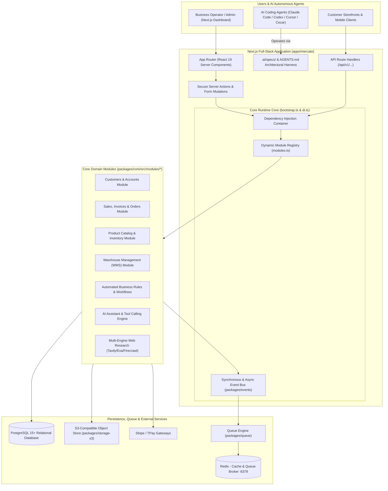
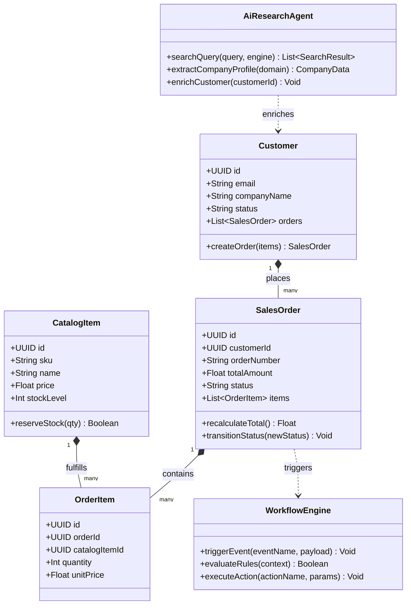
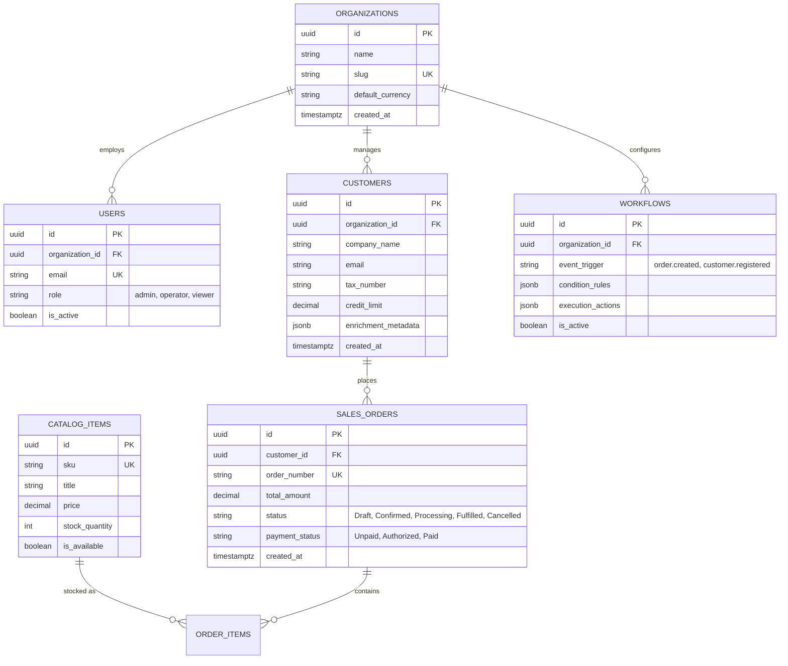
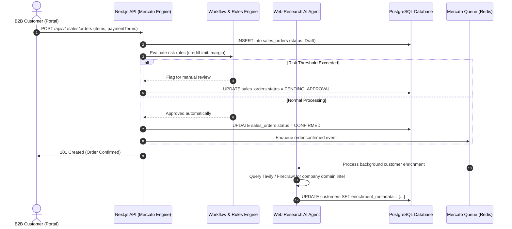

# open-mercato (Open Mercato) - Architecture & Technical Wiki

> **The AI-Engineering Foundation Framework for Modular Business Backends, ERP, CRM & Commerce**  
> GitHub: [open-mercato/open-mercato](https://github.com/open-mercato/open-mercato) | Stack: TypeScript, Next.js 15+ (App Router, React 19), Tailwind CSS, PostgreSQL, Kysely / Drizzle, Redis, Docker, Yarn Berry v4 | License: MIT

---

## 1. Executive Summary & Value Proposition

**open-mercato** is an open-source TypeScript framework built on Next.js and PostgreSQL, purpose-engineered as an **AI-Engineering Foundation Framework**. While conventional application frameworks require starting from a blank slate or stitching together disparate libraries, Open Mercato provides a 80%-complete enterprise back-office foundation out of the box—complete with ready-to-run business modules for CRM, ERP, commerce, warehousing (WMS), and automated workflows.

Crucially, Open Mercato is designed from inception for **AI coding agents** (Claude Code, Cursor, Codex, and Cezar): every project embeds strict architectural rules, module boundaries, database access patterns, and automated verification skills directly within `AGENTS.md` and `.ai/specs/`.

### Core Problems Solved
- **AI Coding Agent Chaos & Drift**: Generative AI tools often place code haphazardly without architectural discipline; Open Mercato provides rigid boundaries, module conventions, and dependency injection guards that guide AI agents to write production-grade code.
- **Repetitive Back-Office Scaffolding**: Provides pre-built, production-tested modules for customer management, product catalogs, shopping carts, checkout, shipping carriers, and invoicing.
- **Autonomous Agent Workflows (Cezar Integration)**: Integrates with Cezar, an agentic development environment that executes engineering tasks in isolated git worktrees, verifying builds and tests before merging.
- **Deep Web Research & Intelligence Ingestion**: Packages native AI research toolkits (`web-research`, `ai-assistant`) supporting multi-engine web crawling (Firecrawl, Exa, Tavily, SearXNG) for autonomous market intelligence and customer data enrichment.
- **Modular Monolith Composition**: Encapsulates discrete business capabilities into standalone modules with isolated database schemas, API routes, and event hooks.

---

## 2. High-Level System Architecture

Open Mercato is structured as a modern Yarn Berry monorepo pairing the Next.js full-stack back-office web application (`apps/mercato`) with modular domain packages (`packages/*`).



---

### 2.1 Core Domain & Service Class Architecture



---

## 3. Technology Stack & Key Dependencies

- **Framework & Runtime**: Next.js 15+ (App Router), React 19, TypeScript 5+, Node.js 22+
- **Styling**: Tailwind CSS, PostCSS, Radix UI component primitives (`packages/ui`)
- **Database & Query Builders**: PostgreSQL 15+ with Kysely / Drizzle type-safe SQL query engines
- **Queue & Async Execution**: Redis-backed queue system (`packages/queue`) with cron scheduler (`packages/scheduler`)
- **Package Management**: Yarn 4.x Berry with zero-install workspaces
- **AI Integrations**:
  - `packages/ai-assistant`: LLM prompt orchestration, function calling, tool registration
  - `packages/web-research`: Multi-provider intelligence crawlers (Exa, Firecrawl, Tavily, SearXNG)
  - Native support for coding agent IDEs (Cezar, Claude Code)
- **Payment & Shipping Gateways**: `gateway-stripe`, `gateway-tpay`, `carrier-inpost`
- **Testing**: Jest with custom DOM and database testing utilities

---

## 4. Repository Layout & Key Modules

```
open-mercato/
├── apps/
│   ├── mercato/                       # Main Next.js enterprise web application
│   │   ├── src/
│   │   │   ├── app/                   # Next.js App Router (Admin dashboard, dynamic views)
│   │   │   ├── modules/               # Application-level custom business extensions
│   │   │   ├── bootstrap.ts           # Service container initialization & DI lifecycle
│   │   │   ├── di.ts                  # Typed dependency injection resolver
│   │   │   └── modules.ts             # Dynamic module loader and hook registry
│   │   └── next.config.ts             # Next.js compiler settings and package transpilation
│   └── docs/                          # Developer and architecture documentation
├── packages/
│   ├── core/                          # Foundational business modules
│   │   └── src/modules/
│   │       ├── customers/             # Customer directory, accounts, groups, and credit limits
│   │       ├── sales/                 # Quotes, sales orders, order items, status machines
│   │       ├── catalog/               # Products, variants, SKUs, inventory stock levels
│   │       ├── cart/                  # Cart calculations, promo discounts, tax lines
│   │       ├── wms/                   # Warehouse locations, bin picking, fulfillment
│   │       ├── workflows/             # Event-triggered rule evaluator and automations
│   │       ├── business_rules/        # Dynamic predicate rules (e.g., minimum margin checks)
│   │       ├── auth/                  # RBAC permissions, session tokens, password hashing
│   │       └── api_keys/              # API key issuing, rotation, and rate-limiting
│   ├── ai-assistant/                  # AI agent orchestration and tool registries
│   ├── web-research/                  # Web crawling and search integration core
│   │   ├── web-research-firecrawl/    # Firecrawl web scraping adapter
│   │   ├── web-research-tavily/       # Tavily AI search adapter
│   │   └── web-research-exa/          # Exa semantic web retrieval adapter
│   ├── queue/                         # Redis / in-memory task queues and retry logic
│   ├── events/                        # Event bus emitter and subscriber registration
│   ├── gateway-stripe/                # Stripe payment gateway integration
│   ├── checkout/                      # One-page checkout flow orchestration
│   └── ui/                            # Reusable React component library
├── .ai/specs/                         # Spec-first AI coding instructions
├── AGENTS.md                          # Global rules and skills for AI agents
├── docker-compose.yml                 # Local PostgreSQL, Redis, and Mailpit environment
└── package.json                       # Root workspaces configuration
```

---

## 5. Core Features & Capabilities

### 5.1 Spec-First AI Coding Harness (`AGENTS.md`)
Open Mercato pioneers an architecture-first approach to AI-assisted coding:
- Specs live directly beside the codebase in `.ai/specs/` (`plan`, `approve`, `implement`).
- The repository’s `AGENTS.md` defines precise conventions: where new entities belong, how database queries must be typed via Kysely/Drizzle, and how UI forms must utilize the design system.
- Cezar runs tasks inside isolated git worktrees, executing test suites before opening pull requests.

### 5.2 Pluggable Modular Architecture
The framework avoids the pitfalls of monolithic spaghettification by treating every capability as an independent module (`packages/core/src/modules/`):
- Modules register database migrations, REST endpoints, and event listeners via standard manifest interfaces.
- Modules can be toggled on/off via configuration flags (`feature_toggles`).
- External developers can scaffold standalone packages using `create-mercato-module`.

### 5.3 Automated Business Rule & Workflow Engine
The `workflows` and `business_rules` modules allow non-developers to configure conditional operational logic:
- *Condition*: `order.total_amount > 5000 AND customer.credit_score < 700`
- *Action*: `require_manager_approval(orderId)` or `enqueue_slack_notification(channel)`
- Evaluated synchronously during request execution or asynchronously via `packages/queue`.

### 5.4 Autonomous Web Research & Intelligence
Through `packages/web-research`, Open Mercato can autonomously research entities:
- When a new B2B customer signs up, a background agent invokes Tavily/Firecrawl to crawl the customer's domain.
- The AI extracts company size, industry classification, key decision-makers, and revenue brackets, saving the enriched profile directly into `customers`.

---

## 6. Data Models & Schema Architecture



---

## 7. Operational Workflows & Sequence Diagrams

### 7.1 Autonomous Order Ingestion, Risk Evaluation & AI Enrichment



---

## 8. Strategic Value & Takeaways for MarketingStudio / SGrowing

### Reusable Architectural Patterns
1. **AI-Coding Agent Harness (`AGENTS.md`)**: The spec-first guidelines, test-first verifications, and module structure conventions in Open Mercato can be directly integrated into MarketingStudio to supercharge Claude Code pairing.
2. **Pluggable Domain Module Architecture**: The clean dependency injection and dynamic module registry (`modules.ts`) provide an architectural pattern for extending MarketingStudio with third-party tools and plugins.
3. **Embedded Web Research Subsystem**: The unified multi-crawler abstraction (`packages/web-research` supporting Exa, Tavily, and Firecrawl) can be directly leveraged in MarketingStudio's AI SDR and outbound research pipelines.
