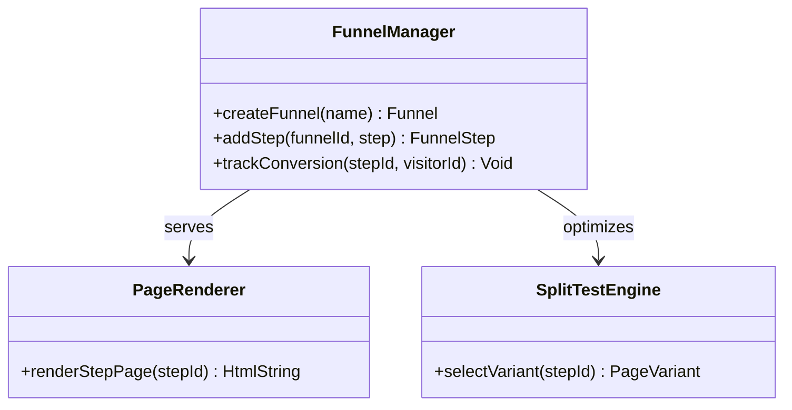
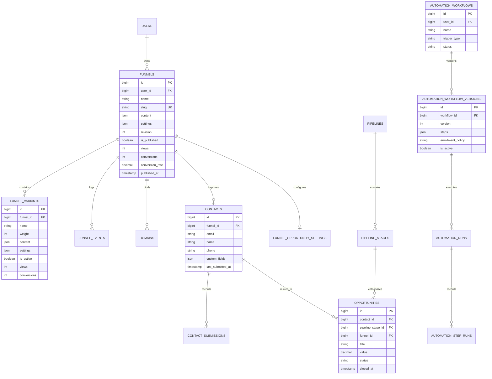
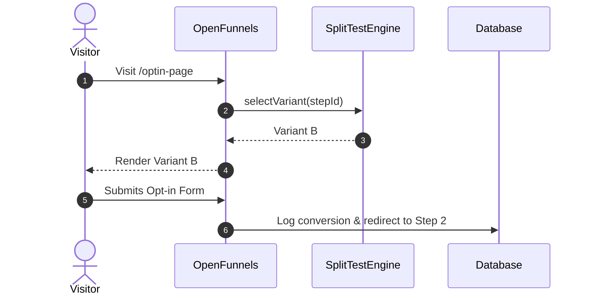

# openfunnels - Architecture & Technical Wiki

> **Self-Hosted Open-Source Funnel Builder, CRM Pipeline, A/B Testing & Workflow Automation Platform**  
> GitHub: [aialvi/openfunnels](https://github.com/aialvi/openfunnels.git) | Stack: PHP 8.3+, Laravel 12+, Inertia.js 2.0, React 19, Tailwind CSS, SQLite/MySQL/PostgreSQL, Redis | License: MIT

---

## 1. Executive Summary & Value Proposition

**OpenFunnels** is a self-hosted, full-stack marketing automation suite, conversion funnel builder, and sales CRM engineered in **PHP 8.3+** and **Laravel 12+**, paired with a reactive **React 19** frontend via **Inertia.js 2.0**. Developed as a modern, unencumbered open-source alternative to proprietary software like ClickFunnels, Systeme.io, and GoHighLevel, OpenFunnels eliminates per-funnel, per-contact, and per-domain licensing restrictions by providing a unified monolith that directly unifies front-of-funnel lead capture with middle-of-funnel CRM opportunity pipelines and back-of-funnel automated workflows.

OpenFunnels is architected around a single cohesive domain boundary: customer interactions captured on landing pages are directly translated into immutable audit events, relational CRM contacts, structured sales pipeline opportunities, and trigger payloads for asynchronous workflow state machines.

### Core Problems Solved
- **Elimination of SaaS Tollgates**: Removes prohibitive subscription fees and arbitrary contact tier caps charged by proprietary platforms ($97-$297+/mo) through an MIT-licensed, completely self-hostable codebase.
- **Unified Funnel-to-CRM Data Continuity**: Squeeze page form submissions immediately hydrate first-party `Contact` and `Opportunity` records without brittle third-party integration webhooks (Zapier/Make).
- **Deterministic Weighted A/B Split Testing**: Employs mathematical cumulative weight distribution with 30-day persistent browser cookies to ensure consistent visitor variant experiences and accurate conversion metrics.
- **Custom Multi-Domain Routing**: Built-in DNS verification and custom CNAME routing that resolves multi-tenant domains directly to published funnel variants without requiring reverse proxy reconfigurations.
- **Visual Automation Studio with DAG Simulation**: Features workflow state machines supporting dry-run validation, simulated execution traversals, and execution retry ledgers.

---

## 2. High-Level System Architecture

OpenFunnels implements a modern **Inertia.js Monolithic Architecture**. Rather than separating API gateways and client single-page applications into isolated runtimes, Laravel handles routing, authentication, multi-domain resolution, and business logic, passing server-rendered state directly into client-side React 19 component trees without REST API serialization overhead.

```mermaid
flowchart TD
    subgraph TrafficIngress ["Traffic Ingress & Edge Routing"]
        DirectTraffic["Public Traffic (app.openfunnels.com)"]
        CustomDomain["Custom CNAME Traffic (landing.custombrand.com)"]
        AdminTraffic["Authenticated Operators (Desktop / Mobile SPA)"]
    end

    subgraph LaravelHttpLayer ["Laravel 12 HTTP Kernel"]
        GlobalMiddleware["Kernel Middleware (Sessions, EncryptCookies, Throttle)"]
        DomainRouter["Domain Route Group (parse_url config:app.url)"]
        FallbackRouter["Custom Domain Fallback Route (DNS CNAME Lookup)"]
    end

    subgraph CoreSubsystems ["Core Domain Subsystems"]
        VariantResolver["FunnelVariantResolver (Cumulative Roll 1-100)"]
        LeadCapture["LeadCaptureController (Attribution & Contact Upsert)"]
        PipelineManager["OpportunityAutomationService (Deals & Stages)"]
        AutomationEngine["Automation Workflow Engine (DAG Steps & Policies)"]
    end

    subgraph QueueWorkerTier ["Asynchronous Queue Tier"]
        QueueWorkers["Laravel Queue Workers (php artisan queue:listen)"]
        AutomationJobs["AutomationRun / Step Execution Jobs"]
        EmailService["Transactional Mail & Unsubscribe Engine"]
    end

    subgraph StorageLayer ["Persistence & Cache Tier"]
        Database[(MySQL 8.0 / PostgreSQL / SQLite)]
        RedisCache[(Redis Cache & Session Store)]
    end

    DirectTraffic --> GlobalMiddleware
    CustomDomain --> GlobalMiddleware
    AdminTraffic --> GlobalMiddleware

    GlobalMiddleware --> DomainRouter
    GlobalMiddleware --> FallbackRouter

    FallbackRouter -->|Resolve Verified Domain| VariantResolver
    DomainRouter -->|Public Slug /f/{slug}| VariantResolver
    AdminTraffic -->|Inertia SSR / JSON| DomainRouter

    VariantResolver -->|Set of_variant_ Cookie| StorageLayer
    
    DirectTraffic -->|POST /funnels/{id}/leads| LeadCapture
    CustomDomain -->|POST /funnels/{id}/leads| LeadCapture

    LeadCapture -->|Upsert Contact & Submission| StorageLayer
    LeadCapture -->|Evaluate FunnelOpportunitySetting| PipelineManager
    PipelineManager -->|Create Deal & Stage Movement| StorageLayer
    PipelineManager -->|Dispatch Trigger Events| AutomationEngine

    AutomationEngine -->|Queue Job| QueueWorkers
    QueueWorkers --> AutomationJobs
    AutomationJobs --> EmailService
    AutomationJobs --> StorageLayer
```

### Architectural Lifecycle of Funnel Resolution & Lead Capture
1. **Domain & Slug Resolution**: When an incoming HTTP request hits the Laravel router, it evaluates whether the hostname matches the canonical app domain. If matched, it invokes standard dashboard or public `/f/{funnel:slug}` routes. If it is an external hostname, the fallback route interrogates the `domains` table for a verified CNAME record matching the request host.
2. **Variant Resolution (`FunnelVariantResolver`)**: The system inspects incoming cookies for `of_variant_{funnel_id}`. If absent, it queries all active `funnel_variants` sorted by ID, generates a cryptographic pseudo-random integer between 1 and 100, and walks cumulative variant weight thresholds. The chosen variant ID is queued in a 30-day Lax cookie.
3. **Lead Capture & Attribution Pipeline**: Submissions arriving at `POST /funnels/{funnel}/leads` parse contact payload fields alongside client attribution context (`utm_source`, `utm_medium`, `utm_campaign`, `ip_address`, `user_agent`). A `Contact` is upserted by email, an immutable `ContactSubmission` is logged, and funnel conversion counters are incremented.
4. **CRM & Workflow Automation Trigger**: If `FunnelOpportunitySetting` is active for the target funnel, `OpportunityAutomationService` creates an `Opportunity` in the configured `PipelineStage`. Concurrently, an `AutomationEvent` is recorded, triggering registered `AutomationWorkflow` runs across the worker queue.

---

### 2.1 Core Domain & Service Class Architecture



---

## 3. Technology Stack & Key Dependencies

- **Language & Runtime**: PHP 8.3+ with strict type declarations (`declare(strict_types=1)`), OPcache, JIT compilation.
- **Web Framework**: Laravel 12.x / 13.x leveraging modern Service Providers, Form Requests, and Eloquent ORM.
- **Presentation Layer**: Inertia.js 2.0 with React 19, Vite 5, Tailwind CSS, Ziggy (client route mapping), and Radix UI / Shadcn primitives.
- **Database Engine**: PostgreSQL 16+ or MySQL 8.0+ in production; SQLite support for embedded testing and single-node instances.
- **Asynchronous Execution & Caching**: Redis 7+ backing Laravel Queue (`queue:work`), Cache, and Session drivers.
- **Testing & Quality Tools**: Pest PHP 4.x (`pestphp/pest`), PHPStan, Laravel Pint (code styling).

---

## 4. Repository Layout & Key Modules

```
inspire/openfunnels/
├── app/
│   ├── Contracts/                   # Service interfaces and abstraction contracts
│   ├── Http/
│   │   ├── Controllers/             # Inertia and API controllers
│   │   │   ├── AutomationController.php           # Visual workflow management & DAG validation
│   │   │   ├── AutomationRunController.php        # Workflow execution lifecycle & retries
│   │   │   ├── ContactController.php              # CRM contact repository and listing
│   │   │   ├── DomainController.php               # CNAME domain verification & mapping
│   │   │   ├── FunnelAnalyticsController.php      # Real-time event logging & conversion math
│   │   │   ├── FunnelController.php               # Funnel CRUD, publishing & autosave
│   │   │   ├── FunnelVariantController.php        # A/B variant splits and weight tuning
│   │   │   ├── LeadCaptureController.php          # Squeeze page form ingestion & attribution
│   │   │   ├── OpportunityController.php          # Kanban pipeline deal management
│   │   │   ├── PipelineController.php             # CRM sales pipeline orchestration
│   │   │   └── PipelineStageController.php        # Pipeline stage sequencing & thresholds
│   │   └── Requests/                # Form validation rules (Funnels, Domains, Leads)
│   ├── Models/                      # Eloquent models with typed casts and relations
│   │   ├── AutomationWorkflow.php   # Top-level automation container
│   │   ├── AutomationWorkflowVersion.php # Immutable DAG step configurations
│   │   ├── Contact.php              # Unified customer record
│   │   ├── ContactSubmission.php    # Timestamped raw lead submission payloads
│   │   ├── Domain.php               # Custom CNAME host mappings
│   │   ├── Funnel.php               # Core funnel container with aggregate stats
│   │   ├── FunnelEvent.php          # Granular page views and button conversions
│   │   ├── FunnelVariant.php        # A/B testing page variations
│   │   ├── Opportunity.php          # CRM deal assigned to pipeline stages
│   │   └── PipelineStage.php        # Ordered sales pipeline steps
│   └── Services/                    # Domain logic and computational services
│       ├── Automation/              # Workflow action nodes, contracts & exceptions
│       ├── FunnelPublicUrlResolver.php  # Public canonical URL generator
│       ├── FunnelVariantResolver.php    # Weighted split testing math engine
│       └── OpportunityAutomationService.php # Funnel submission to CRM deal bridge
├── database/
│   └── migrations/                  # Schema definitions (Funnels, CRM, Automations)
├── resources/
│   └── js/                          # React 19 Inertia SPA
│       ├── components/              # UI components, Kanban boards, Visual Builder
│       └── pages/                   # Page templates (Dashboard, FunnelEditor, CRM)
└── routes/
    └── web.php                      # Application routing, domain routing & CNAME fallback
```

---

## 5. Core Features & Capabilities

### 5.1 A/B Split Testing & Sticky Variant Resolution
OpenFunnels incorporates a mathematically rigorous split-testing engine directly within `FunnelVariantResolver`. Rather than relying on third-party JavaScript snippets that cause layout shifts, split testing is performed during server-side request resolution:
- **Cumulative Threshold Algorithm**: Active variants are queried from the database sorted by `id`. The resolver generates a pseudo-random integer between 1 and 100. It increments an accumulator by each variant's configured `weight`. When the random roll falls within the cumulative boundary, that variant is selected.
- **Sticky Cookie Persistence**: Once assigned, the system queues a cookie named `of_variant_{funnel_id}` containing the variant ID with a 30-day time-to-live (`Lax` SameSite policy). Subsequent visits by the same client bypass random rolling to preserve a consistent user experience.

### 5.2 Dynamic Multi-Domain Routing & DNS Verification
OpenFunnels permits any funnel to be served over white-labeled custom domains:
- The system handles canonical requests via `Route::domain($appDomain)`.
- Non-matching hosts trigger a global fallback route in `web.php` which queries `Domain::where('domain', $host)->where('is_verified', true)->first()`.
- Unverified domains undergo automated DNS checks resolving CNAME records against the platform's root IP before traffic is enabled.

### 5.3 Automated CRM Bridge & Opportunity Creation
Lead capture does not exist in isolation. When a user submits an opt-in form:
- `LeadCaptureController` extracts standardized fields (`name`, `email`, `phone`, `custom_fields`) and UTM parameters.
- `OpportunityAutomationService` inspects `FunnelOpportunitySetting`. If enabled, it automatically instantiates an `Opportunity` tied to the primary contact, assigning it to a designated `Pipeline` and `PipelineStage` with an estimated deal value.

### 5.4 Visual Automation Studio with Workflow Versions
The automation engine decouples workflow definitions from execution state:
- Workflows maintain versioned execution graphs (`AutomationWorkflowVersion`), allowing active runs to execute against their instantiation-time DAG schema while new edits are saved as drafts.
- The engine supports simulation dry-runs (`POST /automations/{workflow}/simulate`) to validate branching logic before publishing.
- Failed workflow nodes can be retried individually via `POST /automations/runs/{run}/retry` without re-executing successfully completed upstream steps.

---

## 6. Data Models & Schema Architecture



### Core Schema Definitions

#### `funnels`
- `id` (bigint, PK): Unique auto-incrementing identifier.
- `user_id` (bigint, FK): Account owner reference.
- `name` (varchar 255): Funnel descriptive label.
- `slug` (varchar 255, Unique): URL route path for public access (`/f/{slug}`).
- `content` (json): Structured page component tree, sections, and form definitions.
- `settings` (json): SEO metadata, tracking scripts, and styling themes.
- `revision` (integer): Optimistic locking increment counter for concurrent autosaves.
- `views` / `conversions` (integer): Aggregate counter columns updated by atomic increment queries.
- `conversion_rate` (decimal 5,2): Pre-calculated conversion percentage.

#### `funnel_variants`
- `id` (bigint, PK): Unique variant identifier.
- `funnel_id` (bigint, FK): Parent funnel container.
- `weight` (integer): Integer percentage (0-100) determining split allocation.
- `content` (json): Variant-specific component and layout overrides.
- `is_active` (boolean): Flag controlling inclusion in the variant resolver roll.

#### `contacts` & `contact_submissions`
- `email` (varchar 255, indexed): Primary customer identifier.
- `custom_fields` (json): Dynamic key-value pairs captured during form opt-in.
- `attribution` (json): Snapshot of HTTP headers, referrer, and UTM tracking tags.

---

### 6.1 Comprehensive Database Schema Specification

#### Table: `funnels`
| Column | Type | Constraints | Default | Description |
| :--- | :--- | :--- | :--- | :--- |
| `id` | `UUID` | `PRIMARY KEY` | `gen_random_uuid()` | Funnel ID |
| `name` | `VARCHAR(255)` | `NOT NULL` | - | Funnel title |
| `status` | `VARCHAR(50)` | `NOT NULL` | `'active'` | State |

---

## 7. API Architecture, Webhooks & Key Endpoints

OpenFunnels utilizes standard RESTful HTTP endpoints for lead capture, analytics collection, and backend administration.

| Method | Endpoint | Description | Auth / Throttle |
| :--- | :--- | :--- | :--- |
| `POST` | `/funnels/{funnel}/leads` | Captures opt-in form submissions, upserts contact, and logs CRM lead | Public (Throttle: 60/min) |
| `POST` | `/funnels/{funnel}/events` | Ingests granular analytics events (`view`, `conversion`, `cta_click`) | Public (Throttle: 120/min) |
| `GET` | `/f/{funnel:slug}` | Public server-rendered funnel page with variant resolution | Public |
| `PUT` | `/funnels/{funnel}/autosave` | Autosaves visual builder content and bumps revision | Session Auth |
| `POST` | `/funnels/{funnel}/variants` | Adds a new A/B split variant to an existing funnel | Session Auth |
| `PATCH`| `/funnels/{funnel}/crm-settings`| Configures automatic pipeline deal creation upon lead capture | Session Auth |
| `POST` | `/automations/{workflow}/simulate`| Runs dry-run simulation of workflow steps | Session Auth |

### Sample Payload: Lead Submission (`POST /funnels/42/leads`)
```json
{
  "name": "Sarah Connor",
  "email": "sarah.connor@sky-defense.net",
  "phone": "+15550198234",
  "variant_id": 84,
  "custom_fields": {
    "company_size": "50-250",
    "primary_interest": "Enterprise Security"
  },
  "attribution": {
    "utm_source": "google",
    "utm_medium": "cpc",
    "utm_campaign": "q4_security_audit",
    "utm_content": "variant_banner_a"
  }
}
```

### Sample Response: Lead Submission Success
```json
{
  "success": true,
  "contact_id": 1092,
  "opportunity_created": true,
  "opportunity_id": 481,
  "redirect_url": "https://landing.custombrand.com/thank-you"
}
```

---

### 7.5 End-to-End Operational Lifecycle Sequence



---

## 8. Strategic Value & Takeaways for MarketingStudio

### Reusable Architectural Patterns
1. **Server-Side Split Resolution over Client-Side Redirects**: OpenFunnels performs A/B variant assignment entirely in the server request lifecycle via `FunnelVariantResolver`. This completely avoids the cumulative layout shift (CLS) and flash-of-unstyled-content (FOUC) penalties associated with traditional client-side redirect tools like Google Optimize. MarketingStudio can replicate this weighted cookie roll in edge workers.
2. **First-Party Funnel-to-CRM Coupling**: Traditional marketing stacks lose attribution because leads are shipped to external CRMs asynchronously via webhooks. OpenFunnels embeds the CRM pipeline directly inside the application database, guaranteeing that contact creation, deal allocation, attribution tagging, and workflow triggers occur inside a single atomic database transaction.
3. **Decoupled Workflow Definitions (`AutomationWorkflowVersion`)**: Workflows are treated as immutable executable graphs. When an operator updates an automation in the visual editor, active leads continuing their execution sequence remain bound to the version under which they were enrolled. This guarantees execution determinism.

### Concrete Convergence Roadmap for MarketingStudio
- **Multi-Tenant Edge Routing**: MarketingStudio can adapt the OpenFunnels fallback domain resolver for Cloudflare Workers / Fastly edge dictionaries, enabling customers to bind custom CNAMEs directly to landing pages without provisioning individual SSL certificates.
- **Unified Attribution Schema**: Implement OpenFunnels' structured `attribution` JSON model across all MarketingStudio forms, storing first-touch and last-touch UTM parameters directly on contact records for multi-touch attribution reporting.
- **Direct Opportunity Bridging**: MarketingStudio should adopt OpenFunnels' `FunnelOpportunitySetting` design, enabling users to automatically spin up CRM deals and assign sales team members the instant high-value funnel steps are completed.
