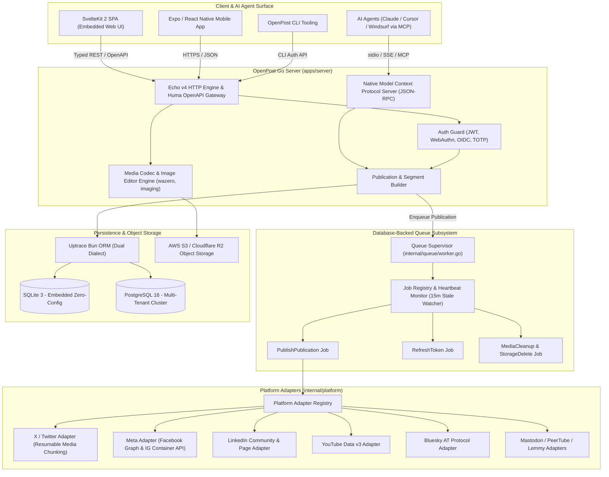
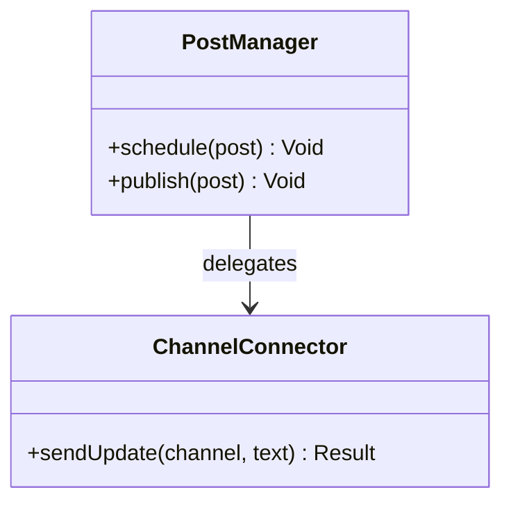
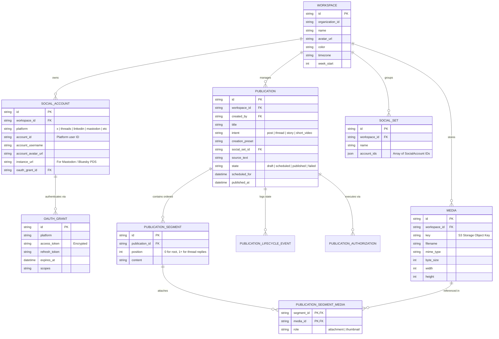
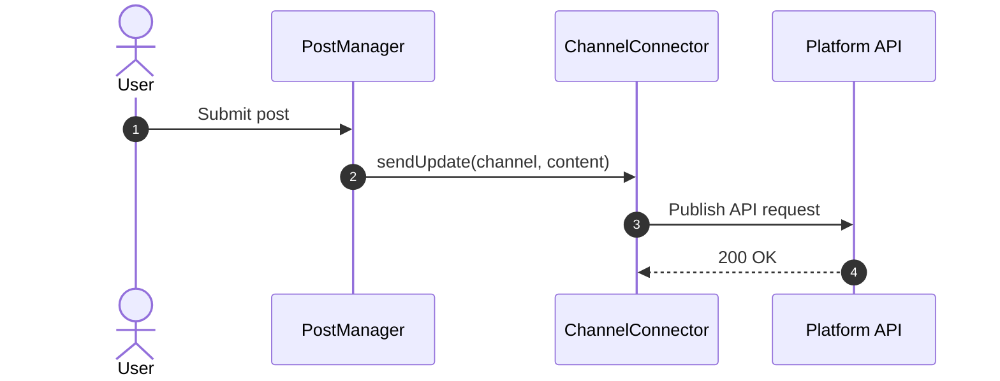

# openpost - Architecture & Technical Wiki

> **Single-Binary Open-Source Social Publishing Engine with Embedded SvelteKit, High-Concurrency Go Backend, Native Media Editors & MCP Server**  
> GitHub: [openpost/openpost](https://github.com/openpost/openpost) | Stack: Go 1.26+, Echo v4, Huma v2 OpenAPI, SvelteKit 2 (Svelte 5), Bun, Uptrace Bun ORM (SQLite / PostgreSQL), AWS S3 v2, OpenAI, WebAuthn, Native MCP Server | License: AGPL-3.0

---

## 1. Executive Summary & Value Proposition

**OpenPost** is a self-hostable, unified social media publishing engine, content studio, and automation platform engineered in **Go** and **SvelteKit 2**. Positioned as "the all-in-one content team for solo founders and agile operators", OpenPost collapses the conventional multi-tiered marketing stack into a single, highly optimized binary capable of running on lightweight VPS instances (using embedded SQLite) while scaling seamlessly to multi-tenant cloud clusters (backed by PostgreSQL and S3-compatible object storage).

OpenPost departs from typical social media schedulers by treating content creation not as simple text broadcast, but as an end-to-end creative assembly pipeline. It features an integrated still-image editor with layer manipulation, a collaborative video project workspace with offline mobile capture recipes, thread segment builders, and a native **Model Context Protocol (MCP)** server that exposes content planning, drafting, and asset management directly to autonomous AI agents.

### Core Problems Solved
- **Operational Complexity & Infrastructure Bloat**: Eliminates bloated microservices and heavy runtime dependencies (such as Node.js, PHP-FPM, or standalone Redis clusters) by compiling the Echo HTTP router, SQLite/PostgreSQL storage layer, queue workers, and embedded SvelteKit frontend into a single portable Go binary.
- **Thread & Multi-Segment Divergence**: Unifies complex multi-part threads across Twitter/X, Mastodon, Bluesky, and Threads via a structured `PublicationSegment` entity model, ensuring atomic ordering and platform-compliant character splits.
- **Destination-Independent "Social Sets"**: Introduces snapshotted destination groupings (`social_sets`) so that changes to team account lists or client portfolios never alter existing scheduled publication batches.
- **Zero-External-Queue Resilience**: Replaces Redis/RabbitMQ brokers with a high-throughput, database-backed transactional queue featuring `FOR UPDATE SKIP LOCKED` (PostgreSQL) and serialized advisory locks (SQLite) with automatic 15-minute heartbeat stale-job recovery.
- **AI Agent Automation via MCP**: Natively implements the Model Context Protocol, allowing AI development tools (Claude Code, Cursor, Windsurf) to inspect publications, generate social graphics, search media, and schedule campaigns without brittle screen-scraping or custom webhook glue.

---

## 2. High-Level System Architecture

OpenPost's architecture pairs an ultra-fast compiled Go server runtime with a reactive SvelteKit client interface, unified through typed OpenAPI contracts (`huma/v2`).



---

### 2.1 Core Domain & Service Class Architecture



---

## 3. Technology Stack & Key Dependencies

| Layer | Technology | Details / Rationale |
| :--- | :--- | :--- |
| **Language & Runtime** | Go 1.26+ | High concurrency, zero-allocation memory pools, single compiled binary |
| **Web Router** | Labstack Echo v4 | `github.com/labstack/echo/v4: 4.15.4` (Middleware, routing, error handling) |
| **REST & OpenAPI** | Huma v2 | `github.com/danielgtaylor/huma/v2: 2.37.3` (Type-safe schemas, auto docs) |
| **Database & ORM** | Uptrace Bun | `github.com/uptrace/bun: 1.2.18` (Dual SQLite & PostgreSQL dialect support) |
| **Authentication** | WebAuthn & OIDC | `go-webauthn/webauthn`, `coreos/go-oidc/v3`, `golang-jwt/jwt/v5`, Passkeys |
| **Frontend Framework** | SvelteKit 2 + Svelte 5 | `@sveltejs/kit: ^2.70`, `@sveltejs/vite-plugin-svelte: ^7.3` |
| **Frontend Runtime** | Bun + Turborepo | `bun@1.2+`, Fast build scripts, Paraglide-js internationalization |
| **Styling & Icons** | Tailwind CSS v4 + Lucide | `@tailwindcss/vite: ^4.1.18`, `@lucide/svelte` |
| **AI Integrations** | OpenAI Go SDK + Fal.ai | `openai-go/v3: 3.54.0`, `valksor/fal-go: 1.0.3` (AI prompts & image gen) |
| **Image & Media Engine** | NativeWebP & Imaging | `HugoSmits86/nativewebp`, `disintegration/imaging`, `gen2brain/avif` |
| **Object Storage** | AWS SDK for Go v2 | `aws/aws-sdk-go-v2/service/s3: 1.104.1` (Multipart resumable uploads) |
| **Payment Gateway** | Paddle Go SDK | `PaddleHQ/paddle-go-sdk/v5: 5.2.0` (Subscriptions and checkout) |

---

## 4. Repository Layout & Key Modules

```
inspire/openpost/
├── apps/
│   ├── server/                        # Go backend engine
│   │   ├── cmd/
│   │   │   ├── openpost/              # Application entrypoint (main.go - 1,520+ lines)
│   │   │   └── openpost-openapi/      # CLI tool exporting openapi.json specification
│   │   ├── internal/
│   │   │   ├── api/                   # Huma API routes, HTTP handlers, auth middleware
│   │   │   ├── capabilities/          # Network feature matrix (video lengths, character budgets)
│   │   │   ├── connectors/            # External integration manifest and client registry
│   │   │   ├── database/              # Schema migrations (bun migrations)
│   │   │   ├── models/                # models.go (170,000+ bytes, complete typed ORM entities)
│   │   │   ├── platform/              # Social adapters (x, meta, linkedin, bluesky, mastodon)
│   │   │   ├── queue/                 # worker.go (transactional database queue processor)
│   │   │   └── services/              # Domain services (tokenmanager, publisher, medialifecycle)
│   │   └── go.mod                     # Go dependencies and direct modules
│   ├── web/                           # SvelteKit 2 web application
│   │   ├── src/lib/components/        # Svelte UI primitives, calendar grid, thread composer
│   │   ├── src/lib/image-editor/      # Built-in multi-page social graphic editor
│   │   ├── src/lib/video-editor/      # Timeline-based video previewer and segment cutter
│   │   └── src/routes/                # Authenticated dashboard, composer, analytics routes
│   ├── mobile/                        # Expo / React Native mobile capture app
│   └── cli/                           # Standalone cross-platform terminal publishing client
├── packages/
│   ├── api-contract/                  # Auto-generated TypeScript bindings from Huma OpenAPI
│   ├── editor-shared/                 # Shared canvas calculations and typography tokens
│   ├── n8n-nodes-openpost/            # Official n8n workflow integration node
│   └── platform-text/                 # Unified character counter conforming to provider specs
├── turbo.json                         # Turborepo task pipeline configuration
└── bun.lock                           # Lockfile for frontend workspaces
```

---

## 5. Core Features & Capabilities

### 5.1 Platform Adapter Architecture & Resumable Media Chunking
Platform connectivity is governed by `internal/platform/adapter.go`. Each social provider implements the `PlatformAdapter` interface:
- **Resumable Chunked Uploads**: For platforms with stringent video constraints (such as X/Twitter and YouTube), OpenPost implements `x_media_resumable.go`. Large binaries are sliced into 4MB byte chunks, uploaded sequentially across `INIT`, `APPEND`, and `FINALIZE` phases, and polled until the platform signals transcoding completion.
- **AT Protocol Native Driver**: Implements Bluesky's decentralized lexicon (`bluesky.go`), creating blobs in personal data servers (PDS) and constructing authenticated `app.bsky.feed.post` records with embedded facets for mentions and links.
- **Token Manager**: `tokenmanager.Service` encapsulates OAuth 1.0a secrets and OAuth 2.0 refresh cycles, guaranteeing tokens are verified and rotated prior to scheduled execution.

### 5.2 Structured Thread Composer with Segment Splitting
OpenPost replaces the single-block textarea with a structured segment pipeline:
- **`PublicationSegment` Model**: A publication is comprised of an ordered list of segments (`position = 0, 1, 2...`). For single-post networks (Instagram, LinkedIn), only segment 0 is dispatched. For thread-capable networks (X, Threads, Mastodon, Bluesky), the worker resolves the chain by passing the parent post ID down the line.
- **Platform Capability Matrix**: `internal/capabilities` continuously validates each segment in real time. If a user exceeds 280 characters on segment 1, the UI flags Twitter while keeping Mastodon (500 chars) in valid state.

### 5.3 Integrated Image Editor & Canvas Studio
Built directly into the web application (`apps/web/src/lib/image-editor`), OpenPost includes a Figma-inspired visual design tool:
- **Multi-Page Social Carousels**: Authors design multi-slide carousels with custom backgrounds, gradients, typography, and SVG shapes.
- **Layer & Template Model**: Layouts are saved as reusable `ScreenshotTemplate` records. The server can render templates headlessly or export ordered images directly into the active publication without third-party tools like Canva.

### 5.4 Database-Backed Transactional Queue
OpenPost rejects external queue brokers in favor of an in-engine queue (`internal/queue/worker.go`):
- **Concurrency & Locking**: When running against PostgreSQL, workers execute `SELECT ... FOR UPDATE SKIP LOCKED` across queue lanes, ensuring multiple Go nodes never pick the same publication. When running against SQLite, an in-memory channel mutex serializes job transactions.
- **Stale Job Heartbeat**: Workers update a heartbeat timestamp every 5 minutes. If a worker crashes mid-upload, the 15-minute watcher resets `jobStatusProcessing` back to `jobStatusPending` with incremented retry counts.

### 5.5 Model Context Protocol (MCP) Server
OpenPost natively exposes an MCP server (`internal/api/handlers/mcp.go`):
- **Tool Expositions**: Exposes tools such as `publications_list`, `publication_create`, `social_accounts_list`, and `media_search`.
- **Direct Agent Publishing**: Coding assistants and autonomous marketing agents can draft, refine, and schedule publications directly through tool calls conforming to JSON-RPC 2.0.

---

## 6. Data Models & Schema Architecture

OpenPost's data model is implemented via Uptrace Bun in `internal/models/models.go`, providing enterprise multi-tenancy and granular publication state.



### Core Entity Definitions

#### `Publication` (Table: `publications`)
- `id` (String, PK): Unique UUID v4 identifier.
- `workspace_id` (String, FK, Not Null): Partition key enforcing multi-tenancy.
- `title` (String): Internal descriptive campaign title.
- `intent` (String): Publication archetype (`post`, `thread`, `story`, `short_video`, `video`).
- `social_set_id` (String): Snapshot identifier of the target account cluster.
- `source_text` (String): Master drafting copy prior to per-channel adaptations.
- `state` (String): Lifecycle state (`draft`, `queued`, `scheduled`, `publishing`, `published`, `failed`).

#### `PublicationSegment` (Table: `publication_segments`)
- `id` (String, PK): Segment identifier.
- `publication_id` (String, FK): Reference to the parent publication.
- `position` (Int): 0-indexed position within the thread structure.

#### `SocialAccount` (Table: `social_accounts`)
- `id` (String, PK): Social channel registration.
- `platform` (String): Provider driver (`x`, `linkedin`, `instagram`, `youtube`, `tiktok`, `bluesky`, `mastodon`).
- `account_username` (String): Visible handle.
- `instance_url` (String, Nullable): Federated server URL for ActivityPub and AT Protocol PDS instances.

---

### 6.1 Comprehensive Database Schema Specification

OpenPost stores multi-platform social media posts in indexed tables.

#### Table: `posts`
| Column | Type | Constraints | Default | Description |
| :--- | :--- | :--- | :--- | :--- |
| `id` | `UUID` | `PRIMARY KEY` | `gen_random_uuid()` | Post ID |
| `content` | `TEXT` | `NOT NULL` | - | Content body |
| `status` | `VARCHAR(50)` | `NOT NULL` | `'pending'` | Status |

---

## 7. API Architecture, Webhooks & Key Endpoints

OpenPost exposes a strictly typed, OpenAPI 3.1 compliant HTTP API powered by Huma v2.

### Key REST Endpoints

| Method | Path | Description |
| :--- | :--- | :--- |
| `GET` | `/api/v1/workspaces/{ws}/publications` | List publications with status, filter, and pagination |
| `POST` | `/api/v1/workspaces/{ws}/publications` | Create draft publication with multi-segment thread array |
| `PATCH` | `/api/v1/workspaces/{ws}/publications/{id}` | Update publication copy, schedule time, or destination list |
| `POST` | `/api/v1/workspaces/{ws}/publications/{id}/publish-now` | Bypass scheduler and enqueue immediate delivery |
| `GET` | `/api/v1/workspaces/{ws}/social-accounts` | List connected channels and token validity states |
| `POST` | `/api/v1/workspaces/{ws}/media/presign` | Obtain S3 presigned upload URL with SHA-256 validation |
| `GET` | `/api/v1/workspaces/{ws}/analytics/overview` | Fetch aggregate impressions, clicks, and follower growth |
| `POST` | `/mcp` | Model Context Protocol JSON-RPC stream endpoint |

### Sample Payload: Creating a Threaded Publication
`POST /api/v1/workspaces/ws_01h9z3x7/publications`
```json
{
  "title": "Architecture Deep Dive: OpenPost",
  "intent": "thread",
  "social_set_id": "set_founders_socials",
  "scheduled_for": "2026-11-10T15:00:00Z",
  "segments": [
    {
      "position": 0,
      "content": "Why we chose Go + SvelteKit over traditional PHP/Node stacks for our social media publishing engine 🧵👇",
      "media_ids": ["med_01h9z5a1"]
    },
    {
      "position": 1,
      "content": "1/ Single binary portability: Running an embedded SQLite database and compiled SvelteKit assets inside one binary means zero deployment friction.",
      "media_ids": []
    },
    {
      "position": 2,
      "content": "2/ High concurrency: Go goroutines handle 4MB chunked media uploads and OAuth token rotations without blocking the main event loop.",
      "media_ids": []
    }
  ]
}
```

---

### 7.5 End-to-End Operational Lifecycle Sequence



---

## 8. Strategic Value & Takeaways for MarketingStudio

OpenPost provides architectural patterns that directly solve common enterprise pain points.

### Reusable Architectural Patterns
1. **Single-Binary Zero-Dependency Deployment**: The ability to run the complete web server, API, queue workers, and UI from a single binary via Go's `//go:embed` is the gold standard for self-hosted products. MarketingStudio can evaluate a Go core or Bun-bundled single binary for lightweight enterprise on-premise editions.
2. **First-Class Thread Modeling (`PublicationSegment`)**: Treating posts not as monolithic strings with character truncators, but as structured, ordered arrays of `segments`, makes multi-part threads trivial across both thread-first platforms (Twitter/Bluesky) and single-post channels (LinkedIn/Facebook).
3. **Snapshot-Based Social Sets**: By copying destination IDs into the publication rather than pointing to a live mutable team set, OpenPost prevents "schedule corruption" where editing a client's social set inadvertently alters posts that were already queued for next week.
4. **Native MCP Server for Autonomous Marketing**: Embedding the Model Context Protocol directly into the core server allows external AI workflows to interact with MarketingStudio as a trusted data source and publishing tool, opening up automated content workflows.
