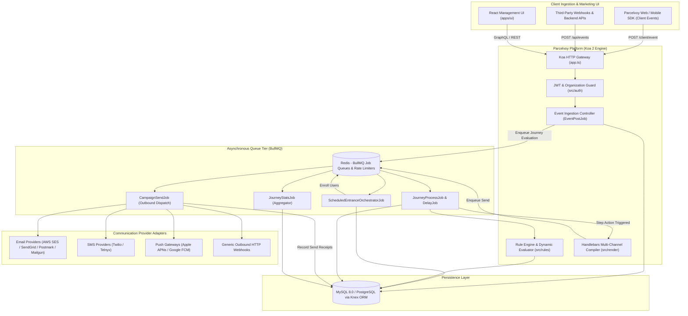
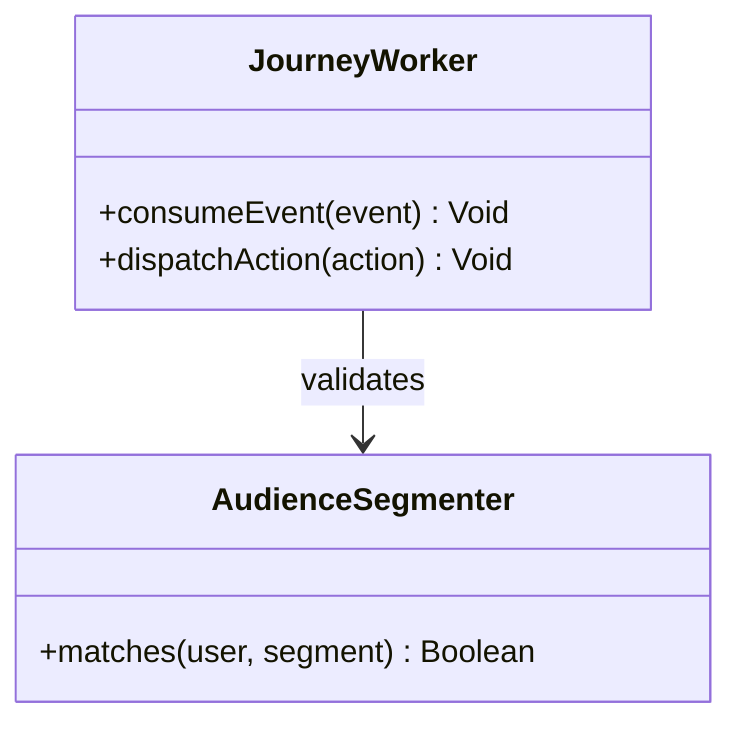
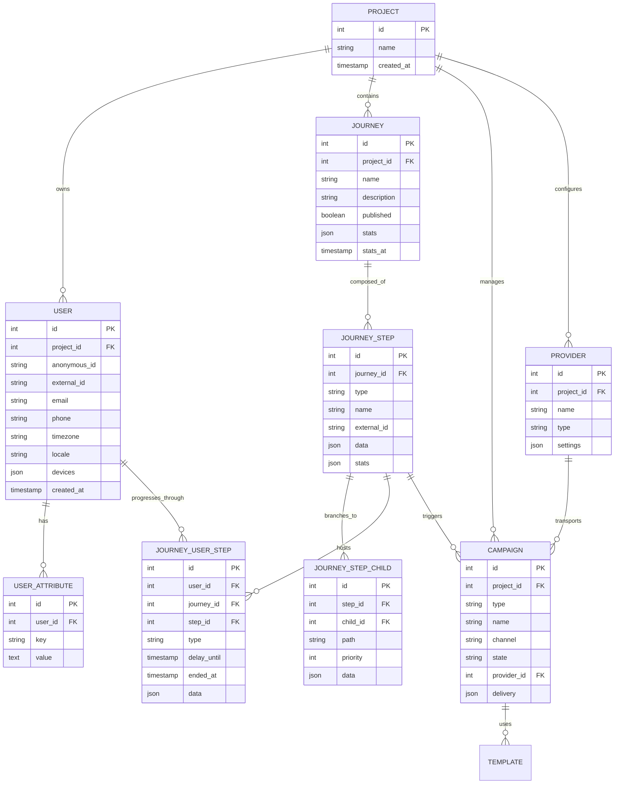
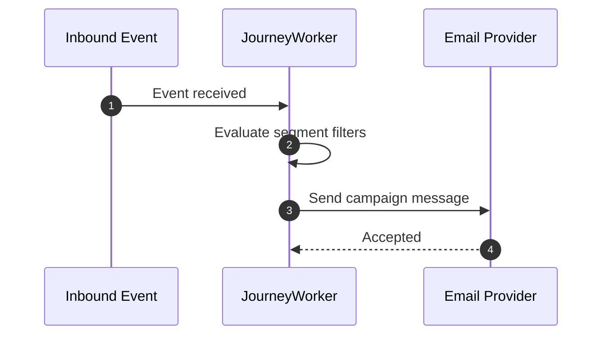

# parcelvoy - Architecture & Technical Wiki

> **Multi-Channel Customer Journey Automation, Event-Driven Orchestration & Open Source Lifecycle Messaging**  
> GitHub: [parcelvoy/parcelvoy](https://github.com/parcelvoy/parcelvoy) | Stack: TypeScript, Node.js 18+, Koa 2, Knex (MySQL 8 / PostgreSQL), BullMQ, Redis, Handlebars, Nodemailer, AWS SES/SNS/SQS, Twilio | License: MIT

---

## 1. Executive Summary & Value Proposition

**Parcelvoy** is an open-source, customer relationship and lifecycle messaging platform designed as a modern, developer-friendly alternative to proprietary tools like Braze, Iterable, and OneSignal. Written in TypeScript using Koa and Knex, Parcelvoy unifies cross-channel engagement—including transactional and marketing Email, SMS, Mobile Push notifications (APNs and FCM), and In-App messages—under a single, event-driven orchestration engine.

At the core of Parcelvoy is its **Modular Step Journey Engine** (`apps/platform/src/journey`), which represents complex marketing automations as Directed Graphs. With dedicated execution primitives for event/schedule entrances (`JourneyEntrance`), conditional branching gates (`JourneyGate`), randomized multivariate experiments (`JourneyExperiment`), timezone-aware delay timers (`JourneyDelay`), traffic rate smoothing (`JourneyBalancer`), and message actions (`JourneyAction`), Parcelvoy provides marketing engineers with programmatic and visual control over how users traverse lifecycle funnels.

### Core Problems Solved
- **Vendor-Driven Channel Fragmentation**: Unifies email, SMS, mobile push, and webhooks into a coherent journey graph, preventing disjointed user communications across siloed tools.
- **Runaway Per-Message Markup**: Eliminates the high markup fees imposed by third-party engagement SaaS tools by allowing teams to connect their own underlying infrastructure accounts (AWS SES, Twilio, SendGrid, Mailgun).
- **Timezone-Shift Delivery Degradation**: Incorporates timezone-aware recurrence scheduling via RRULE (`JourneyEntrance` and `JourneyDelay`), guaranteeing that users receive communications during appropriate daylight hours regardless of global location.
- **High-Concurrency Queue Saturation**: Offloads campaign audience population and individual message dispatch to specialized BullMQ queues backed by Redis, maintaining sub-second API responsiveness even during massive blast sends.
- **Device & Attribute Divergence**: Resolves multi-device tracking by indexing user device tokens (`devices: Device[]`), anonymous session cookies, and external account IDs under a single profile ledger.

---

## 2. High-Level System Architecture

Parcelvoy is split into a central application backend (`apps/platform`), background queue workers (`worker.ts`), and a modern React management dashboard (`apps/ui`):
1. **API Ingress (Koa 2 Router)**: Ingests user telemetry events, profile updates, and campaign interactions, validating payloads via Ajv JSON Schema.
2. **Journey State Machine (`JourneyProcessJob` & `JourneyDelayJob`)**: Processes steps sequentially for enrolled users, writing progression states to `journey_user_step` and scheduling delayed transitions in Redis.
3. **Queue & Worker Engine (BullMQ)**: Orchestrates distributed asynchronous workers across dedicated queues (journey processing, delivery dispatch, campaign loading, and analytics stats).
4. **Multi-Channel Provider Layer (`src/providers`)**: Executes delivery across email (AWS SES, Postmark, SendGrid, Mailgun, SMTP), SMS (Twilio, Telnyx), and push notifications (APNs, Firebase Cloud Messaging).



---

### 2.1 Core Domain & Service Class Architecture



---

## 3. Technology Stack & Key Dependencies

- **Language & Runtime**: TypeScript 5+, Node.js 18+ (ESM / CommonJS dual compatibility).
- **HTTP Server Framework**: **Koa 2** (`koa`, `@koa/router`, `koa-body`, `@koa/cors`), providing a lightweight middleware-driven API architecture.
- **Database & Query Layer**:
  - **Knex.js** (`knex` v2.3+) with support for **MySQL 8.0+** (`mysql2`) and **PostgreSQL 15+** (`pg`).
  - Active-record pattern abstraction implemented in `apps/platform/src/core/Model.ts`.
- **Background Queues & Scheduling**:
  - **BullMQ** (`bullmq` v5+, `ioredis` v5.3+) for delayed queues, retries, and job concurrency management.
  - `rrule`: RFC 5545 recurrence rule generator for timezone-aware scheduled campaign triggers.
  - `date-fns` & `date-fns-tz`: Precision date manipulation and cross-timezone projections.
- **Template Rendering**: **Handlebars** (`handlebars` v4.7) with custom helpers (`handlebars-utils`) and `html-to-text` for automated plaintext email generation.
- **Channel Delivery Libraries**:
  - Email: `nodemailer`, `@aws-sdk/client-ses`.
  - SMS: `twilio`.
  - Mobile Push: `node-pushnotifications` (unified wrapper for APNs HTTP/2 and Firebase FCM).
  - Validation: `ajv` (JSON Schema validation for incoming events and rule configurations).

---

## 4. Repository Layout & Key Modules

```
inspire/parcelvoy/
├── apps/
│   ├── platform/                     # Core backend API & worker daemon
│   │   ├── src/
│   │   │   ├── campaigns/            # Campaign blast/trigger definitions and state
│   │   │   ├── client/               # Public SDK ingestion routes (/client/event)
│   │   │   ├── core/                 # Knex Model base class & Active Record layer
│   │   │   ├── journey/              # Multi-channel journey orchestrator
│   │   │   │   ├── Journey.ts        # Journey model, publication, and entry triggers
│   │   │   │   ├── JourneyStep.ts    # Node subclasses (Entrance, Delay, Action, Gate)
│   │   │   │   ├── JourneyState.ts   # Runtime context tracking user path traversal
│   │   │   │   └── JourneyProcessJob.ts # BullMQ step execution worker
│   │   │   ├── lists/                # Static and dynamic segment lists
│   │   │   ├── providers/            # Vendor drivers (SES, Twilio, APNs, FCM, Postmark)
│   │   │   ├── queue/                # BullMQ queue definitions and worker wrappers
│   │   │   ├── render/               # Handlebars template compiler
│   │   │   ├── rules/                # Boolean rule evaluator (RuleEngine)
│   │   │   ├── subscriptions/        # Channel opt-in / opt-out preferences
│   │   │   ├── users/                # User profile models, device tokens, and attributes
│   │   │   ├── app.ts                # Koa application initialization
│   │   │   ├── worker.ts             # Dedicated background worker process entrypoint
│   │   │   └── index.ts              # Server startup script
│   │   ├── db/
│   │   │   └── migrations/           # Knex SQL migrations for all tables
│   │   └── package.json
│   └── ui/                           # React / Next.js management web application
├── docker/                           # Container definitions (platform, UI, mysql, redis)
├── docker-compose.yml                # Production multi-service orchestration
└── package.json                      # Lerna monorepo workspace configuration
```

---

## 5. Core Features & Capabilities

### 5.1 Polymorphic Journey Step Engine (`JourneyStep.ts`)
Parcelvoy decomposes customer journeys into modular, executable node types inheriting from `JourneyStep`:
- **`JourneyEntrance`**: Entry point activated via real-time user events (`trigger: 'event'`) or recurring cron schedules (`trigger: 'schedule'`) using RRULE strings with timezone localization.
- **`JourneyDelay`**: Holds users at a step for a relative duration (e.g., 2 hours, 3 days) or until an absolute calendar time (e.g., Friday at 9:00 AM in the recipient's timezone).
- **`JourneyAction`**: Dispatches a multi-channel campaign (Email, SMS, Push, In-App) via `triggerCampaignSend`, passing dynamic customer context into the template renderer.
- **`JourneyGate`**: Evaluates conditional boolean rules (`src/rules/RuleEngine`). If the user satisfies the criteria (e.g., `has_made_purchase == true`), they proceed down path A; otherwise, they route to path B.
- **`JourneyExperiment`**: Executes randomized A/B multivariate splits, distributing traffic according to assigned weight percentages.
- **`JourneyBalancer`**: Smooths out traffic spikes by rate-limiting how many users can enter subsequent steps per minute, protecting downstream webhooks or sales teams from overload.

### 5.2 User Step Progress Ledger (`JourneyUserStep`)
User lifecycle progression is preserved in the `journey_user_step` database table:
- Records the `user_id`, active `step_id`, entry timestamp, and scheduled execution time (`delay_until`).
- Accumulates custom data payloads (`getDataMap`), making data gathered in earlier steps (e.g., event parameters from an entrance trigger) available in subsequent email templates.
- Guarantees idempotent execution: if a worker restarts mid-job, the state machine checks `ended_at` to prevent sending duplicate emails.

### 5.3 Unified Cross-Channel Template Compilation (`src/render`)
Parcelvoy uses Handlebars to compile communication templates across all channels:
- Supports shared partials, conditional formatting, and deep JSON attribute evaluation (`{{ user.attributes.company_name }}`).
- Automatically strips HTML to generate plaintext fallbacks for email templates.
- Validates that templates meet channel character and payload limits before submission to vendor APIs.

### 5.4 Multi-Channel Subscription Management (`src/subscriptions`)
Respects user communication preferences across channels:
- Models granular topics (e.g., Marketing, Product Updates, Billing Alerts) mapped to specific delivery channels.
- When a user unsubscribes from a topic via email, their SMS or push preferences remain intact unless they opt out globally.
- Hard bounces received from email or SMS providers automatically mark the respective address/phone number as inactive.

---

## 6. Data Models & Schema Architecture

The relational schema links projects, users, multi-device tokens, visual journeys, step graphs, and campaigns.



### Key Field Descriptions
- `journey_step.type`: Polymorphic identifier (`"entrance"`, `"delay"`, `"action"`, `"gate"`, `"experiment"`, `"balancer"`, `"exit"`).
- `journey_step_child.path`: Identifies branch conditional logic (e.g., `"true"`, `"false"`, or variant name `"variant_a"`).
- `journey_user_step.delay_until`: Precise timestamp specifying when a user can advance past a `JourneyDelay` node.
- `user.devices`: JSON array of mobile devices containing APNs device tokens, FCM registration keys, OS versions, and app builds.

---

### 6.1 Comprehensive Database Schema Specification

Parcelvoy models audiences and communication templates in PostgreSQL.

#### Table: `campaigns`
| Column | Type | Constraints | Default | Description |
| :--- | :--- | :--- | :--- | :--- |
| `id` | `UUID` | `PRIMARY KEY` | `gen_random_uuid()` | Campaign ID |
| `name` | `VARCHAR(255)` | `NOT NULL` | - | Campaign name |
| `channel` | `VARCHAR(50)` | `NOT NULL` | `'email'` | Medium |

---

## 7. API Architecture, Webhooks & Key Endpoints

Parcelvoy exposes a RESTful API built on Koa 2 with JWT authentication.

| HTTP Method | Endpoint | Purpose | Sample Payload |
| :--- | :--- | :--- | :--- |
| `POST` | `/api/v1/client/event` | Ingest user client telemetry | `{"external_id": "usr_482", "name": "Plan Upgraded", "data": {"plan": "Pro"}}` |
| `POST` | `/api/v1/users` | Create or update user profile | `{"external_id": "usr_482", "email": "carol@firm.com", "timezone": "America/New_York"}` |
| `POST` | `/api/v1/journeys` | Create journey with step map | `{"name": "Welcome Journey", "published": true, "stepMap": {...}}` |
| `POST` | `/api/v1/campaigns` | Create multi-channel broadcast | `{"name": "Holiday Push", "channel": "push", "type": "blast", "provider_id": 2}` |
| `POST` | `/api/v1/campaigns/{id}/send` | Trigger campaign send | Path param: `id=12` |

---

### 7.5 End-to-End Operational Lifecycle Sequence



---

## 8. Strategic Value & Takeaways for MarketingStudio

### Architectural Patterns to Replicate
1. **Polymorphic Step Subclassing (`JourneyStep`)**: Parcelvoy models journey nodes as distinct TypeScript classes inheriting from `JourneyStep`, each encapsulating its own `process()`, `next()`, and JSON serialization logic. MarketingStudio should structure its customer journey execution engine using this polymorphic pattern to simplify the addition of new step types (e.g., AI agent decision nodes).
2. **Context Accumulation Across Steps (`getDataMap`)**: By aggregating event payload data from earlier journey steps in `JourneyUserStep.getDataMap()`, Parcelvoy allows templates downstream to interpolate parameters from the original entrance trigger without extra database lookups. MarketingStudio should adopt this runtime context dictionary.
3. **Traffic Rate Smoothing (`JourneyBalancer`)**: Sudden spikes in event-triggered journeys can overwhelm third-party webhooks or outbound email APIs. Parcelvoy's `JourneyBalancer` step throttles downstream progression, ensuring consistent message flow. MarketingStudio should include flow-control balancers in its journey canvas.
4. **Timezone-Shifted Recurrence via RRULE**: Integrating `rrule` with timezone offsets allows scheduled journey entrances to trigger accurately based on local contact time rather than server UTC time. This capability is critical for global marketing automation in MarketingStudio.
