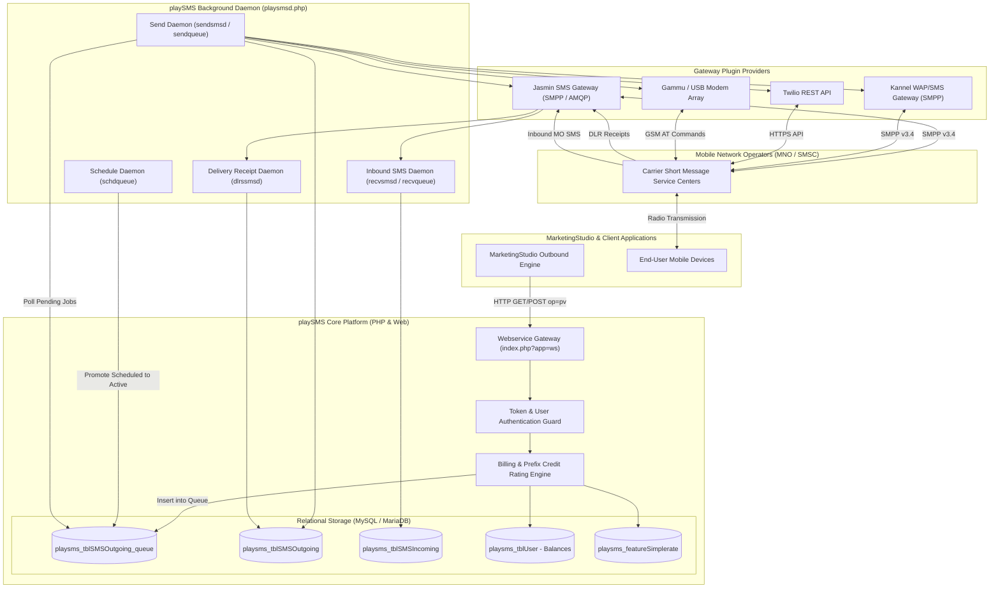
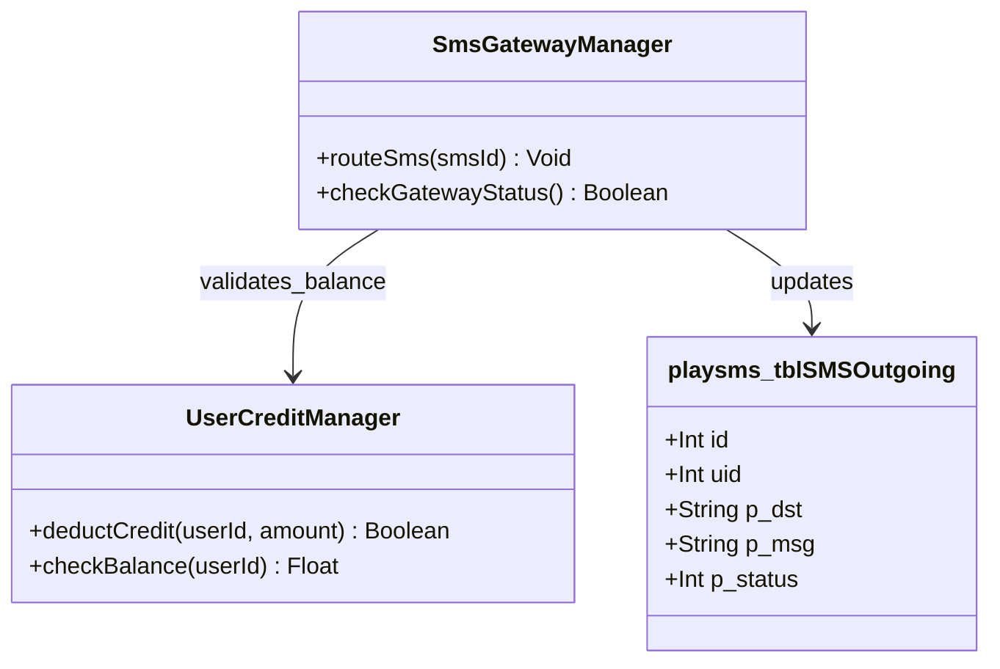
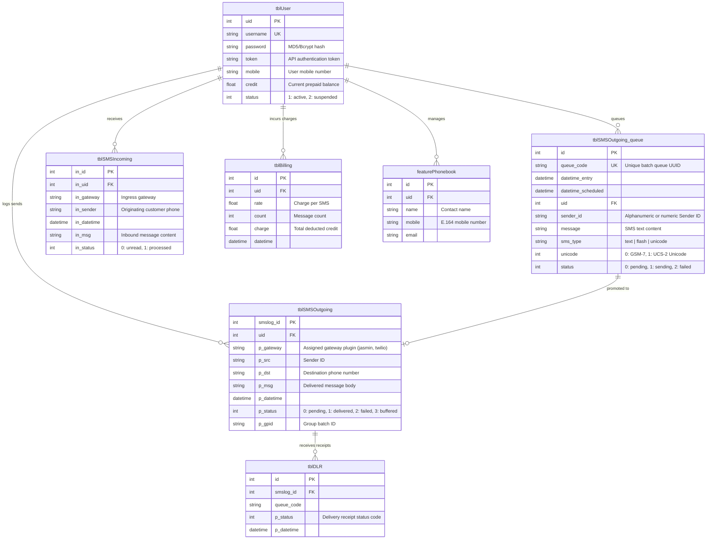
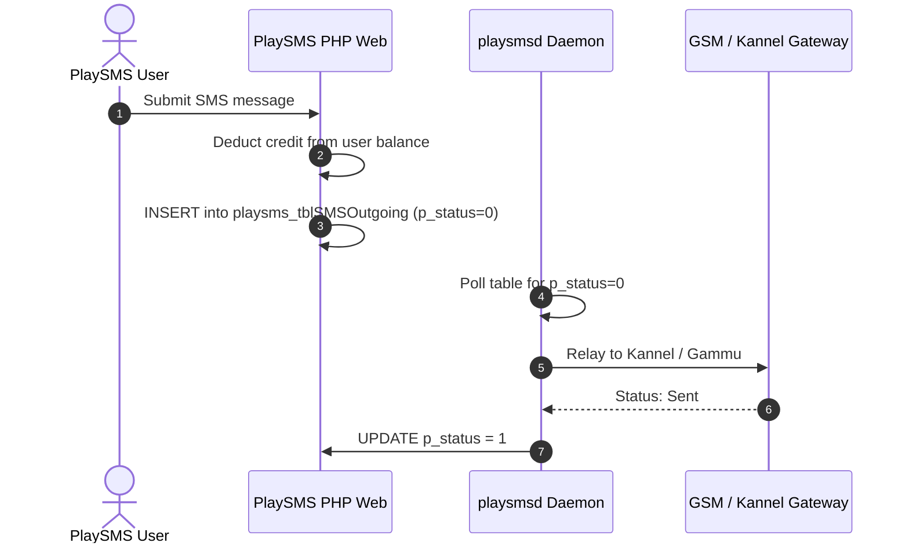

# playsms - Architecture & Technical Wiki

> **The Classic Multi-Gateway SMS Portal, Rate-Billing & Telephony Hub**  
> GitHub: [playsms/playsms](https://github.com/playsms/playsms.git) | Stack: PHP 8+, MySQL/MariaDB, Linux CLI Daemons (playsmsd), SMPP/HTTP Gateways (Jasmin, Kannel, Twilio, Gammu) | License: GPL-3.0+

---

## 1. Executive Summary & Value Proposition

**playSMS** is one of the most battle-tested open-source SMS management and routing portals in the global telecommunications ecosystem. Written in PHP and driven by multi-process Linux background daemons (`playsmsd.php`), playSMS functions as a multi-tenant SMS portal, billing engine, and protocol mediator. It bridges enterprise business applications with carrier-grade SMSCs (Short Message Service Centers) via SMPP, HTTP, or direct GSM modem arrays.

### Core Problems Solved
- **Gateway & Protocol Fragmentation**: Different telecoms and aggregators require different protocols: SMPP v3.4 for Jasmin/Kannel, HTTP REST for Twilio/Nexmo, AT commands for physical Gammu modems. playSMS provides a unified pluggable gateway interface that abstracts underlying telco protocols.
- **Prepaid Credit & Per-Prefix Rate Billing**: Built-in rating and billing engine (`playsms_featureSimplerate`, `playsms_tblBilling`) that calculates SMS segment costs per destination country/prefix and deducts user credit balances before dispatch.
- **Asynchronous Scheduled Campaigns & Bulk Dispatching**: Features a multi-daemon background pipeline (`sendsmsd`, `schdqueue`, `ratesmsd`) that schedules marketing broadcasts, queues recipient batches, and enforces concurrency limits without tying up web workers.
- **SMS Two-Way Keyword Applications**: Out-of-the-box interactive SMS automation modules: autoreply scenarios, interactive voting/polls, quizzes, broadcast boards, and SMS-to-email / email-to-SMS forwarding.

---

## 2. High-Level System Architecture

playSMS is split into two operational layers:
1. **Web UI & Webservices Layer (Apache/Nginx & PHP)**: Exposes a multi-tenant web administration portal and an HTTP REST/Query webservice (`index.php?app=ws`). Validates requests, calculates prefix rates, and writes outbound messages to the MySQL database queue.
2. **Daemon Orchestration Layer (`playsmsd.php`)**: A persistent multi-process CLI daemon running in Linux userspace. It continuously loops through the queue tables (`playsms_tblSMSOutgoing_queue`), executes user balance debits, passes messages to active gateway plugins (e.g., Jasmin or Kannel), and ingests delivery reports (`dlrssmsd`).



---

### 2.1 Core Domain & Service Class Architecture



---

## 3. Technology Stack & Key Dependencies

- **Language & Runtime**: PHP 8.1+ (CLI and FPM), Linux Shell scripting for daemon lifecycle (`daemon/linux/bin/playsmsd.php`).
- **Database & Data Layer**: MySQL 8.0+ or MariaDB 10.6+ using PDO / MySQLi with transactional queue locks.
- **Web Server**: Apache 2.4+ (with mod_rewrite) or Nginx with PHP-FPM.
- **Composer Dependencies**:
  - `playsms/webservices`: JSON/XML webservice serialization.
  - `phpmailer/phpmailer` (v6.x): Transactional alert delivery and Email-to-SMS gateway.
  - `ezyang/htmlpurifier`: XSS sanitization on inbound message streams.
  - `gregwar/captcha`: Human verification on registration and public portals.
  - `mlocati/ip-lib`: IP address security and access control enforcement.
- **Underlying Telco Protocols**: SMPP v3.4 (via Jasmin or Kannel), GSM AT command sets (via Gammu/Smstools3), and HTTP/REST aggregators.

---

## 4. Repository Layout & Key Modules

```
inspire/playsms/
├── composer.json                    # Composer dependencies (PHPMailer, HTMLPurifier)
├── daemon/
│   └── linux/
│       ├── bin/
│       │   └── playsmsd.php         # Master multi-process background scheduler & daemon
│       └── etc/
│           └── playsmsd.conf.dist   # Daemon loop timers and thread configurations
├── db/
│   ├── playsms.sql                  # Initial relational database schema definitions
│   └── playsms-upgrade_*.sql        # Database migration and upgrade scripts
├── install-playsms.sh               # Automated Linux deployment bash installer
└── web/
    ├── index.php                    # Front controller routing requests to apps
    ├── inc/
    │   ├── app/
    │   │   ├── main.php             # Core UI administration portal
    │   │   └── webservices.php      # HTTP API router (op=pv, op=bc, op=ds, op=cr)
    │   └── user/                    # User authentication and ACL permission validators
    ├── lib/
    │   ├── fn_core.php              # Global helper functions, sanitizers, and hooks
    │   ├── fn_gateway.php           # Gateway routing, active provider selection
    │   ├── fn_rates.php             # Destination prefix cost rating calculators
    │   └── fn_sms.php               # Outbound queuing, splitting, and status updates
    └── plugin/
        ├── feature/                 # Pluggable user features
        │   ├── simplebilling/       # Credit ledger, invoice generator, transactions
        │   ├── simplerate/          # Prefix-based pricing table (e.g., +1 = 0.01, +44 = 0.03)
        │   ├── phonebook/           # Contacts, distribution lists, CSV import
        │   └── sms_autoreply/       # Keyword-based automated response logic
        └── gateway/                 # Hardware & protocol gateway plugins
            ├── jasmin/              # Connector for Jasmin SMS Gateway (AMQP / HTTP)
            ├── kannel/              # Connector for Kannel Open Source WAP/SMS Gateway
            ├── twilio/              # REST driver for Twilio SMS API
            ├── gammu/               # Direct AT-command driver for local GSM modems
            └── generic/             # Customizable HTTP GET/POST forwarder
```

---

## 5. Core Features & Capabilities

### Multi-Process Daemon Architecture (`playsmsd.php`)
playSMS isolates web requests from message transport through five specialized background daemons:
1. `sendsmsd`: Polls `playsms_tblSMSOutgoing_queue`, pulls pending messages, verifies gateway availability, and passes jobs to `fn_gateway.php`.
2. `schdqueue`: Monitors scheduled marketing campaigns, moving future-dated jobs into the active queue when their execution timestamp arrives.
3. `ratesmsd`: Processes credit transactions, calculates SMS segment costs, and deducts user account balances.
4. `dlrssmsd`: Listens for asynchronous delivery receipt callbacks from telecom SMSCs and updates outgoing message status codes.
5. `recvsmsd`: Processes inbound MO (Mobile Originated) messages, running them through keyword trigger pipelines.

### Prefix-Based Rate Billing & Credit Engine
Every outbound SMS is evaluated against `playsms_featureSimplerate`:
- Matches destination phone numbers against country codes and mobile network prefixes.
- Calculates segment counts based on GSM 03.38 character sets (160 characters for standard text, 70 characters for Unicode).
- Deducts user credits from `playsms_tblUser.credit`. If credits are insufficient, the message is refused before hitting the carrier gateway.

### Multi-Gateway Dynamic Routing & Failover
Administrators configure routing rules across multiple carriers:
- Direct local domestic traffic through low-cost local modems (`gammu`).
- Route high-volume international campaigns through enterprise SMPP connectors (`jasmin`).
- Fall back to commercial aggregators (`twilio`) if an SMPP bind drops.

### Two-Way Keyword Automation Engine
playSMS includes built-in keyword routing:
- **Autoreply**: Matches incoming message prefixes (e.g., `INFO`, `JOIN`) and automatically fires a predefined response.
- **Polls & Quizzes**: Collects incoming votes and tallies results in real time.
- **Stoplist**: Intercepts `STOP` or `CANCEL` commands, immediately blocking outgoing messages to those numbers.

---

## 6. Data Models & Schema Architecture

playSMS relies on a structured MySQL relational schema. All operational logs and queue states are tracked with integer foreign keys and status codes.



### Core Schema Entity Specifications
- **`playsms_tblUser`**: Core user entity. Stores authentication tokens, role permissions (`admin`, `reseller`, `user`), and live floating-point credit balances.
- **`playsms_tblSMSOutgoing_queue`**: High-velocity transit table where outgoing messages wait for `sendsmsd` daemon workers to process them.
- **`playsms_tblSMSOutgoing`**: Historical audit table preserving all outbound SMS transmissions, assigned telco gateways, and final DLR delivery statuses.
- **`playsms_tblSMSIncoming`**: Ingress log storing all incoming MO text messages received from telco gateways.

---

### 6.1 Comprehensive Database Schema Specification

PlaySMS stores users, credits, and outgoing SMS messages in MySQL.

#### Table: `playsms_tblSMSOutgoing`
| Column | Type | Constraints | Default | Description |
| :--- | :--- | :--- | :--- | :--- |
| `smslog_id` | `INT` | `PRIMARY KEY AUTO_INCREMENT` | - | Log ID |
| `uid` | `INT` | `NOT NULL` | `0` | User account ID |
| `p_dst` | `VARCHAR(100)` | `NOT NULL` | `''` | Destination phone |
| `p_msg` | `TEXT` | `NOT NULL` | - | Message body |
| `p_status` | `INT` | `NOT NULL` | `0` | 0=Pending, 1=Sent, 2=Failed |

*Indexes:* `idx_outgoing_status` (`(p_status)`).

---

## 7. API Architecture, Webhooks & Key Endpoints

playSMS exposes a parameterized HTTP Web Services API mounted at `index.php?app=ws`.

### 1. Messaging: Send SMS to Single Recipient (`op=pv`)
- **GET / POST** `/index.php?app=ws&op=pv`
- **Authentication**: `u=<username>&h=<api_token>`

**Query Parameters:**
- `u`: Username
- `h`: API token
- `to`: Destination mobile number in international format (`+15559876543`)
- `msg`: URL-encoded message text
- `from`: (Optional) Approved alphanumeric Sender ID
- `format`: Output format (`json` or `xml`)

**Sample Request URL:**
```
https://sms.marketingstudio.internal/index.php?app=ws&op=pv&u=admin&h=9c8b7a6d5e4f3a2b1c&to=15559876543&msg=Your+MarketingStudio+code+is+59201&format=json
```

**Response Payload (`200 OK`):**
```json
{
  "status": "success",
  "data": [
    {
      "status": "success",
      "error": "0",
      "smslog_id": "48201",
      "queue_code": "qc_667a9921bc",
      "to": "15559876543"
    }
  ],
  "error_string": null
}
```

### 2. Messaging: Send Broadcast to Phonebook Group (`op=bc`)
- **GET / POST** `/index.php?app=ws&op=bc`

**Sample Request URL:**
```
https://sms.marketingstudio.internal/index.php?app=ws&op=bc&u=admin&h=9c8b7a6d5e4f3a2b1c&bc=VIP_CUSTOMERS&msg=Exclusive+VIP+access+starts+now!&format=json
```

### 3. Reporting: Check Message Delivery Status (`op=ds`)
- **GET / POST** `/index.php?app=ws&op=ds`

**Sample Request URL:**
```
https://sms.marketingstudio.internal/index.php?app=ws&op=ds&u=admin&h=9c8b7a6d5e4f3a2b1c&queue_code=qc_667a9921bc&format=json
```

**Response Payload (`200 OK`):**
```json
{
  "status": "success",
  "data": [
    {
      "status": "1",
      "status_text": "Delivered",
      "smslog_id": "48201",
      "queue_code": "qc_667a9921bc"
    }
  ]
}
```

### 4. Billing: Check User Credit Balance (`op=cr`)
- **GET / POST** `/index.php?app=ws&op=cr`

**Response Payload (`200 OK`):**
```json
{
  "status": "success",
  "data": {
    "credit": "1420.50"
  }
}
```

---

### 7.5 End-to-End Operational Lifecycle Sequence



---

## 8. Strategic Value & Takeaways for MarketingStudio

### Reusable Architectural Patterns
1. **Separation of Web Ingestion from Daemon Execution (`playsmsd`)**:
   - *Problem*: Directly binding telco network requests to HTTP web workers causes connection timeouts and memory leaks when carrier SMSCs experience throttling.
   - *Solution*: playSMS accepts outbound messages instantaneously into a database queue (`playsms_tblSMSOutgoing_queue`), offloading actual protocol transport to persistent CLI daemons (`sendsmsd`). MarketingStudio should use this queuing model to handle viral marketing spikes without crashing web servers.

2. **Prefix-Based Rating & Prepaid Quota Accounting**:
   - *Problem*: Sending SMS internationally without pre-flight cost verification can rapidly run up unexpected carrier bills or exhaust marketing budgets.
   - *Solution*: playSMS checks phone number prefixes against a rate table, calculates character segment lengths (GSM-7 vs Unicode), and verifies available user credits prior to queue insertion. MarketingStudio should adopt this prefix rating model for its multi-tenant client billing.

3. **Pluggable Protocol Gateway Drivers**:
   - *Problem*: Marketing systems often need to switch between enterprise SMPP channels (e.g., Jasmin) and commercial cloud APIs (e.g., Twilio) without rewriting core campaign controllers.
   - *Solution*: playSMS structures gateways as independent plugins under `plugin/gateway/`, implementing a clean contract for `send()` and `callback()`. MarketingStudio should adopt a standardized gateway driver interface to allow seamless carrier failover.

### Concrete Convergence Roadmap for MarketingStudio
- **Carrier Hub Connector**: Position playSMS as a centralized gateway aggregator for MarketingStudio, allowing operators to route traffic across local GSM modems, SMPP carriers, and Twilio from a single backend.
- **Client Credit Management**: Leverage playSMS's billing ledger model to provide agency clients with self-service prepaid SMS balances and rate-card transparency.
- **Two-Way SMS Lead Gen**: Integrate playSMS's incoming SMS webhook endpoints to capture prospective lead replies from billboard and print campaigns directly into MarketingStudio's marketing funnels.
