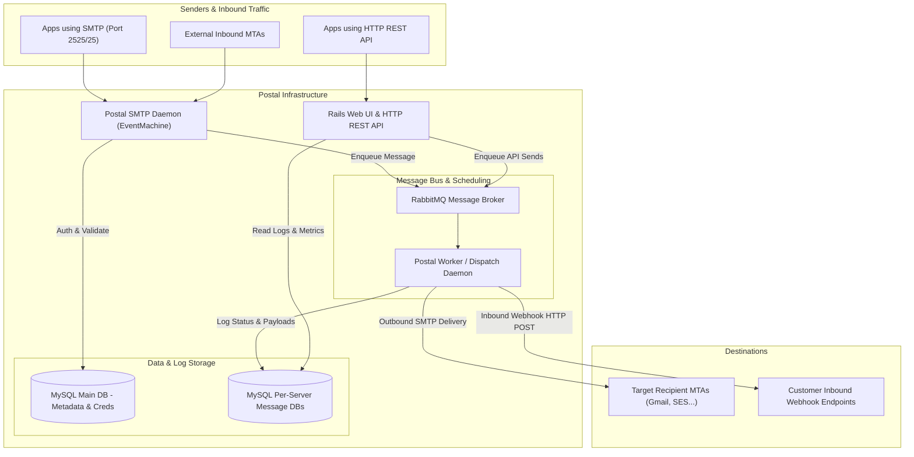
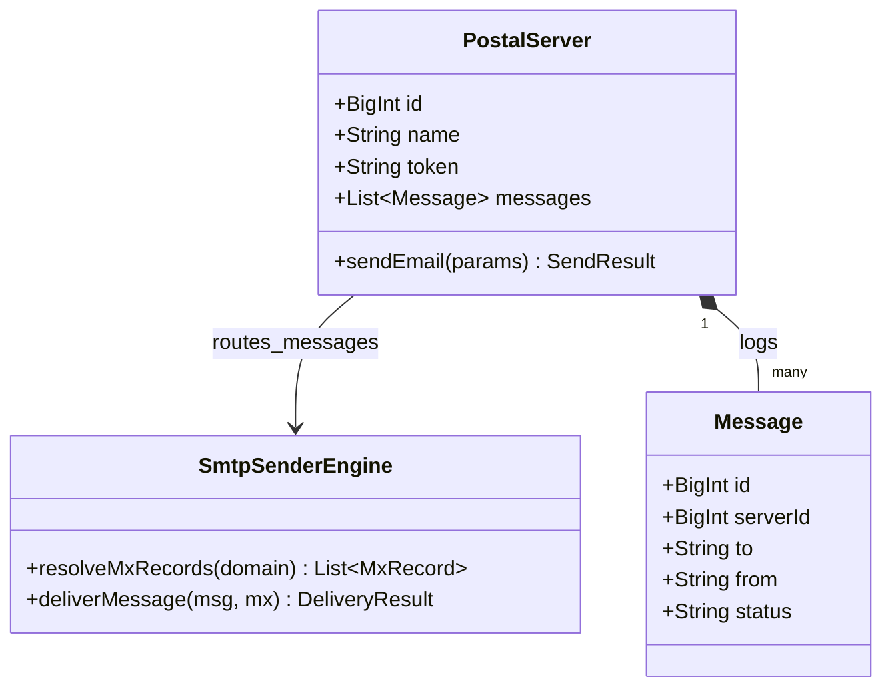
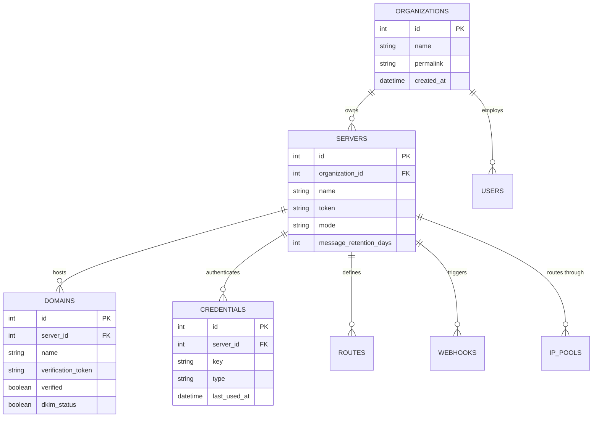
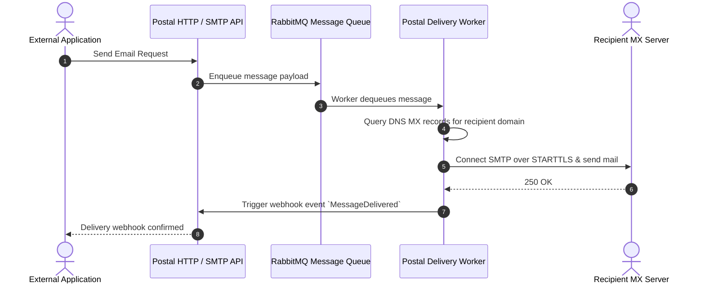

# postal - Architecture & Technical Wiki

> **Complete Open-Source Mail Delivery Platform for Inbound & Outbound Email**
> GitHub: [postalserver/postal](https://github.com/postalserver/postal.git) | Stack: Ruby on Rails, MySQL, RabbitMQ, EventMachine | License: MIT

---

## 1. Executive Summary & Value Proposition

**postal** is a comprehensive, industrial-strength open-source mail delivery platform developed by aTech Media / Krystal. Positioned as a self-hosted alternative to SendGrid, Postmark, and Mailgun, Postal handles both outbound dispatch (SMTP and HTTP REST API) and inbound routing (processing incoming emails and delivering them to webhooks or mailboxes).

### Core Problems Solved
- **Mail Server Virtualization**: Organizations can carve out multiple isolated virtual "Mail Servers", each with dedicated credentials, domains, IP pools, and routing rules.
- **Granular Message Inspection**: Every single inbound and outbound message is indexed, providing full transmission logs, bounce codes, raw MIME previews, and tracking.
- **Dynamic IP Pool Management**: Flexible routing of specific outbound mail streams through dedicated IP addresses and pool rotation rules.
- **Webhook Delivery Engine**: Real-time HTTP POST notifications on delivery, bounce, click, open, and incoming mail.

---

## 2. High-Level System Architecture

Postal separates its responsibilities into three distinct runtimes: the Web Management UI & REST API (Rails), the High-Concurrency SMTP Server (EventMachine/Ruby daemon), and the Asynchronous Worker / Queue (RabbitMQ).



---

### 2.1 Core Domain & Service Class Architecture



---

## 3. Technology Stack & Key Dependencies

- **Language & Framework**: Ruby 3.1+, Ruby on Rails 7
- **Database**: MySQL / MariaDB 10.5+
- **Message Broker**: RabbitMQ (for queueing message payloads and retry events)
- **High-Performance Daemons**: EventMachine (powers the low-overhead SMTP daemon)
- **Asset Pipeline**: Webpacker / Sprockets with TailwindCSS
- **Key Gems**:
  - `authie`: Session authentication engine
  - `bunny`: RabbitMQ Ruby client
  - `mail`: MIME creation, parsing, and attachment handling

---

## 4. Repository Layout & Key Modules

```
postal/
├── app/
│   ├── controllers/         # Web management controllers & API endpoints
│   ├── models/              # Active Record models (Server, Domain, User, Credential)
│   ├── views/               # Rails HTML views
│   └── workers/             # Background job processors
├── bin/
│   └── postal               # Postal master CLI (initialize, run daemons, make-user)
├── config/                  # Database, postal.yml configuration templates
├── db/
│   ├── schema.rb            # Main central schema
│   └── schema_template.sql  # Per-server isolated message storage schema
└── lib/
    ├── postal/
    │   ├── api/             # HTTP REST API controller logic
    │   ├── smtp_server/     # EventMachine SMTP daemon handling inbound/outbound
    │   └── message_db/      # Abstraction for sharded per-server message databases
```

---

## 5. Core Features & Capabilities

1. **Multi-Tenant Server Isolation**:
   - Each "Server" created in Postal operates as an independent mail silo with its own API keys, webhooks, suppression lists, and message retention policies.
2. **Advanced Inbound Routing & Webhooks**:
   - Postal can accept inbound mail for domains, parse the MIME structure (HTML, text, headers, attachments), and POST clean JSON payloads to external URLs.
3. **Dedicated IP Pools & Fallback Rules**:
   - Assign transactional messages to high-reputation IP pools and marketing newsletters to separate pools.
4. **Live Click and Open Tracking**:
   - Re-writes links with tracking redirects and injects 1x1 transparent GIFs for read receipts.

---

## 6. Data Models & Schema Architecture

Postal employs a dual-database pattern: a central database for accounts, servers, and credentials, and isolated message databases per server.



---

### 6.1 Comprehensive Database Schema Specification

Postal runs on MySQL with server-scoped email message routing and audit logs.

#### Table: `messages`
| Column | Type | Constraints | Default | Description |
| :--- | :--- | :--- | :--- | :--- |
| `id` | `BIGINT` | `PRIMARY KEY AUTO_INCREMENT` | - | Message ID |
| `server_id` | `INT` | `NOT NULL` | - | Virtual mail server ID |
| `scope` | `VARCHAR(20)` | `NOT NULL` | `'outbound'` | Direction (`inbound`, `outbound`) |
| `rcpt_to` | `VARCHAR(255)` | `NOT NULL` | - | Recipient email |
| `mail_from` | `VARCHAR(255)` | `NOT NULL` | - | Sender email |
| `status` | `VARCHAR(50)` | `NOT NULL` | `'Pending'` | Delivery status |

*Indexes:* `idx_messages_server` (`(server_id)`), `idx_messages_status` (`(status)`).

---

## 7. API Architecture & Key Endpoints

Postal provides an HTTP API using the `X-Server-API-Key` header:

- `POST /api/v1/send/message`: Send a single message with attachments, headers, and tracking options.
  ```json
  {
    "to": ["user@example.com"],
    "from": "sales@marketingstudio.com",
    "subject": "Platform Onboarding",
    "plain_body": "Welcome to MarketingStudio",
    "html_body": "<p>Welcome to MarketingStudio</p>"
  }
  ```
- `POST /api/v1/send/raw`: Send raw RFC2822 formatted MIME data.
- `GET /api/v1/messages/message`: Retrieve real-time delivery status, bounce codes, and click timestamps for any message ID.

---

### 7.5 End-to-End Operational Lifecycle Sequence



---

## 8. Strategic Value & Takeaways for MarketingStudio

### Reusable Architectural Patterns
1. **Multi-Tenant Server Partitioning**: Postal's architecture of isolating client organizations into virtual mail servers with dedicated retention and credentials directly fits MarketingStudio's workspace tenancy model.
2. **Inbound Email Webhook Parsing**: Postal's clean JSON representation of inbound emails (headers, parsed text, sanitized HTML, attachments encoded in base64) is an ideal blueprint for MarketingStudio's inbound email processing.
3. **IP Pool Balancing**: Implement Postal's IP pool rules to automatically steer marketing vs. transactional streams to separate outbound addresses.
