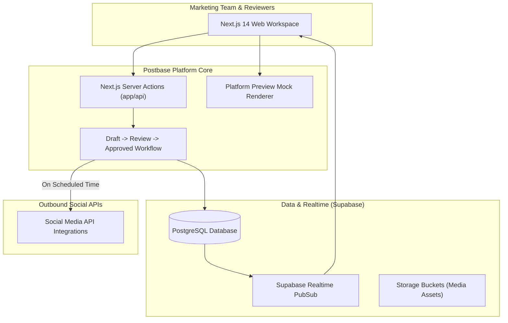
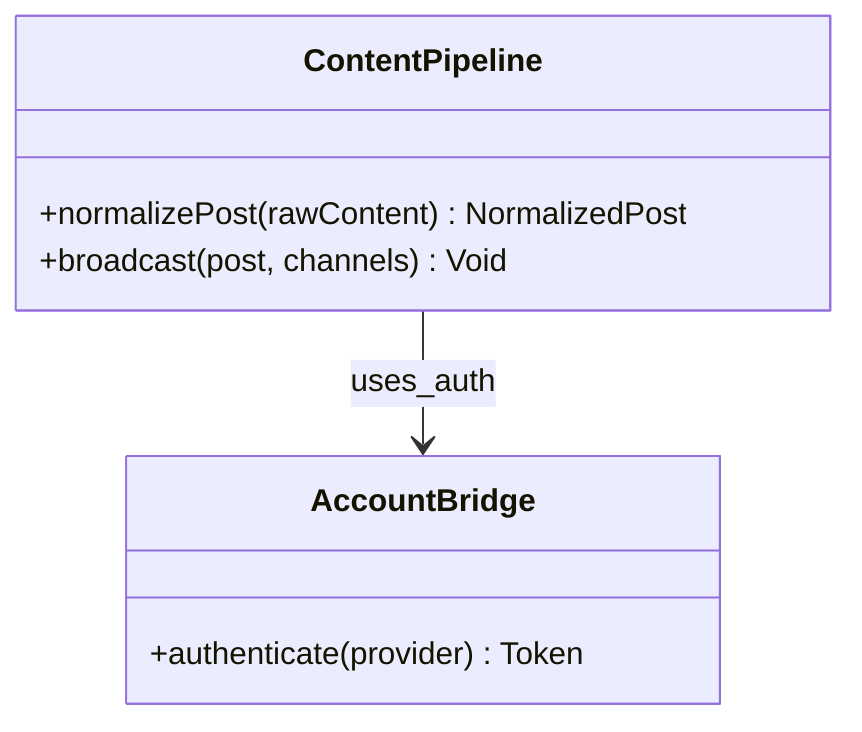
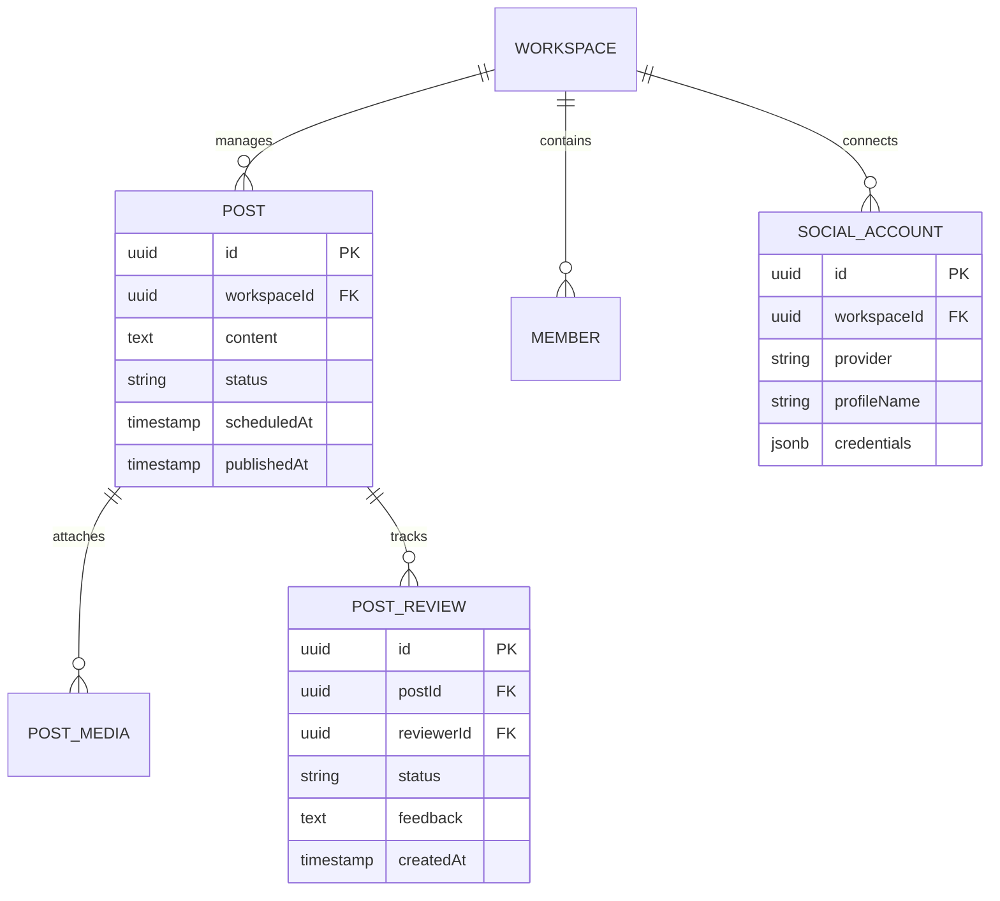
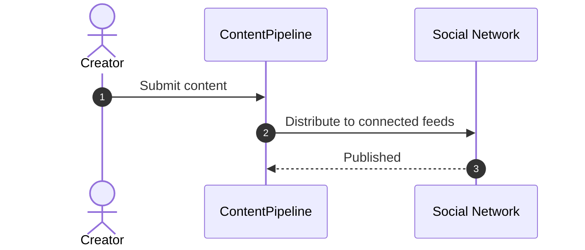

# postbase - Architecture & Technical Wiki

> **Next.js Social Media Scheduling & Team Collaboration Workspace**
> GitHub: [postbasehq/postbase](https://github.com/postbasehq/postbase.git) | Stack: TypeScript, Next.js 14, Supabase (PostgreSQL), TailwindCSS | License: MIT

---

## 1. Executive Summary & Value Proposition

**postbase** is an open-source social media collaboration and scheduling workspace built with Next.js 14 and Supabase. Geared towards marketing agencies and distributed teams, Postbase provides a collaborative kanban and calendar workspace where copywriters, designers, and marketing managers can create, review, approve, and schedule social campaigns.

### Core Problems Solved
- **Team Review Bottlenecks**: Implements formal draft approval workflows before any scheduled post can be dispatched to live social accounts.
- **Client Presentation & Previews**: Renders authentic platform previews (showing exactly how a post will look on Twitter, LinkedIn, or Instagram).
- **Supabase Realtime Sync**: Enables live collaborative editing and status updates across team members.
- **Serverless-Friendly Next.js Stack**: Deployable to Vercel, Netlify, or self-hosted Docker containers with minimal configuration.

---

## 2. High-Level System Architecture

Postbase utilizes Next.js 14 App Router, Server Actions, and Supabase PostgreSQL with Row Level Security (RLS).



---

### 2.1 Core Domain & Service Class Architecture



---

## 3. Technology Stack & Key Dependencies

- **Language**: TypeScript 5.3+
- **Frontend / Fullstack**: Next.js 14 (App Router), React 18, TailwindCSS, Shadcn UI
- **Database & Storage**: PostgreSQL via Supabase (RLS, Realtime, Storage)
- **State & Hooks**: React Query / Server Actions

---

## 4. Repository Layout & Key Modules

```
postbase/
├── app/                     # Next.js 14 App Router (calendar, drafts, settings)
├── components/              # Social preview cards (TwitterPreview, LinkedInPreview)
├── lib/                     # Supabase client, database helpers, validation
├── content/                 # Marketing content and documentation
├── DEPLOYMENT.md            # Self-hosting instructions
└── package.json
```

---

## 5. Core Features & Capabilities

1. **Accurate Social Previews**:
   - Pixel-perfect mockups of how posts will appear on Twitter (dark/light mode), LinkedIn, and Instagram.
2. **Approval Stages**:
   - Posts flow through `Draft` -> `Needs Review` -> `Approved` -> `Scheduled` -> `Published`.
3. **Asset Vault**:
   - Direct upload and organization of high-resolution images and videos via Supabase Storage.

---

---

## 6. Data Models & Schema Architecture

Postbase's relational schema in Supabase coordinates teams, posts, media assets, and approval audit states:



---

### 6.1 Comprehensive Database Schema Specification

Postbase stores normalized content and social connection tokens.

#### Table: `content_items`
| Column | Type | Constraints | Default | Description |
| :--- | :--- | :--- | :--- | :--- |
| `id` | `UUID` | `PRIMARY KEY` | `gen_random_uuid()` | Item ID |
| `content` | `TEXT` | `NOT NULL` | - | Social text |
| `status` | `VARCHAR(50)` | `NOT NULL` | `'draft'` | Item status |

---

## 7. API Architecture & Server Actions

Postbase leverages Next.js 14 Server Actions and Supabase Row Level Security:

- `createPostAction(data)`: Validates content limits per platform and creates a draft record.
- `updatePostStatusAction(id, status)`: Transitions post through approval pipeline.
- `schedulePostAction(id, timestamp)`: Validates future timestamp and queues notification.

---

### 7.5 End-to-End Operational Lifecycle Sequence



---

## 8. Strategic Value & Takeaways for MarketingStudio

### Reusable Architectural Patterns
1. **Social Preview Card Components**: Extract Postbase's React preview components (`TwitterPreview`, `LinkedInPreview`) to give MarketingStudio users instant visual feedback before publishing.
2. **Agency Approval Workflow**: Enforce review checkpoints before automated campaigns go live, preventing accidental or unvetted posts.
3. **Supabase Row Level Security**: Secure multi-tenant workspace data directly in PostgreSQL using RLS policies.
