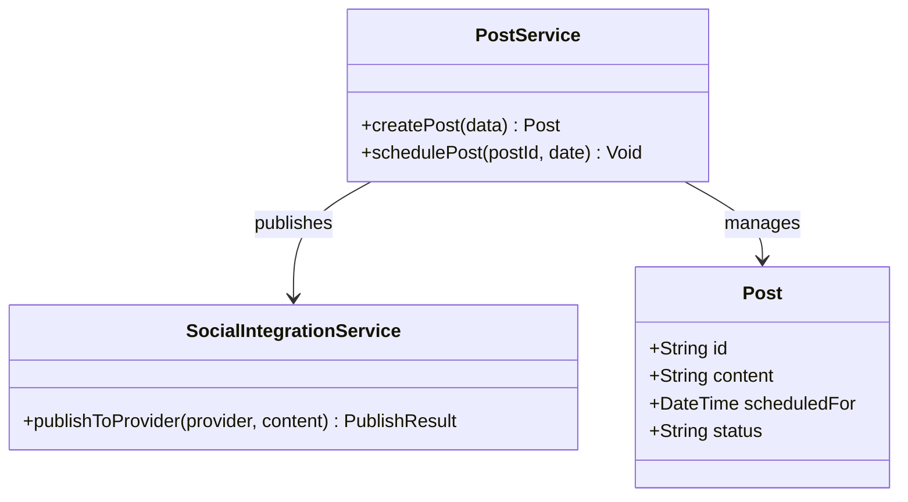
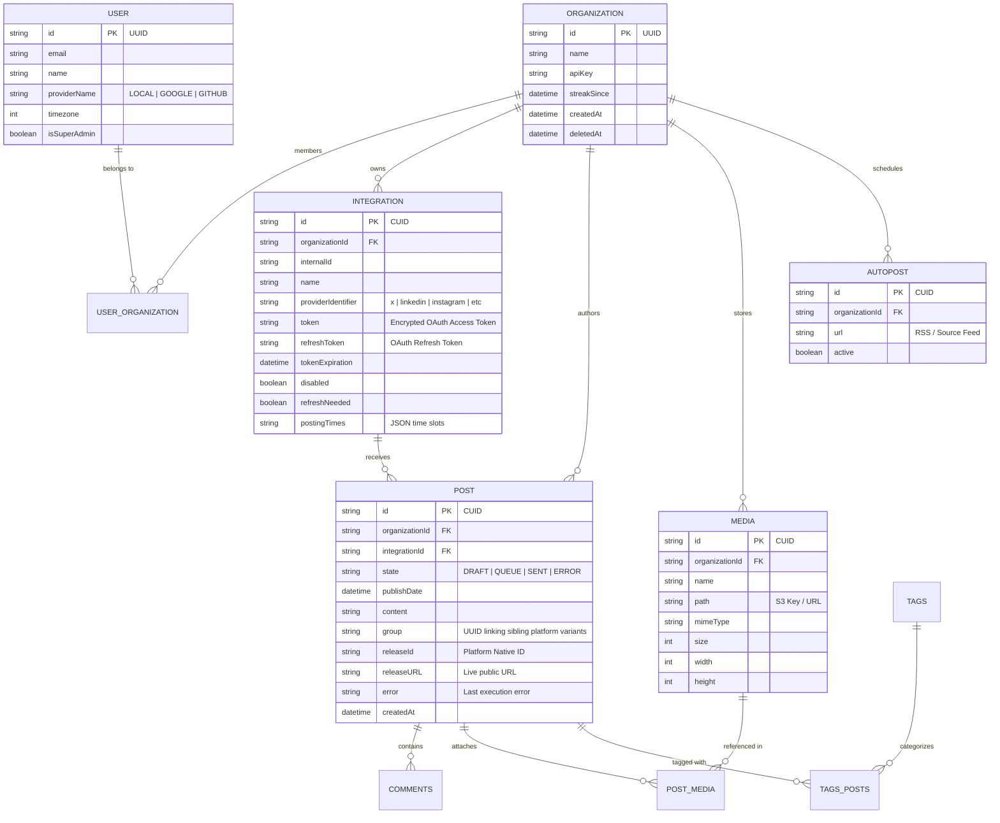
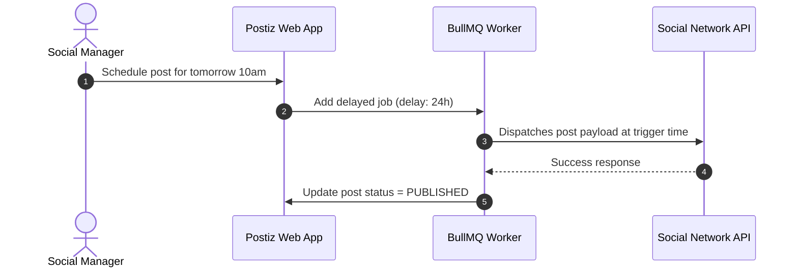

# postiz-app - Architecture & Technical Wiki

> **Enterprise-Grade Open-Source Social Media Scheduling & Content Management Engine with Temporal.io Durable Workflows, NestJS Microservices, and AI Agents**  
> GitHub: [gitroomhq/postiz-app](https://github.com/gitroomhq/postiz-app) | Stack: TypeScript, Node.js 22+, NestJS 10, Next.js 14, PostgreSQL (Prisma 6.5), Temporal.io, Redis / BullMQ, Mastra AI Agent Framework, Sharp, AWS S3 | License: AGPL-3.0

---

## 1. Executive Summary & Value Proposition

**Postiz** (formerly Gitroom) is a modern, enterprise-ready, open-source social media management, automation, and analytics suite designed to power high-scale content distribution for creators, agencies, and cross-functional marketing teams. Built on a modular monorepo architecture leveraging **NestJS**, **Next.js**, **Prisma**, and **Temporal.io**, Postiz provides an alternative to proprietary marketing platforms with support for more than 30 social, community, and developer networks (including X/Twitter, LinkedIn, Instagram, TikTok, YouTube, Reddit, Discord, Bluesky, Threads, Farcaster, and Mastodon).

Unlike conventional schedulers that rely on simple database polling or ephemeral Redis queues that lose execution state upon server restarts or API rate-limit errors, Postiz employs **Temporal.io durable workflow orchestration**. Every scheduled publication, media transcoding job, and token refresh is modeled as a stateful, fault-tolerant workflow capable of surviving process restarts, network outages, and long multi-day retry intervals without duplicate posts or orphaned payloads.

### Core Problems Solved
- **Durable Scheduling Without State Loss**: Replaces fragile cron intervals and transient worker queues with Temporal durable execution, ensuring scheduled posts survive server reboots, infrastructure deployments, and third-party rate-limit freezes.
- **Heterogeneous Multi-Platform Publishing (30+ Channels)**: Solves the extreme fragmentation of social network APIs via a unified, extensible `SocialProvider` abstraction with support for modern federated protocols (AT Protocol / Bluesky, Nostr, Farcaster, ActivityPub) alongside traditional legacy APIs.
- **Safe Partial Failure & Two-Phase Publish Guarantees**: Introduces specialized error primitives (`PublishedWithError`, `RefreshToken`, `Disconnect`) to handle edge cases where a post succeeds on the remote platform (e.g., YouTube video upload) but a secondary step fails (e.g., custom thumbnail attachment), preventing accidental duplicate uploads on retry.
- **Automated OAuth Token Rotation**: Implements proactive and reactive token rotation workflows that refresh short-lived OAuth 2.0 access tokens prior to expiration, eliminating unexpected publication failures.
- **Native AI-Powered Content Creation**: Embeds AI agent orchestration via the Mastra framework, Model Context Protocol (MCP) tool exposure, and CopilotKit in-canvas drafting, enabling autonomous generation of viral hooks, platform rewrites, and video clipping workflows.

---

## 2. High-Level System Architecture

Postiz is architected as an event-driven distributed system separated into an API Gateway (`apps/backend`), a Durable Workflow Worker cluster (`apps/orchestrator`), a modern SSR Web App (`apps/frontend`), and a shared core library layer (`libraries/nestjs-libraries`).

```mermaid
flowchart TD
    subgraph ClientInterfaces ["Client & Authoring Surfaces"]
        WebFrontend["Next.js 14 Web Application (Mantine UI + CopilotKit)"]
        BrowserExt["Chrome / Firefox Web Extension"]
        PublicAPIClient["External REST / Public API Consumers"]
    end

    subgraph APIServices ["NestJS API Gateway Cluster (apps/backend)"]
        APIRouter["API Router & JWT / API Key Authentication"]
        PostController["PostsController (Queue, Edit, Validate)"]
        IntegrationController["IntegrationsController (OAuth Callbacks)"]
        MediaController["MediaController (S3 Presigned Uploads)"]
        CopilotController["CopilotController (Mastra / LangGraph AI)"]
    end

    subgraph StorageLayer ["Persistence & State Layer"]
        PostgresDB[(PostgreSQL 16 - Multi-Tenant Prisma Schema)]
        RedisCache[(Redis - BullMQ & Throttling Cache)]
        S3Storage["AWS S3 / Cloudflare R2 (Media & Clips)"]
    end

    subgraph TemporalCluster ["Temporal.io Workflow Engine"]
        TemporalServer["Temporal Core Server (gRPC)"]
        PostWorkflow["PostWorkflows (Publish / Delay / Retry)"]
        TokenWorkflow["RefreshTokenWorkflow"]
        ClipWorkflow["ClippingWorkflow (Video Slicing)"]
        StreakWorkflow["StreakWorkflow (Gamified Publishing)"]
    end

    subgraph OrchestratorWorkers ["NestJS Orchestrator Workers (apps/orchestrator)"]
        PostActivity["PostActivities (Execute Social API Calls)"]
        IntegrationActivity["IntegrationActivities (Token Exchange)"]
        MediaActivity["MediaActivities (Sharp Image / FFMpeg Transcode)"]
        EmailActivity["EmailActivities (Transactional Digests)"]
    end

    subgraph SocialNetworkGateways ["External Platform Adapters (30+ Networks)"]
        XProvider["X / Twitter Provider (OAuth 1.0a / 2.0)"]
        MetaProvider["Facebook & Instagram Provider (Graph API)"]
        LinkedInProvider["LinkedIn Member & Page Provider"]
        TikTokProvider["TikTok Business & Direct Provider"]
        YouTubeProvider["YouTube Data v3 Provider (Resumable Uploads)"]
        BlueskyProvider["Bluesky AT Protocol Provider"]
        CommunityProviders["Reddit / Discord / Slack / Lemmy / Mastodon"]
    end

    WebFrontend -->|HTTPS / REST| APIRouter
    BrowserExt -->|HTTPS / REST| APIRouter
    PublicAPIClient -->|API Key| APIRouter

    APIRouter --> PostController
    APIRouter --> IntegrationController
    APIRouter --> MediaController
    APIRouter --> CopilotController

    PostController --> PostgresDB
    IntegrationController --> PostgresDB
    MediaController --> S3Storage

    PostController -->|Start Execution| TemporalServer
    IntegrationController -->|Trigger Rotation| TemporalServer

    TemporalServer --> PostWorkflow
    TemporalServer --> TokenWorkflow
    TemporalServer --> ClipWorkflow
    TemporalServer --> StreakWorkflow

    PostWorkflow --> PostActivity
    TokenWorkflow --> IntegrationActivity
    ClipWorkflow --> MediaActivity

    PostActivity --> XProvider
    PostActivity --> MetaProvider
    PostActivity --> LinkedInProvider
    PostActivity --> TikTokProvider
    PostActivity --> YouTubeProvider
    PostActivity --> BlueskyProvider
    PostActivity --> CommunityProviders

    PostActivity --> PostgresDB
    MediaActivity --> S3Storage
    PostActivity -->|Refresh Token Signal| TokenWorkflow
```



---

### 2.1 Core Domain & Service Class Architecture



---

## 3. Technology Stack & Key Dependencies

| Component | Technology | Version / Purpose |
| :--- | :--- | :--- |
| **Language & Runtime** | TypeScript / Node.js | TypeScript 5.5+, Node.js `22.x` (ESM native, strict typing) |
| **Monorepo Manager** | pnpm Workspaces | `pnpm@10.6.1` with NX / Turborepo build caching |
| **Backend Framework** | NestJS | `^10.4.0` (Modular DI architecture, microservice bindings) |
| **Durable Orchestrator** | Temporal.io SDK | `@temporalio/client`, `@temporalio/workflow`, `@temporalio/activity` |
| **Database & ORM** | PostgreSQL 16 + Prisma | `prisma: 6.5.0` (Multi-tenant schema, transaction-safe queries) |
| **Caching & In-Memory** | Redis + ioredis | Distributed locking, rate-limiting (`@nestjs/throttler`), BullMQ |
| **Frontend Framework** | Next.js 14 | App Router, React 18, Mantine UI components (`@mantine/core: ^5.10`) |
| **AI & Agent Runtime** | Mastra + LangChain | `@mastra/core: ^1.67`, `@mastra/mcp: ^1.18`, `@langchain/langgraph` |
| **In-App AI Assistant** | CopilotKit | `@copilotkit/react-core: 1.72.0`, `@copilotkit/react-ui` |
| **Decentralized Social** | AT Protocol SDK | `@atproto/api: ^0.15.15` (Bluesky lexicon & firehose interaction) |
| **Media Transcoding** | Sharp & FFmpeg | `sharp: ^0.33.5` (High-performance image transforms & metadata stripping) |
| **Storage Backend** | AWS SDK v3 | `@aws-sdk/client-s3: ^3.787.0`, Presigned URL generation |

---

## 4. Repository Layout & Key Modules

```
inspire/postiz-app/
├── apps/
│   ├── backend/                       # NestJS API Gateway (port 3000)
│   │   └── src/
│   │       ├── api/routes/            # REST controllers (posts, integrations, media, oauth)
│   │       ├── public-api/            # Public headless API v1 controllers
│   │       └── services/              # Auth, Stripe, Organization, and Tenant guards
│   ├── orchestrator/                  # Temporal.io Worker Cluster
│   │   └── src/
│   │       ├── activities/            # post.activity.ts, integrations.activity.ts, media.activity.ts
│   │       ├── workflows/             # post-workflows/, refresh.token.workflow.ts, clipping.workflow.ts
│   │       └── signals/               # Temporal workflow signal listeners
│   ├── frontend/                      # Next.js 14 Web Application (port 4200)
│   │   └── src/                       # Calendar views, multi-channel composer, Copilot textareas
│   ├── extension/                     # Chrome / browser extension for rapid social bookmarking
│   └── sdk/                           # Auto-generated TypeScript client SDK for Postiz Public API
├── libraries/
│   ├── helpers/                       # Shared utility functions (timer, string formatters)
│   ├── react-shared-libraries/        # Shared React hooks, icons, and Mantine theme tokens
│   └── nestjs-libraries/              # Core business domain logic
│       └── src/
│           ├── database/prisma/       # schema.prisma (1,840+ lines, PostgreSQL schema)
│           ├── integrations/
│           │   ├── social/            # 30+ Social provider implementations (x, linkedin, tiktok, etc.)
│           │   ├── social.abstract.ts # Abstract base class with SSRF protection & error wrappers
│           │   ├── integration.manager.ts # Provider factory and capability router
│           │   └── refresh.integration.service.ts # Proactive OAuth rotation service
│           ├── agent/                 # Mastra AI agents and tool registration
│           └── temporal/              # Temporal connection client and heartbeat helpers
├── docker-compose.yaml                # Production Docker stack (Backend, Frontend, Temporal, Redis, Postgres)
└── pnpm-workspace.yaml                # Monorepo workspace configuration
```

---

## 5. Core Features & Capabilities

### 5.1 Social Account Connection & Proactive OAuth Rotation
Postiz abstracts connectivity via `SocialAbstract` and `IntegrationManager`. Over 30 social platforms are maintained as independent provider classes conforming to `SocialIntegrationsInterface`.
- **Token Storage**: Credentials, refresh tokens, and expirations are persisted in the `Integration` table.
- **Durable Token Refresh**: If an API call fails with a `RefreshToken` error, the Temporal `post.activity` automatically invokes `refresh.token.workflow.ts`. The workflow executes `refresh.integration.service.ts`, acquires a mutex lock, exchanges the refresh token with the upstream provider, updates PostgreSQL, and resumes the paused post activity without user intervention.
- **Permanent Disconnect Detection**: Irreversible errors (such as user credential revocation or account banning) throw `Disconnect`, immediately updating the integration status to disabled (`disabled = true`) and notifying the tenant via WebSocket/email.

### 5.2 Multi-Platform Post Composer with CopilotKit
The authoring interface enables cross-network drafting with real-time constraint validation:
- **Platform-Specific Formats**: Authors toggle destination tabs (e.g. X Thread vs. LinkedIn Article vs. TikTok Video). Each tab maintains independent character budgets, hashtag limits, and media attachments.
- **AI-Assisted Writing**: Integrated via `@copilotkit/react-textarea`, the composer allows users to prompt inline LLMs to expand, summarize, or tone-shift copy directly within the drafting canvas.
- **Safe HTML & Markdown Sanitization**: `social.abstract.ts` implements strict SSRF-safe parsers and dispatcher filters (`getSsrfSafeDispatcher`) ensuring uploaded images or external link previews do not probe private network addresses (e.g. cloud metadata endpoints at `169.254.169.254`).

### 5.3 Video Clipping & Media Processing Pipeline
Postiz includes advanced media manipulation built directly into the orchestrator:
- **Sharp Image Normalization**: Before dispatching to social networks with rigid aspect ratio requirements (such as Instagram 1:1 or 4:5), `media.activity.ts` uses Sharp to resize, pad, and convert images into compliant JPEG/PNG buffers.
- **Short-Form Video Clipping**: `clipping.workflow.ts` accepts long-form video URLs (or YouTube links), downloads the source via secure streaming, invokes speech-to-text transcription via Deepgram, identifies viral hook segments using OpenAI, slices the video via FFmpeg, and automatically stages vertical short clips into the publishing queue.

### 5.4 Temporal-Powered Queue & State Machine
The post publishing lifecycle is managed by `post-workflows/`:
1. **QUEUE**: The post is scheduled for a future timestamp. A Temporal timer sleeps until the target `publishDate`.
2. **PROCESSING**: The workflow signals `post.activity.ts`. The activity uploads media binaries and submits the post payload.
3. **PUBLISHED / ERROR**: If the post succeeds, the state transitions to `PUBLISHED` and populates `releaseId` and `releaseURL`. If an error occurs, Temporal evaluates the exception:
   - Transient network failure -> Exponential backoff retry.
   - `PublishedWithError` -> Marks the post with error notes but preserves `releaseURL` to prevent double-posting.

### 5.5 Gamified Consistency & Streaks Engine
Postiz incorporates user retention mechanics through `streak.workflow.ts`. An automated daily Temporal cron evaluates whether an organization has published within a rolling 24-hour window, updating `Organization.streakSince` to gamify team publishing discipline.

---

## 6. Data Models & Schema Architecture

The Postiz schema is defined in `schema.prisma`, featuring rich relations across multi-tenant organizations, integrations, posts, media, and collaboration sets.



### Core Schema Highlights

#### `Integration` (Table: `Integration`)
- `id` (String, PK, `@default(cuid())`): Unique integration identifier.
- `organizationId` (String, FK): Tenant organization owning the connection.
- `providerIdentifier` (String): Social provider key (`x`, `linkedin-page`, `instagram`, `tiktok`, `youtube`, `bluesky`).
- `token` (String): Stored OAuth 2.0 access token or API bearer key.
- `refreshToken` (String, Nullable): OAuth refresh token used by Temporal refresh workflows.
- `tokenExpiration` (DateTime, Nullable): Epoch tracking expiration threshold.
- `postingTimes` (String): JSON-encoded default schedule time slots (`"[{\"time\":120}, {\"time\":400}]"`).

#### `Post` (Table: `Post`)
- `id` (String, PK, `@default(cuid())`): Post identifier.
- `state` (Enum `State`): `DRAFT`, `QUEUE`, `SENT`, `ERROR`.
- `group` (String): UUID linking multi-platform variants of the same broadcast.
- `publishDate` (DateTime): Exact UTC timestamp when the Temporal timer should fire.
- `releaseId` (String, Nullable): The remote platform's published post/tweet ID.
- `releaseURL` (String, Nullable): Live permalink to the published content.
- `error` (String, Nullable): Sanitized failure payload if publication was rejected.

---

### 6.1 Comprehensive Database Schema Specification

Postiz persists social posts and media files using Prisma on PostgreSQL.

#### Table: `Post`
| Column | Type | Constraints | Default | Description |
| :--- | :--- | :--- | :--- | :--- |
| `id` | `TEXT` | `PRIMARY KEY` | `cuid()` | Unique post ID |
| `content` | `TEXT` | `NOT NULL` | - | Post copy |
| `scheduledFor` | `TIMESTAMP(3)` | `NULLABLE` | `NULL` | Scheduled timestamp |
| `status` | `TEXT` | `NOT NULL` | `'DRAFT'` | State (`DRAFT`, `SCHEDULED`, `PUBLISHED`) |

*Indexes:* `Post_scheduledFor_idx` (`(scheduledFor)`).

---

## 7. API Architecture, Webhooks & Key Endpoints

Postiz exposes a dual API architecture: internal session-guarded routes for the Next.js frontend and an API-key authenticated Public REST API (`/v1`) for headless integration.

### Core Endpoints

| Method | Endpoint | Description |
| :--- | :--- | :--- |
| `GET` | `/api/posts` | Retrieve calendar and queue posts filtered by date range and state |
| `POST` | `/api/posts` | Create, validate, and schedule posts across multiple integration IDs |
| `PUT` | `/api/posts/{id}` | Update post content, scheduled date, or media before execution |
| `DELETE` | `/api/posts/{id}` | Cancel and unschedule a post (signals Temporal cancellation) |
| `GET` | `/api/integrations` | List all connected social channels and token health states |
| `POST` | `/api/integrations/{provider}/connect` | Initiate OAuth 2.0 redirect flow for a specific network |
| `POST` | `/api/media` | Request presigned S3 upload URL for direct client-to-bucket upload |
| `POST` | `/api/copilot/chat` | AI agent endpoint for conversational drafting and rewrites |
| `POST` | `/api/autopost` | Configure RSS feed autoposting rules |

### Sample Payload: Post Scheduling Request
`POST /api/posts`
```json
{
  "posts": [
    {
      "integrationId": "cly109a8b0001xyz7890",
      "content": "Excited to launch MarketingStudio v2! Check out the thread below 👇",
      "publishDate": "2026-11-05T16:00:00.000Z",
      "settings": {
        "x": {
          "whoCanReply": "following"
        }
      },
      "media": [
        {
          "id": "cly109cd40002xyz1234"
        }
      ]
    },
    {
      "integrationId": "cly109ef70003xyz5678",
      "content": "Today we are officially rolling out MarketingStudio v2. An architectural leap forward in social media management for high-growth teams.",
      "publishDate": "2026-11-05T16:00:00.000Z",
      "media": [
        {
          "id": "cly109cd40002xyz1234"
        }
      ]
    }
  ]
}
```

---

### 7.5 End-to-End Operational Lifecycle Sequence



---

## 8. Strategic Value & Takeaways for MarketingStudio

Postiz represents an exceptional benchmark for high-scale, fault-tolerant social media publishing.

### Reusable Architectural Patterns
1. **Durable Workflow Orchestration (Temporal Pattern)**: Postiz proves that complex social publishing (with delays, retries, media transcode pipelines, and multi-day schedules) is fundamentally a workflow problem. MarketingStudio should implement durable state machines (via Temporal or BullMQ persistent flows) so that in-flight publishing jobs survive container restarts without double-posting.
2. **Two-Phase Publication Fault Tolerance (`PublishedWithError`)**: When posting rich media (e.g. YouTube videos or LinkedIn carousels), the asset is often created before the metadata is finalized. If the second call fails, a standard retry would post a duplicate video. Postiz's pattern of persisting `releaseId` and `releaseURL` even during error states is a critical safeguard MarketingStudio must adopt.
3. **Decentralized Social Network Readiness**: By implementing first-class AT Protocol (`@atproto/api`), Nostr, and Farcaster providers alongside traditional Big Tech APIs, Postiz ensures compatibility with modern federated ecosystems. MarketingStudio can borrow these exact provider blueprints.
4. **SSRF-Safe Media Fetching**: The `getSsrfSafeDispatcher` pattern prevents malicious users from supplying media URLs pointing to internal private infrastructure (`127.0.0.1`, cloud metadata IP addresses), safeguarding multi-tenant self-hosted clusters.
