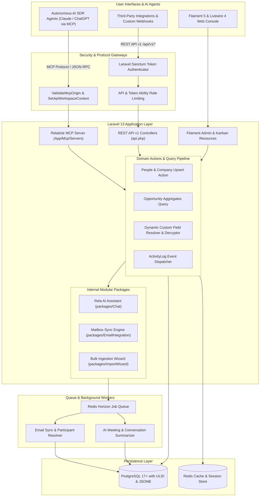
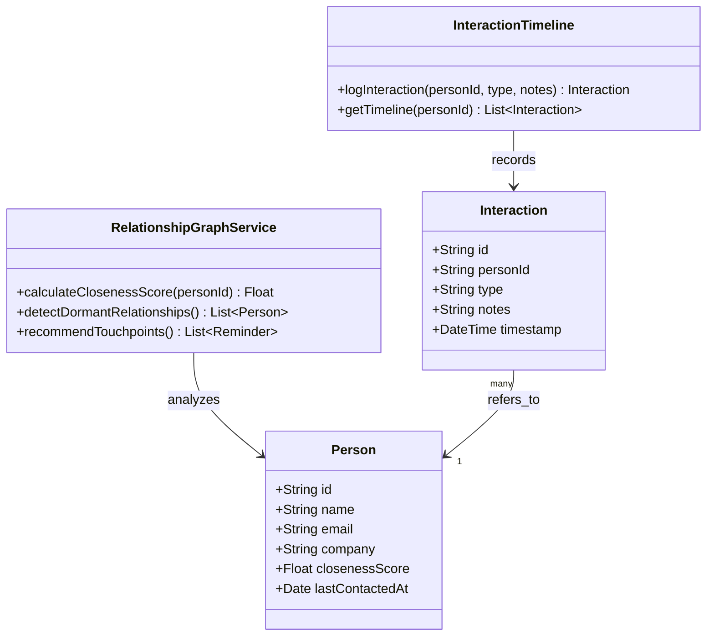
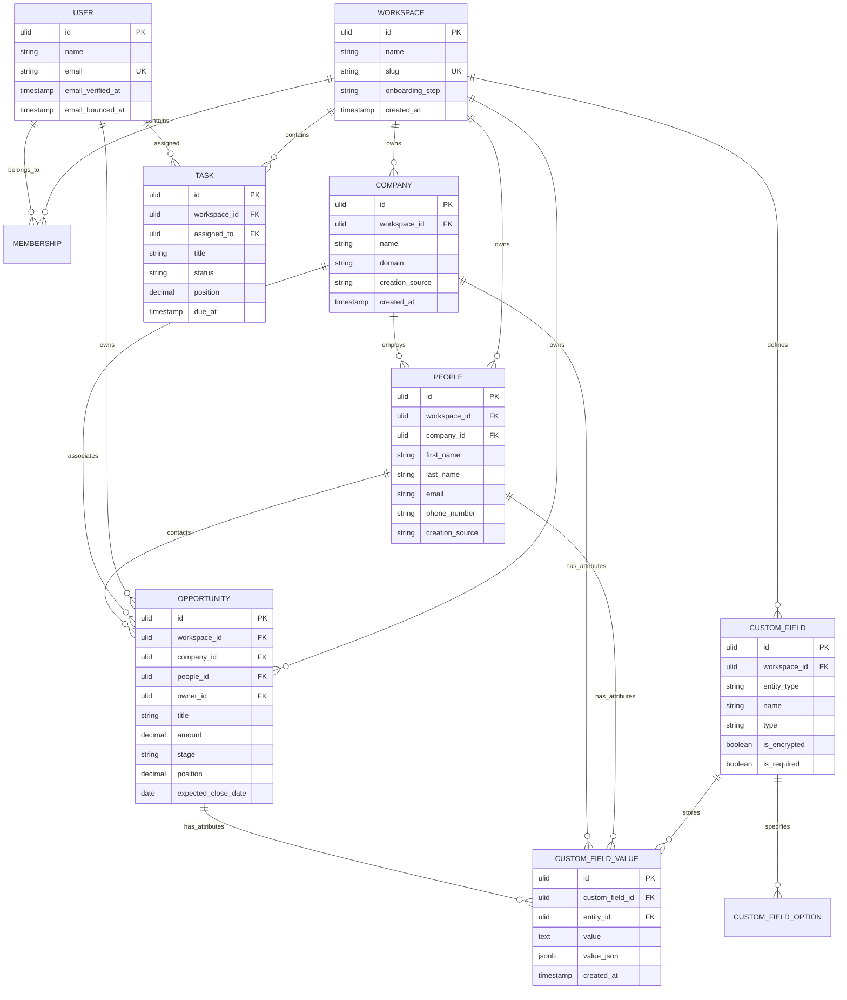
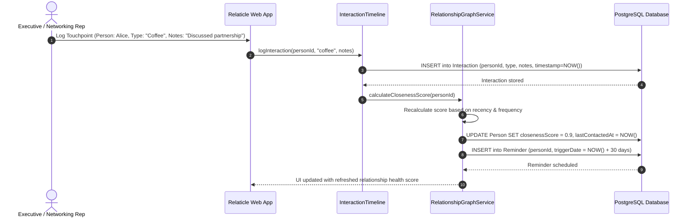

# relaticle - Architecture & Technical Wiki

> **Agent-Native Modern Open-Source CRM & Extensible Workspace Platform**  
> GitHub: [Relaticle/relaticle](https://github.com/Relaticle/relaticle) | Stack: PHP 8.5+, Laravel 13, Filament 5, Livewire 4, PostgreSQL 17+, Redis, Model Context Protocol (MCP) | License: AGPL-3.0

---

## 1. Executive Summary & Value Proposition

**relaticle** is a next-generation, agent-native open-source CRM engineered with modern PHP 8.5 and Laravel 13, featuring an administrative user interface powered by Filament 5 and Livewire 4. Designed specifically for developer-led teams, high-growth startups, and AI-forward enterprises, relaticle redefines the customer relationship platform by treating autonomous AI agents as first-class workspace participants alongside human sales teams.

Unlike legacy PHP CRMs bogged down by technical debt and monolithic designs, relaticle combines strict architectural standards, ULID primary keys, and multi-tenant workspace isolation with a native **Model Context Protocol (MCP) server**. External autonomous agents (such as Claude, ChatGPT, or open-source local LLMs) can securely connect to relaticle via MCP or a granularly throttled REST API to inspect CRM data schemas, execute complex prospect deduplication and upserts, perform pipeline analytics, and log sales activities in real time.

### Core Problems Solved
- **AI Agent Blindness to CRM Context**: Provides a native, standardized Model Context Protocol (MCP) server that grants autonomous AI agents direct, structured tools to read, write, query, and summarize CRM records safely.
- **Relational Schema Rigidity & Migration Downtime**: Features an extensible dynamic custom fields engine (`CustomField`, `CustomFieldValue`, `CustomFieldSection`) supporting dates, currency, multi-selects, and record linkages with per-field encryption—without executing database migrations.
- **Enterprise Multi-Tenancy & Data Isolation**: Guarantees strict multi-workspace boundaries (`Workspace`, `Membership`, `WorkspaceInvitation`) with granular role-based access control (Owner, Admin, Member, Guest) and token abilities.
- **Legacy PHP CRM Architecture**: Built on a modern reactive stack using PHP 8.5, Laravel 13, Filament 5, Livewire 4, PostgreSQL 17, and Redis queues, providing sub-50ms reactive updates and automated CI testing.
- **Fragmented Communication History**: Delivers a deep email and calendar synchronization package (`packages/EmailIntegration`) that extracts email participants, resolves company domains, and tracks meeting join URLs automatically.

---

## 2. High-Level System Architecture

relaticle decouples its presentation tier (Filament 5 / Livewire 4) from its external agent interface (Model Context Protocol server and REST API v1), backed by Laravel 13 service layers, Redis queue workers, and PostgreSQL 17 storage.



---

### 2.1 Core Domain & Service Class Architecture



---

## 3. Technology Stack & Key Dependencies

- **Language & Runtime**: PHP 8.5+ (strict typing, match expressions, native attributes), Node.js 22+
- **Application Framework**: Laravel 13.x (latest micro-framework optimizations and streamlined routing)
- **Admin Panel & Reactive UI**: Filament 5, Livewire 4, Alpine.js, TailwindCSS, Vite
- **Primary Database**: PostgreSQL 17+ (utilizing native JSONB indexing, partial indexes, and ULID identifiers)
- **Queue & In-Memory Store**: Redis with Laravel Horizon for queue worker orchestration
- **Agentic Protocol**: Model Context Protocol (MCP) Server (`config/mcp.php`, `App\Mcp\Servers\RelaticleServer`)
- **Authentication & Security**: Laravel Sanctum (token abilities, token hashing), Passkeys / WebAuthn for administrators, per-field encryption
- **Code Quality & Architecture Tooling**: PHPUnit 11, Pest 3, PHPStan (level 8 + custom method-length rules), Rector (automated code migrations), Laravel Pint

---

## 4. Repository Layout & Key Modules

```
relaticle/
├── app/
│   ├── Actions/                      # Single-responsibility business mutation actions
│   │   ├── Company/                  # UpsertCompany, DeduplicateCompany, MergeCompany
│   │   ├── People/                   # UpsertPeople, VerifyEmail, AssignWorkspace
│   │   └── Opportunity/              # MoveStage, CalculateWinProbability, CloseDeal
│   ├── Enums/                        # Typed enums (WorkspaceRole, CreationSource, FieldType)
│   ├── Http/
│   │   ├── Controllers/Api/V1/       # RESTful API controllers (Companies, People, Tasks)
│   │   └── Middleware/               # SetApiWorkspaceContext, ValidateMcpOrigin
│   ├── Mcp/                          # First-class Model Context Protocol implementation
│   │   ├── Servers/                  # RelaticleServer protocol definition
│   │   └── Tools/                    # Autonomous agent tools:
│   │       ├── AggregateOpportunitiesTool.php # Pipeline totals and conversion stats
│   │       ├── GetCrmSchemaTool.php           # Introspects custom objects and fields
│   │       ├── GetCrmSummaryTool.php          # High-level pipeline and account briefing
│   │       ├── ListCompaniesTool.php          # Filtered company search
│   │       ├── ListOpportunitiesTool.php      # Deal query and stage filtering
│   │       └── ListPeopleTool.php             # Contact search with custom field filters
│   ├── Models/                       # Eloquent models (ULID primary keys)
│   │   ├── Company.php               # Account accounts and firmographics
│   │   ├── CustomField.php           # Dynamic attribute definition
│   │   ├── CustomFieldValue.php      # Encrypted/JSONB custom attribute storage
│   │   ├── Opportunity.php           # Revenue deals progressing across stages
│   │   ├── People.php                # Individual customer and lead records
│   │   ├── Task.php                  # Sales assignments and follow-up reminders
│   │   └── Workspace.php             # Multi-tenant operational boundary
│   └── Queries/                      # Specialized query objects for analytical reporting
├── config/                           # Application configs (mcp.php, database.php, auth.php)
├── database/
│   └── migrations/                   # PostgreSQL schema definitions with ULID migrations
├── packages/                         # Modular internal domain packages
│   ├── Chat/                         # Rela conversational AI assistant package
│   ├── Documentation/                # Embedded technical guides and interactive API docs
│   ├── EmailIntegration/             # Imap/OAuth mail syncing, participant parser
│   ├── ImportWizard/                 # High-throughput CSV/Excel mapping and ingestion
│   └── SystemAdmin/                  # Tenant management and platform-wide monitoring
├── routes/
│   ├── api.php                       # Versioned REST endpoints (/api/v1/*)
│   ├── ai.php                        # AI agent conversation routes
│   └── web.php                       # Filament and auth web routes
├── composer.json                     # PHP dependencies and package autoloading
└── vite.config.js                    # Vite frontend bundling configuration
```

---

## 5. Core Features & Capabilities

### First-Class Model Context Protocol (MCP) Server
relaticle features an integrated MCP server designed to connect directly with autonomous AI agents. Rather than relying on fragile web scrapers or unconstrained SQL access, agents query the system using strictly typed tools:
- `GetCrmSchemaTool`: Returns the active workspace schema, including all custom fields, types, and allowable select options.
- `GetCrmSummaryTool`: Generates an executive briefing of active deals, new leads, and overdue tasks.
- `AggregateOpportunitiesTool`: Computes weighted pipeline revenue, stage conversion velocity, and deal counts.
- `ListCompaniesTool` / `ListPeopleTool`: Performs high-speed multi-criteria lead lookups supporting complex filtering on dynamic custom fields.

### Dynamic Custom Fields with Per-Field Encryption
To allow growth and marketing teams to tailor the CRM without engineering dependencies, relaticle implements a flexible custom fields engine (`CustomField`, `CustomFieldValue`). Supported types include `text`, `number`, `currency`, `date`, `boolean`, `select`, `multi_select`, `domain`, and `record_link`. Critical sensitive fields (such as SSNs, compensation data, or confidential contract values) can be designated for AES-256-GCM per-field encryption, preventing unauthorized access even in the event of database snapshots.

### Multi-Workspace Isolation & Granular Token Abilities
The data model enforces multi-tenant isolation via the `Workspace` entity. All CRM records (`Company`, `People`, `Opportunity`, `Task`, `Note`) are strictly workspace-scoped. Access tokens issued through Laravel Sanctum can be scoped to specific workspaces and granted granular permissions (e.g., `read`, `create`, `update`, `delete`), guaranteeing that an AI SDR agent with `create` abilities cannot delete customer records or access unassigned workspaces.

### Opportunity & Deal Pipeline Management with Fractional Positioning
Sales deals (`Opportunity`) progress across visual Kanban boards with real-time financial tracking. To prevent race conditions and performance locks during simultaneous stage reordering, relaticle utilizes decimal fractional positioning (`FlowforgePosition`). When an operator or AI agent moves a deal between stages, only a single row's fractional order index is recalculated, avoiding bulk table row rewrites.

### Omnichannel Email & Meeting Participant Ingestion
The `packages/EmailIntegration` module connects directly to enterprise email accounts. The background ingestion engine parses incoming mail bodies, creates or links `People` records based on participant headers, and tracks company domains. It automatically extracts calendar meeting join URLs (Zoom, Google Meet, Microsoft Teams) and links them to relevant deal timelines.

### Rela AI Conversational Assistant
Integrated via `packages/Chat`, the "Rela" assistant provides human operators with an in-app copilot. Rela can answer natural language questions about active deals, draft follow-up notes, summarize email threads, and propose next actions for human account executives.

---

## 6. Data Models & Schema Architecture

relaticle utilizes Eloquent models with ULID (Universally Unique Lexicographically Sortable Identifier) primary keys in PostgreSQL 17.



### Core Schema Entity Specifications

| Model Class | Table Name | Key Attributes & Foreign Keys | Functional Role |
| :--- | :--- | :--- | :--- |
| `Workspace` | `workspaces` | `id` (ULID PK), `name` (String), `slug` (Unique String), `onboarding_step` | Master multi-tenant tenant boundary enforcing isolation across all database queries. |
| `Company` | `companies` | `id` (ULID PK), `workspace_id` (FK), `name`, `domain` (Indexed String), `creation_source` (`api`, `manual`, `sample`, `mcp`) | Represents organization accounts; acts as primary aggregation root for deals and contacts. |
| `People` | `people` | `id` (ULID PK), `workspace_id` (FK), `company_id` (Nullable FK), `first_name`, `last_name`, `email` (Indexed) | Individual prospect/contact entity with associated activity streams and custom attributes. |
| `Opportunity` | `opportunities` | `id` (ULID PK), `workspace_id` (FK), `company_id` (FK), `amount` (Currency Decimal), `stage`, `position` (Decimal) | Pipeline sales deal tracked with fractional ordering for non-blocking Kanban reordering. |
| `CustomField` | `custom_fields` | `id` (ULID PK), `workspace_id` (FK), `entity_type` (`Company`, `People`, `Opportunity`), `type`, `is_encrypted` (Boolean) | Defines dynamic metadata attributes without requiring schema migration. |
| `CustomFieldValue` | `custom_field_values`| `id` (ULID PK), `custom_field_id` (FK), `entity_id` (ULID FK), `value` (Text/Encrypted), `value_json` (JSONB) | Stores concrete custom values with indexed JSONB queries and automated encryption hooks. |

---

### 6.1 Comprehensive Database Schema Specification

Relaticle models personal CRM interactions and relationship graphs using Prisma with PostgreSQL.

#### Table: `Person`
Individual contact profiles in the personal/executive network.

| Column | Type | Constraints | Default | Description |
| :--- | :--- | :--- | :--- | :--- |
| `id` | `TEXT` | `PRIMARY KEY` | `cuid()` | Unique person ID |
| `name` | `TEXT` | `NOT NULL` | - | Full name |
| `email` | `TEXT` | `NULLABLE, UNIQUE` | `NULL` | Email address |
| `company` | `TEXT` | `NULLABLE` | `NULL` | Business organization |
| `closenessScore`| `DOUBLE PRECISION`| `NOT NULL` | `0.5` | Connection strength metric (0.0 - 1.0) |
| `lastContactedAt`| `TIMESTAMP(3)` | `NULLABLE` | `NULL` | Timestamp of last engagement |

*Indexes:* `Person_email_key` (`UNIQUE (email)`), `Person_closenessScore_idx` (`(closenessScore)`).

---

#### Table: `Interaction`
Chronological log of meetings, coffees, calls, and email exchanges.

| Column | Type | Constraints | Default | Description |
| :--- | :--- | :--- | :--- | :--- |
| `id` | `TEXT` | `PRIMARY KEY` | `cuid()` | Interaction record ID |
| `personId` | `TEXT` | `NOT NULL, FK -> Person(id)` | - | Associated contact |
| `type` | `TEXT` | `NOT NULL` | `'note'` | Medium (`coffee`, `call`, `email`, `note`) |
| `notes` | `TEXT` | `NOT NULL` | - | Conversational takeaway notes |
| `timestamp` | `TIMESTAMP(3)` | `NOT NULL` | `CURRENT_TIMESTAMP` | Occurrence date |

*Indexes:* `Interaction_personId_idx` (`(personId)`).

---

## 7. API Architecture, Webhooks & Key Endpoints

The REST API v1 is accessible under `/api/v1/*` and protected by Laravel Sanctum token abilities, workspace scope middleware, and JSON format guards.

### 1. Upsert Company Record (Deduplication by Domain)
```http
POST /api/v1/companies/upsert
Content-Type: application/json
Authorization: Bearer 1|abc123token...
X-Workspace-Id: 01j9a8b7c6d5e4f3g2h1

{
  "name": "Starlight Robotics",
  "domain": "starlightrobotics.com",
  "custom_fields": {
    "target_hardware": "Autonomous Mobile Robots",
    "annual_procurement_budget": 500000
  }
}
```
**Response (200 OK):**
```json
{
  "data": {
    "id": "01jar90bce78ab91cdef012345",
    "name": "Starlight Robotics",
    "domain": "starlightrobotics.com",
    "created_at": "2026-10-24T10:50:00.000000Z",
    "updated_at": "2026-10-24T10:50:00.000000Z"
  }
}
```

### 2. Multi-Criteria Opportunity Query
```http
POST /api/v1/opportunities/query
Content-Type: application/json
Authorization: Bearer 1|abc123token...
X-Workspace-Id: 01j9a8b7c6d5e4f3g2h1

{
  "filter": {
    "stage": ["Proposal Sent", "Negotiation"],
    "min_amount": 25000
  },
  "sort": "-amount",
  "page": 1,
  "per_page": 10
}
```
**Response (200 OK):**
```json
{
  "data": [
    {
      "id": "01jar92a4bc01def456789abcd",
      "title": "Enterprise Fleet License",
      "amount": "120000.00",
      "stage": "Negotiation",
      "expected_close_date": "2026-11-15",
      "company": {
        "id": "01jar90bce78ab91cdef012345",
        "name": "Starlight Robotics"
      }
    }
  ],
  "meta": {
    "total": 1,
    "current_page": 1
  }
}
```

### 3. MCP Tool Invocation Example (`AggregateOpportunitiesTool`)
AI SDR agents invoke MCP tools via JSON-RPC:
```json
{
  "jsonrpc": "2.0",
  "id": "call_98124",
  "method": "tools/call",
  "params": {
    "name": "aggregate_opportunities",
    "arguments": {
      "timeframe": "this_quarter",
      "group_by": "stage"
    }
  }
}
```
**Response:**
```json
{
  "jsonrpc": "2.0",
  "id": "call_98124",
  "result": {
    "total_pipeline_value": 850000,
    "weighted_pipeline_value": 412500,
    "stage_breakdown": {
      "Discovery": {"count": 12, "value": 240000},
      "Demo Completed": {"count": 8, "value": 260000},
      "Negotiation": {"count": 4, "value": 350000}
    }
  }
}
```

---

### 7.5 End-to-End Operational Lifecycle Sequence

The following sequence details how Relaticle logs social touchpoints, updates relationship closeness metrics, and reschedules future reminders.



---

## 8. Strategic Value & Takeaways for MarketingStudio

### Reusable Architectural Patterns
1. **Native Model Context Protocol (MCP) Server for Autonomous SDRs**:  
   relaticle’s MCP implementation (`App/Mcp/Servers/RelaticleServer`) provides the exact pattern MarketingStudio needs to expose its lead intelligence, email sequences, and attribution analytics directly to external LLM agents (Claude, ChatGPT, Cursor). Agents receive strongly typed schema introspection and operational tools rather than brittle raw API access.
2. **Encrypted Dynamic Custom Fields Engine**:  
   The hybrid custom field architecture (`CustomField` + `CustomFieldValue` with AES-256 encryption and JSONB indexing) demonstrates how MarketingStudio can allow agency clients to store custom marketing attributes (e.g., proprietary lead scoring variables, GDPR opt-in tokens, client billing data) with complete cryptographic security and zero database migrations.
3. **Domain-Based Idempotent Upsert Strategy**:  
   relaticle's `CompaniesUpsertController` and `PeopleUpsertController` implement atomic match-and-merge pipelines keyed on email addresses and domain names. MarketingStudio’s lead enrichment pipelines can adopt this exact upsert workflow to ingest hundreds of leads from scraping bots without generating duplicate company or contact records.
4. **Fractional Positioning for Real-Time Kanban Deal Flow**:  
   Using floating-point/decimal ordering (`FlowforgePosition`) eliminates the classic database bottleneck of updating dozens of integer order rows whenever a deal moves between pipeline stages. MarketingStudio can implement decimal positioning in its campaign builders and deal boards for instantaneous, conflict-free stage transitions.
