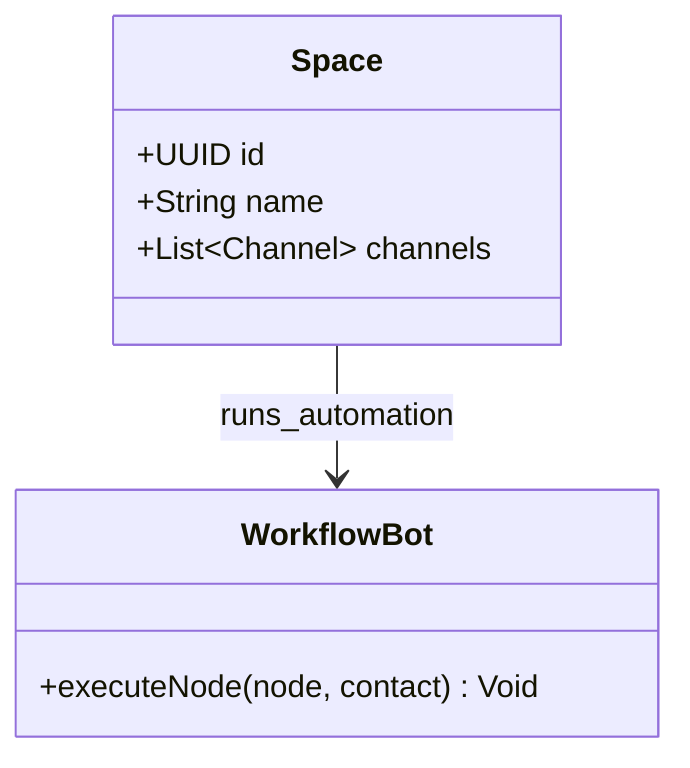
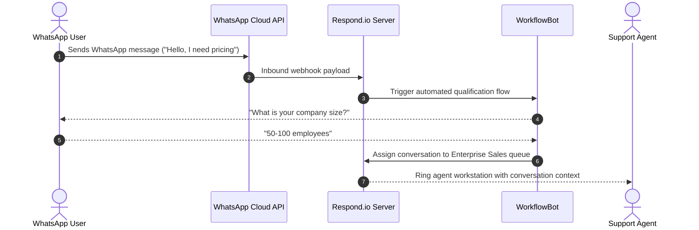

# Respond.io System and Functional Architecture

> Comprehensive technical and functional reference for Respond.io: the enterprise customer conversation management platform uniting WhatsApp Business Platform, Instagram, Telegram, SMS, and Web Chat into an omnichannel AI-orchestrated support and sales engine.

---

## 1. Executive Overview and Market Positioning

Modern customer communication is fragmented across diverse messaging platforms: WhatsApp dominates EMEA and LATAM, LINE leads in Japan and Taiwan, Telegram leads in Eastern Europe and crypto communities, and Instagram Direct leads in social commerce. Traditional customer support platforms (such as Zendesk or Freshdesk) were built around ticketing systems and asynchronous email threads, which struggle with real-time conversational messaging.

Respond.io solves this fragmentation by providing an omnichannel conversational operating system. It aggregates all instant messaging channels into a single unified customer inbox, unifies contact identities across platforms, automates conversational routing via a visual workflow canvas, and integrates autonomous AI agents with human-in-the-loop hand-offs.

### Core Value Proposition
- **True Omnichannel Aggregation:** Unified integration of WhatsApp Business Platform (Cloud API and On-Premises), Instagram Direct, Facebook Messenger, Telegram, SMS, Web Chat, LINE, Viber, and WeChat.
- **Cross-Channel Identity Resolution:** Automatically merges conversation histories across different channels based on shared phone numbers or email addresses into a single customer profile.
- **Visual Workflow Builder:** Drag-and-drop conversational routing engine supporting round-robin agent distribution, interactive chat menus, HTTP API calls, and SLA management.
- **Respond AI Engine:** Autonomous AI agents trained on proprietary knowledge bases for automated resolution, combined with agent-assist tools (smart replies, tone adjustment, real-time 40+ language translation).
- **High-Velocity WhatsApp Broadcasts:** Programmatic delivery of WhatsApp marketing templates with Meta template approval synchronization and message quality rating safeguards.

---

## 2. Core Entities and Data Model

```
┌────────────────────────────────────────────────────────┐
│                      Workspace                         │
│   (Organization, Plan, Teammates, Custom Fields, SLAs) │
└───────────┬────────────────────────────────┬───────────┘
            │ 1:N                            │ 1:N
            ▼                                ▼
┌───────────────────────┐        ┌───────────────────────┐
│       Channels        │        │     Workflow Canvas   │
│ (WhatsApp Cloud API,  │        │ (Triggers, Conditions,│
│  Telegram, IG, SMS)   │        │  HTTP Nodes, Actions) │
└───────────┬───────────┘        └───────────┬───────────┘
            │                                │
            │ Ingests Events                 │ Routes / Modifies
            └────────────────►┌──────────────▼──────────┐
                              │     Unified Contact     │
                              │ (Identity: Phone/Email, │
                              │  Merged Channel Links)  │
                              └──────────────┬──────────┘
                                             │ 1:N
                                             ▼
                              ┌─────────────────────────┐
                              │      Conversation       │
                              │ (Status: Open/Closed,   │
                              │  Assigned Agent, Team)  │
                              └──────────────┬──────────┘
                                             │ 1:N
                                             ▼
                              ┌─────────────────────────┐
                              │         Message         │
                              │ (Text, Media, Buttons,  │
                              │  Channel Origin, State) │
                              └─────────────────────────┘
```

### Entity Definitions
1. **Workspace:** Tenant isolation container holding organization settings, team permissions, SLA policies, and connected communication channels.
2. **Channel:** An authenticated integration endpoint (e.g., WhatsApp Cloud API, Instagram Messaging API, Telegram Bot token, or Twilio SMS).
3. **Unified Contact:** A persistent customer identity aggregating multiple channel identifiers (WhatsApp phone number, Instagram handle, Telegram user ID) under a single record.
4. **Conversation:** A discrete messaging session opened between a contact and the organization, containing assignment states (Assigned, Unassigned), statuses (Open, Closed, Snoozed), and SLA metrics.
5. **Message:** Individual communication item: text, image, audio note, document, location pin, interactive quick-reply button, or WhatsApp template.
6. **Workflow:** An automated directed graph consisting of triggers, conditional branches, conversational steps, external HTTP requests, and agent assignment rules.

---

### 2.1 Core Domain and Service Class Architecture



---

### 2.2 Comprehensive Database Schema Specification

#### Table: `conversations`
| Column | Type | Constraints | Default | Description |
| :--- | :--- | :--- | :--- | :--- |
| `id` | `UUID` | `PRIMARY KEY` | `gen_random_uuid()` | Conversation ID |
| `channel_type` | `VARCHAR(50)` | `NOT NULL` | - | Channel (`whatsapp`, `telegram`, `messenger`) |
| `status` | `VARCHAR(50)` | `NOT NULL` | `'open'` | Status |

---

## 3. Comprehensive Feature and Functional Breakdown

### 3.1 Omnichannel Channel Management and Identity Resolution

Respond.io connects to all major global messaging networks through official enterprise APIs.

#### 3.1.1 Supported Communication Channels
- **WhatsApp Business Platform:** Direct integration via Meta Cloud API or Business Solution Providers (BSPs: 360dialog, Twilio, MessageBird). Supports WhatsApp Templates, interactive buttons, list pickers, and media messages.
- **Instagram Direct:** Official Meta Graph API integration supporting Instagram DMs, story mentions, story replies, and comment-to-DM triggers.
- **Facebook Messenger:** Full support for page messaging, automated icebreakers, and quick replies.
- **Telegram:** Direct connection using Telegram Bot API with unlimited inbound/outbound messaging.
- **SMS:** Native integration with Twilio, Vonage, and MessageBird for global SMS transmission.
- **Web Chat Widget:** Customizable live chat widget embeddable on any website with omnichannel hand-off (customers can choose to continue the conversation on WhatsApp or Telegram).
- **Regional Channels:** Official integrations for LINE (Japan/Taiwan/Thailand), Viber (Eastern Europe), WeChat (China), and Google Business Messages.
- **Custom Channels (Open Channel API):** REST webhook interface allowing connection of proprietary apps or bespoke chat systems.

#### 3.1.2 Cross-Channel Identity Resolution (Contact Merging)
- **Automatic Matching:** When a user contacts via Web Chat providing an email, and subsequently messages via WhatsApp providing the same email or phone number, Respond.io merges both profiles.
- **Unified Timeline:** Agents view the complete historical dialogue across all past channels within a single chronological stream, eliminating context loss.
- **Channel Switching:** Agents can seamlessly switch response channels (e.g., receiving a message via Web Chat and replying via WhatsApp if the user leaves the website).

---

### 3.2 Visual Workflow Builder and Automation Canvas

The workflow engine orchestrates complex conversational routing without writing code.

#### 3.2.1 Workflow Triggers
- **Conversation Opened:** Triggered when a customer sends a message or opens a new session.
- **Conversation Closed:** Fired when an agent or system marks a conversation as resolved.
- **Tag Added / Removed:** Triggered upon lead classification.
- **Inbound Webhook Trigger:** Initiates a conversational workflow from an external system event (e.g., an abandoned cart in Shopify).

#### 3.2.2 Core Workflow Node Types
1. **Branch / Conditional Split:** Routes execution based on contact attributes, message channel, operating hours (Business Hours vs. After Hours), or previous customer responses.
2. **Ask a Question:** Prompts the customer for input (Free Text, Email, Phone Number, Single Choice, Multiple Choice) with automated input validation and retry loops.
3. **Interactive Messages:** Dispatches WhatsApp Quick-Reply buttons or List menus for structured self-service navigation.
4. **Routing & Assignment:**
   - **Round-Robin Assignment:** Distributes conversations evenly across all active team members.
   - **Least-Busy Routing:** Allocates conversations to the agent with the fewest open tickets.
   - **Departmental Routing:** Directs leads to the Sales Team and existing customers to Tier 1 Support.
5. **HTTP Request Node:** Makes live REST API calls (GET, POST, PUT) to external backends:
   - Querying Shopify to fetch the customer's live order status.
   - Creating a new lead record inside Salesforce or HubSpot.
   - Verifying account status in a custom database.
6. **SLA Management Node:** Sets specific response time countdowns and triggers automated escalation if the SLA is breached.

---

### 3.3 Respond AI: Autonomous Agent and AI Assist

Respond.io incorporates generative AI models directly into customer conversational workflows.

#### 3.3.1 Autonomous AI Agent
- **Knowledge Base Ingestion:** Train AI agents on uploaded PDFs, Word documents, website URLs, and existing knowledge bases (Zendesk Guide, Notion).
- **Automated Inquiry Resolution:** The AI agent autonomously answers customer FAQs, provides technical guidance, and verifies account information 24/7.
- **Human Escalation Fallback:** If the AI determines that a question exceeds its confidence threshold or if the customer explicitly requests human assistance, it seamlessly routes the conversation to an active agent with a summary of the interaction.

#### 3.3.2 AI Assist for Human Agents
- **Smart Reply Suggestions:** Generates context-aware response suggestions based on the ongoing dialogue and company knowledge base.
- **Tone Adjuster:** Rewrites agent drafts to be Formal, Empathetic, Concise, or Enthusiastic with one click.
- **Grammar & Spellcheck:** Instant cleanup of rep responses.
- **Real-Time 40+ Language Translation:** Incoming foreign-language messages are automatically translated into the agent's preferred language; outgoing agent messages are translated back into the customer's native language.

---

### 3.4 WhatsApp Broadcasts and Outbound Marketing

Respond.io provides an enterprise broadcast engine for WhatsApp marketing and notifications.

#### 3.4.1 WhatsApp Template Management
- **Template Creation and Sync:** Create text, image, video, and document templates with quick-reply buttons and call-to-action links; synchronized directly with Meta for automated approval.
- **Dynamic Variable Personalization:** Populate template parameters (`{{1}}`, `{{2}}`) with custom contact attributes (name, order number, tracking link).

#### 3.4.2 Targeted Broadcast Campaigns
- **Dynamic Audience Segmentation:** Filter recipient lists using tags, custom contact fields, previous channel interaction dates, and lifecycle stages.
- **Rate-Limiting & Meta Quality Safeguards:** System throttles message dispatch to protect the WhatsApp Business Account (WABA) phone number quality rating (High, Medium, Low), preventing number bans.
- **Broadcast Analytics:** Detailed reporting on message volume: Sent, Delivered, Read, Replied, and Failed with error code diagnostics.

---

### 3.5 Team Collaboration and SLA Performance Management

- **Internal Comments & Mentions:** Teammates tag colleagues (`@teammate`) inside customer threads for internal collaboration invisible to the customer.
- **SLA Policies:** Define First Response Time (FRT) and Resolution Time targets categorized by priority level (Urgent, High, Normal).
- **Team Roles and Permissions:** Granular role definitions: Owner, Admin, Manager, and Agent with restricted channel and contact visibility.
- **CSAT Survey Automation:** Automated dispatch of Customer Satisfaction rating surveys immediately following conversation closure.

---

## 4. API, Webhooks, and Enterprise Integrations

### 4.1 Native Integrations
- **Salesforce & HubSpot:** Bi-directional sync updating contact properties, syncing conversation transcripts, and triggering outbound messages from CRM status changes.
- **Zapier & Make:** Connects Respond.io events with thousands of third-party apps.

### 4.2 Webhook Subscriptions
- `contact_created`: Fired when a new user record is established.
- `conversation_opened`: Triggered upon new conversational inquiry.
- `conversation_closed`: Fired upon ticket resolution.
- `message_sent` & `message_received`: Real-time streaming of all inbound and outbound payloads.

---

### 3.1 End-to-End Operational Lifecycle Sequence



---

## 5. Architectural Comparison and Key Differentiators

| Capability | Respond.io | Traditional Helpdesk (e.g., Zendesk) | Live Chat Only (e.g., Intercom) |
| :--- | :--- | :--- | :--- |
| **Core Architecture** | Real-time omnichannel messaging | Asynchronous email ticketing | Website web chat widget |
| **WhatsApp Enterprise** | Native Cloud API, templates, broadcasts | Add-on or third-party connector | Basic add-on |
| **Cross-Channel Identity** | Automatic contact merging across channels | Separate tickets per channel | Separate threads |
| **Visual Workflow Engine** | Drag-and-drop conversational graph | Linear triggers and automations | Series / Tours |
| **Real-Time Translation** | Built-in 40+ languages both ways | Third-party plugin | Basic integration |