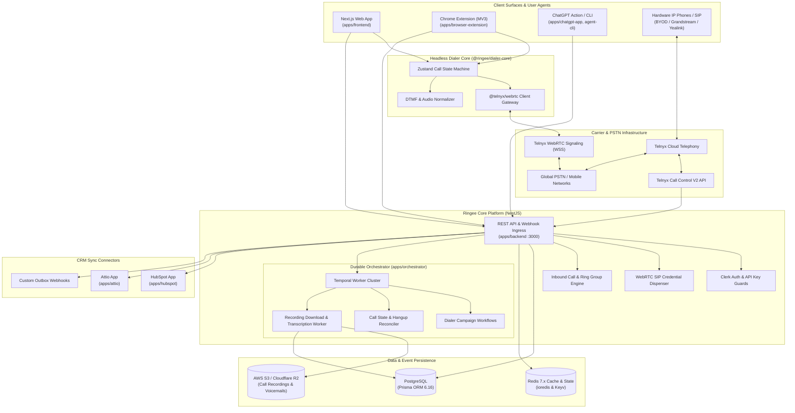
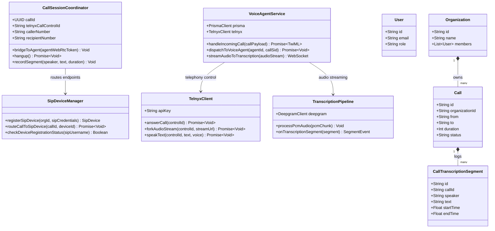
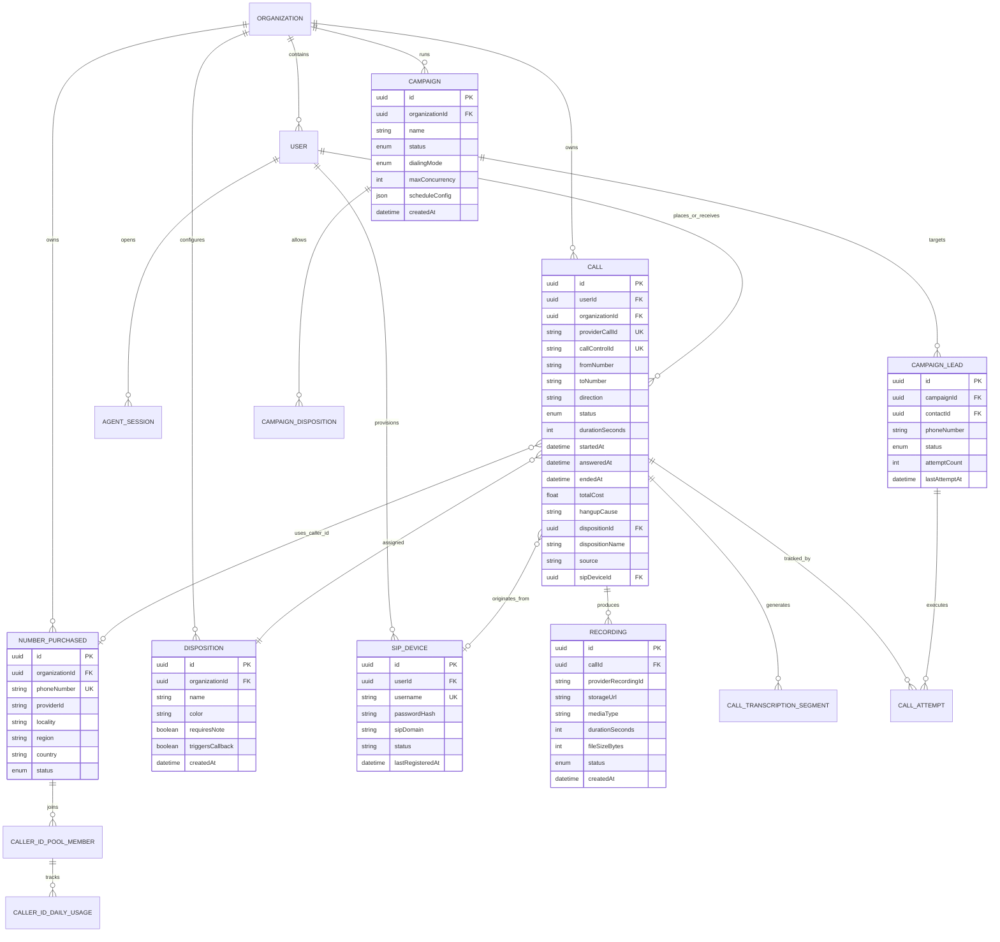
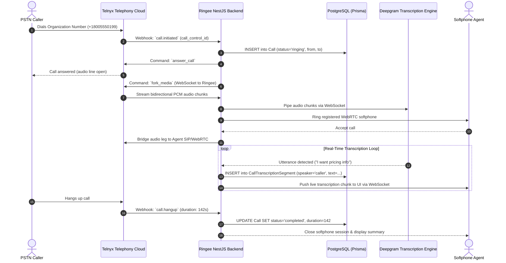

# ringee-app - Architecture & Technical Wiki

> **Enterprise Multi-Tenant Outbound Telephony, Power Dialer, WebRTC Softphone & CRM Sync Platform**  
> GitHub: [ringee-io/ringee-app](https://github.com/ringee-io/ringee-app.git) | Stack: TypeScript, NestJS, Next.js, Zustand, Telnyx WebRTC, PostgreSQL, Prisma, Temporal.io, Redis | License: AGPL-3.0

---

## 1. Executive Summary & Value Proposition

**ringee-app** is an open-source, multi-tenant sales engagement and cloud telephony platform designed to streamline high-volume outbound calling, automated power dialing, and inbound call distribution. Architected as a modular TypeScript monorepo using pnpm workspaces, Ringee bridges the gap between raw telecom carriers (specifically Telnyx PSTN and WebRTC infrastructure) and customer-facing revenue workflows.

Modern sales development reps (SDRs) and outbound call centers face severe friction from manual dialing, fragmented CRM tracking, carrier spam flagging, and latency in browser audio. Ringee resolves these operational bottlenecks through a decoupled headless dialer engine, automated local presence caller ID rotation, deterministic Temporal.io campaign workflows, and seamless bi-directional synchronization with modern CRMs like HubSpot and Attio.

### Core Problems Solved
- **Manual Dialing Friction & Disconnected Workflows**: Eliminates copy-pasting numbers through a headless WebRTC dialer engine embedded into Next.js dashboards, Manifest V3 Chrome Extensions, and ChatGPT apps with instant click-to-call capabilities.
- **Outbound Spam Flagging & Degrading Answer Rates**: Implements dynamic caller ID pools and local-presence algorithms that rotate outbound DIDs (Direct Inward Dialing) matching prospect area codes while enforcing daily rate limits per number to maintain clean carrier reputation.
- **Call Center Post-Call Administrative Burden**: Captures dual-channel audio recordings, streams realtime transcription segments, generates LLM-powered conversation summaries, and auto-populates structured disposition tags directly into downstream CRM timelines without rep intervention.
- **Brittle Multi-Leg Telephony State Management**: Replaces fragile webhook-driven calling states with durable execution workflows powered by Temporal.io, guaranteeing state recovery across carrier drops, network blips, or agent disconnections.
- **Siloed Inbound Distribution**: Supports flexible inbound routing rules, atomic hunt groups / ring groups with simultaneous or round-robin ringing, desk phone SIP endpoints (BYOD / BYOC), and seamless transfer between human agents and AI voice bots.

---

## 2. High-Level System Architecture

Ringee operates on a decoupled multi-tier architecture separating the browser user agent, edge telecom signaling, durable workflow orchestration, core REST APIs, and external CRM connectors.



### Architectural Narrative & Data Flow
1. **Authentication & Session Initiation**: When an agent logs into the Next.js frontend or launches the Chrome extension, authentication is verified via Clerk (`clerk.auth.guard.ts`). The client requests temporary WebRTC session credentials from `apps/backend/src/api/routes/webrtc.controller.ts`.
2. **WebRTC Media & Call Control**: The `@ringee/dialer-core` package instantiates `@telnyx/webrtc`, opening a secure WebSocket signaling tunnel to the Telnyx media gateway. Calls initiated from the softphone invoke Telnyx Call Control commands (`dial`, `bridge`, `transfer`) while audio streams directly between the browser peer connection and Telnyx WebRTC media nodes via SRTP/Opus.
3. **Inbound Call Processing**: When a call hits a purchased DID, Telnyx fires a webhook to `apps/backend/src/api/routes/inbound-call.controller.ts`. The `InboundRouter` queries `InboundRoute` and `RingGroup` tables, dynamically deciding whether to route the call to an AI Voice Agent, an individual user's WebRTC softphone, or an atomic multi-agent ring group.
4. **Durable Campaign Power Dialing**: The `apps/orchestrator` service leverages Temporal.io workflows. Campaign runs spawn durable activities that throttle outbound calls based on trunk concurrency, check Do-Not-Call (DNC) lists, select optimal caller IDs from `CallerIdPoolMember`, and advance leads based on hangup causes and agent dispositions.
5. **Post-Call Ingestion & CRM Fanout**: When a call terminates, Telnyx sends `call.hangup` and `call.recording.saved` webhooks. Ringee reconciles duration, cost (`TelnyxRatePerMinute`), and hangup cause. The recording audio is archived to S3, transcribed into `CallTranscriptionSegment` records, summarized via Claude/GPT models, and synced to HubSpot and Attio via dedicated integration workers.

---

### 2.1 Core Domain & Service Class Architecture



---

## 3. Technology Stack & Key Dependencies

| Layer | Component / Technology | Specification & Purpose |
|---|---|---|
| **Monorepo & Build** | pnpm + Turborepo / tsconfig | Workspace package resolution, TypeScript 5.9, unified builds |
| **Backend Framework** | NestJS 11 + Express 5 | Enterprise modular REST API architecture, guards, interceptors |
| **Durable Orchestration**| Temporal.io SDK (`@temporalio/workflow`, `@temporalio/worker`) | Fault-tolerant dialer campaigns, retries, multi-step telephony state |
| **Frontend Framework** | Next.js 14 (App Router) + React 18 | SSR/SSG administrative dashboard, live campaign views, analytics |
| **State Management** | Zustand 5.0 | Headless state management in `@ringee/dialer-core` and `@ringee/dialer-ui` |
| **Telephony & VoIP** | Telnyx Call Control V2 & WebRTC SDK | WebRTC browser media, PSTN carrier origination/termination, SIP trunks |
| **Database & ORM** | PostgreSQL 16 + Prisma ORM 6.16 | Strict relational data models, automated migrations, high-throughput indexing |
| **Cache & In-Memory** | Redis 7.x + Keyv + ioredis | Agent presence, active call session state, distributed rate limiting |
| **AI & LLM Services** | Anthropic Claude SDK + OpenAI SDK | Post-call summarization, sentiment extraction, AI voice agent logic |
| **Object Storage** | AWS S3 SDK (`@aws-sdk/client-s3`) | Dual-channel call recordings, voicemail drops, compliance audio files |
| **Browser Extension** | Chrome Manifest V3 | DOM phone number parser, floating dialer iframe, background WebRTC worker |

---

## 4. Repository Layout & Key Modules

```
ringee-app/
├── apps/
│   ├── agent-cli/               # CLI utility for interacting with Ringee agent runtimes
│   ├── attio/                   # Standalone connector service for Attio CRM sync
│   ├── backend/                 # Primary NestJS API application (:3000)
│   │   └── src/
│   │       ├── api/routes/      # 60+ controller routes (calls, campaigns, DNC, routes)
│   │       ├── api/guards/      # Auth guards (Clerk, API keys, SuperAdmin)
│   │       └── main.ts          # Express bootstrapping and Swagger OpenAPI initialization
│   ├── browser-extension/       # Chrome extension for click-to-call on any web page
│   ├── chatgpt-app/             # ChatGPT action integration and MCP bridge
│   ├── frontend/                # Next.js 14 customer dashboard & reporting web portal
│   ├── hubspot/                 # Dedicated HubSpot CRM webhook & OAuth integration worker
│   └── orchestrator/            # Temporal.io workflow worker & background cron jobs
│       └── src/temporal/        # Workflows, activities, and scheduling definitions
├── packages/
│   ├── agent/                   # Agent tool execution abstractions and prompts
│   ├── configuration/           # Shared environment validation (Zod schemas)
│   ├── database/                # Database layer
│   │   └── prisma/
│   │       └── schema.prisma    # 5,000+ line master schema (50+ models)
│   ├── dialer-core/             # Headless WebRTC state machine & Telnyx client
│   │   └── src/
│   │       ├── contracts/       # Call events, status types, action payloads
│   │       ├── dtmf/            # Audio tone synthesis and keypad signals
│   │       ├── engine/          # Carrier routing, session reconnect, WebRTC state map
│   │       └── phone/           # E.164 normalization via libphonenumber-js
│   ├── dialer-sdk/              # Client JavaScript SDK for third-party embedding
│   ├── dialer-ui/               # Reusable React softphone components & audio widgets
│   ├── frontend-shared/         # Shared React UI components, Tailwind themes, tables
│   ├── platform/                # Platform utilities, crypto, and date manipulation
│   └── services/                # Cross-app business services (billing, notifications)
├── docker-compose.yml           # Local dev infrastructure (Postgres, Redis, MinIO)
└── pnpm-workspace.yaml          # Monorepo workspace package definitions
```

---

## 5. Core Features & Capabilities

### 5.1 Headless Dialer Core & WebRTC Softphone
The core dialing logic lives in `packages/dialer-core`, completely isolated from React UI components. Powered by `@telnyx/webrtc` and Zustand, it models every phase of the call lifecycle (`idle`, `connecting`, `ringing`, `active`, `held`, `ended`). Because it is headless, the same state engine powers the Next.js web application, the Chrome extension popup, and headless test runners. It features automatic session reconnection on temporary network interruption and client-side DTMF tone playback.

### 5.2 Outbound Power Dialer & List Processing
The campaign engine supports automated power dialing through `apps/orchestrator`. Contacts from `ContactList` are loaded into a campaign queue (`CampaignLead`). The engine dials through the list sequentially or according to configured pacing rules. If a call encounters a busy tone, voicemail, or no-answer, the orchestrator evaluates `RetryRule` models to schedule callbacks or drop a pre-recorded audio file (`VoicemailDropAsset`).

### 5.3 Local Presence & Intelligent Caller ID Rotation
To maximize connection rates and prevent numbers from being marked as "Spam Likely", Ringee includes a sophisticated caller ID rotation subsystem (`CallerIdRotationSettings`, `CallerIdPoolMember`, `CallerIdDailyUsage`). When placing an outbound call, Ringee inspects the recipient's phone number prefix (NPA-NXX) and selects an available number in the organization's pool matching the destination's area code or geographic region. The system enforces strict daily call limits per number, automatically cycling exhausted numbers out of rotation.

### 5.4 Inbound Call Routing & Atomic Ring Groups
Ringee routes inbound calls through flexible rule pipelines (`InboundRoute`). Incoming calls can be dispatched to:
- Direct user extensions (WebRTC softphones).
- AI Voice Agents for conversational qualification.
- Ring Groups (`RingGroup`): Calls ring across multiple agents simultaneously or sequentially. Atomic database transactions (`answeredByUserId`, `answeredByRingAttemptId`) guarantee that only one agent claims the incoming leg, cleanly canceling ringing attempts on all other endpoints without race conditions.

### 5.5 Dual-Channel Audio Recording & AI Transcription
Every call leg can be automatically recorded via carrier-side mixing. Audio tracks are saved to S3-compatible storage. Ringee streams audio to transcription services, writing timestamped entries into `CallTranscriptionSegment`. Post-call hooks execute LLM prompts to extract sentiment, detect objections, generate follow-up action items, and score sales reps on script adherence.

### 5.6 Automated CRM Bi-Directional Synchronization
Through dedicated micro-apps (`apps/hubspot`, `apps/attio`), Ringee keeps external CRMs in continuous lockstep. When a call completes, an outbox event (`TriggerLoopOutboxEvent`) is emitted. The CRM sync worker resolves the prospect's contact record in HubSpot or Attio, uploads the MP3 recording URL, attaches the full transcript and AI summary, and updates the contact's lifecycle stage based on the logged `Disposition`.

---

## 6. Data Models & Schema Architecture

The database architecture is defined in Prisma (`packages/database/prisma/schema.prisma`). Below is the entity relationship diagram of the core telephony and campaign domain:



### Key Field Descriptions
- **`Call.callControlId`**: Unique identifier from Telnyx Call Control V2 API. Used as the idempotency key for all inbound and outbound webhook event processing.
- **`Call.hangupCause`**: Raw carrier disconnect reason (e.g., `normal_clearing`, `call_rejected`, `unallocated_number`, `user_busy`). Crucial for distinguishing carrier-level rejections from genuine prospect no-answers.
- **`Call.source`**: Identifies whether the call originated from the web dialer (`web`), browser extension (`chrome_extension`), automated dialer (`campaign`), hardware desk phone (`sip_device`), or an AI agent (`ai_voice_agent`).
- **`CallerIdDailyUsage.callsCount`**: Daily counter tracking calls placed from a specific number. When threshold is met, the pool manager excludes the number until the next midnight rollover.

---

### 6.1 Comprehensive Database Schema Specification

The database architecture is built with PostgreSQL and defined through Prisma ORM, providing real-time multi-tenant telephony and billing management.

#### Table: `Organization`
Tenant workspace entity managing enterprise phone numbers, users, and routing policies.

| Column | Type | Constraints | Default | Description |
| :--- | :--- | :--- | :--- | :--- |
| `id` | `TEXT` | `PRIMARY KEY` | `cuid()` | Unique organization identifier |
| `name` | `TEXT` | `NOT NULL` | - | Business name of the tenant |
| `createdAt` | `TIMESTAMP(3)` | `NOT NULL` | `CURRENT_TIMESTAMP` | Workspace creation timestamp |
| `updatedAt` | `TIMESTAMP(3)` | `NOT NULL` | - | Modification timestamp |

*Indexes:* Primary key on `id`.

---

#### Table: `Call`
Core telephony log recording metadata, status, provider IDs, and duration for all inbound/outbound calls.

| Column | Type | Constraints | Default | Description |
| :--- | :--- | :--- | :--- | :--- |
| `id` | `TEXT` | `PRIMARY KEY` | `cuid()` | Internal call session identifier |
| `organizationId` | `TEXT` | `NOT NULL, FK -> Organization(id)` | - | Tenant scope key |
| `telnyxCallControlId`| `TEXT` | `NULLABLE, UNIQUE` | `NULL` | Telnyx Call Control API ID |
| `from` | `TEXT` | `NOT NULL` | - | Caller E.164 phone number |
| `to` | `TEXT` | `NOT NULL` | - | Destination E.164 phone number |
| `status` | `TEXT` | `NOT NULL` | `'ringing'` | Call state (`ringing`, `answered`, `completed`, `busy`) |
| `duration` | `INTEGER` | `NOT NULL` | `0` | Connected duration in seconds |
| `recordingUrl` | `TEXT` | `NULLABLE` | `NULL` | Public/presigned S3 recording URL |
| `createdAt` | `TIMESTAMP(3)` | `NOT NULL` | `CURRENT_TIMESTAMP` | Call initiation timestamp |

*Indexes:* `Call_organizationId_idx` (`(organizationId)`), `Call_telnyxCallControlId_key` (`UNIQUE (telnyxCallControlId)`).

---

#### Table: `CallTranscriptionSegment`
Fine-grained real-time transcription chunks captured from conversational audio streams.

| Column | Type | Constraints | Default | Description |
| :--- | :--- | :--- | :--- | :--- |
| `id` | `TEXT` | `PRIMARY KEY` | `cuid()` | Segment identifier |
| `callId` | `TEXT` | `NOT NULL, FK -> Call(id) ON DELETE CASCADE` | - | Associated call session |
| `speaker` | `TEXT` | `NOT NULL` | `'caller'` | Speaker tag (`caller`, `agent`, `ai`) |
| `text` | `TEXT` | `NOT NULL` | - | Transcribed utterance content |
| `startTime` | `DOUBLE PRECISION`| `NOT NULL` | `0.0` | Offset start time in seconds |
| `endTime` | `DOUBLE PRECISION`| `NOT NULL` | `0.0` | Offset end time in seconds |
| `confidence` | `DOUBLE PRECISION`| `NOT NULL` | `1.0` | STT engine confidence score |

*Indexes:* `CallTranscriptionSegment_callId_idx` (`(callId)`).

---

## 7. API Architecture, Webhooks & Key Endpoints

Ringee exposes REST endpoints via NestJS, WebRTC token dispensers, and carrier webhook endpoints.

### Key REST & Carrier Endpoints

| Method | Endpoint | Description | Auth / Security |
|---|---|---|---|
| `POST` | `/api/v1/webrtc/token` | Generates ephemeral Telnyx WebRTC SIP login tokens for browser softphone | Bearer JWT (Clerk) |
| `POST` | `/api/v1/calls/dial` | Initiates an outbound softphone or click-to-call leg | Bearer JWT (Clerk) |
| `POST` | `/api/v1/calls/:id/hangup` | Terminates an active call session | Bearer JWT (Clerk) |
| `POST` | `/api/v1/calls/:id/disposition`| Submits call outcome tag and optional notes | Bearer JWT (Clerk) |
| `POST` | `/api/v1/campaigns/:id/start` | Enqueues and initiates outbound power dialing campaign | Bearer JWT / API Key |
| `POST` | `/api/v1/telephony/webhook` | Ingress for Telnyx Call Control V2 events (`call.initiated`, `call.answered`, `call.hangup`, `call.recording.saved`) | Telnyx Webhook Signature Header (`telnyx-signature-ed25519`) |

### Sample Request: Initiate Outbound Softphone Call
```http
POST /api/v1/calls/dial HTTP/1.1
Host: api.ringee.io
Authorization: Bearer <clerk_user_jwt>
Content-Type: application/json

{
  "toNumber": "+14155552671",
  "contactId": "b18a38db-d502-4b2a-8959-1e16fc9ea6d2",
  "campaignId": null,
  "useLocalPresence": true,
  "clientState": "outbound_web_v1"
}
```

### Sample Carrier Webhook: `call.hangup` Event
```http
POST /api/v1/telephony/webhook HTTP/1.1
Host: api.ringee.io
Content-Type: application/json
telnyx-signature-ed25519: t=1786607298,h=qf94j823n...

{
  "data": {
    "event_type": "call.hangup",
    "id": "c62243d8-e7bb-41cb-b39f-cb3dc6dafa6a",
    "occurred_at": "2026-10-24T10:14:22.182Z",
    "payload": {
      "call_control_id": "v2:vF50P3q1-...",
      "call_leg_id": "4280b5e2-6320-410a-...",
      "call_session_id": "9a80e118-...",
      "connection_id": "1846205739281749",
      "direction": "outgoing",
      "from": "+14155550100",
      "to": "+14155552671",
      "hangup_cause": "normal_clearing",
      "hangup_source": "callee",
      "start_time": "2026-10-24T10:13:00.000Z",
      "end_time": "2026-10-24T10:14:22.000Z"
    }
  }
}
```

---

### 7.5 End-to-End Operational Lifecycle Sequence

The following sequence diagram details inbound SIP call routing, Telnyx Call Control API interaction, WebRTC audio forking, and real-time AI transcription.



---

## 8. Strategic Value & Takeaways for MarketingStudio

### Reusable Architectural Patterns
1. **Headless State & Decoupled Softphone UI (`packages/dialer-core` + `packages/dialer-ui`)**:
   - *Pattern*: Decoupling the WebRTC state machine (Zustand) from the visual components (React) enables a single dialer engine to run inside the MarketingStudio main dashboard, a Chrome extension for LinkedIn sourcing, or an embedded drawer widget without code duplication.
   - *MarketingStudio Convergence*: Package our softphone logic into `@marketingstudio/dialer-core` and build reusable UI controls (`@marketingstudio/dialer-ui`).
2. **Durable Campaign Orchestration via Temporal.io**:
   - *Pattern*: High-volume outbound calling inevitably suffers from timeouts, carrier dropouts, and browser crashes. Using Temporal workflows guarantees that dialer state, lead retries, and callback schedules are persistent and resilient against process crashes.
   - *MarketingStudio Convergence*: Adopt Temporal or robust Redis BullMQ state machines for MarketingStudio's multi-channel drip and power dialing sequences.
3. **Dynamic Local-Presence Caller ID Pools with Burn Protection**:
   - *Pattern*: Tracking `CallerIdDailyUsage` and dynamically mapping destination area codes to outbound DIDs drastically elevates pick-up rates while systematically preventing phone numbers from being flagged as spam.
   - *MarketingStudio Convergence*: Incorporate DID reputation monitoring and automatic area-code selection into MarketingStudio's outbound telephony and cold calling modules.
4. **Outbox Pattern for Real-Time CRM Timeline Sync**:
   - *Pattern*: Ringee decouples carrier webhook ingestion from CRM synchronization using an outbox event model (`TriggerLoopOutboxEvent`). Webhooks return a fast `200 OK`, while background workers asynchronously write calls, transcripts, and recordings to CRMs.
   - *MarketingStudio Convergence*: Implement an outbox pattern for MarketingStudio's CRM sync workers, guaranteeing zero data loss when syncing call recordings to HubSpot, Salesforce, or Twenty CRM.
