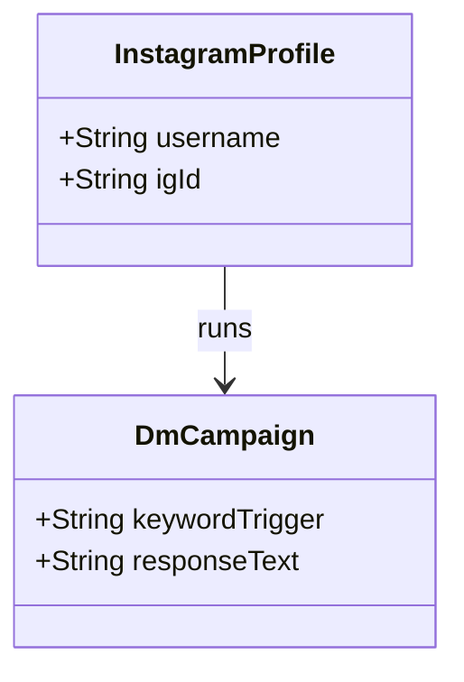
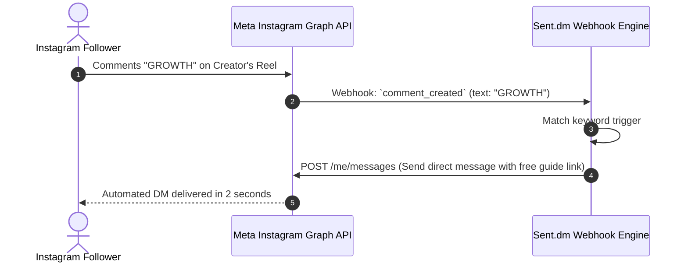

# Sent.dm System and Functional Architecture

> Comprehensive technical and functional reference for Sent.dm: the specialized Instagram and Twitter/X Direct Message (DM) outreach, conversational lead capture, and social sales funnel platform.

---

## 1. Executive Overview and Market Positioning

Direct messaging on social platforms (primarily Instagram and X / Twitter) yields significantly higher attention and open rates than traditional email, frequently exceeding 70% to 90% read rates. However, executing outbound outreach and inbound lead capture across social platforms is notoriously challenging:
- Meta and X enforce aggressive rate limits and anti-bot algorithms.
- Social inboxes lack native CRM capabilities, pipeline tracking, and multi-user delegation.
- Single accounts cannot scale outbound prospecting without risking shadowbans or permanent suspensions.

Sent.dm was engineered to solve these operational hurdles. It combines multi-account social profile management with inbound comment-to-DM automation, cold outbound DM cadences, conversational lead capture, and anti-detection browser fingerprinting.

### Core Value Proposition
- **Multi-Account Social Orchestration:** Safely connect and rotate multiple Instagram and X (Twitter) accounts with dedicated residential proxy isolation and browser fingerprint virtualization.
- **Inbound Comment-to-DM Funnels:** Automatically detect keyword comments on Reels, Posts, and Carousels (e.g., commenting "GROWTH" or "PROMPT"), instantly triggering a public comment reply and a private DM delivering a lead magnet.
- **Outbound Cold DM Sequences:** Multi-touch outbound messaging sequences with randomized delays, Spintax variation, and automated pause upon prospect response.
- **Unified Master Social Inbox:** Centralized inbox consolidating direct messages across all connected social handles into a single team interface.
- **Conversational Lead Capture:** AI conversational flows that extract email addresses and phone numbers within the chat, pushing them directly to CRMs (HubSpot, GoHighLevel) and webhook endpoints.

---

## 2. Core Entities and Data Model

```
┌────────────────────────────────────────────────────────┐
│                      Workspace                         │
│   (Organization, Team Seats, Global Suppression Lists) │
└───────────┬────────────────────────────────┬───────────┘
            │ 1:N                            │ 1:N
            ▼                                ▼
┌───────────────────────┐        ┌───────────────────────┐
│  Connected Social Acc │        │   Campaign / Funnel   │
│ (Instagram/X Session, │        │ (Inbound Trigger or   │
│  Proxy, Warmup Curve) │        │  Outbound Sequence)   │
└───────────┬───────────┘        └───────────┬───────────┘
            │                                │
            │ Assigned Senders               │ Enrolls Prospects
            └────────────────►┌──────────────▼──────────┐
                              │      Social Lead        │
                              │ (Handle, Name, Bio,     │
                              │  Captured Email/Phone)  │
                              └──────────────┬──────────┘
                                             │ 1:N
                                             ▼
                              ┌─────────────────────────┐
                              │      Direct Message     │
                              │ (Inbound/Outbound,      │
                              │  Status, Spintax Seed)  │
                              └──────────────┬──────────┘
                                             │ Aggregates
                                             ▼
                              ┌─────────────────────────┐
                              │  Unified Social Inbox   │
                              │ (Cross-Account Thread,  │
                              │  CRM Stage, Rep Notes)  │
                              └─────────────────────────┘
```

### Entity Definitions
1. **Workspace:** Multi-tenant container isolating team permissions, client brands, connected social accounts, and billing quotas.
2. **Connected Social Account:** An authenticated Instagram or X (Twitter) profile bound to a persistent residential proxy, user-agent string, and browser fingerprint profile.
3. **Inbound Trigger:** An event listener configured to monitor specific social interactions (e.g., comments on a specific Reel, mentions in a Story, or incoming keyword DMs).
4. **Outbound Campaign:** A scheduled cold messaging workflow targeting a scraped audience with multi-step follow-ups and randomized delay schedules.
5. **Social Lead:** A prospective contact record containing their social handle, public profile information, captured email/phone data, and pipeline stage.
6. **Unified Social Thread:** Centralized conversational view linking the prospect to the corresponding social sender profile, enabling team messaging and CRM hand-off.

---

### 2.1 Core Domain and Service Class Architecture



---

### 2.2 Comprehensive Database Schema Specification

#### Table: `dm_campaigns`
| Column | Type | Constraints | Default | Description |
| :--- | :--- | :--- | :--- | :--- |
| `id` | `UUID` | `PRIMARY KEY` | `gen_random_uuid()` | Campaign ID |
| `keyword_trigger` | `VARCHAR(100)` | `NOT NULL` | - | Trigger word (e.g. `GROWTH`) |
| `response_message`| `TEXT` | `NOT NULL` | - | Automated DM response |

---

## 3. Comprehensive Feature and Functional Breakdown

### 3.1 Multi-Account Social Infrastructure and Anti-Detection

Operating automated workflows on Instagram and X requires rigorous infrastructure to prevent account suspension.

#### 3.1.1 Session Virtualization and Fingerprinting
- **Isolated Browser Environments:** Each connected profile operates in a virtualized browser instance with distinct WebGL, Canvas, AudioContext, and font fingerprints.
- **Dedicated Residential Proxies:** Senders are assigned dedicated static residential or 4G mobile IP addresses matching their registration geography, preventing suspicious IP jump detections.
- **Mobile User-Agent Spoofing:** Outbound traffic emulates native iOS or Android mobile client headers rather than desktop web scrapers.

#### 3.1.2 Progressive Account Warming Curves
- **Automated Ramp-Up:** New social profiles are enrolled in an automated warm-up sequence:
  - Days 1-5: 5-10 DMs/day (warm-up interactions with friendly accounts).
  - Days 6-12: 15-20 DMs/day.
  - Days 13-20: 25-35 DMs/day.
  - Day 21+: Maximum safe operational ceiling (40-50 DMs/day per account).
- **Activity Cooling and Operating Windows:** Configurable active sending windows respecting the account's local daytime hours, pausing all outbound activity overnight.

---

### 3.2 Inbound Comment-to-DM and Story Funnels

Inbound automation captures high-intent prospects who engage with organic or paid social content.

#### 3.2.1 Comment-to-DM Automation (Reels, Posts, Carousels)
- **Keyword Listener:** Monitors post comments for designated trigger words (e.g., "SYSTEM", "SCALE", "BLUEPRINT").
- **Automated Public Reply:** Instantly posts a randomized public comment reply (e.g., "Just sent it to your DMs!", "Check your inbox!", "Sent over!") to increase post engagement metrics on the social platform's algorithm.
- **Automated Direct Message:** Concurrently dispatches a direct message containing the promised resource link, free guide, or calendar invite.
- **Interactive Button Menus (Instagram):** Renders native interactive quick-reply buttons inside the DM allowing the prospect to choose their interest category.

#### 3.2.2 Story Mention and Story Reply Automation
- **Story Mention Listener:** Detects when a user tags the brand's account in their public Instagram Story and sends an immediate personalized thank-you message and discount offer.
- **Story Reply Trigger:** Automates responses to interactive question stickers, poll responses, or direct replies on active Stories.

---

### 3.3 Outbound Cold DM Sequences

For proactive customer acquisition, Sent.dm provides automated outbound outreach workflows.

#### 3.3.1 Audience Scraping and Targeting
- **Competitor Follower Scraping:** Scrapes followers of designated competitor profiles or industry influencers.
- **Post Engagement Scraper:** Scrapes users who commented on or liked high-engagement posts in a specific niche.
- **Bio Keyword Search:** Identifies users whose profile bio contains specific keywords (e.g., "Founder", "Realtor", "Coach", "E-commerce").
- **Quality Filtering:** Filters out inactive accounts, private accounts, bot profiles, and profiles with zero posts or low follower ratios.

#### 3.3.2 Multi-Step Sequence Cadence
- **Linear Drip Sequences:** Multi-step cadences with configurable inter-message delays (e.g., Initial DM -> wait 24 hours -> Follow-up 1 -> wait 48 hours -> Follow-up 2).
- **Auto-Stop on Reply:** Sequence terminates instantly when the prospect responds, handing over the conversation to a human rep or conversational qualification bot.
- **Spintax and Content Randomization:** Robust support for nested Spintax syntax to ensure no two messages share identical character hashes:
  `{Hey|Hi|Hello} {{name}}, {loved your content on|great post regarding} {{topic}}!`

---

### 3.4 Unified Social Inbox and Conversational CRM

Sent.dm centralizes direct message management across all connected accounts.

#### 3.4.1 Master Team Inbox
- **Multi-Account View:** View and respond to DMs from 10+ Instagram and X accounts within a single unified dashboard.
- **Human-in-the-Loop Takeover:** Human reps can seamlessly take over automated bot conversations at any time; manual typing pauses automated sequences.
- **Conversation Tagging:** Categorize leads into pipeline stages: New Lead, Resource Sent, Qualified, Demo Booked, Closed Won, Not Interested.

#### 3.4.2 Automated Lead Capture and Extraction
- **Regex Information Parsing:** Automated detection of email addresses and phone numbers provided within chat text.
- **Two-Step Verification:** Prompting the user to confirm their email address before delivering a downloadable PDF or access link.

---

### 3.5 Anti-Detection Engine and Safety Controls

Sent.dm implements continuous algorithmic safeguards to protect customer social assets.

- **Human Typing Emulation:** Variable keystroke speeds with natural pauses mimicking genuine human typing before sending.
- **Randomized Jitter Delays:** Delays between subsequent outbound actions are randomized between 120 and 300 seconds.
- **Automated Circuit Breakers:** If Instagram or X displays an "Action Blocked" modal or verification challenge, the system immediately quarantines that account, alerts the team, and preserves account standing.

---

### 3.6 Downstream CRM and Webhook Integrations

#### 3.6.1 Native Integrations
- **Google Sheets:** Real-time appending of newly captured social leads, emails, and phone numbers.
- **GoHighLevel & HubSpot:** Automatic contact creation and workflow triggers upon successful lead qualification.
- **Zapier & Make:** Outbound webhook dispatch on conversational milestones.

#### 3.6.2 Webhook Triggers
- `dm_received`: Fired upon incoming direct message.
- `lead_captured`: Fired when an email or phone number is extracted.
- `funnel_completed`: Fired when a prospect reaches the final node of a sequence.
- `account_action_blocked`: Alerts admin if an account requires human review.

---

### 3.1 End-to-End Operational Lifecycle Sequence



---

## 4. Architectural Comparison and Key Differentiators

| Capability | Sent.dm | Generic Social Schedulers (e.g., Buffer) | Inbound Chat Tools (e.g., ManyChat) |
| :--- | :--- | :--- | :--- |
| **Outbound Cold DMs** | Multi-account cold outreach sequences | None | Strictly prohibited / inbound only |
| **Multi-Account Rotation** | Connect & rotate dozens of social profiles | Single profile per network | 1 profile per account |
| **Inbound Comment-to-DM** | Native keyword trigger & automated public reply| None | Primary focus (single account) |
| **Anti-Detection Isolation** | Dedicated residential proxies & fingerprinting | Standard cloud IP | Cloud API only |
| **Conversational CRM** | Built-in lead qualification & email extraction | None | Basic custom fields |