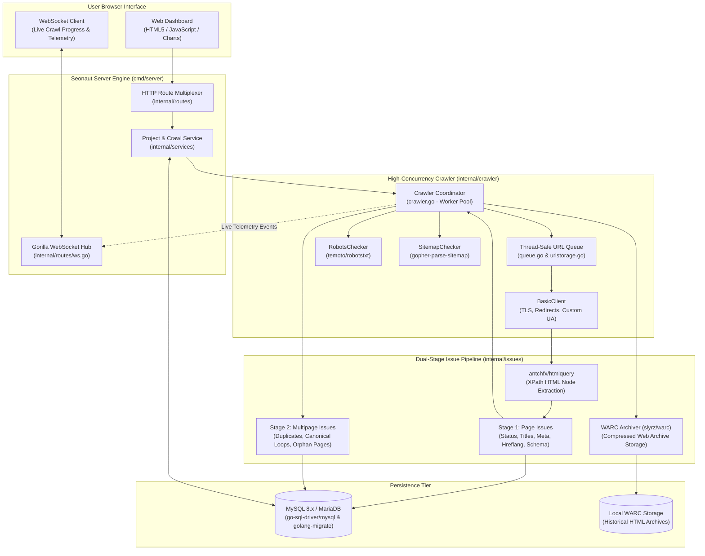
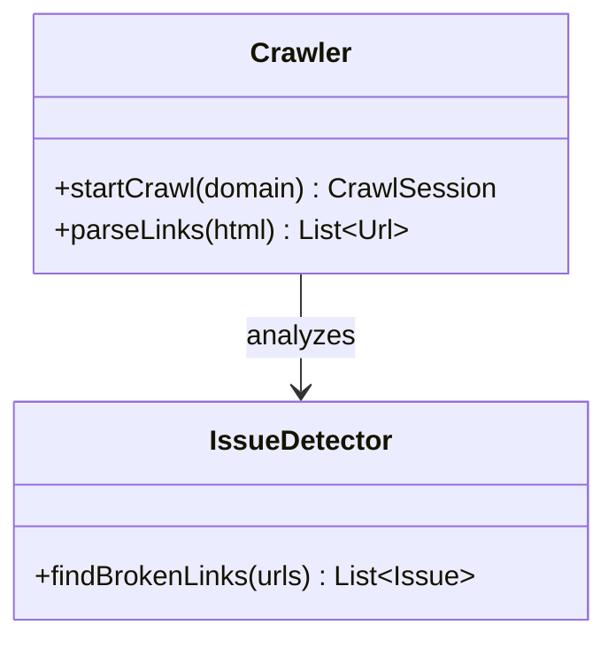
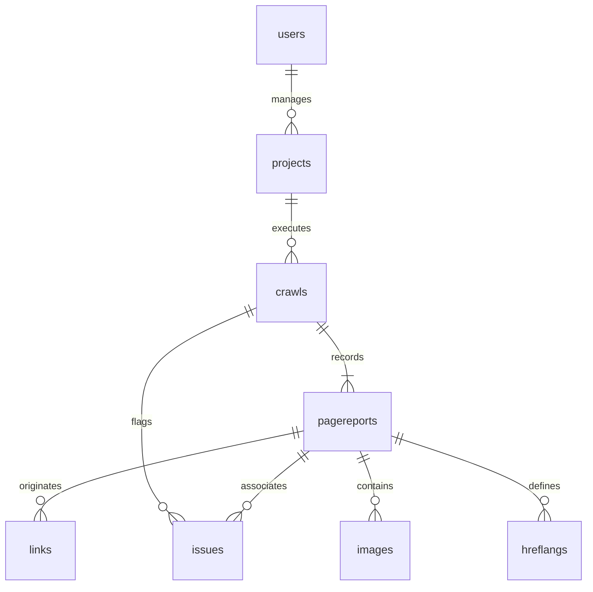
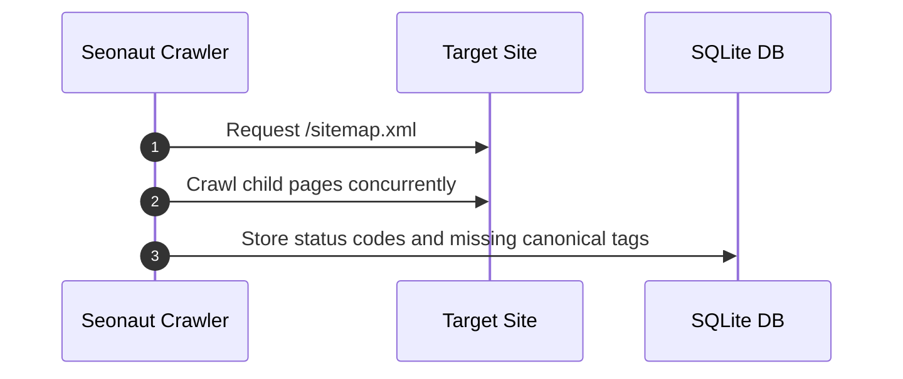

# seonaut - Architecture & Technical Wiki

> **High-Performance Concurrent Go Website Crawler, Technical SEO Audit Engine & Real-Time WebSocket Telemetry Platform**  
> GitHub: [stjudewashere/seonaut](https://github.com/stjudewashere/seonaut.git) | Stack: Go 1.25, MySQL / MariaDB, antchfx/htmlquery (XPath), gorilla/websocket, temoto/robotstxt, slyrz/warc | License: MIT

---

## 1. Executive Summary & Value Proposition

**seonaut** is an ultra-fast, concurrent open-source technical SEO auditing engine and website crawler built from the ground up in Go (Golang). Developed to provide marketing teams, agencies, and web developers with an agile, resource-efficient alternative to heavyweight Java or Python crawlers (e.g., Screaming Frog, Sitebulb), Seonaut crawls websites at high speeds while streaming real-time audit progress over WebSockets directly into an interactive browser dashboard.

Auditing large web applications with thousands of pages frequently leads to high memory overhead, slow sequential HTTP execution, or system crashes when using interpreted runtimes. Seonaut solves this through Go's lightweight concurrency model (goroutines, channels, and worker pools), an efficient XPath-based HTML parser (`htmlquery`), and a dual-stage audit pipeline that separates instantaneous per-page checks from graph-wide multi-page issue analysis (duplicate title tags, orphan pages, canonical loops).

### Core Problems Solved
- **Heavyweight Crawler Memory Bloat**: Replaces memory-hungry JVM and browser-based crawlers with a compiled Go binary operating on a sub-100MB RAM footprint even during deep multi-thousand-page crawls.
- **Slow Crawl Execution**: Leverages Go channels and configurable concurrent worker pools to crawl hundreds of URLs per second while respecting server crawl-delays and `robots.txt` directives.
- **Opaque Background Crawl Progress**: Employs `gorilla/websocket` to stream real-time crawl statistics (pages crawled, HTTP status codes, discovered errors) live to the user interface.
- **Complex Multi-Page Structural Regressions**: Detects complex graph-level issues that single-page scanners miss, including orphan pages with zero inbound links, duplicate content across varied URLs, and internal redirect chains.
- **Historical Web Archiving & Compliance**: Implements the ISO-standard Web ARChive (WARC) format via `slyrz/warc`, allowing organizations to preserve exact snapshot copies of crawled websites for legal compliance and historical diff analysis.

---

## 2. High-Level System Architecture

Seonaut is organized into decoupled Go packages covering network fetching, queue management, robots/sitemap parsing, HTML XPath extraction, two-phase issue evaluation, and WebSocket broadcasting.



### Crawl Execution Pipeline
1. **Initialization & Frontier Seeding**: A crawl is initiated. `RobotsChecker` downloads and parses `robots.txt`, extracting disallows and crawl delays. `SitemapChecker` recursively queries sitemaps, pushing seed URLs to the thread-safe `UrlQueue`.
2. **Concurrent Goroutine Worker Execution**: A pool of worker goroutines pulls URLs from `UrlQueue`. Each worker dispatches HTTP requests using `BasicClient`, following redirects and collecting HTTP headers, response times, and payloads.
3. **XPath HTML Extraction**: The HTML payload is parsed using `antchfx/htmlquery`. Optimized XPath expressions extract title tags, meta descriptions, headings (H1-H6), canonical links, hreflang attributes, image `alt` attributes, and internal/external anchor links.
4. **Stage 1 (Per-Page Analysis)**: Immediate checks evaluate HTTP status codes, missing tags, image dimensions, and indexability flags. Page report records are saved to MySQL while progress events stream across WebSockets.
5. **Stage 2 (Multi-Page Cross-Analysis)**: Once the queue is exhausted, the engine initiates multipage analysis: grouping identical titles/descriptions to flag duplicates, tracing internal links to uncover orphan pages, and detecting redirect hops or canonical conflicts.

---

### 2.1 Core Domain & Service Class Architecture



---

## 3. Technology Stack & Key Dependencies

| Component | Library / Tool | Role & Technical Implementation |
|---|---|---|
| **Language & Runtime** | Go 1.25 | Compiled, statically typed language with native lightweight goroutine scheduling |
| **Database** | MySQL 8.x / MariaDB | Relational storage for projects, crawled URLs, issue reports, and link graphs |
| **Database Driver** | `go-sql-driver/mysql` | Pure Go MySQL driver with connection pooling and prepared statements |
| **Migrations** | `golang-migrate/migrate/v4` | Automated, version-controlled database schema migrations |
| **HTML & XPath Parser** | `antchfx/htmlquery` | High-performance XPath parser traversing Go's `golang.org/x/net/html` trees |
| **WebSockets** | `gorilla/websocket` | Real-time bi-directional streaming of crawling metrics to browser clients |
| **Robots.txt Parser** | `temoto/robotstxt` | RFC-compliant parsing of robots exclusion standards and crawl delays |
| **Sitemap Parser** | `gopher-parse-sitemap` | High-speed XML sitemap, sitemap index, and gzipped sitemap parsing |
| **Web Archiving** | `slyrz/warc` | Writing full HTTP responses to standard compressed `.warc.gz` archives |
| **Configuration** | `spf13/viper` | Environment variable and YAML/JSON configuration management |

---

## 4. Repository Layout & Key Modules

```text
inspire/seonaut/
├── cmd/
│   └── server/                      # Main server binary entrypoint (main.go)
├── internal/
│   ├── crawler/                     # Core crawling engine
│   │   ├── crawler.go               # Coordinator managing worker pools, loops, and callbacks
│   │   ├── basic_client.go          # Custom HTTP client with timeout and TLS handling
│   │   ├── queue.go                 # In-memory thread-safe FIFO queue with mutex guards
│   │   ├── robots_checker.go        # robots.txt parser and validation checker
│   │   ├── sitemap_checker.go       # XML sitemap crawler and parser
│   │   └── urlstorage.go            # Visited URL deduplication map with bloom/hash checks
│   ├── issues/                      # Technical SEO issue analysis engine
│   │   ├── page/                    # Single-page inspectors (title, meta, status, schema)
│   │   ├── multipage/               # Cross-page inspectors (duplicates, orphans, loops)
│   │   └── issue_reporter.go        # Issue aggregation, severity classification, and saving
│   ├── archiver/                    # WARC archiving utilities for page snapshots
│   ├── models/                      # Go structs (Project, Crawl, PageReport, Issue, Link)
│   ├── repository/                  # Raw SQL query execution and database repositories
│   ├── routes/                      # HTTP handlers, session management, and WebSocket hub
│   └── services/                    # Business services orchestrating crawls and reports
├── migrations/                      # SQL schema migration files for MySQL
└── web/                             # HTML templates, CSS, JavaScript, and static assets
```

---

## 5. Core Features & Capabilities

### 5.1 High-Speed Concurrent Goroutine Crawling
Seonaut harnesses Go's native CSP (Communicating Sequential Processes) concurrency model. Worker pools execute non-blocking network I/O across hundreds of goroutines without the thread context-switching overhead common to Java or Python crawlers. Crawl speeds scale effortlessly to the maximum bandwidth permitted by target hosts.

### 5.2 Real-Time WebSocket Telemetry Streaming
Rather than forcing operators to wait for entire crawls to complete, Seonaut maintains persistent WebSocket connections with active client browsers via `gorilla/websocket`. As each page is fetched, metrics (URL, HTTP status, response time, discovered issues) stream live to the browser, updating interactive charts and issue tallies instantaneously.

### 5.3 Two-Stage Audit Architecture (Page vs. Multi-Page)
Seonaut divides technical auditing into two clean phases:
1. **Synchronous Page Checks**: Inspected immediately upon fetching (e.g., 404 status, empty title tag, missing H1, uncompressed image, invalid canonical syntax).
2. **Asynchronous Multi-Page Checks**: Evaluated after the entire site graph is collected. This includes detecting **duplicate titles** and **meta descriptions** across distinct URLs, identifying **orphan pages** (pages present in sitemaps but possessing zero inbound internal links), and untangling **canonical loops** (Page A pointing to Page B, which points back to Page A).

### 5.4 WARC Web Archival Compliance
Through `slyrz/warc`, Seonaut can write all fetched HTTP requests and responses to standard **WARC (Web ARChive)** files (`.warc.gz`). This enables digital agencies and enterprises to retain exact forensic snapshots of marketing websites before and after major site migrations, redesigns, or CMS updates.

### 5.5 Exhaustive Technical SEO Inspections
Seonaut audits over 70 distinct on-page and technical parameters:
- **Status & Headers**: 301, 302, 307 redirects, 4xx client errors, 5xx server faults, X-Robots-Tag headers.
- **Content & Indexing**: Title length, description length, H1 tag count, thin content word count.
- **Linking & Architecture**: Internal vs. external links, nofollow attributes, inlink count, depth level.
- **Localization & Media**: Hreflang language and region matching, image alt text, video schema.

---

## 6. Data Models & Schema Architecture

Seonaut stores projects, crawl runs, individual page reports, discovered issues, and link relations in MySQL.



### Core Go Model Structs & Database Tables

#### `Project` (`projects`)
- `ID` (`int64`, PK): Unique project identifier.
- `URL` (`string`): Target website root URL (e.g., `https://example.com`).
- `IgnoreRobotsTxt` (`bool`): Flag to bypass robots exclusion.
- `FollowSitemap` (`bool`): Flag to discover URLs via XML sitemaps.
- `UserAgent` (`string`): Custom crawl user-agent string.
- `UserID` (`int64`, FK): Owning user ID.

#### `Crawl` (`crawls`)
- `ID` (`int64`, PK): Unique crawl execution ID.
- `ProjectID` (`int64`, FK): Reference to parent project.
- `Start` (`time.Time`), `End` (`time.Time`, nullable): Execution timestamps.
- `TotalURLs` (`int`): Count of discovered URLs.
- `Issues` (`int`): Count of flagged issues.

#### `PageReport` (`pagereports`)
- `ID` (`int64`, PK): Page audit record ID.
- `CrawlID` (`int64`, FK): Parent crawl run.
- `URL` (`string`): Normalized page URL.
- `StatusCode` (`int`): HTTP response code (e.g., 200, 301, 404).
- `ContentType` (`string`): MIME type (e.g., `text/html`).
- `Size` (`int`): Page size in bytes.
- `ResponseTime` (`int64`): Response duration in milliseconds.
- `Title` (`string`), `Description` (`string`), `H1` (`string`): Extracted on-page metadata.
- `Canonical` (`string`, nullable): Declared canonical URL.
- `Words` (`int`): Computed word count.
- `Inlinks` (`int`): Count of internal pages linking to this URL.
- `Depth` (`int`): Click distance from site homepage.

#### `Issue` (`issues`)
- `ID` (`int64`, PK): Flagged issue ID.
- `CrawlID` (`int64`, FK): Associated crawl run.
- `PageReportID` (`int64`, FK, nullable): Affected page report.
- `IssueType` (`string`): Machine code (e.g., `duplicate_title`, `broken_link`, `missing_h1`).
- `Critical` (`bool`): Severity rating flag.

---

### 6.1 Comprehensive Database Schema Specification

Seonaut stores web crawler sessions and identified technical issues.

#### Table: `crawled_urls`
| Column | Type | Constraints | Default | Description |
| :--- | :--- | :--- | :--- | :--- |
| `id` | `UUID` | `PRIMARY KEY` | `gen_random_uuid()` | Page ID |
| `url` | `TEXT` | `NOT NULL` | - | Crawled URL |
| `status_code` | `INTEGER` | `NOT NULL` | `200` | HTTP status code |

---

## 7. API Architecture, Webhooks & Key Endpoints

Seonaut serves both server-rendered administrative endpoints and WebSocket streams for real-time telemetry.

### Key Routes & Endpoints

| Method | Path | Description | Type |
|---|---|---|---|
| `POST` | `/crawl` | Initiate a new crawl run for a specified project | HTTP Form / JSON |
| `GET` | `/ws` | WebSocket endpoint streaming live crawl telemetry and counters | WebSocket |
| `GET` | `/report` | Retrieve aggregated issue tallies and severity breakdowns | HTTP HTML / JSON |
| `GET` | `/report/issues` | Filter pages affected by a specific issue code | HTTP HTML / JSON |
| `GET` | `/export/csv` | Export complete crawl findings and page reports to CSV | CSV Stream |
| `POST` | `/project/delete`| Delete a project and cascade purge historical crawl data | HTTP POST |

### WebSocket Real-Time Crawl Frame
```json
{
  "type": "crawl_progress",
  "crawl_id": 412,
  "data": {
    "url": "https://example.com/pricing",
    "status_code": 200,
    "response_time_ms": 142,
    "total_crawled": 354,
    "queue_remaining": 820,
    "issues_detected": [
      {
        "type": "missing_h1",
        "severity": "warning"
      },
      {
        "type": "low_word_count",
        "severity": "notice"
      }
    ]
  }
}
```

---

### 7.5 End-to-End Operational Lifecycle Sequence



---

## 8. Strategic Value & Takeaways for MarketingStudio

### Reusable Architectural Patterns
1. **Lightweight Concurrency Model (Goroutines & Channels)**: Seonaut illustrates how compiled Go code can outperform interpreted Python/Node crawlers by orders of magnitude, providing MarketingStudio with an architectural blueprint for a dedicated micro-crawler daemon capable of auditing enterprise sites on minimal cloud infrastructure.
2. **WebSocket Live Crawl Streaming**: The continuous WebSocket event stream provides the ultimate responsive UX for marketing users, replacing frozen loading spinners with real-time counters and live status badges.
3. **Two-Stage Audit Separation (Page vs Graph Multipage)**: Splitting simple local DOM checks from complex global graph analyses (such as orphan detection and duplicate clustering) ensures audit pipelines remain performant and memory-bounded.

### Convergence Blueprint for MarketingStudio
- **High-Speed Site Pre-Flight Checker**: Deploy Seonaut's crawling core as a lightweight Go sidecar microservice inside MarketingStudio to perform rapid pre-launch site audits before major client marketing campaigns go live.
- **Automated Orphan Page & Broken Link Discovery**: Utilize Seonaut's link graph analyzer to automatically map internal PageRank flow and highlight high-converting landing pages that are accidentally orphaned.
- **WARC Archive Backups Before Redesigns**: Offer MarketingStudio clients automated WARC site archives, capturing snapshot backups of live client websites prior to launching new landing page templates or CMS overhauls.
