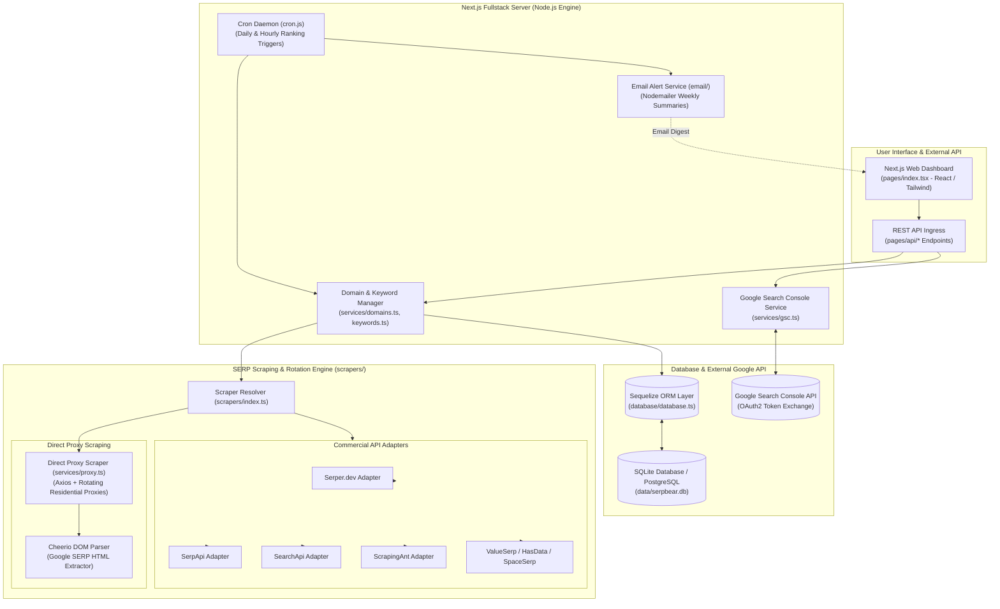
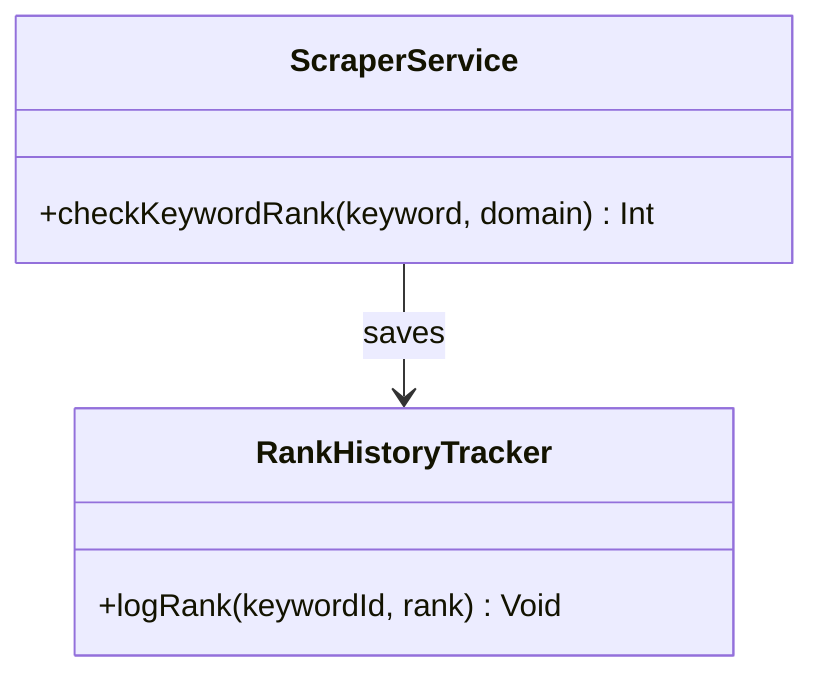
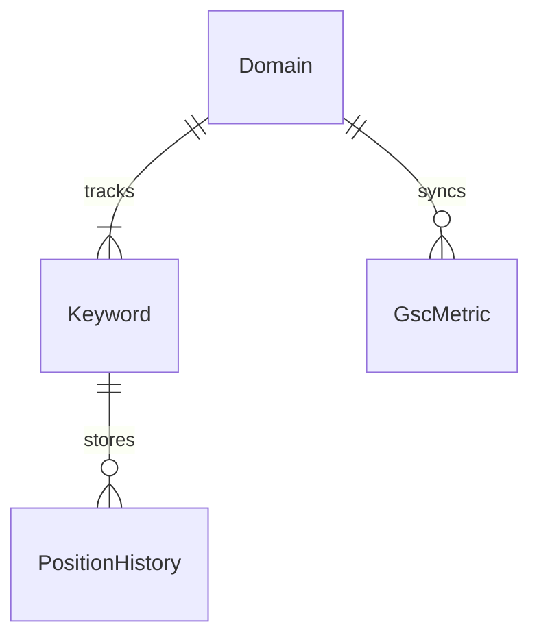
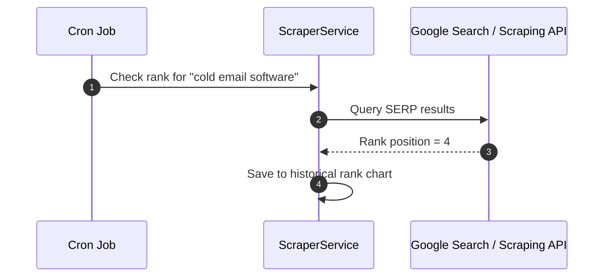

# serpbear - Architecture & Technical Wiki

> **Open-Source Search Engine Rank Tracking Platform, Proxy-Rotated SERP Scraper & Google Search Console Analytics Suite**  
> GitHub: [towfiqi/serpbear](https://github.com/towfiqi/serpbear.git) | Stack: TypeScript, Next.js (Pages Router), React, Sequelize ORM, SQLite / PostgreSQL, Cheerio, Axios, Nodemailer, Tailwind CSS | License: MIT

---

## 1. Executive Summary & Value Proposition

**serpbear** is an open-source, self-hosted search engine keyword rank tracking and SERP (Search Engine Results Page) monitoring platform. Developed as a cost-effective alternative to expensive SEO rank tracking subscriptions such as Ahrefs, SEMrush, and AccuRanker, SerpBear allows digital agencies, growth hackers, and marketing teams to monitor unlimited domains and keyword rankings on Google without recurring monthly per-keyword fees.

Traditional rank trackers charge exorbitant subscription fees tied directly to the number of tracked keywords, making broad keyword monitoring financially prohibitive for growing brands. SerpBear circumvents these constraints by combining a lightweight Next.js application core, Sequelize ORM persistence on SQLite/PostgreSQL, a swappable multi-provider SERP scraping subsystem (supporting direct rotating HTTP proxies, Tor, and 10+ commercial scraping APIs), and automated Google Search Console (GSC) synchronization.

### Core Problems Solved
- **Exorbitant Per-Keyword Rank Tracking Costs**: Eliminates subscription pricing tiers, enabling agencies and businesses to track thousands of search keywords on self-hosted infrastructure.
- **Aggressive Anti-Bot SERP Detection & IP Banning**: Implements intelligent request jitter, randomized user agents, and seamless rotation across direct HTTP/SOCKS proxies, Tor, or headless scraping gateways.
- **Provider Redundancy & Vendor Independence**: Decouples scraping logic through a swappable driver architecture supporting direct proxies as well as 10 commercial SERP APIs (SerpApi, Serper, SearchApi, ScrapingAnt, ValueSerp, etc.).
- **Mobile vs. Desktop Geographic Rank Discrepancies**: Monitors rankings across custom geographical locations (countries and cities) and device formats (mobile vs. desktop user agents).
- **Scraped vs. Actual Search Performance Reconciliation**: Direct integration with Google Search Console APIs to cross-reference scraped SERP rankings against verified organic search impressions, clicks, and CTR.

---

## 2. High-Level System Architecture

SerpBear decouples keyword scheduling, multi-provider SERP scraping, historical ranking persistence, and reporting alerts within a unified Next.js fullstack service.



### Keyword Scraping & Historical Sync Pipeline
1. **Cron Trigger & Queue Ingestion**: The standalone cron runner (`cron.js`) awakens on a scheduled interval (e.g., daily at 02:00 UTC) and queries `Keyword` records due for position checks.
2. **Provider Selection**: `scrapers/index.ts` selects the active scraping driver based on application settings (e.g., direct proxy rotation or commercial API like Serper).
3. **Execution & Anti-Detection Jitter**: If using direct proxies, `services/proxy.ts` attaches residential proxy headers, applies random request delays (jitter), injects realistic mobile or desktop user agents, and executes HTTP GET against Google search results.
4. **SERP Parsing & Position Extraction**: `CheerioParser` traverses the Google HTML response, scanning organic result containers (`div.g`, cite tags) to locate the tracked domain.
5. **Historical Logging & Position Delta**: The scraped position is compared with the previous rank. A new entry is appended to the keyword's JSON history array, recording date, position, and URL. If significant rank movements occur, `AlertMailer` queues email notifications.

---

### 2.1 Core Domain & Service Class Architecture



---

## 3. Technology Stack & Key Dependencies

| Component | Framework / Library | Role & Details |
|---|---|---|
| **Fullstack Framework** | Next.js 14 (Pages Router), React 18 | SSR and client-side rendered dashboard with serverless API route endpoints |
| **Language & Styling** | TypeScript, Tailwind CSS | Type-safe business logic with responsive dashboard layout and dark theme |
| **Database & ORM** | Sequelize 6.x, SQLite / PostgreSQL | Lightweight file-based SQLite database default with enterprise Postgres option |
| **Scheduler** | `node-cron` (`cron.js`) | Background cron daemon executing unattended daily ranking scans and email alerts |
| **HTTP Client & Parsing** | Axios, Cheerio | High-efficiency HTTP client with Cheerio for fast server-side HTML DOM traversal |
| **Direct Scraper** | Custom Rotating Proxy Engine | Built-in proxy client supporting HTTP, HTTPS, and SOCKS5 proxy pools |
| **Supported SERP APIs** | Serper, SerpApi, SearchApi, ScrapingAnt, etc. | 10 pre-built adapters for leading commercial search scraping gateways |
| **Search Console Sync** | `googleapis` (GSC API v3) | Google Search Console OAuth2 integration for impressions, clicks, and queries |
| **Transactional Email** | Nodemailer | Automated daily/weekly rank shift digest delivery via SMTP, SendGrid, or SES |

---

## 4. Repository Layout & Key Modules

```text
inspire/serpbear/
├── database/
│   ├── database.ts                  # Sequelize connection manager and SQLite initializer
│   ├── config.js                    # Database dialect and path configuration
│   └── models/                      # Database entities
│       ├── domain.ts                # Domain entity (domain name, notification settings)
│       └── keyword.ts               # Keyword entity (query, country, device, position history)
├── scrapers/
│   ├── index.ts                     # Scraper dispatcher routing requests to active service
│   └── services/                    # Provider-specific scraping implementations
│       ├── proxy.ts                 # Direct proxy scraper with Cheerio HTML parsing
│       ├── serper.ts                # Serper.dev Google API integration
│       ├── serpapi.ts               # SerpApi gateway adapter
│       ├── searchapi.ts             # SearchApi.io JSON adapter
│       ├── scrapingant.ts           # ScrapingAnt headless browser gateway
│       └── valueserp.ts             # ValueSerp Google API client
├── services/
│   ├── domains.ts                   # Domain management logic and CRUD helpers
│   ├── keywords.ts                  # Keyword creation, update, and scraping orchestration
│   └── gsc.ts                       # Google Search Console OAuth2 client and metric fetcher
├── pages/
│   ├── index.tsx                    # Main dashboard displaying tracked domains and ranks
│   ├── domain/[domain].tsx          # Detailed keyword view for a specific web property
│   └── api/                         # REST API endpoints
│       ├── domains.ts               # Domain list and creation endpoints
│       ├── keywords.ts              # Keyword management and manual refresh triggers
│       └── cron.ts                  # Webhook trigger for serverless cron orchestrators
├── cron.js                          # Standalone Node.js background scheduler daemon
└── email/                           # Nodemailer email formatting templates
```

---

## 5. Core Features & Capabilities

### 5.1 Dual-Engine Scraping Architecture (Direct Proxy vs. 10+ APIs)
SerpBear offers unparalleled scraping flexibility:
- **Direct Rotating Proxies**: Users configure a list of HTTP/SOCKS5 proxies. The built-in proxy engine (`scrapers/services/proxy.ts`) rotates IP addresses, applies randomized human delays, and parses Google search result DOMs directly using Cheerio without incurring any third-party fees.
- **Commercial API Fallback**: When scraping high keyword volumes without managing private proxy pools, SerpBear supports 10 turnkey commercial APIs: **Serper**, **SerpApi**, **SearchApi**, **ScrapingAnt**, **ScrapingRobot**, **HasData**, **SpaceSerp**, **ValueSerp**, **CrazySerp**, and **Serply**.

### 5.2 Granular Historical Ranking & Volatility Tracking
For every tracked keyword, SerpBear persists a complete daily timeline within the `history` JSON field:
- **Current Position vs. Starting Position vs. Best Position**: Visualizes all-time progress.
- **SERP Features**: Flags whether the domain appears in organic results, Featured Snippets, Local Packs, or People Also Ask.
- **Device & Geo Precision**: Allows tracking separate ranking positions for mobile vs. desktop searches across specific country codes and metropolitan city locations.

### 5.3 Google Search Console (GSC) Performance Triangulation
Scraped rankings represent a single point in time from a specific IP. SerpBear resolves this limitation by integrating directly with the **Google Search Console API**. It pulls actual impressions, clicks, CTR, and average positions aggregated across millions of real Google users, allowing SEO managers to spot discrepancies between simulated rank and actual user traffic.

### 5.4 Search Volume & CPC Enrichment
Beyond raw rank numbers, SerpBear enriches keyword dashboards with search intent and commercial metrics:
- Monthly Search Volume.
- Estimated Cost-Per-Click (CPC).
- Paid Search Competition level.

### 5.5 Automated Alert Digests & Scheduled Cron Daemon
SerpBear includes a dedicated background cron daemon (`cron.js`). At configured intervals, it automatically iterates through all active keywords, schedules scraping jobs with respectful inter-request spacing, updates database records, and compiles beautiful HTML email digests summarizing top gainers, top losers, and major SERP shifts.

---

## 6. Data Models & Schema Architecture

SerpBear utilizes Sequelize ORM to model web domains and tracked keywords with embedded JSON historical metrics.



### Core Sequelize Models & Attributes

#### `Domain` (`database/models/domain.ts`)
- `id` (`INTEGER`, PK): Auto-incrementing domain identifier.
- `domain` (`STRING`, unique): Root domain or subdomain (e.g., `marketingstudio.io`).
- `notification` (`BOOLEAN`): Enables email notifications for rank changes.
- `notification_interval` (`STRING`): `daily`, `weekly`, `monthly`.
- `notification_emails` (`STRING`): Comma-separated list of recipient email addresses.
- `search_console` (`TEXT`): Serialized JSON storing Google Search Console OAuth2 tokens and property URL.

#### `Keyword` (`database/models/keyword.ts`)
- `id` (`INTEGER`, PK): Keyword record ID.
- `domain` (`STRING`, FK): Owning domain identifier.
- `keyword` (`STRING`): The search query phrase being tracked (e.g., "b2b marketing automation").
- `device` (`STRING`): Target search device format: `desktop` or `mobile`.
- `country` (`STRING`): Two-letter country code (e.g., `US`, `GB`, `DE`).
- `city` (`STRING`, nullable): Metropolitan targeting (e.g., `San Francisco`, `London`).
- `position` (`INTEGER`): Current rank position (1 to 100, or 0 if unranked).
- `url` (`STRING`): Specific landing page URL ranking on Google.
- `history` (`TEXT` / `JSON`): Serialized chronological array of daily position records:
  ```json
  [
    { "date": "2026-10-22", "position": 14, "url": "https://example.com/crm" },
    { "date": "2026-10-23", "position": 12, "url": "https://example.com/crm" },
    { "date": "2026-10-24", "position": 8,  "url": "https://example.com/crm" }
  ]
  ```
- `volume` (`INTEGER`): Estimated monthly search volume.
- `cpc` (`FLOAT`): Estimated Google Ads cost per click.
- `last_updated` (`DATE`): Timestamp of the most recent scrape.

---

### 6.1 Comprehensive Database Schema Specification

Serpbear tracks SERP keyword rankings in SQLite.

#### Table: `keywords`
| Column | Type | Constraints | Default | Description |
| :--- | :--- | :--- | :--- | :--- |
| `id` | `INTEGER` | `PRIMARY KEY AUTOINCREMENT` | - | Keyword ID |
| `keyword` | `VARCHAR(255)` | `NOT NULL` | - | Search query |
| `domain` | `VARCHAR(255)` | `NOT NULL` | - | Tracked domain |
| `current_rank`| `INTEGER` | `NOT NULL` | `0` | Google rank position |

---

## 7. API Architecture, Webhooks & Key Endpoints

SerpBear exposes JSON endpoints through Next.js API routes under `/api/*` secured via session cookies or API keys.

### Key API Endpoints

| Method | Endpoint | Description | Auth |
|---|---|---|---|
| `GET` | `/api/domains` | Retrieve all tracked domains and aggregate health metrics | Session / API Key |
| `POST` | `/api/domains` | Register a new web domain for rank monitoring | Session / API Key |
| `GET` | `/api/keywords` | List keywords for a domain with position history and volume | Session / API Key |
| `POST` | `/api/keywords` | Add new search queries, target device, and country | Session / API Key |
| `POST` | `/api/keywords/refresh`| Manually trigger an immediate SERP scrape for a keyword | Session / API Key |
| `POST` | `/api/cron` | Webhook endpoint to trigger batch scraping runs from external schedulers | Bearer Secret |

### API Payload Example: Add Tracked Keyword
```http
POST /api/keywords HTTP/1.1
Host: serpbear.internal.net
Authorization: Bearer sb_live_88af12c9b4e
Content-Type: application/json

{
  "domain": "marketingstudio.io",
  "keywords": [
    {
      "keyword": "open source sales automation",
      "device": "desktop",
      "country": "US",
      "city": "New York"
    },
    {
      "keyword": "open source sales automation",
      "device": "mobile",
      "country": "US"
    }
  ]
}
```

### Keyword Scrape Result Response
```json
{
  "success": true,
  "data": {
    "keywordId": 4810,
    "keyword": "open source sales automation",
    "domain": "marketingstudio.io",
    "position": 4,
    "previousPosition": 7,
    "change": 3,
    "url": "https://marketingstudio.io/features/automation",
    "serpFeatures": ["organic", "people_also_ask"],
    "scrapedAt": "2026-10-24T12:15:30Z",
    "providerUsed": "serper"
  }
}
```

---

### 7.5 End-to-End Operational Lifecycle Sequence



---

## 8. Strategic Value & Takeaways for MarketingStudio

### Reusable Architectural Patterns
1. **Multi-Provider Scraping Strategy Pattern**: SerpBear's decoupled scraper interface (`scrapers/services/`) allows seamless switching between zero-cost direct proxy pools and reliable commercial SERP APIs without modifying application business logic.
2. **Triangulating Simulated Ranks with Real GSC Telemetry**: By combining point-in-time scraped ranks with actual aggregated Google Search Console impressions and CTR, MarketingStudio can provide users with true, verifiable SEO performance metrics.
3. **Chronological JSON Time-Series in Relational Models**: Storing daily rank histories as compact serialized JSON arrays within the `Keyword` table allows rapid multi-month historical chart rendering without performing expensive million-row SQL joins.

### Convergence Blueprint for MarketingStudio
- **Integrated Campaign Keyword Rank Tracker**: Embed SerpBear's rank tracking directly into MarketingStudio's SEO dashboard, enabling marketing teams to monitor keyword movements triggered by blog releases, backlinks, and content updates.
- **Automated Competitor SERP Monitoring**: Configure SerpBear to track target competitors on high-value commercial keywords, automatically notifying MarketingStudio users when a competitor jumps into the top 3 on Google.
- **Full-Loop SEO Convergence**: Merge Seonaut and Open-SEO's technical crawl audit warnings with SerpBear's keyword rank alerts — alerting marketers immediately when a drop in keyword rankings was caused by a technical SEO regression (e.g., missing canonical or 404 error).
