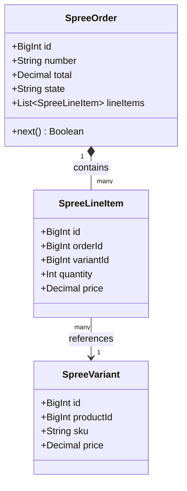
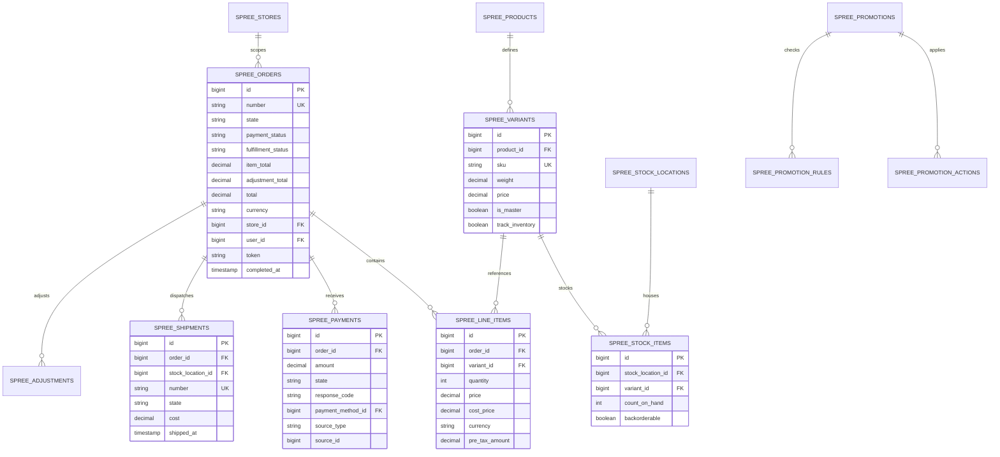
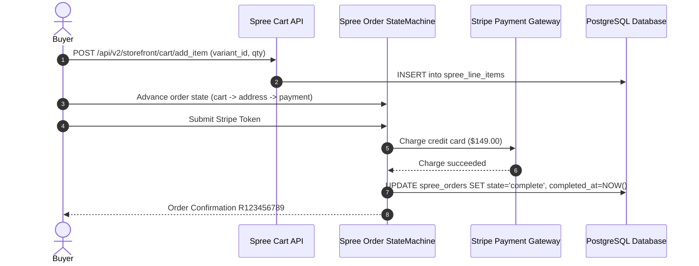

# spree - Architecture & Technical Wiki

> **Enterprise Headless E-Commerce Monorepo, Deterministic Order State Machine & Multi-Store Platform**  
> GitHub: [spree/spree](https://github.com/spree/spree.git) | Stack: Ruby 3.3+, Rails 7.2/8.0, PostgreSQL, Redis, Sidekiq, TypeScript, React, Vite, OpenTelemetry | License: BSD 3-Clause

---

## 1. Executive Summary & Value Proposition

**Spree Commerce** is a production-grade, headless e-commerce monorepo and API-first platform engineered in **Ruby on Rails 7.2/8.0** alongside a modern **TypeScript / React** ecosystem. Serving global enterprises, marketplace aggregators, and high-volume direct-to-consumer retailers, Spree delivers a battle-tested e-commerce engine with an extensible state machine, multi-store and multi-currency architecture, granular inventory tracking, flexible tax and promotion engines, and native integration for AI commerce agents via Model Context Protocol (MCP).

Spree combines the reliability of Ruby on Rails domain modeling with the agility of headless modern frontends. Its core engine manages order lifecycles through deterministic transitions, ensuring that payments, fulfillment logistics, promotion applications, and stock reservations never encounter invalid states or double-allocation bugs.

### Core Problems Solved
- **Brittle Checkout State Failures**: Implements a strict, auditable checkout state machine that sequences orders through distinct validations (address verification, shipping rate calculations, payment authorization, and order completion).
- **Multi-Store & Multi-Currency Fragmentation**: Unifies distinct storefront domains, localized currencies, localized catalog pricing tiers, and regional warehouse fulfillment under a single backend cluster.
- **Complex Promotion & Discount Conflict Resolution**: Features a composable promotion rules engine (`Spree::PromotionRule`) and action executors (`Spree::PromotionAction`) that calculate line-item, whole-order, and free-shipping discounts without race conditions.
- **Granular Multi-Warehouse Stock Allocation**: Tracks physical inventory down to individual items (`Spree::InventoryUnit`) across distributed fulfillment centers (`Spree::StockLocation`), supporting backorders, split shipments, and drop-shipping.
- **Headless API & Agent Readiness**: Provides high-throughput REST API v2 endpoints, typed TypeScript client SDKs (`@spree/sdk`, `@spree/admin-sdk`), and a built-in MCP server for automated programmatic commerce.

---

## 2. High-Level System Architecture

Spree Commerce operates as a **Headless E-Commerce Engine**. The Rails backend exposes a comprehensive REST API v2, managing domain logic, database transactions, and background workers, while operator and vendor dashboards are delivered as decoupled React single-page applications managed via Turborepo and PNPM.

```mermaid
flowchart TD
    subgraph ClientAndConsumerTier ["Client & Channel Consumers"]
        HeadlessStorefront["Next.js / Astro / Mobile Storefronts"]
        AdminDashboard["React Admin Dashboard (@spree/dashboard)"]
        SellerPortal["Multi-Vendor Seller Portal (@spree/seller-dashboard)"]
        AIAgents["AI Commerce Agents (MCP Protocol / JSON-RPC)"]
    end

    subgraph ApiGatewayTier ["API Routing & Security Layer"]
        StorefrontAPI["Spree Storefront API v2 (/api/v2/storefront)"]
        PlatformAPI["Spree Platform API v2 (/api/v2/platform)"]
        MCPEndpoint["Spree MCP Server (/mcp)"]
        OAuthServer["Doorkeeper OAuth2 & API Key Authentication"]
    end

    subgraph RailsCoreEngine ["Spree Core Engine (Ruby on Rails)"]
        OrderStateMachine["Order & Cart State Machine (Spree::Order)"]
        OrderUpdater["OrderUpdater (Totals, Taxes, Adjustments)"]
        InventoryEngine["Inventory Allocator (StockLocations & Units)"]
        PaymentProcessor["Payment Orchestrator (Gateways & Splits)"]
        PromotionEngine["Promotion Rule & Calculator Evaluator"]
        EventBus["Spree Event Bus (publishes_lifecycle_events)"]
    end

    subgraph BackgroundExecution ["Distributed Background Tier (Sidekiq)"]
        SidekiqWorkers["Sidekiq Queue Workers"]
        WebhookDispatcher["WebhookDelivery Workers (HMAC Outbox)"]
        SearchIndexer["Meilisearch / Elastic Catalog Indexing"]
    end

    subgraph PersistenceLayer ["Persistence & Storage"]
        PostgresDB[(PostgreSQL 16+ Primary Database)]
        RedisCache[(Redis 7+ Cache & Session Store)]
        ObjectStorage["S3 / GCS (Product Media & Invoices)"]
    end

    HeadlessStorefront -->|REST API v2 (Bearer / Token)| StorefrontAPI
    AdminDashboard -->|REST Platform API| PlatformAPI
    SellerPortal -->|REST Platform API| PlatformAPI
    AIAgents -->|MCP Tool Calls| MCPEndpoint

    StorefrontAPI --> OAuthServer
    PlatformAPI --> OAuthServer
    OAuthServer --> OrderStateMachine

    OrderStateMachine --> OrderUpdater
    OrderUpdater --> InventoryEngine
    OrderUpdater --> PaymentProcessor
    OrderUpdater --> PromotionEngine

    OrderStateMachine --> EventBus
    EventBus --> SidekiqWorkers
    SidekiqWorkers --> WebhookDispatcher
    SidekiqWorkers --> SearchIndexer

    OrderStateMachine --> PostgresDB
    OrderUpdater --> RedisCache
    InventoryEngine --> PostgresDB
    PaymentProcessor --> PostgresDB
    SidekiqWorkers --> ObjectStorage
```

### Architectural Lifecycle of an Order & Checkout
1. **Cart Creation & Line Item Management**: A shopper initializes a cart via `POST /api/v2/storefront/cart`. Spree instantiates a `Spree::Order` (prefixed with `or_` using Stripe-style Prefix IDs) in the `cart` state. Line items are appended, triggering `Spree::OrderUpdater` to calculate line item pricing, applied promotions, and taxes based on the active `Spree::Store` currency.
2. **Transition Through Checkout States**: During checkout, the cart advances sequentially through defined state transitions:
   - `address`: Populates billing and shipping addresses (`Spree::Address`).
   - `delivery`: Evaluates shipping zones (`Spree::Zone`) and queries stock locations to generate shipments (`Spree::Shipment`) and available shipping rates (`Spree::ShippingRate`).
   - `payment`: Collects payment source tokens (credit card, store credit, gift card), creating `Spree::Payment` records.
   - `confirm`: Final review stage for total order reconciliation.
3. **Payment Processing & Order Completion**: Advancing past `confirm` triggers payment processing. The payment method gateway authorizes or captures funds. Upon successful charge, the state transitions to `complete`, transitioning `payment_status` to `paid` or `authorized`.
4. **Inventory Allocation & Lifecycle Events**: Concurrently, `Spree::InventoryUnit` rows are transitioned from `on_hand` to `allocated` across physical `Spree::StockLocation` records. The engine dispatches an `order.placed` event to the `Spree::Event` bus, prompting asynchronous Sidekiq jobs to dispatch confirmation emails, execute search index synchronizations, and fire configured webhooks.

---

### 2.1 Core Domain & Service Class Architecture



---

## 3. Technology Stack & Key Dependencies

- **Language & Runtime**: Ruby 3.3+ (Core backend) and Node.js 22+ (Dashboard & SDK ecosystem).
- **Backend Framework**: Ruby on Rails 7.2 / 8.0 configured as an API engine with engines architecture (`spree_core`, `spree_api`, `spree_emails`).
- **Database & Object Relational Mapper**: PostgreSQL 16+ or MySQL 8.0+ managed via ActiveRecord; migration rollback and data integrity tests.
- **Background Jobs & Cache**: Sidekiq 7+ backed by Redis 7+ for queue processing, token bucket rate limiters, and distributed caching.
- **Frontend & Monorepo Tooling**: TypeScript 5+, React 19, Tailwind CSS v4, Turborepo 2.x, PNPM 11.x, Biome (linter/formatter).
- **Search & Telemetry**: Meilisearch / Elasticsearch for catalog facet filtering; OpenTelemetry instrumentation (`spree/opentelemetry`) for distributed tracing.

---

## 4. Repository Layout & Key Modules

```
inspire/spree/
├── packages/                        # TypeScript & Frontend Monorepo
│   ├── admin-sdk/                   # Auto-generated TypeScript client for Admin API
│   ├── cli/                         # Spree developer CLI tooling
│   ├── core/                        # Shared frontend types, validators and schemas
│   ├── dashboard/                   # Core React dashboard SPA
│   ├── dashboard-ui/                # Design system UI components (Tailwind v4)
│   ├── sdk/                         # Storefront REST API v2 client library
│   ├── seller-dashboard/            # Multi-vendor seller management UI
│   └── seller-sdk/                  # TypeScript client for vendor interactions
├── spree/                           # Rails Engine Monorepo
│   ├── api/                         # Spree API v2 engine
│   │   ├── app/controllers/spree/api/v2/ # Storefront and Platform API controllers
│   │   └── app/serializers/         # Fast JSON / Alba API serializers
│   ├── core/                        # Foundational e-commerce domain models and services
│   │   ├── app/models/spree/        # Order, Product, Variant, Payment, Shipment models
│   │   │   ├── order.rb             # Master order entity & state machine logic
│   │   │   ├── line_item.rb         # Order item pricing & currency conversions
│   │   │   ├── payment.rb           # Payment transaction state machine
│   │   │   ├── shipment.rb          # Shipping rates & fulfillment status
│   │   │   ├── stock_item.rb        # Warehouse inventory counts and backorders
│   │   │   └── promotion.rb         # Promotional rules and action handlers
│   │   ├── app/services/spree/      # Business services (Checkout, Inventory, Orders)
│   │   │   ├── cart/                # Line item add/remove/update services
│   │   │   ├── checkout/            # Checkout state advance & payment services
│   │   │   └── order_updater.rb     # Order total recalculation coordinator
│   │   └── db/migrate/              # Database schema migrations
│   ├── emails/                      # ActionMailer transactional email templates
│   ├── mcp/                         # Model Context Protocol server for AI agents
│   └── opentelemetry/               # Tracing spans and performance instrumentation
└── turbo.json                       # Turborepo pipeline configuration
```

---

## 5. Core Features & Capabilities

### 5.1 Deterministic Order & Cart State Machine
Spree implements an auditable state machine governing checkout transitions:
- Orders transition predictably through `cart` → `address` → `delivery` → `payment` → `confirm` → `complete`.
- Spree 6 explicitly separates active browsing carts (`Spree::Cart`) from immutable placed orders (`Spree::Order`), enforcing that out-of-stock items can only be automatically stripped prior to completion.
- Uses Stripe-style Prefix IDs (`has_prefix_id :or` for orders, `li_` for line items, `pm_` for payments) to avoid exposing sequential database integers.

### 5.2 Independent Payment & Fulfillment Status Systems
Rather than conflating order lifecycle with delivery and financial state, Spree maintains orthogonal, decoupled state vocabularies:
- **Payment Status (`PAYMENT_STATUSES`)**: Handled by `Spree::Orders::UpdateStatuses` to derive: `none`, `authorized`, `partially_paid`, `paid`, `partially_refunded`, `refunded`, `overcharged`, `voided`.
- **Fulfillment Status (`FULFILLMENT_STATUSES`)**: Reflects actual logistical progress: `unfulfilled`, `partial`, `fulfilled`, `backorder`, `ready`, `shipped`, `delivered`, `canceled`.
- **Payment Splits (`Spree::PaymentSplit`)**: In multi-seller marketplace checkouts, payments are automatically split across designated vendor accounts while maintaining an aggregate master charge.

### 5.3 Rule-Based Promotion & Discount Engine
Spree supports sophisticated discounting strategies:
- **Promotion Rules (`Spree::PromotionRule`)**: Criteria engines evaluating coupon codes, user groups, item quantities, or catalog taxonomy requirements.
- **Promotion Actions (`Spree::PromotionAction`)**: Executors calculating adjustments: percentage-off, fixed-amount discount per line item, or free shipping.
- Discounts are attached as polymorphic `Spree::Adjustment` records, ensuring transparent order invoices that preserve pre-discount base amounts.

### 5.4 Multi-Warehouse Stock Locations & Backordering
Inventory is managed with physical warehouse precision:
- `Spree::StockLocation` represents physical distribution centers.
- Each variant has a `Spree::StockItem` per location tracking `count_on_hand` and `backorderable` flags.
- When an order completes, `Spree::StockMovement` records log inventory allocation. If items ship from separate hubs, the order cleanly splits into multiple `Spree::Shipment` objects.

### 5.5 AI Agent Enablement via Native MCP
Spree integrates a built-in **Model Context Protocol (MCP)** server:
- AI assistants and autonomous coding agents can inspect catalog products, check stock levels, generate carts, and execute order checkouts over standardized JSON-RPC protocols.

---

## 6. Data Models & Schema Architecture



### Core Schema Definitions

#### `spree_orders`
- `id` (bigint, PK): Internal integer database identifier.
- `number` (varchar 32, Unique): Public reference code (e.g., `R102938475`).
- `state` (varchar 32): Current position in checkout state machine (`cart`, `address`, `delivery`, `payment`, `confirm`, `complete`).
- `payment_status` (varchar 32): Financial status (`none`, `authorized`, `paid`, `refunded`, etc.).
- `fulfillment_status` (varchar 32): Fulfillment status (`unfulfilled`, `partial`, `shipped`, `delivered`).
- `item_total`, `adjustment_total`, `total` (decimal 10,2): Immutable order figures reconciled by `OrderUpdater`.
- `currency` (varchar 3): ISO 4217 three-letter currency code (e.g. `USD`, `EUR`).

#### `spree_line_items`
- `order_id` (bigint, FK): Reference to the parent order.
- `variant_id` (bigint, FK): Associated catalog product variation.
- `quantity` (integer): Units purchased.
- `price` (decimal 10,2): Unit price captured at the moment of addition to cart.

#### `spree_payments` & `spree_shipments`
- `payment_method_id` (bigint, FK): Link to configured payment gateway (Stripe, Braintree, PayPal).
- `amount` (decimal 10,2): Monetary amount authorized or captured.
- `stock_location_id` (bigint, FK): Warehouse origin fulfilling the shipment.

---

### 6.1 Comprehensive Database Schema Specification

Spree Commerce uses PostgreSQL / MySQL with active state machines for e-commerce checkouts.

#### Table: `spree_orders`
| Column | Type | Constraints | Default | Description |
| :--- | :--- | :--- | :--- | :--- |
| `id` | `BIGINT` | `PRIMARY KEY AUTO_INCREMENT` | - | Order ID |
| `number` | `VARCHAR(32)` | `NOT NULL, UNIQUE` | - | Order reference number (e.g. `R123456789`) |
| `item_total` | `DECIMAL(10, 2)`| `NOT NULL` | `0.00` | Subtotal amount |
| `total` | `DECIMAL(10, 2)`| `NOT NULL` | `0.00` | Grand total |
| `state` | `VARCHAR(255)` | `NOT NULL` | `'cart'` | Checkout state (`cart`, `address`, `delivery`, `payment`, `complete`) |

*Indexes:* `idx_spree_orders_number` (`UNIQUE (number)`), `idx_spree_orders_state` (`(state)`).

---

## 7. API Architecture, Webhooks & Key Endpoints

Spree provides two distinct REST API v2 surfaces: **Storefront API v2** (public client facing) and **Platform API v2** (administrative and vendor integration).

| Method | Endpoint | Description | Auth Scope |
| :--- | :--- | :--- | :--- |
| `POST` | `/api/v2/storefront/cart` | Creates a new customer shopping cart | Public / Bearer Token |
| `POST` | `/api/v2/storefront/cart/add_item` | Appends a variant SKU with quantity to the active cart | Public / Bearer Token |
| `PATCH`| `/api/v2/storefront/checkout` | Advances checkout state machine, submitting addresses or shipping options | Cart Token |
| `POST` | `/api/v2/storefront/checkout/complete` | Finalizes order and executes payment processing | Cart Token |
| `GET`  | `/api/v2/platform/orders` | Administrative order querying, status filtering & exports | Platform Admin Token |
| `POST` | `/api/v2/platform/webhook_endpoints` | Registers an HMAC-signed webhook listener | Platform Admin Token |

### Sample Payload: Add Item to Cart (`POST /api/v2/storefront/cart/add_item`)
```json
{
  "variant_id": "var_9812401",
  "quantity": 2,
  "options": {
    "monogram_text": "MARKETING-STUDIO"
  }
}
```

### Sample Response: Updated Cart
```json
{
  "data": {
    "id": "or_59182301",
    "type": "cart",
    "attributes": {
      "number": "R849201948",
      "state": "cart",
      "item_total": "198.00",
      "total": "198.00",
      "currency": "USD",
      "item_count": 2,
      "payment_status": "none",
      "fulfillment_status": "unfulfilled"
    },
    "relationships": {
      "line_items": {
        "data": [{ "id": "li_410294", "type": "line_item" }]
      }
    }
  }
}
```

---

### 7.5 End-to-End Operational Lifecycle Sequence



---

## 8. Strategic Value & Takeaways for MarketingStudio

### Reusable Architectural Patterns
1. **Separation of Checkout State from Financial & Logistical Status**: Spree does not attempt to overload a single `status` column with checkout progress, credit card capture, and parcel delivery. By dividing order reality into three distinct axes (`state`, `payment_status`, `fulfillment_status`), MarketingStudio avoids race conditions where an item is shipped before payment capture or marked complete before tracking numbers are assigned.
2. **OrderUpdater Reconciliation Coordinator**: In Spree, totals, taxes, shipping rates, and promotional discounts are never updated ad-hoc by individual controllers. Instead, any modification to a line item, address, or coupon code delegates exclusively to `Spree::OrderUpdater`. This centralized coordinator calculates all ledger amounts atomically and updates the order record.
3. **Prefix IDs for API Security**: Spree's implementation of Stripe-style prefixed identifiers (`or_`, `li_`, `var_`) obfuscates internal database sequence keys, preventing enumeration attacks while making IDs human-readable across server logs and customer support tickets.

### Concrete Convergence Roadmap for MarketingStudio
- **Multi-Product Funnel Checkouts**: MarketingStudio can borrow Spree's `OrderUpdater` pattern for sales funnel checkouts. When an order bump or one-click upsell is accepted, an atomic coordinator recomputes discounts, sales tax, and total charge before dispatching the Stripe PaymentIntent.
- **Composable Promotion Engine**: Adopt Spree's `PromotionRule` and `PromotionAction` abstraction for MarketingStudio's discount coupon subsystem, allowing marketing operators to build rule combinations (e.g., "cart value > \$100 AND user has tag VIP").
- **MCP-Native E-Commerce**: Incorporate Spree's MCP architecture to allow MarketingStudio's AI conversational agents to check customer order histories, initiate return requests, and suggest replenishment products directly inside chat channels.
