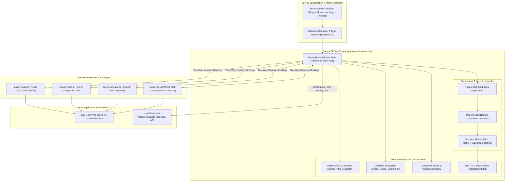
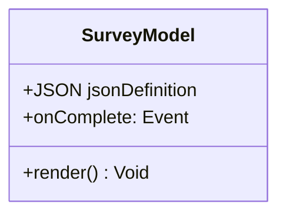
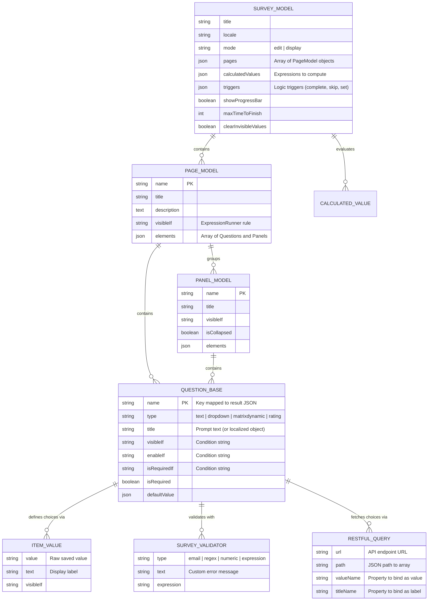
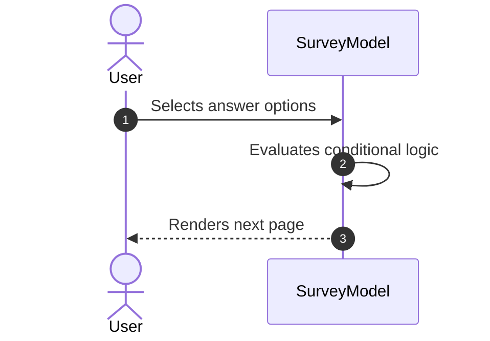

# survey-library - Architecture & Technical Wiki

> **Framework-Agnostic Reactive Survey & Form Engine, JSON Schema Compiler & Multi-Framework UI Suite**  
> GitHub: [surveyjs/survey-library](https://github.com/surveyjs/survey-library) | Stack: TypeScript, React, Vue 3, Angular, Knockout, Web Components, SCSS | License: MIT

---

## 1. Executive Summary & Value Proposition

**SurveyJS (`survey-library`)** is the industry-standard, framework-agnostic form and survey rendering engine. Deployed across thousands of commercial SaaS platforms, healthcare systems, and enterprise internal tools, SurveyJS provides an unconstrained, self-hosted, headless alternative to Typeform, Qualtrics, and Google Forms. It decouples survey definitions from any specific backend, framework, or cloud vendor through a comprehensive, standardized **JSON Survey Schema**.

While most form packages tightly couple form rendering with a specific web framework (e.g., React-only or Vue-only) and basic flat input models, SurveyJS is built on a clean **Model-View-ViewModel (MVVM)** core. The reactive foundation (`packages/survey-core`) manages all business invariants—complex expressions, validation rules, calculated values, dynamic arrays, cascading REST lookups, and internationalization—while thin presentation packages (`survey-react-ui`, `survey-vue3-ui`, `survey-angular-ui`) bind this core model to framework-native virtual DOM trees.

### Core Problems Solved
- **Framework Fragmentation & Re-implementation Waste**: Centralizes all form logic, validation, and calculations in a framework-agnostic TypeScript core (`survey-core`), rendering identically across React, Vue 3, Angular, and native HTML.
- **Dynamic Complex Form Hierarchies**: Natively supports nested `Panels`, repeatable dynamic matrix grids (`matrixdynamic`), and dynamic panel iterators (`paneldynamic`) without bespoke state plumbing.
- **Embedded Expression & Math Calculation Engine**: Features a built-in expression tokenizer and Abstract Syntax Tree (AST) evaluator (`ExpressionRunner`) supporting ternary operators, conditional visibility (`visibleIf`), and custom math functions (`FunctionsFactory`).
- **Real-Time Cascading REST Endpoints**: Dynamically loads select choices, autocomplete tags, and country/state lists via declarative asynchronous REST configurations (`choicesRestful`).
- **Uncompromised Accessibility Compliance**: Fully certified for WCAG 2.1 AA, Section 508, high-contrast themes, ARIA live-regions, and complete keyboard-navigable operations.

---

## 2. High-Level System Architecture

SurveyJS is organized as a multi-package monorepo. The core state machine lives within `packages/survey-core`, completely decoupled from DOM operations. Presentation packages observe the `SurveyModel` and render native framework components.



### Architectural Lifecycle of SurveyJS Execution
1. **Schema Instantiation & Deserialization**: The host application passes a JSON schema into `const survey = new SurveyModel(json)`. The `Serializer` validates types, instantiates `PageModel`, `PanelModel`, and concrete `Question` subclasses, and registers default property values.
2. **Framework Binding & DOM Mounting**: The framework adapter (e.g., `<Survey model={survey} />` in React) mounts the survey. UI components subscribe to `survey.onPropertyChanged` and re-render only modified nodes.
3. **Reactive Expression Evaluation**: When a user changes an input value, `SurveyModel.doOnValueChanged()` triggers `ExpressionRunner`. Expressions like `visibleIf: "{has_budget} == 'yes'"` or `enableIf: "{employees} > 10"` evaluate instantly across all dependent elements.
4. **Calculated Value Recalculation**: If calculated values are defined (e.g., `totalPrice = {qty} * {unitPrice}`), the calculation graph runs and assigns output to virtual survey variables.
5. **Validation & Completion Pipeline**: Clicking "Complete" triggers `SurveyModel.completeLastPage()`. All validators run (sync and async). If valid, `survey.onComplete` fires, passing clean, structured JSON data (`survey.data`) to the host application for submission to downstream APIs.

---

### 2.1 Core Domain & Service Class Architecture



---

## 3. Technology Stack & Key Dependencies

- **Language & Runtime**: TypeScript 5.3+, Node.js 18+ / 20+ build tools (Rollup, Webpack, Vite).
- **Core Engine**:
  - `packages/survey-core`: Zero external runtime dependencies. Self-contained MVVM state machine, expression parser, and event emitter.
- **UI Framework Bindings**:
  - `survey-react-ui`: React 16.8+ through React 19.
  - `survey-vue3-ui`: Vue 3 (Composition API & `<script setup>`).
  - `survey-angular-ui`: Angular 14 through Angular 18+.
  - `survey-js-ui`: Web Components and Knockout runtime fallback.
- **Styling & Theming**:
  - SCSS with a modern theme token architecture (`defaultV2`, `sharp`, `borderless`, `flat`).
  - CSS variables for runtime color customization, dark mode, and typography.
- **Testing & Quality Assurance**:
  - Playwright, TestCafe, Vitest for unit, functional, visual regression, and WCAG accessibility testing.

---

## 4. Repository Layout & Key Modules

```
survey-library/
├── packages/
│   ├── survey-core/                  # Framework-agnostic survey kernel
│   │   ├── src/
│   │   │   ├── actions/              # Action bar models, buttons, header controls
│   │   │   ├── conditions/           # Condition runner, operators (empty, contains, etc.)
│   │   │   ├── expressions/          # Expression parser, tokenizers, AST evaluator
│   │   │   ├── localization/         # 40+ language translation dictionaries
│   │   │   ├── mask/                 # Input masking (phone, credit card, currency)
│   │   │   ├── base.ts               # Base observable object & event emitter
│   │   │   ├── choicesRestful.ts     # Asynchronous REST choice fetcher
│   │   │   ├── jsonobject.ts         # Schema serializer & type metadata registry
│   │   │   ├── page.ts               # PageModel container
│   │   │   ├── panel.ts              # PanelModel container (collapsible panels)
│   │   │   ├── question.ts           # Abstract Question base class
│   │   │   ├── question_*.ts         # Concrete questions (text, matrixdynamic, rating, etc.)
│   │   │   ├── survey.ts             # Master SurveyModel class (~440KB core logic)
│   │   │   └── validator.ts          # Email, numeric, text length, regex validators
│   │   └── package.json
│   ├── survey-react-ui/              # React components wrapping survey-core
│   ├── survey-vue3-ui/               # Vue 3 components wrapping survey-core
│   ├── survey-angular-ui/            # Angular components wrapping survey-core
│   └── survey-js-ui/                 # Vanilla JS / Web Components wrapper
├── visualRegressionTests/            # Visual pixel-comparison test suites
├── accessibilityTests/               # Automated aXe WCAG 2.1 compliance tests
└── package.json                      # Monorepo build and release scripts
```

---

## 5. Core Features & Capabilities

### 5.1 Comprehensive Question Hierarchy (30+ Input Types)
SurveyJS contains the most diverse collection of input controls available in open source:
- **Matrix Questions**: Single-choice matrix, multi-select matrix, dynamic matrix (`matrixdynamic`) with repeatable rows, and dropdown matrix.
- **Dynamic Panels (`paneldynamic`)**: Repeatable composite sub-forms (e.g., adding an arbitrary number of dependents or job experiences).
- **Specialized Inputs**: Image picker, rating stars/smileys, ranking list with drag-and-drop, signature pad, file upload with direct base64/URL handling, tag box, and sliders.

### 5.2 ExpressionRunner & Mathematical Parsing
The embedded expression parser handles logic without executing unsafe `eval()`:
- **Conditional Visibility**: `visibleIf: "{age} >= 21 and {country} == 'US'"`.
- **Dynamic Readonly & Required**: `enableIf` and `isRequiredIf` dynamically lock or demand inputs based on previous answers.
- **Custom Functions**: Developers register domain logic via `FunctionsFactory.Instance.register("calculateRiskScore", (params) => { ... })`.

### 5.3 Dynamic RESTful Choice Population
Dropdowns and checkbox lists can populate options from external APIs:
```json
{
  "type": "dropdown",
  "name": "company_industry",
  "choicesByUrl": {
    "url": "https://api.marketingstudio.internal/v1/industries",
    "valueName": "code",
    "titleName": "name"
  }
}
```
Supports cascading dependencies: changing a `country` dropdown automatically triggers the `state` dropdown to re-query with `{country}` in the URL query string.

### 5.4 Multi-Language Localization Engine
- Localizes labels directly within the survey JSON schema:
  ```json
  "title": {
    "default": "What is your email address?",
    "fr": "Quelle est votre adresse e-mail ?",
    "de": "Wie lautet Ihre E-Mail-Adresse?"
  }
  ```
- Instant runtime language switching via `survey.locale = "fr"`.

---

## 6. Data Models & Schema Architecture

SurveyJS models its survey AST in memory via TypeScript classes, serialized to and from a canonical JSON schema.



### Core Schema Invariants
1. **Name Uniqueness**: Every `Question.name` across pages must be unique. The final output payload `survey.data` is an atomic dictionary mapping `{ [question.name]: answerValue }`.
2. **Invisible Value Sanitization**: Configured via `survey.clearInvisibleValues = "onHidden" | "onComplete"`. When conditional logic hides a previously answered question, SurveyJS sanitizes or preserves the value based on policy.
3. **Extensible Metadata Architecture**: Developers add custom properties to the schema using `Serializer.addProperty("question", "marketingTag:string")`, which automatically persist through JSON exports.

---

### 6.1 Comprehensive Database Schema Specification

Client-side JSON schema model.

---

## 7. API Architecture, Webhooks & Key Endpoints

Because `survey-library` is a client-side headless engine, it connects to any backend via standard JavaScript event hooks.

### Core Event Integration Lifecycle

```typescript
import { SurveyModel } from "survey-core";
import "survey-core/defaultV2.min.css";

const survey = new SurveyModel(surveyJson);

// 1. Partial auto-save hook
survey.onValueChanged.add((sender, options) => {
  fetch("/api/forms/auto-save", {
    method: "POST",
    headers: { "Content-Type": "application/json" },
    body: JSON.stringify({
      question: options.name,
      value: options.value,
      partialData: sender.data
    })
  });
});

// 2. Final submission completion hook
survey.onComplete.add((sender, options) => {
  options.showDataSaving("Submitting your answers to MarketingStudio...");
  
  fetch("/api/forms/submit", {
    method: "POST",
    headers: { "Content-Type": "application/json" },
    body: JSON.stringify({
      surveyId: "mkt_lead_form_01",
      submission: sender.data,
      timeSpent: sender.timeSpent
    })
  })
  .then(res => res.json())
  .then(() => options.showDataSavingSuccess("Submission received!"))
  .catch(() => options.showDataSavingError("Failed to submit. Please try again."));
});
```

### Sample Output Payload: `survey.data`
```json
{
  "full_name": "Alexander Hayes",
  "corporate_email": "alexander.hayes@apex-capital.com",
  "team_headcount": 120,
  "interested_products": ["Lead Scoring", "Automated Outreach"],
  "marketing_budget": 50000,
  "dynamic_stakeholders": [
    {
      "name": "Sarah Miller",
      "role": "VP Marketing",
      "email": "sarah.miller@apex-capital.com"
    },
    {
      "name": "David Zhou",
      "role": "Head of Growth",
      "email": "david.zhou@apex-capital.com"
    }
  ]
}
```

---

### 7.5 End-to-End Operational Lifecycle Sequence



---

## 8. Strategic Value & Takeaways for MarketingStudio

### Reusable Architectural Patterns
1. **Adopting the SurveyJS JSON Schema as Internal Standard**:
   - Instead of inventing an arbitrary internal schema for MarketingStudio's Form and Survey builders, adopting or aligning with the SurveyJS JSON specification provides immediate access to 30+ field types, complex expressions, dynamic arrays, and multi-language support.
2. **Decoupled MVVM State Engine**:
   - The architectural separation of `packages/survey-core` (state machine) from React/Vue renderers proves that form business logic, validation, and expression calculation should never reside directly in React components. MarketingStudio should implement a headless core for its embeddable lead widgets.
3. **Declarative Asynchronous REST Lookups (`choicesRestful`)**:
   - Implementing SurveyJS's `choicesByUrl` pattern enables MarketingStudio forms to dynamically query internal CRM databases, product catalogs, and agent schedules without writing bespoke frontend glue code.
4. **Dynamic Complex Structures (`matrixdynamic` & `paneldynamic`)**:
   - When building B2B account onboarding workflows where prospects need to add multiple team members or configure multiple outreach channels, dynamic panel iterators provide a robust, tested UI pattern.
