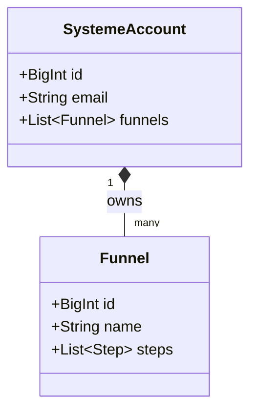
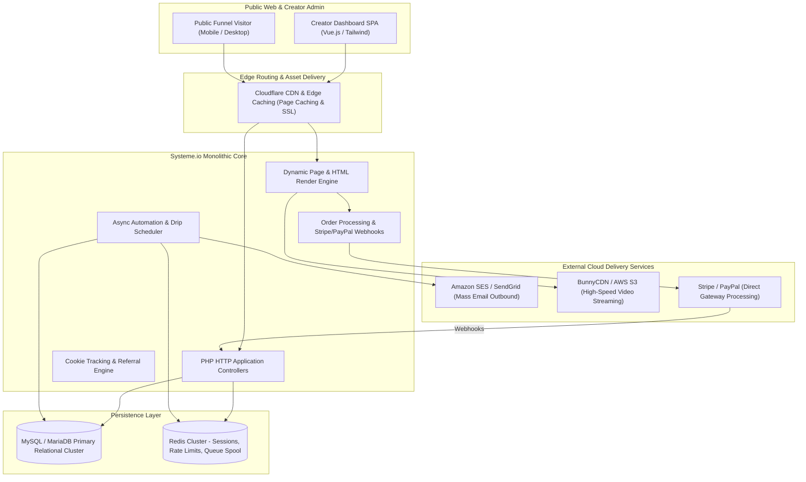
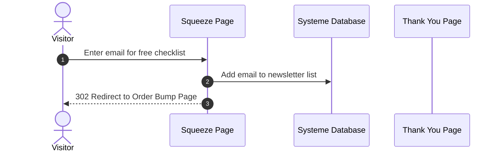

# Systeme.io System and Functional Architecture

> Comprehensive technical and functional reverse-engineered reference for **Systeme.io**: the high-efficiency, all-in-one sales funnel, tag-based email marketing, online course platform, and affiliate management engine.

---

## 1. Executive Overview and Market Positioning

**Systeme.io** was founded by French entrepreneur Aurélien Amacker with a disruptive mission: replace the expensive, bloated software stack required by digital creators and solopreneurs ($297/mo for ClickFunnels, $149/mo for Kajabi, $79/mo for ActiveCampaign, $99/mo for Teachable) with a clean, ultra-fast, and affordable all-in-one marketing platform offering a generous free-forever tier.

By stripping away enterprise complexity and optimizing its software architecture for extreme operational efficiency, Systeme.io achieved explosive global growth, supporting over 300,000 online entrepreneurs and processing millions of digital sales transactions.

### Core Value Proposition
- **Tag-Based Contact Architecture:** Completely eliminates traditional "Lists". Contacts exist once in a single global database, categorized entirely by Tags, preventing duplicate subscriber charges.
- **High-Velocity Sales Funnel Engine:** Visual funnel step manager supporting Opt-in / Squeeze pages, Sales pages, Order forms, One-Click Upsells, Downsells, and Thank You pages.
- **Built-In Course & Membership Hosting:** Integrated digital product delivery with student access control, video streaming, and automated drip course scheduling.
- **Integrated Affiliate Management:** Native affiliate tracking system automatically generating affiliate links, tracking referral cookies, and managing multi-tier commission payouts via PayPal/TransferWise.
- **Ultra-Lean Infrastructure Economics:** Built on an optimized web stack delivering sub-150ms page load times and exceptional server cost efficiency.

---

## 2. Core Entities and Reverse-Engineered Data Model

```
┌────────────────────────────────────────────────────────┐
│                      User Account                      │
│     (Email, Custom Domain, Stripe/PayPal Gateway)      │
└───────────┬────────────────────────────────┬───────────┘
            │ 1:N                            │ 1:N
            ▼                                ▼
┌───────────────────────┐        ┌───────────────────────┐
│     Sales Funnel      │        │   Course / Community  │
│ (Type: Sales/Leads)   │        │ (Modules, Lectures,   │
└───────────┬───────────┘        │  Student Enrollments) │
            │ 1:N                └───────────────────────┘
            ▼
┌────────────────────────────────────────────────────────┐
│                     Funnel Steps                       │
│  ┌──────────────┬──────────────┬──────────────┬──────┐ │
│  │ Squeeze Page │  Sales Page  │  Order Form  │Upsell│ │
│  └──────────────┴──────────────┴──────────────┴──────┘ │
└───────────┬────────────────────────────────────────────┘
            │ Collects / Triggers
            ▼
┌────────────────────────────────────────────────────────┐
│                   Unified Contact                      │
│      (Email, Name, Country, Custom Fields)             │
└───────────┬────────────────────────────────────────────┘
            │ Tagged With
            ▼
┌────────────────────────────────────────────────────────┐
│                        Tags                            │
│    (e.g., "lead_ebook", "customer_course", "vip")      │
└───────────┬────────────────────────────────────────────┘
            │ Triggers
            ▼
┌────────────────────────────────────────────────────────┐
│                  Automations & Rules                   │
│   (When Tag Added ➔ Subscribe to Campaign / Send Mail) │
└───────────┬────────────────────────────────────────────┘
            │ Generates
            ▼
┌────────────────────────────────────────────────────────┐
│             Affiliate Commission Ledger                │
│    (Referrer ID, Order ID, Commission %, Payout Status)│
└────────────────────────────────────────────────────────┘
```

### Entity Schema Breakdown
1. **Sales Funnel:** Top-level container representing a customer conversion journey. Funnels have a primary goal (`Build an audience`, `Sell a product`, `Custom`, `Run an evergreen webinar`).
2. **Funnel Step:** Individual pages in the funnel sequence. Each step has a specific architectural role (`optin`, `sales_page`, `order_form`, `upsell`, `downsell`, `thank_you`).
3. **Contact:** Flat contact record. Identified uniquely by `email`. Contains standard fields (first name, phone, address, country) and dynamic key-value attributes.
4. **Tag:** The fundamental categorization primitive. Instead of subscribing a contact to multiple lists (which leads to duplicate entries in Mailchimp or AWeber), tags are dynamically attached or detached from contacts.
5. **Campaign (Email Drip):** Linear series of scheduled email follow-ups with defined hourly or daily delay offsets relative to the previous email.
6. **Automation Rule:** Event-action pairs: `Trigger: Tag Added` ➔ `Action: Enroll in Course` + `Subscribe to Email Campaign`.
7. **Affiliate Program:** Tracks referral cookies (typically 30-day or lifetime attribution), commission rates (e.g. 40-50%), and generates automated monthly payout invoices.

---

### 2.1 Core Domain and Service Class Architecture



---

### 2.2 Comprehensive Database Schema Specification

#### Table: `funnels`
| Column | Type | Constraints | Default | Description |
| :--- | :--- | :--- | :--- | :--- |
| `id` | `BIGINT` | `PRIMARY KEY` | - | Funnel ID |
| `name` | `VARCHAR(255)` | `NOT NULL` | - | Funnel name |

---

## 3. Reverse-Engineered System Architecture & Engineering Blueprint



### 3.1 Technology Stack & Operational Efficiency
- **Core Runtime & Framework:** High-performance modern PHP (PHP 8.2+ with OPcache and JIT enabled) utilizing lightweight frameworks (Laravel / Symfony components). This enables minimal memory consumption per request (< 15 MB RAM) and exceptional request throughput.
- **Frontend Architecture:** **Vue.js 3** and TailwindCSS for the creator dashboard, featuring an intuitive drag-and-drop page builder that outputs ultra-clean, minimal HTML and CSS.
- **Database Architecture:** Optimized MySQL / MariaDB relational cluster. Heavy reliance on clean indexes on `contacts(email)`, `contact_tags(contact_id, tag_id)`, and `funnel_steps(funnel_id, step_order)` ensures queries execute in under 5 milliseconds.
- **Email Infrastructure:** Rather than hosting complex local MTAs, Systeme.io operates multi-account **Amazon SES (Simple Email Service)** clusters with dedicated IP pools, achieving enterprise deliverability at minimal cost ($0.10 per 1,000 emails).
- **Video Delivery:** Leverages cost-effective specialized video CDNs (such as **BunnyCDN**) to stream course lectures smoothly without paying exorbitant AWS CloudFront video bandwidth rates.

---

## 4. Key Operational Mechanics & Deep Technical Differentiators

### 4.1 The Flat Tag-Based Contact Architecture
Traditional email platforms (like Mailchimp or AWeber) charge users based on total list entries. If a customer is on the "Newsletter List", "Free Ebook List", and "Customers List", the business pays for 3 contacts.
- Systeme.io enforces a **Single Contact Entity**:
  ```sql
  CREATE TABLE contacts (
      id BIGINT AUTO_INCREMENT PRIMARY KEY,
      account_id BIGINT NOT NULL,
      email VARCHAR(255) NOT NULL,
      created_at TIMESTAMP,
      UNIQUE KEY uq_account_email (account_id, email)
  );
  ```
- Categorization is handled via an associative lookup table (`contact_tags`). Adding or removing tags does not duplicate data, simplifying marketing automation logic and eliminating subscriber overage fees.

### 4.2 One-Click Upsell & Downsell Funnel Mechanics
In high-converting e-commerce funnels, capturing the customer's payment information once and offering post-purchase upgrades without re-entering credit card details is critical:
- When a customer submits an Order Form, Systeme.io tokenizes the card via Stripe Customer Tokens or PayPal Vault.
- On the subsequent Upsell page, clicking "Yes, Add to My Order" triggers a backend server-to-server charge via Stripe's `PaymentIntent` API using the existing payment token (`off_session: true`).
- If the customer declines ("No thanks"), the funnel redirects immediately to a configured Downsell offer.

### 4.3 Native Two-Tier Affiliate Commission Automation
Systeme.io features an integrated affiliate marketplace:
- When an affiliate shares a link (`https://systeme.io?sa=YOUR_AFFILIATE_ID`), a 30-day tracking cookie is set on the visitor's browser.
- If the visitor registers a free account or purchases a course, the `referred_by` affiliate ID is permanently attached to the contact record in the database.
- Any future purchases made by that contact:even months later:automatically generate commission records in the affiliate ledger, paying out recurring SaaS commissions effortlessly.

---

## 5. Integration Architecture and API Surface

- **Public REST API:** Exposes endpoints to create and retrieve contacts, assign tags, enroll students in courses, and query sales orders.
- **Webhooks Engine:** Sends instantaneous JSON HTTP POST notifications on events: `contact_created`, `tag_added`, `tag_removed`, `sale_completed`, `subscription_cancelled`.
- **Payment Gateway Direct Integrations:** Native API connectors for Stripe, PayPal, Razorpay, and Mercado Pago.

---

### 7.5 End-to-End Operational Lifecycle Sequence



---

## 6. MarketingStudio Convergence & Architectural Takeaways

Systeme.io provides the ideal model for high-conversion funnel engineering and creator monetization:

1. **Adopt Systeme.io's Flat Tag-Based Contact Model**: Store contacts once in MarketingStudio's database and use dynamic tags rather than siloed lists, avoiding duplicate records and billing confusion.
2. **Implement One-Click Upsell / Downsell Funnel Logic**: Build funnel step state machines where checkout tokens allow instant post-purchase upgrades.
3. **Embed Native Course & Digital Product Delivery**: Integrate member portals directly into MarketingStudio so creators can sell and host video courses without third-party tools.
4. **Build a Native Affiliate Tracking Engine**: Automatically generate referral links and calculate affiliate commissions to drive viral word-of-mouth customer acquisition.