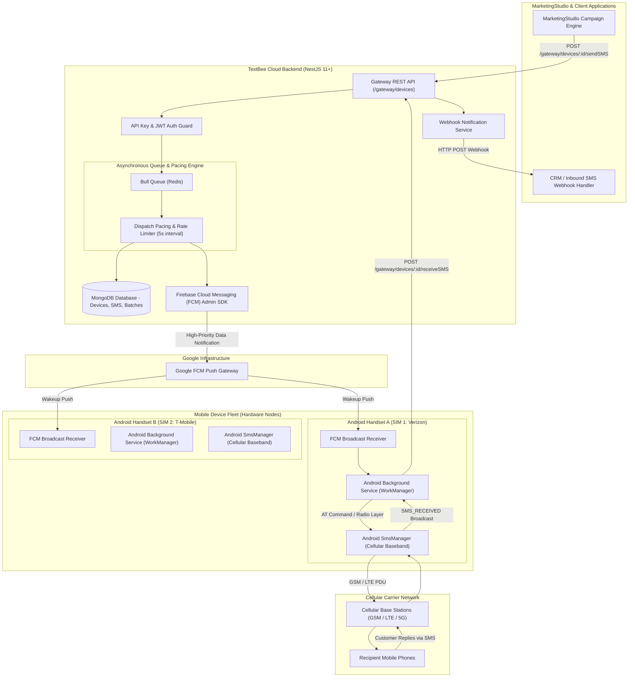
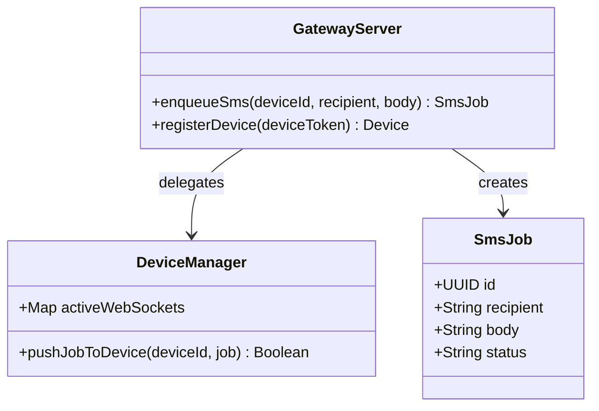
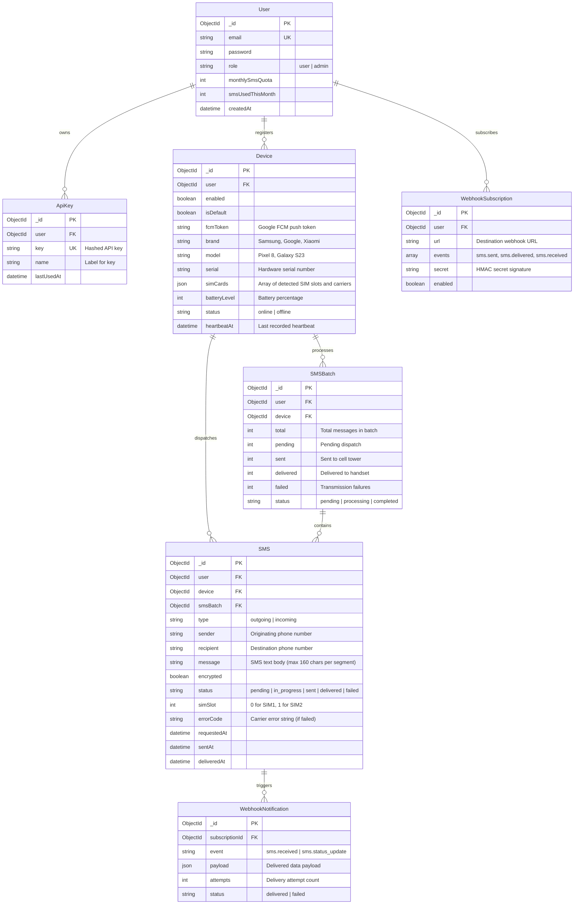
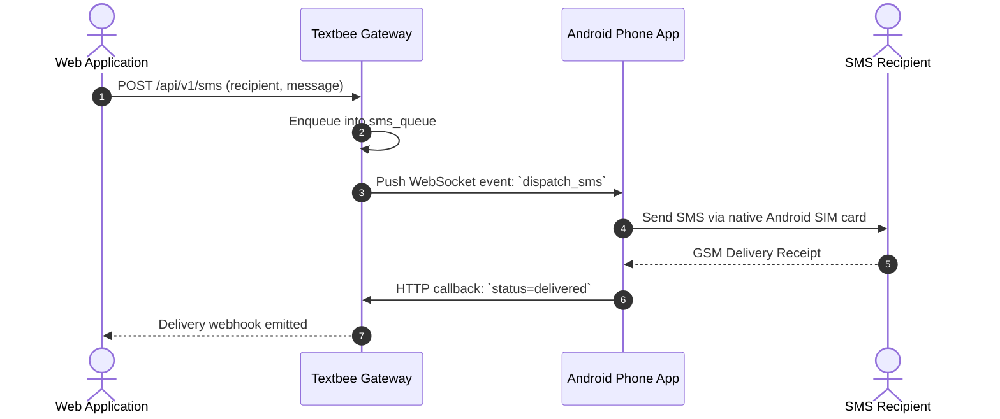

# textbee - Architecture & Technical Wiki

> **Decentralized Android-Powered SMS Gateway & Multi-Device Dispatch Fabric**  
> GitHub: [textbee/textbee](https://github.com/textbee/textbee.git) | Stack: TypeScript, NestJS 11+, MongoDB/Mongoose, Bull/Redis, Firebase Cloud Messaging (FCM), Kotlin Android App | License: MIT

---

## 1. Executive Summary & Value Proposition

**textbee** is an open-source decentralized SMS gateway platform that turns everyday Android smartphones into high-availability, programmable SMS gateways. By pairing a NestJS/MongoDB cloud orchestrator with a lightweight native Android companion application over Firebase Cloud Messaging (FCM) and WebSockets, TextBee eliminates the high monthly subscription fees and per-message charges associated with legacy aggregators (Twilio, Vonage, Sinch). It enables marketing agencies, growth teams, and SaaS platforms to send and receive two-way SMS globally using local carrier SIM cards with unlimited plans.

### Core Problems Solved
- **Prohibitive Carrier & Aggregator Costs**: Legacy SMS providers charge anywhere from \$0.0079 to \$0.08 per outbound SMS, plus monthly fees for 10DLC (10-Digit Long Code) registration. TextBee leverages existing cellular phone plans with unlimited SMS bundles, reducing the marginal cost per SMS to virtually zero.
- **Strict Carrier 10DLC & Template Scrutiny**: Traditional cloud SMS gateways enforce rigorous pre-registration of marketing templates, leading to high rejection rates. TextBee transmits messages directly through local cellular network base stations as authentic mobile-originated (MO) traffic.
- **Multi-Device SIM Clustering & Automatic Failover**: Aggregates a fleet of Android handsets under a single API account, automatically round-robining SMS batches across active devices, handling dual-SIM slot selection, and monitoring battery/connectivity health.
- **Two-Way Conversational SMS Loop**: Inbound text messages received on physical Android devices are instantly intercepted by native Android broadcast receivers and pushed to TextBee's cloud API, which triggers HTTP webhooks into CRM and marketing platforms.

---

## 2. High-Level System Architecture

TextBee operates across three primary tiers:
1. **API & Orchestrator Tier (NestJS)**: Exposes REST APIs, enforces authentication guards, manages database persistence via Mongoose, and enqueues outbound SMS jobs into BullMQ/Redis.
2. **Push Delivery Fabric (FCM / WebSocket)**: Awakens dormant Android phones via high-priority Firebase Cloud Messaging notifications, instructing the background worker to fetch or execute pending SMS payloads.
3. **Hardware Dispatcher Tier (Android Native APK)**: Runs a persistent foreground service on Android that parses SMS payloads, queries the native `TelephonyManager` for Dual-SIM availability, and invokes `SmsManager.sendTextMessage()` to broadcast over the cellular radio.



---

### 2.1 Core Domain & Service Class Architecture



---

## 3. Technology Stack & Key Dependencies

- **Language & Runtime**: TypeScript 5.4+, Node.js 20+ LTS, pnpm package manager.
- **Backend Framework**: NestJS 11+ with `@nestjs/mongoose`, `@nestjs/bull`, `@nestjs/swagger`, and `@nestjs/throttler`.
- **Database & Persistence**: MongoDB 7+ via Mongoose 9.0+ utilizing compound indexes for fast cursor-based pagination and status rollups.
- **Queue & Async Job Processing**: Bull 4.16+ backed by Redis 7+ (`ioredis`) for reliable message queuing, rate-limiting, and automatic retry handling.
- **Push Notification Transport**: `firebase-admin` (v13.6+) for sending high-priority FCM data messages directly to Android handsets.
- **Mobile Client Engine**: Kotlin, Android Jetpack, `WorkManager`, `TelephonyManager`, and Android native `SmsManager` supporting Dual-SIM (SubscriptionManager) on Android 8.0+ (API 26) through Android 15.
- **Billing & Subscriptions**: `@polar-sh/sdk` for SaaS billing, plan limits, and automated subscription webhooks.

---

## 4. Repository Layout & Key Modules

```
inspire/textbee/
├── android/                         # Native Android companion application (Kotlin)
│   ├── app/src/main/
│   │   ├── java/dev/textbee/        # Android services, receivers, and DB sync
│   │   │   ├── receivers/           # SMS_RECEIVED and BOOT_COMPLETED broadcast receivers
│   │   │   ├── services/            # FCM messaging service and foreground notification service
│   │   │   └── workers/             # Background SMS dispatch workers (WorkManager)
│   │   └── AndroidManifest.xml      # Required permissions: SEND_SMS, RECEIVE_SMS, READ_PHONE_STATE
├── api/                             # Cloud backend API (NestJS)
│   ├── src/
│   │   ├── main.ts                  # Application entry point, Swagger docs, global validation
│   │   ├── auth/                    # API key validation, JWT strategy, access footprints
│   │   ├── billing/                 # Polar.sh checkout, subscription and plan schemas
│   │   ├── gateway/                 # Core gateway orchestration subsystem
│   │   │   ├── gateway.controller.ts# REST endpoints for devices, SMS sending, and callbacks
│   │   │   ├── gateway.service.ts   # Core business logic for message dispatch and verification
│   │   │   ├── queue/               # Bull queue processor and dispatch pacing
│   │   │   │   ├── sms-queue.processor.ts # Pulls jobs from Redis and triggers FCM/HTTP push
│   │   │   │   └── dispatch-pacing.ts    # Enforces carrier safety delays between SMS
│   │   │   ├── schemas/             # Mongoose schemas: Device, SMS, SMSBatch, Tombstone
│   │   │   └── tasks/               # Cron jobs: heartbeat checks, stale SMS status updates
│   │   ├── mail/                    # Transactional emailer and suppression lists
│   │   ├── notifications/           # In-app dashboard notifications
│   │   ├── users/                   # User profiles and usage quotas
│   │   └── webhook/                 # Outbound webhook delivery to external subscribers
│   ├── docker-compose.yaml          # MongoDB, Redis, and API orchestration
│   └── package.json                 # Backend dependencies and build scripts
└── web/                             # Next.js / React management dashboard
```

---

## 5. Core Features & Capabilities

### Android Hardware Node Registration & Heartbeats
Android devices are registered into the cluster by scanning a QR code or entering an API token in the mobile app. The device reports its manufacturer, model, operating system version, battery status, and available SIM card slots (`simCards` array with carrier names and ICCIDs). Devices transmit periodic heartbeat signals (`POST /gateway/devices/:id/heartbeat`). If a handset fails to check in within 15 minutes, TextBee marks it as offline and halts dispatching.

### Hardware Pacing & Anti-Spam Throttling
Sending hundreds of SMS consecutively through a consumer SIM card triggers automated carrier fraud filters and blocks the SIM. TextBee enforces a mandatory pacing interval (`DEFAULT_SMS_SEND_DELAY_SECONDS = 5`) between successive SMS transmissions on the same device. The pacing engine coordinates with BullMQ to delay downstream queue jobs automatically.

### Dual-SIM Slot Selection
In emerging markets, Android devices typically house two SIM cards from competing cellular providers (e.g., SIM 1 = MTN, SIM 2 = Airtel). TextBee allows API callers to specify which SIM slot to transmit from, or automatically selects the cheapest carrier based on the destination phone prefix.

### Asynchronous Bulk SMS Batching
The `/gateway/devices/:id/sendBulkSMS` endpoint accepts thousands of recipient numbers in a single JSON payload. TextBee decomposes the array into individual `SMS` documents associated with a parent `SMSBatch` record, queueing them sequentially in Redis with configurable jitter intervals.

### End-to-End Delivery Receipts & Status Callbacks
When an Android device fires `SmsManager.sendTextMessage()`, it registers two `PendingIntent` callbacks:
1. `SentIntent`: Verifies that the phone's baseband processor successfully handed the PDU over to the local cell tower (`Activity.RESULT_OK`).
2. `DeliveryIntent`: Listens for carrier-level delivery confirmation (PDU status report) confirming arrival on the recipient's phone.
The Android app posts these status updates back to `/gateway/devices/:id/updateSMSStatus`, which triggers instant webhooks to MarketingStudio.

---

## 6. Data Models & Schema Architecture

TextBee's data tier is powered by MongoDB schemas defined with `@nestjs/mongoose`.



### Core Schema Entity Specifications
- **`Device`**: Tracks the physical smartphone hardware state, FCM push token, battery percentage, SIM inventory, and connectivity health.
- **`SMS`**: Core transactional record storing message direction (`incoming` / `outgoing`), sender/recipient E.164 phone numbers, SIM slot routing, and delivery timestamps.
- **`SMSBatch`**: Aggregates multi-recipient broadcast campaigns for high-level progress monitoring and batch cancellation.
- **`WebhookSubscription`**: Registers external URLs to receive real-time push events upon inbound message receipt or delivery receipts.

---

### 6.1 Comprehensive Database Schema Specification

Textbee persists devices and SMS dispatch queues within PostgreSQL.

#### Table: `devices`
Android smartphones operating as physical cellular SMS gateways.

| Column | Type | Constraints | Default | Description |
| :--- | :--- | :--- | :--- | :--- |
| `id` | `UUID` | `PRIMARY KEY` | `gen_random_uuid()` | Device identifier |
| `name` | `VARCHAR(100)` | `NOT NULL` | - | Device model name |
| `status` | `VARCHAR(50)` | `NOT NULL` | `'offline'` | Connection state |
| `api_key` | `VARCHAR(255)` | `NOT NULL, UNIQUE` | - | Authentication token |

*Indexes:* `idx_devices_key` (`UNIQUE (api_key)`).

---

#### Table: `sms_queue`
| Column | Type | Constraints | Default | Description |
| :--- | :--- | :--- | :--- | :--- |
| `id` | `UUID` | `PRIMARY KEY` | `gen_random_uuid()` | SMS Job ID |
| `device_id` | `UUID` | `NOT NULL, FK -> devices(id)` | - | Target phone |
| `recipient` | `VARCHAR(50)` | `NOT NULL` | - | Destination number |
| `message` | `TEXT` | `NOT NULL` | - | SMS content |
| `status` | `VARCHAR(50)` | `NOT NULL` | `'pending'` | State (`pending`, `sent`, `failed`) |

*Indexes:* `idx_sms_status` (`(status)`).

---

## 7. API Architecture, Webhooks & Key Endpoints

### 1. Messaging: Dispatch Single SMS via Android Device
- **POST** `/gateway/devices/:deviceId/sendSMS`
- **Headers**: `x-api-key: <API_KEY>`, `Content-Type: application/json`

**Request Payload:**
```json
{
  "recipients": ["+15559876543"],
  "message": "Your one-time MarketingStudio login passcode is: 482910. Valid for 10 minutes.",
  "simSlot": 0,
  "priority": "high"
}
```

**Response Payload (`201 Created`):**
```json
{
  "success": true,
  "data": {
    "smsId": "667a12b8c9d0e1f2a3b4c5d6",
    "deviceId": "667a0f82c9d0e1f2a3b4c1a2",
    "recipient": "+15559876543",
    "status": "pending",
    "simSlot": 0,
    "createdAt": "2026-10-24T11:58:00.000Z"
  }
}
```

### 2. Messaging: Dispatch Bulk SMS Broadcast Campaign
- **POST** `/gateway/devices/:deviceId/sendBulkSMS`
- **Headers**: `x-api-key: <API_KEY>`, `Content-Type: application/json`

**Request Payload:**
```json
{
  "recipients": [
    "+15551112222",
    "+15553334444",
    "+15557778888"
  ],
  "message": "MarketingStudio Flash Sale! Use code AUTUMN30 for 30% off today only: https://mktg.st/deal",
  "delaySeconds": 5
}
```

**Response Payload (`202 Accepted`):**
```json
{
  "success": true,
  "data": {
    "batchId": "667a145ec9d0e1f2a3b4c7e8",
    "totalCount": 3,
    "status": "processing",
    "pacingIntervalSeconds": 5
  }
}
```

### 3. Device Callback: Received Inbound SMS (Android to Cloud)
- **POST** `/gateway/devices/:deviceId/receiveSMS`
- **Headers**: `x-device-token: <DEVICE_JWT>`, `Content-Type: application/json`

**Request Payload:**
```json
{
  "sender": "+15559876543",
  "message": "YES, please unsub me from this list.",
  "receivedAt": "2026-10-24T11:59:15.000Z",
  "simSlot": 0
}
```

### 4. Outbound Webhook to MarketingStudio (`sms.received`)
Dispatched by TextBee to MarketingStudio when an inbound customer reply arrives:
```json
{
  "event": "sms.received",
  "deviceId": "667a0f82c9d0e1f2a3b4c1a2",
  "data": {
    "smsId": "667a18f2c9d0e1f2a3b4c9a1",
    "sender": "+15559876543",
    "message": "YES, please unsub me from this list.",
    "receivedAt": "2026-10-24T11:59:15.000Z",
    "simSlot": 0
  },
  "timestamp": "2026-10-24T11:59:16.000Z"
}
```

---

### 7.5 End-to-End Operational Lifecycle Sequence



---

## 8. Strategic Value & Takeaways for MarketingStudio

### Reusable Architectural Patterns
1. **Decentralized Mobile Edge Dispatch Fabric**:
   - *Problem*: Traditional SMS gateways suffer from prohibitive carrier rates, especially for global marketing outreach where international termination fees apply.
   - *Solution*: TextBee demonstrates how standard consumer smartphones equipped with unlimited carrier plans can serve as decentralized edge transmitters. MarketingStudio can support an "Own Your SMS Gateway" feature, allowing enterprise clients in any country to link local Android handsets and broadcast campaigns at zero per-message cost.

2. **Carrier-Safe Hardware Pacing Engine**:
   - *Problem*: Bursting dozens of SMS messages through a mobile base station triggers immediate automated SIM suspension by telecom providers.
   - *Solution*: TextBee's queue architecture enforces an automated 5-second pacing window between SMS transmissions per device. MarketingStudio must adopt this hardware-safe rate limiter when dispatching outbound SMS via edge nodes.

3. **Hybrid Push Wakeup Architecture (FCM + WebSockets)**:
   - *Problem*: Modern mobile operating systems (Android 12+) aggressively kill background network connections to conserve battery life.
   - *Solution*: TextBee uses high-priority Google FCM data messages to wake up dormant Android companion apps only when an SMS job is waiting in the queue. This prevents battery drain while maintaining near-instant transmission response times.

### Concrete Convergence Roadmap for MarketingStudio
- **Zero-Cost SMS Outreach Channel**: Integrate TextBee alongside Twilio and Jasmin as an alternate SMS gateway driver for budget-conscious campaigns or regions with prohibitive international SMS rates.
- **Automated Opt-Out Engine**: Connect inbound `sms.received` webhooks to MarketingStudio's suppression list manager; when contacts reply with "STOP" or "UNSUBSCRIBE", instantly mark their profiles as do-not-contact.
- **Two-Way SMS Lead Nurturing**: Stream incoming customer SMS dialogues into MarketingStudio's unified shared inbox, allowing human sales agents or AI bots to reply directly over cellular SMS.
