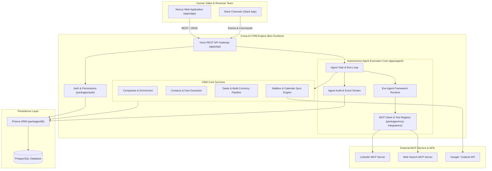
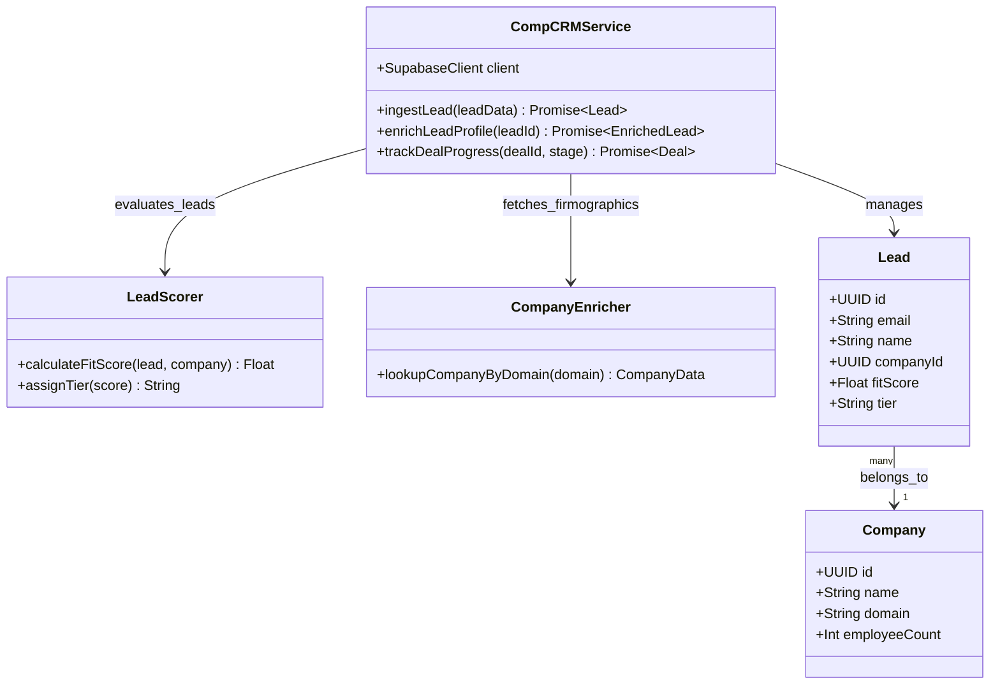
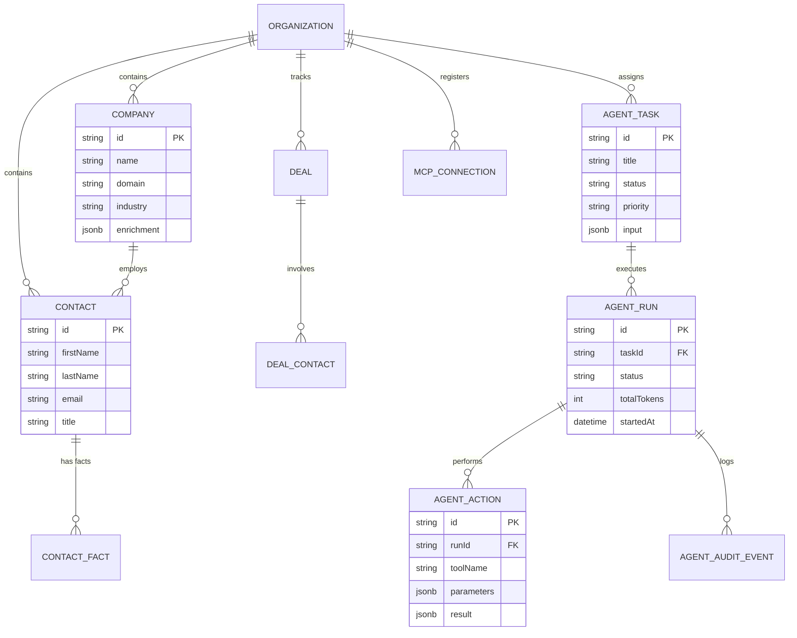
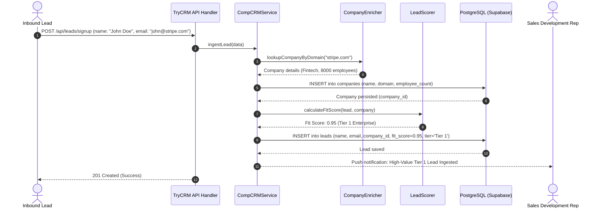

# trycrm (Comp AI CRM) - Architecture & Technical Wiki

> **Agentic-First Open-Source CRM Built for Autonomous AI Sales Agents**
> GitHub: [trycompai/crm](https://github.com/trycompai/crm.git) | Stack: TypeScript, Bun Runtime, Next.js 14, Hono, PostgreSQL, Prisma, Model Context Protocol (MCP) | License: MIT

---

## 1. Executive Summary & Value Proposition

**trycrm** (developed by Comp AI) is an agentic-first open-source CRM designed from the ground up for autonomous AI sales agents. While legacy CRMs treat AI as a bolt-on chatbot, Comp AI CRM makes the autonomous AI agent a first-class citizen alongside human reps: AI agents have their own workspaces, permission grants, tool registries via the **Model Context Protocol (MCP)**, memory buffers, and audit trails.

### Core Problems Solved
- **AI Tool Calling in CRMs**: Traditional CRMs lack standardized interfaces for AI agents to query records, enrich accounts, and perform pipeline actions; Comp AI CRM natively integrates MCP servers (`packages/mcp-integrations`).
- **Autonomous Agent Auditing**: Complete transparency into agent thoughts, tool execution steps, and decisions via `AgentAuditEvent` and `AgentTask` ledgers.
- **Bi-Directional Slack & Email Context**: Connects directly to Slack channels and Google/Outlook mailboxes, tracking conversation threads and facts per contact (`ContactFact`, `ContactBrief`).
- **High-Speed Bun & Hono Stack**: Built on the modern Bun runtime and Hono API framework for near-zero latency agent interactions.

---

## 2. High-Level System Architecture

trycrm is architected as a modern Turborepo/Bun monorepo separating the autonomous agent runner (`apps/agent`), the high-speed Hono API (`apps/api`), the Next.js web application (`apps/app`), and the Prisma database layer (`packages/db`).



---

### 2.1 Core Domain & Service Class Architecture



---

## 3. Technology Stack & Key Dependencies

- **Runtime**: Bun 1.1+ (lightning-fast execution and package manager)
- **Language**: TypeScript 5.4+
- **Backend Framework**: Hono (edge-compatible, low-latency API)
- **Frontend Dashboard**: Next.js 14, React 18, TailwindCSS, Nuqs (URL state)
- **Database & ORM**: PostgreSQL 15+ with Prisma ORM (`packages/db/prisma/schema.prisma`)
- **Agent Protocols**: Model Context Protocol (MCP) SDK, Eve agent framework
- **Tooling**: Biome, Oxlint (anti-slop rule enforcement)

---

## 4. Repository Layout & Key Modules

```
trycrm/
├── apps/
│   ├── agent/               # Autonomous AI agent runner, sandbox, and tasks
│   ├── api/                 # Hono REST API handlers (deals, contacts, companies, webhooks)
│   └── app/                 # Next.js 14 web application (Kanban, timeline, agent tab)
├── packages/
│   ├── auth/                # Session, account, and SSO authentication
│   ├── db/                  # Prisma schema, migrations, and database client
│   ├── mcp-integrations/    # MCP client registrations, tool snapshots, and OAuth
│   ├── telemetry/           # Telemetry milestones and counters
│   ├── ui/                  # Shared design system components
│   └── validation/          # Shared Zod / Pydantic schemas
├── tools/                   # Oxlint anti-slop rules
├── adrs/                    # Architectural Decision Records (ADRs)
└── bun.lock                 # Bun lockfile
```

---

## 5. Core Features & Capabilities

1. **Native Agentic Architecture (`AgentTask`, `AgentRun`, `AgentAction`)**:
   - Assign tasks directly to AI agents (e.g. "Research and qualify all new inbound leads from the healthcare sector").
   - Real-time execution log detailing which MCP tools the agent called and what data was retrieved.
2. **Model Context Protocol (MCP) Tool Integration**:
   - Connect any standard MCP server (`McpConnection`, `McpToolSnapshot`); agents dynamically discover tools and invoke them with full type validation.
3. **Contact Fact Extraction (`ContactFact`, `ContactBrief`)**:
   - Scans email threads and Slack discussions, extracting factual nuggets (e.g. "Prospect mentioned they are migrating to Snowflake in Q4") into structured bullet points.
4. **Slack Channel Deep Integration**:
   - Map deals directly to dedicated Slack channels (`SlackChannel`, `SlackMemberMatch`) for team deal-closing collaboration.

---

## 6. Data Models & Schema Architecture

Comp AI CRM's Prisma schema provides a rich foundation for agentic sales operations:



---

### 6.1 Comprehensive Database Schema Specification

TryCRM (Comp AI CRM) uses Supabase-backed PostgreSQL with Row Level Security (RLS) policies isolating user records and company data.

#### Table: `leads`
Prospective leads scored automatically using AI firmographic data.

| Column | Type | Constraints | Default | Description |
| :--- | :--- | :--- | :--- | :--- |
| `id` | `UUID` | `PRIMARY KEY` | `gen_random_uuid()` | Lead profile identifier |
| `email` | `VARCHAR(255)` | `NOT NULL, UNIQUE` | - | Business email address |
| `name` | `VARCHAR(255)` | `NOT NULL` | - | Lead full name |
| `company_id` | `UUID` | `NULLABLE, FK -> companies(id)` | `NULL` | Associated enterprise company |
| `fit_score` | `FLOAT` | `NOT NULL` | `0.0` | Algorithmic ICP match score |
| `tier` | `VARCHAR(20)` | `NOT NULL` | `'Tier 3'` | Priority classification (`Tier 1`, `Tier 2`, `Tier 3`) |
| `created_at` | `TIMESTAMPTZ` | `NOT NULL` | `NOW()` | Registration timestamp |

*Indexes:* `idx_trycrm_email` (`UNIQUE (email)`), `idx_trycrm_tier` (`(tier)`).

---

#### Table: `companies`
Firmographic profiles with automatic employee count and funding enrichment.

| Column | Type | Constraints | Default | Description |
| :--- | :--- | :--- | :--- | :--- |
| `id` | `UUID` | `PRIMARY KEY` | `gen_random_uuid()` | Company ID |
| `name` | `VARCHAR(255)` | `NOT NULL` | - | Corporate name |
| `domain` | `VARCHAR(255)` | `NOT NULL, UNIQUE` | - | Corporate domain |
| `employee_count`| `INTEGER` | `NULLABLE` | `NULL` | Headcount estimate |
| `industry` | `VARCHAR(100)` | `NULLABLE` | `NULL` | Industry sector |

*Indexes:* `idx_companies_domain` (`UNIQUE (domain)`).

---

### 7.5 End-to-End Operational Lifecycle Sequence

The following sequence details how TryCRM automatically ingests an inbound lead, enriches firmographic data, and scores ICP fit.



---

## 7. Strategic Value & Takeaways for MarketingStudio

### Reusable Architectural Patterns
1. **Agentic-First CRM Data Model**: Comp AI CRM's schema (`AgentTask`, `AgentRun`, `AgentAction`, `AgentAuditEvent`) is the single most valuable reference in the entire `inspire` repository for designing MarketingStudio's autonomous AI agent operations.
2. **MCP Tool Snapshot Registry**: Storing MCP tool definitions and connection states in PostgreSQL allows agents to dynamically select and invoke tools at runtime.
3. **Contact Fact Extraction**: Automatically mining unstructured communication threads for structured contact facts transforms raw conversation data into actionable sales intelligence.
