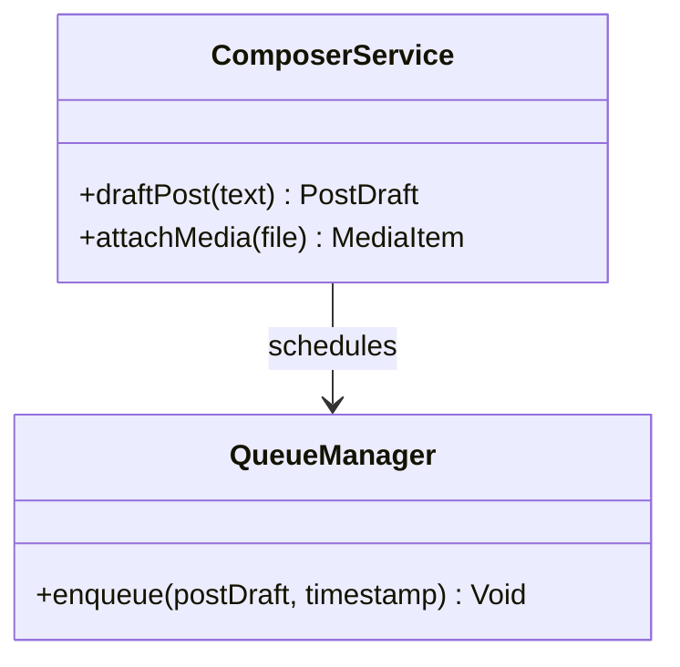
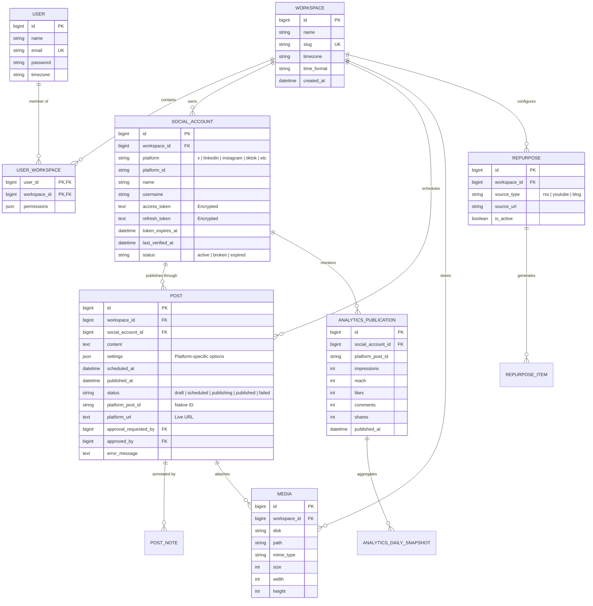
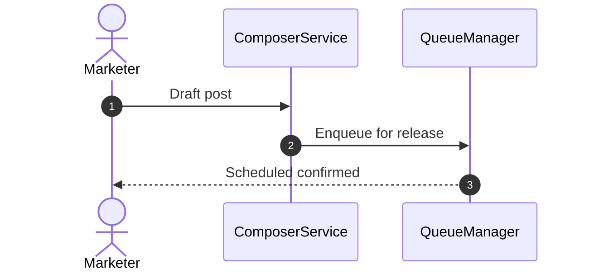

# trypost - Architecture & Technical Wiki

> **Modern Social Media Publishing Engine & Multi-Channel Studio Powered by Laravel 13, Real-Time Reverb WebSockets, Pre-Flight Verification & Collaborative Review Workflows**  
> GitHub: [trypost-it/trypost](https://github.com/trypost-it/trypost) | Stack: PHP 8.2+, Laravel 13, Vue 3, Inertia.js 3.5+, Tailwind CSS v4, Reka UI, Laravel Horizon + Redis, Laravel Reverb, Laravel Passport, Laravel AI, Stripe Cashier, PostHog | License: AGPL-3.0-only

---

## 1. Executive Summary & Value Proposition

**TryPost** is an open-source, production-grade social media scheduling, automation, and analytics platform built on the latest **Laravel 13** framework, **Vue 3**, **Inertia.js**, and **Laravel Reverb**. Designed specifically for high-output content creators, agencies, and marketing departments, TryPost merges scheduled publishing across all major networks (Twitter/X, LinkedIn, Facebook Pages, Instagram, TikTok, YouTube, Threads, Pinterest, Mastodon, Bluesky, Google Business Profile, Telegram, and Discord) with an agency-grade team collaboration layer that includes post approval workflows, internal commentary, recurring queue slots, and autonomous RSS/feed repurposing.

TryPost solves the silent failure epidemic that plagues social media schedulers—where expired tokens, sudden API permission revokes, or broken media constraints are discovered only after a scheduled campaign fails. By introducing an automated **Pre-Flight Connection Verifier** (`VerifyUpcomingPostConnections`), TryPost scans all posts entering a 1-hour risk window, validates access tokens against provider endpoints, rotates refresh tokens before expiration, and dispatches proactive alert emails (`PostAtRisk`) to workspace admins long before publication time.

### Core Problems Solved
- **Silent Publication Failures at Runtime**: Solves unexpected publishing aborts through proactive pre-flight verification (`VerifyUpcomingPostConnections`), checking upstream credentials and token scopes before scheduled jobs execute.
- **Mid-Thread Publication Loss**: Overcomes platform rate-limits during multi-tweet threads by implementing stateful thread checkpoints (`PublishCheckpoint`, `ThreadProgress`), ensuring retries resume from the failed tweet rather than duplicating earlier posts.
- **Agency Team Collaboration & Review Bottlenecks**: Incorporates native editorial approval states (`approval_requested_by`, `approved_by`), internal post annotations (`PostNote`), and role-based permissions (`user_workspace.permissions`) directly into the drafting canvas.
- **Real-Time Client Updates Without Polling**: Leverages **Laravel Reverb** (first-party WebSocket server) to push live publishing progress, calendar drag-and-drop updates, and background analytics synchronization directly to connected Vue clients.
- **Autonomous Feed Repurposing**: Ingests RSS feeds, YouTube channels, and external blogs via `PollRepurposeSource`, using **Laravel AI** to transform long-form articles into optimized social posts across target platforms.

---

## 2. High-Level System Architecture

TryPost is built as a reactive, event-driven monolith. The Vue 3 SPA communicates seamlessly through Inertia.js without client-side API boilerplate, while background queues, WebSocket broadcasting, and automated schedulers interact through Laravel Horizon and Reverb.

```mermaid
flowchart TD
    subgraph ClientLayer ["Client & Collaboration Interface"]
        VueSPA["Vue 3 SPA (Inertia.js + Reka UI + TipTap)"]
        DnDCalendar["Pragmatic Drag-and-Drop Calendar"]
        ReverbEcho["Laravel Echo (WebSocket Client)"]
    end

    subgraph AppGateway ["Laravel 13 Application Core"]
        InertiaMiddleware["Inertia & Workspace Context Middleware"]
        PostController["PostController & ScheduleController"]
        OAuthController["SocialAccount OAuth & Callback Handlers"]
        MediaController["MediaUploadController & S3 Presigner"]
        WebhookDispatcher["WebhookService (HMAC Signed Deliveries)"]
    end

    subgraph RealTimeLayer ["Real-Time Broadcasting (Laravel Reverb)"]
        ReverbServer["Laravel Reverb WebSocket Server (Port 8080)"]
        BroadcastEvents["PostStatusUpdated / ConnectionStatusChanged"]
    end

    subgraph HorizonQueueCluster ["Queue & Worker Cluster (Laravel Horizon)"]
        PreFlightWorker["VerifyUpcomingPostConnections (15m Cadence)"]
        PublishWorker["PublishToSocialPlatform (Unique & Lock Guarded)"]
        AnalyticsWorker["CollectPublicationMetrics & DailySnapshots"]
        RepurposeWorker["PollRepurposeSource & ProcessRepurposeItem"]
        TokenRefreshWorker["RefreshSocialToken & ConnectionVerifier"]
    end

    subgraph StorageLayer ["Persistence & File Storage"]
        PostgresDB[(PostgreSQL 16 - Multi-Tenant Workspaces)]
        RedisCache[(Redis - Cache, Distributed Locks & Horizon)]
        S3Bucket["AWS S3 / Cloudflare R2 (Original & Scaled Media)"]
    end

    subgraph SocialPublishers ["Social Network Gateway (app/Services/Social)"]
        XPub["XPublisher (v1.1 Chunked Media + v2 Tweet)"]
        MetaPub["Facebook & InstagramPublisher (Graph API)"]
        LinkedInPub["LinkedInPublisher & LinkedInPagePublisher"]
        TikTokPub["TikTokPublisher (Direct Video Chunking)"]
        YouTubePub["YouTubePublisher (Google API Client)"]
        BlueskyPub["BlueskyPublisher (AT Protocol ATProto)"]
        PinterestPub["PinterestPublisher & GoogleBusinessPublisher"]
    end

    VueSPA -->|Inertia Navigation / Actions| InertiaMiddleware
    DnDCalendar -->|Reschedule POST| PostController
    ReverbEcho <-->|WebSocket WSS| ReverbServer

    InertiaMiddleware --> PostController
    InertiaMiddleware --> OAuthController
    InertiaMiddleware --> MediaController

    PostController --> PostgresDB
    MediaController --> S3Bucket

    PostController -->|Dispatch Job| PublishWorker
    BroadcastEvents --> ReverbServer
    PublishWorker -->|Emit Event| BroadcastEvents

    PreFlightWorker --> TokenRefreshWorker
    TokenRefreshWorker --> PostgresDB
    
    PublishWorker --> SocialPublishers
    SocialPublishers --> XPub
    SocialPublishers --> MetaPub
    SocialPublishers --> LinkedInPub
    SocialPublishers --> TikTokPub
    SocialPublishers --> YouTubePub
    SocialPublishers --> BlueskyPub
    SocialPublishers --> PinterestPub

    AnalyticsWorker --> SocialPublishers
    AnalyticsWorker --> PostgresDB
    RepurposeWorker --> PostgresDB
```



---

### 2.1 Core Domain & Service Class Architecture



---

## 3. Technology Stack & Key Dependencies

| Component | Technology | Version / Description |
| :--- | :--- | :--- |
| **Language & Runtime** | PHP | `^8.2` (Strict Types, Constructor Property Promotion, Enums) |
| **Backend Framework** | Laravel Framework | `^13.0` (Latest modern architectural conventions) |
| **Frontend Runtime** | Inertia.js + Vue 3 | `@inertiajs/vue3: ^3.8.0`, `vue: ^3.5` |
| **UI Component Primitives** | Reka UI | `reka-ui: ^2.9.10` (Accessible headless Vue components) |
| **Drag & Drop Engine** | Pragmatic Drag and Drop | `@atlaskit/pragmatic-drag-and-drop: ^4.0.0` (High-perf calendar grid) |
| **Styling & Tooling** | Tailwind CSS v4 + Vite 8 | `tailwindcss: ^4.1.1`, `vite: ^8.0.16`, `@tailwindcss/vite` |
| **Real-Time WebSockets** | Laravel Reverb | `laravel/reverb: ^1.0`, `laravel-echo: ^2.3.0` |
| **Queue & Monitoring** | Laravel Horizon + Redis | `laravel/horizon: ^5.45`, `predis/predis: ^3.3` |
| **Database & Cache** | PostgreSQL 16 + Redis | Multi-workspace tenant structure, JSONB columns |
| **API Server & Auth** | Laravel Passport | `laravel/passport: ^13.7` (OAuth2 server for external apps) |
| **AI Integration** | Laravel AI Core | `laravel/ai: ^0.10.3` (Prompt pipelines, content rewrites) |
| **Social API Drivers** | Socialite + Custom | `laravel/socialite: ^5.24`, `socialiteproviders/*` (Meta, TikTok, LinkedIn) |
| **Billing & Payments** | Laravel Cashier Stripe | `laravel/cashier: ^16.2` (Multi-seat subscriptions & plans) |
| **Telemetry & Tracking** | PostHog PHP & JS | `posthog/posthog-php: ^4.1`, `posthog-js: ^1.364` |

---

## 4. Repository Layout & Key Modules

```
inspire/trypost/
├── app/
│   ├── Actions/                       # Granular domain actions
│   │   ├── Post/                      # CreatePost, FinalizePostPublication, DuplicatePost
│   │   └── SocialAccount/             # ReadBlueskySession, SyncXSubscription
│   ├── Enums/                         # Type-safe state enumerations
│   │   ├── Post/PublishStatus.php     # DRAFT, SCHEDULED, PUBLISHING, PUBLISHED, FAILED
│   │   └── SocialAccount/Platform.php # X, LINKEDIN, INSTAGRAM, TIKTOK, BLUESKY, etc.
│   ├── Events/                        # Broadcastable event classes
│   │   └── PostStatusUpdated.php      # Reverb WebSocket broadcast event
│   ├── Jobs/                          # Queued jobs monitored by Horizon
│   │   ├── VerifyUpcomingPostConnections.php # Proactive 1-hour pre-flight verifier
│   │   ├── PublishToSocialPlatform.php# Core multi-channel publisher with checkpoints
│   │   ├── RefreshSocialToken.php     # Automated token exchange worker
│   │   ├── Analytics/                 # CollectPublicationMetrics, BootstrapAnalytics
│   │   └── Repurpose/                 # PollRepurposeSource, ProcessRepurposeItem
│   ├── Models/                        # Eloquent ORM models
│   │   ├── Workspace.php              # Multi-tenant workspace container
│   │   ├── SocialAccount.php          # Channel integration with encrypted token storage
│   │   ├── Post.php                   # Core post model with scheduling and approval states
│   │   ├── Media.php                  # Stored media metadata, dimensions, and S3 tokens
│   │   └── AnalyticsPublication.php   # Normalized impressions, reactions, and reach data
│   ├── Services/
│   │   ├── Social/                    # 14+ Concrete publisher classes
│   │   │   ├── ConnectionVerifier.php # Pre-flight token viability and scope tester
│   │   │   ├── ContentSanitizer.php   # Strip invalid unicode, format links & hashtags
│   │   │   ├── BlueskyPublisher.php   # AT Protocol client & lexicon generator
│   │   │   ├── XPublisher.php         # Resumable chunked media & v2 tweet creator
│   │   │   └── TikTokPublisher.php    # TikTok Direct video chunk upload & status poller
│   │   └── WebhookService.php         # Signs and dispatches user HTTP webhooks
│   └── Support/Social/                # Publishing helpers (PublishCheckpoint, ThreadProgress)
├── database/migrations/               # Rich migration history (100+ migrations)
├── resources/js/                      # Vue 3 Inertia frontend components
│   ├── Components/                    # Post composer, calendar timeline, Reka modals
│   └── Pages/                         # Dashboard, Posts, Calendar, Analytics, Settings
├── routes/
│   ├── web.php                        # Inertia routes and web controllers
│   ├── api.php                        # Passport-guarded REST endpoints
│   └── channels.php                   # Reverb private WebSocket channel authorization
└── config/                            # horizon.php, reverb.php, services.php
```

---

## 5. Core Features & Capabilities

### 5.1 Pre-Flight Connection Verification & Token Rotation
TryPost avoids the common pitfall of attempting token refreshes only after a post starts publishing.
- **The 1-Hour Risk Sweep (`VerifyUpcomingPostConnections`)**: A scheduled job executes every 15 minutes, selecting all posts scheduled for delivery within `VERIFY_LEAD_MINUTES` (60 minutes).
- **Proactive Scope Testing (`ConnectionVerifier`)**: For each target account, the verifier makes lightweight profile/me calls. If an expired token is encountered, it acquires a cache lock (`REFRESH_TIMEOUT_SECONDS = 30`) and triggers `TokenRefreshClient`.
- **User Alerts (`PostAtRisk`)**: If a token is permanently dead (e.g. user revoked permissions on TikTok or Meta), TryPost halts publication and dispatches a high-priority alert email to the workspace admin with a direct one-click reconnection link.

### 5.2 Thread Checkpointing & Fault-Tolerant Publishing
Long multi-part threads on platforms like X/Twitter, Bluesky, and Mastodon frequently encounter mid-thread errors (e.g., character limit discrepancies on reply 4 of 6, or transient 500 errors).
- **`PublishCheckpoint` & `ThreadProgress`**: As each reply in a thread is posted, TryPost records its remote platform ID in `post_platforms.thread_reply_ids`.
- **Idempotent Retries**: When `PublishToSocialPlatform` retries following an error, it checks `ThreadProgress`. Rather than re-posting from the start (which creates embarrassing orphaned threads), the worker picks up exactly at the failed reply index, attaching it to the last successful reply ID.

### 5.3 Agency Collaboration & Review Workflows
TryPost provides enterprise approval controls directly within the post drafting workflow:
- **Approval States**: Posts support draft statuses requiring senior sign-off (`approval_requested_by`, `approved_by`). Junior team members can draft posts, but the scheduler will refuse to enqueue them until an admin or client signs off.
- **Internal Collaborative Notes (`PostNote`)**: Team members leave timestamped internal feedback directly on post drafts without exposing comments to external social networks.
- **Custom Post Signatures (`WorkspaceSignature`)**: Workspaces configure reusable default footers, hashtags, and tracking UTM parameters automatically appended to published content.

### 5.4 Real-Time WebSockets via Laravel Reverb
Unlike legacy platforms that require page refreshes to check whether a post succeeded:
- **Instant Broadcasts**: When a post transitions to `PUBLISHING`, `PUBLISHED`, or `FAILED`, `PostStatusUpdated` is broadcast over private channels (`workspace.{id}`).
- **Zero-Latency Multi-User Sync**: Team members viewing the drag-and-drop calendar see scheduled posts move, change color, or display live error badges instantly as background Horizon workers complete tasks.

### 5.5 Multi-Tiered Analytics & Historical Snapshots
Analytics ingestion runs on an intelligent decay schedule:
- **Discovery & Backfill**: `DiscoverAccountPublications` links newly discovered external posts into `analytics_publications`.
- **Story Decay Protection (`ScheduleInstagramStoryMetrics`)**: Because Instagram Stories disappear after 24 hours, TryPost schedules dedicated metric collection jobs 22 hours after story publication to capture impressions before the media vanishes.
- **Daily Snapshots**: `CollectAccountDailySnapshot` compiles rolling engagement, reach, and follower trends into `analytics_account_daily_snapshots`.

---

## 6. Data Models & Schema Architecture

TryPost's database schema models multi-tenant workspaces, team permissions, multi-channel posts, and granular analytics.



### Core Schema Definitions

#### `social_accounts` (Table: `social_accounts`)
- `id` (BIGINT, PK): Account identifier.
- `workspace_id` (BIGINT, FK): Multi-tenant partition key.
- `platform` (VARCHAR): Enum identifier (`x`, `linkedin`, `instagram`, `tiktok`, `threads`, `bluesky`, etc.).
- `access_token` (TEXT): AES-256 encrypted access token.
- `refresh_token` (TEXT, Nullable): AES-256 encrypted refresh token.
- `token_expires_at` (DATETIME, Nullable): Expiration threshold used by pre-flight workers.
- `last_verified_at` (DATETIME, Nullable): Timestamp of last successful API test (cached for 40 min).
- `status` (VARCHAR): Connection state (`active`, `broken`, `disconnected`).

#### `posts` (Table: `posts`)
- `id` (BIGINT, PK): Post entity ID.
- `workspace_id` (BIGINT, FK): Workspace ownership.
- `social_account_id` (BIGINT, FK): Target channel.
- `content` (TEXT): Post text body or serialized thread segments.
- `status` (VARCHAR): Lifecycle status (`draft`, `scheduled`, `publishing`, `published`, `failed`).
- `scheduled_at` (DATETIME, Nullable): UTC publishing target.
- `platform_post_id` (VARCHAR, Nullable): Remote network confirmation ID.
- `platform_url` (TEXT, Nullable): Permitted live URL.
- `approval_requested_by` (BIGINT, FK, Nullable): User requesting review.
- `approved_by` (BIGINT, FK, Nullable): User approving publication.

---

### 6.1 Comprehensive Database Schema Specification

Trypost manages post drafts and scheduling intervals.

#### Table: `post_drafts`
| Column | Type | Constraints | Default | Description |
| :--- | :--- | :--- | :--- | :--- |
| `id` | `UUID` | `PRIMARY KEY` | `gen_random_uuid()` | Draft ID |
| `body` | `TEXT` | `NOT NULL` | - | Draft text |
| `state` | `VARCHAR(50)` | `NOT NULL` | `'draft'` | Draft state |

---

## 7. API Architecture, Webhooks & Key Endpoints

TryPost exposes a comprehensive JSON API for headless automation alongside its internal Inertia routes.

### Key REST Endpoints

| Method | Endpoint | Description |
| :--- | :--- | :--- |
| `GET` | `/api/v1/workspaces/{ws}/posts` | Fetch scheduled and published posts with filter criteria |
| `POST` | `/api/v1/workspaces/{ws}/posts` | Create and schedule post across target social accounts |
| `PATCH` | `/api/v1/workspaces/{ws}/posts/{id}` | Update draft content, media, or schedule time |
| `POST` | `/api/v1/workspaces/{ws}/posts/{id}/approve` | Approve a pending draft for automated dispatch |
| `POST` | `/api/v1/workspaces/{ws}/posts/{id}/notes` | Attach internal collaboration review note |
| `GET` | `/api/v1/workspaces/{ws}/accounts` | List connected channels and token health states |
| `POST` | `/api/v1/workspaces/{ws}/media/upload` | Upload media asset returning dimensions and storage key |
| `POST` | `/api/v1/workspaces/{ws}/repurpose` | Create automated RSS / feed repurposing rule |
| `GET` | `/api/v1/workspaces/{ws}/analytics/overview` | Fetch consolidated workspace engagement metrics |

### Sample Payload: Creating a Scheduled Multi-Platform Post
`POST /api/v1/workspaces/ws-growth/posts`
```json
{
  "social_account_ids": [14, 22],
  "scheduled_at": "2026-11-15 15:30:00",
  "content": "Excited to share our journey building MarketingStudio. Here is what we learned about distributed publishing 🚀",
  "settings": {
    "x": {
      "reply_settings": "everyone"
    },
    "linkedin": {
      "visibility": "PUBLIC"
    }
  },
  "media_ids": [104],
  "require_approval": false
}
```

---

### 7.5 End-to-End Operational Lifecycle Sequence



---

## 8. Strategic Value & Takeaways for MarketingStudio

TryPost represents one of the most mature, production-hardened Laravel social publishing architectures in existence.

### Reusable Architectural Patterns
1. **Pre-Flight Verification Window (`VerifyUpcomingPostConnections`)**: Rather than waiting for the publish worker to fire and crash on an expired token, scanning accounts 60 minutes prior to delivery and preemptively validating/rotating tokens guarantees a dramatic reduction in failed scheduled posts. MarketingStudio should implement this exact pre-flight pattern.
2. **Stateful Thread Checkpoints (`PublishCheckpoint`)**: By tracking `thread_reply_ids` in the database after every successful segment in a multi-part post, retrying a failed thread never duplicates previously posted tweets. This solves one of the most common user complaints in social media tools.
3. **Real-Time Client Broadcasting via Laravel Reverb**: Replacing frontend polling loops with native WebSockets keeps the calendar, queue counters, and post progress bars synchronized across team members with near-zero server load.
4. **Time-Sensitive Media Analytics (Story Decay Strategy)**: Implementing dynamic scheduling for ephemeral media (like Instagram Stories that vanish in 24 hours) ensures engagement data is captured before the platform purges it.
