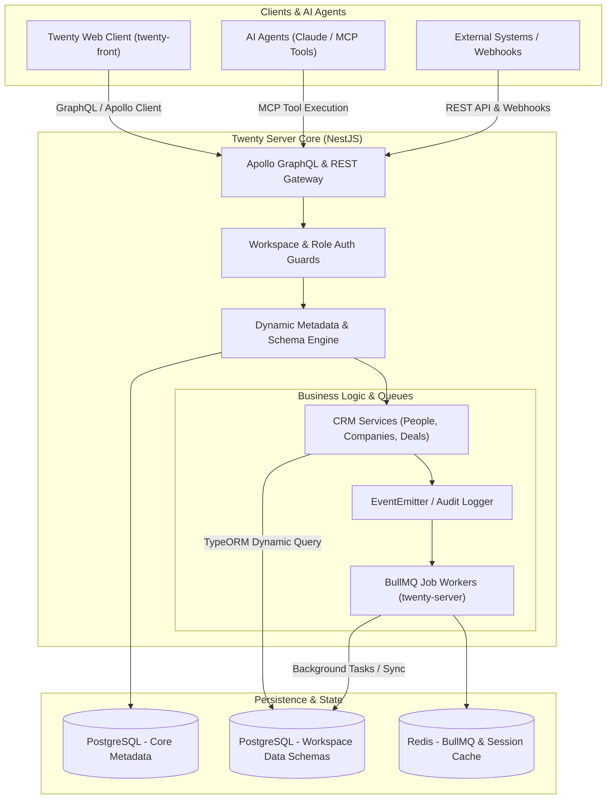
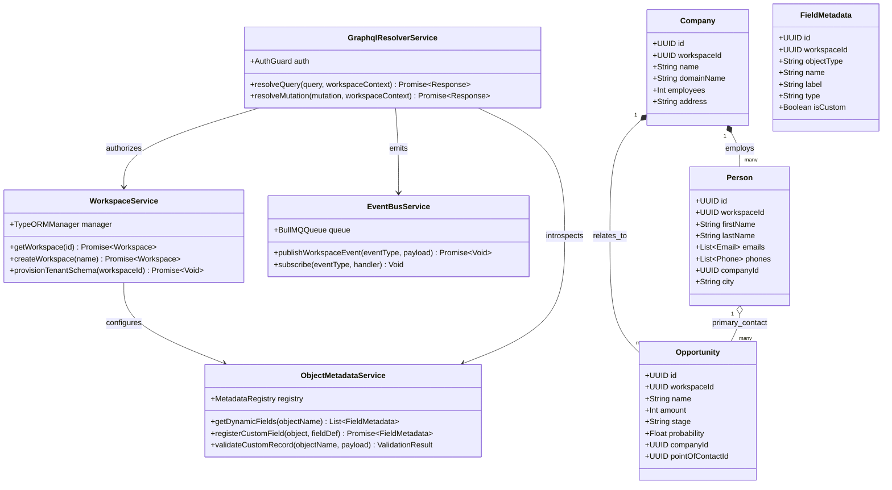
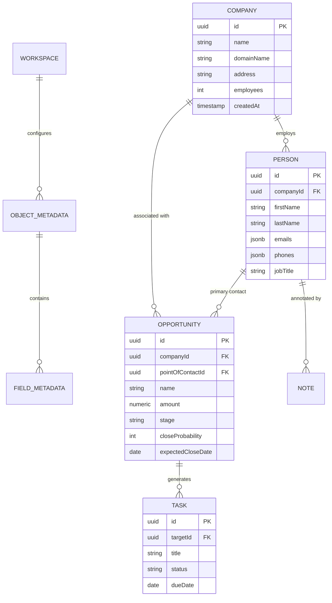
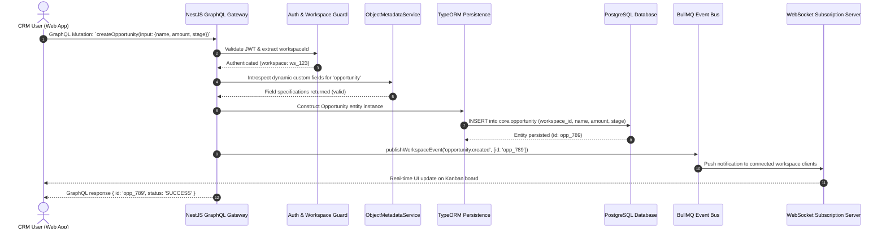

# twenty - Architecture & Technical Wiki

> **Next-Generation Open-Source CRM with Dynamic Metadata Schema & AI Agent Skills**
> GitHub: [twentyhq/twenty](https://github.com/twentyhq/twenty.git) | Stack: TypeScript, NestJS, React, PostgreSQL, TypeORM, BullMQ | License: AGPL-3.0

---

## 1. Executive Summary & Value Proposition

**twenty** is a modern, extensible open-source CRM developed as a full-featured alternative to Salesforce and HubSpot. Architected natively in TypeScript with an Nx/Yarn monorepo, Twenty introduces a revolutionary **metadata-driven object model** that allows end-users and developers to define custom entities, relations, fields, and views dynamically at runtime without executing manual database migrations.

### Core Problems Solved
- **Rigid CRM Schemas**: Traditional CRMs force businesses into fixed tables or clunky custom fields; Twenty dynamically provisions workspace-scoped PostgreSQL schemas for custom objects.
- **Developer Extensibility**: Provides auto-generated GraphQL and REST APIs for every custom object, plus a strongly typed SDK and CLI (`packages/twenty-cli`).
- **Native AI Agent Integration**: Built-in agent skills (`packages/twenty-agent-skills`, `packages/twenty-claude-skills`) enabling autonomous AI agents to query records, create leads, and trigger sales actions via Model Context Protocol (MCP).
- **High-Velocity UI/UX**: Keyboard-first interface built with modern React, custom hooks, and TailwindCSS inspired by Linear and Notion.

---

## 2. High-Level System Architecture

Twenty is structured as a decoupled monorepo where `twenty-server` handles GraphQL/REST API execution and metadata orchestration, and `twenty-front` delivers an optimistic, cached client interface.



---

### 2.1 Core Domain & Service Class Architecture



---

## 3. Technology Stack & Key Dependencies

- **Language & Runtime**: TypeScript 5.4+, Node.js 20+
- **Backend Framework**: NestJS 10+ (modular dependency injection)
- **API Engine**: Apollo Server (GraphQL code-first and dynamic metadata schema), NestJS REST controllers
- **Database & ORM**: PostgreSQL 15+, TypeORM with dynamic schema isolation
- **Queue & Async**: BullMQ with Redis
- **Frontend Framework**: React 18, Vite, Recoil (state management), Emotion / TailwindCSS
- **Monorepo Architecture**: Yarn 4 Workspaces + Nx build caching

---

## 4. Repository Layout & Key Modules

```
twenty/
├── packages/
│   ├── twenty-agent-skills/     # Model Context Protocol (MCP) server & agent tools
│   ├── twenty-apps/             # Official app templates & extensions
│   ├── twenty-cli/              # CLI for scaffolding apps and managing environments
│   ├── twenty-client-sdk/       # Auto-generated typed TypeScript SDK
│   ├── twenty-docker/           # Production Dockerfile and docker-compose
│   ├── twenty-emails/           # React Email templates for transactional mail
│   ├── twenty-front/            # React Single-Page Application (Linear-style UI)
│   ├── twenty-server/           # NestJS core application
│   │   ├── src/
│   │   │   ├── engine/          # Dynamic metadata engine, schema migrations, core
│   │   │   ├── modules/         # Standard CRM modules (Person, Company, Opportunity)
│   │   │   └── queue/           # BullMQ workers for webhooks, email sync, and cron
│   ├── twenty-shared/           # Shared TypeScript interfaces and utility types
│   └── twenty-ui/               # Reusable design system components
├── package.json
└── nx.json
```

---

## 5. Core Features & Capabilities

1. **Dynamic Custom Object Engine**:
   - Create new business entities (e.g. `Vehicle`, `Property`, `Subscription`) in the UI.
   - Automatically generates database columns, indexes, GraphQL mutations/queries, and views.
2. **Pipelines & Kanban Stages**:
   - Customizable sales funnels with drag-and-drop opportunity tracking, probability weights, and expected revenue totals.
3. **Bi-Directional Email & Calendar Sync**:
   - Connect Google Workspace and Microsoft 365 to automatically capture emails and calendar events into contact timelines.
4. **AI & MCP Agent Readiness**:
   - Exposes standardized tool calls (`find_person`, `create_opportunity`, `update_task`) enabling autonomous AI agents to act as automated sales reps.

---

## 6. Data Models & Schema Architecture

Twenty maintains a dual-tier database schema:
1. **Core Metadata Schema**: Stores `Workspace`, `User`, `ObjectMetadata`, `FieldMetadata`, `RelationMetadata`.
2. **Workspace Data Schema**: Dedicated PostgreSQL tables generated dynamically for each object:



---

### 6.1 Comprehensive Database Schema Specification

Twenty uses PostgreSQL with a metadata-driven architecture where standard CRM entities and user-defined custom fields are bound to multi-tenant workspace schemas.

#### Table: `core.workspace`
Represents the tenant isolation boundary encompassing users, permissions, custom objects, and billing tiers.

| Column | Type | Constraints | Default | Description |
| :--- | :--- | :--- | :--- | :--- |
| `id` | `UUID` | `PRIMARY KEY` | `gen_random_uuid()` | Unique workspace identifier |
| `name` | `VARCHAR(255)` | `NOT NULL` | - | Commercial name of workspace |
| `subdomain` | `VARCHAR(100)` | `NOT NULL, UNIQUE` | - | Subdomain used for URL routing |
| `logo` | `TEXT` | `NULLABLE` | `NULL` | Organization brand image URL |
| `metadata_version`| `INTEGER` | `NOT NULL` | `1` | Schema version controlling custom field migrations |
| `created_at` | `TIMESTAMPTZ` | `NOT NULL` | `NOW()` | Workspace registration timestamp |
| `updated_at` | `TIMESTAMPTZ` | `NOT NULL` | `NOW()` | Modification timestamp |

*Indexes:* `idx_workspace_subdomain` (`UNIQUE (subdomain)`).

---

#### Table: `core.person`
Standard person entity representing leads, contacts, and prospects.

| Column | Type | Constraints | Default | Description |
| :--- | :--- | :--- | :--- | :--- |
| `id` | `UUID` | `PRIMARY KEY` | `gen_random_uuid()` | Contact record identifier |
| `workspace_id` | `UUID` | `NOT NULL, FK -> core.workspace(id)` | - | Tenant partitioning key |
| `first_name` | `VARCHAR(255)` | `NOT NULL` | `''` | Given name |
| `last_name` | `VARCHAR(255)` | `NOT NULL` | `''` | Family name |
| `emails` | `JSONB` | `NOT NULL` | `'[]'` | Array of email objects (`{ primary: bool, address: str }`) |
| `phones` | `JSONB` | `NOT NULL` | `'[]'` | Array of phone objects (`{ primary: bool, number: str }`) |
| `company_id` | `UUID` | `NULLABLE, FK -> core.company(id)` | `NULL` | Employer company reference |
| `job_title` | `VARCHAR(255)` | `NULLABLE` | `NULL` | Professional job title |
| `city` | `VARCHAR(100)` | `NULLABLE` | `NULL` | Geographic city location |
| `created_at` | `TIMESTAMPTZ` | `NOT NULL` | `NOW()` | Record creation timestamp |

*Indexes:* `idx_person_workspace` (`(workspace_id)`), `idx_person_company` (`(company_id)`), `idx_person_emails` (`USING gin (emails)`).

---

#### Table: `core.opportunity`
Deals and revenue opportunities tracked across custom pipeline stages.

| Column | Type | Constraints | Default | Description |
| :--- | :--- | :--- | :--- | :--- |
| `id` | `UUID` | `PRIMARY KEY` | `gen_random_uuid()` | Opportunity identifier |
| `workspace_id` | `UUID` | `NOT NULL, FK -> core.workspace(id)` | - | Tenant boundary key |
| `name` | `VARCHAR(255)` | `NOT NULL` | - | Opportunity title / deal label |
| `amount` | `NUMERIC(15, 2)`| `NOT NULL` | `0.00` | Commercial value of deal |
| `currency` | `VARCHAR(3)` | `NOT NULL` | `'USD'` | ISO 4217 currency code |
| `stage` | `VARCHAR(100)` | `NOT NULL` | `'PROSPECT'`| Active pipeline stage |
| `close_date` | `DATE` | `NULLABLE` | `NULL` | Expected deal close date |
| `company_id` | `UUID` | `NULLABLE, FK -> core.company(id)` | `NULL` | Linked prospective company |
| `point_of_contact_id`| `UUID` | `NULLABLE, FK -> core.person(id)` | `NULL` | Primary prospect contact |
| `created_at` | `TIMESTAMPTZ` | `NOT NULL` | `NOW()` | Record creation timestamp |

*Indexes:* `idx_opportunity_workspace_stage` (`(workspace_id, stage)`), `idx_opportunity_close_date` (`(close_date)`).

---

### 7.5 End-to-End Operational Lifecycle Sequence

The following sequence details how the GraphQL API resolves a multi-tenant opportunity mutation, executes custom field validation, persists through TypeORM, and broadcasts event updates.



---

## 7. Strategic Value & Takeaways for MarketingStudio

### Reusable Architectural Patterns
1. **Metadata-Driven Object Architecture**: The ultimate architectural blueprint for MarketingStudio's CRM layer. Instead of fixed lead tables, adopt Twenty's `ObjectMetadata` and `FieldMetadata` schema pattern so users can model custom businesses (e.g. real estate listings, healthcare patients, SaaS accounts).
2. **Native MCP Agent Tools**: Port `twenty-agent-skills` patterns to give MarketingStudio's AI agents direct, structured tool calls for managing leads and pipeline stages.
3. **Optimistic React UI**: Emulate `twenty-front`'s keyboard navigation and instantaneous optimistic updates to give marketers an ultra-responsive workflow.
