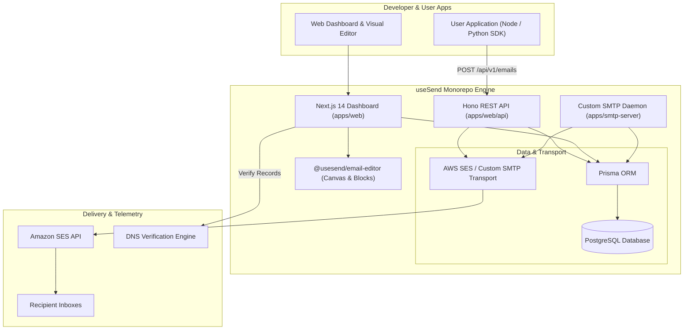
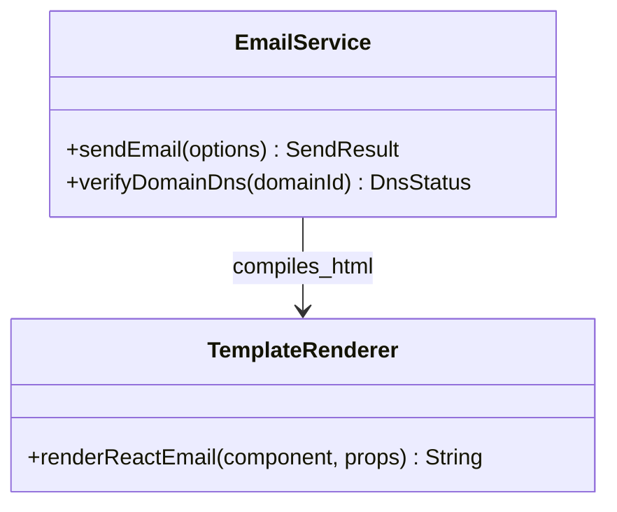
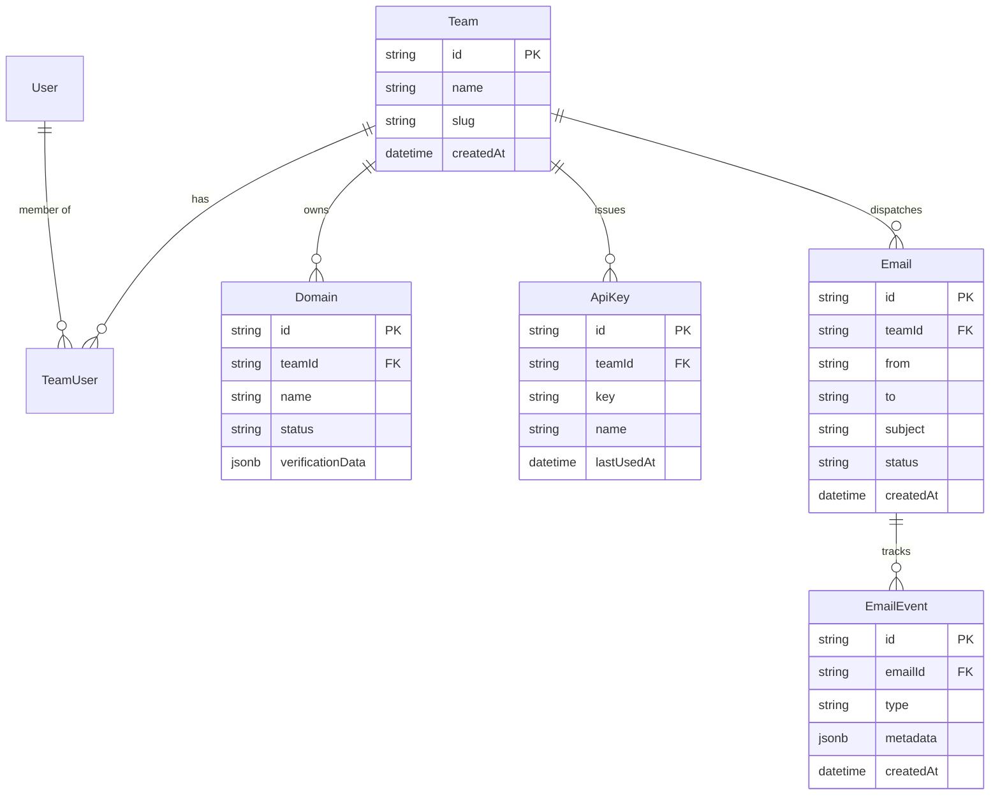
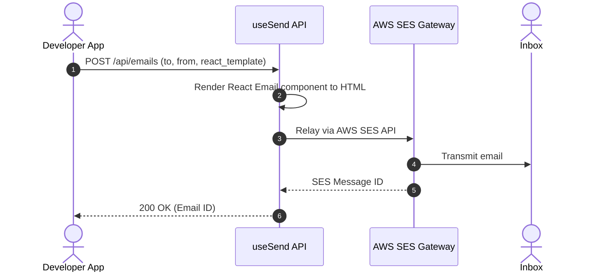

# useSend - Architecture & Technical Wiki

> **Modern Open-Source Transactional Email Platform & Visual Builder**
> GitHub: [usesend/useSend](https://github.com/usesend/useSend.git) | Stack: TypeScript, Next.js 14, Hono, Prisma, PostgreSQL, TailwindCSS | License: MIT

---

## 1. Executive Summary & Value Proposition

**useSend** is a sleek, modern open-source transactional email service designed as an agile, developer-first alternative to Resend. Built with TypeScript across the entire stack, useSend features an interactive drag-and-drop block email editor, automated DNS verification (SPF, DKIM, DMARC, MX), multi-tenant teams, and a ultra-fast sending API powered by Hono and Amazon SES.

### Core Problems Solved
- **Visual + Code Email Composition**: Seamlessly bridge the gap between developers writing React/HTML templates and marketers using visual drag-and-drop canvas blocks.
- **Turnkey Domain Verification**: Automatic DNS record generation and status polling for custom sending domains.
- **Lightweight Infrastructure**: Eliminates the heavy footprint of legacy mail stacks by leveraging serverless-friendly TypeScript frameworks (Hono, Next.js App Router, Prisma).
- **First-Party SDKs**: Includes clean TypeScript and Python SDKs for instant developer onboarding.

---

## 2. High-Level System Architecture

useSend is organized as a Turborepo monorepo featuring a Next.js web application, a lightweight Hono API service for high-throughput transactional requests, and a custom SMTP bridge.



---

### 2.1 Core Domain & Service Class Architecture



---

## 3. Technology Stack & Key Dependencies

- **Language**: TypeScript 5.3+
- **Frontend / Fullstack**: Next.js 14 (App Router), React 18, TailwindCSS, Radix UI
- **API Runtime**: Hono (lightweight, edge-compatible web framework)
- **Database & ORM**: PostgreSQL with Prisma ORM
- **Visual Editor**: `@tiptap/react` and custom block drag-and-drop canvas
- **Package Manager & Monorepo**: pnpm + Turborepo
- **Email Delivery**: `@aws-sdk/client-ses` and Nodemailer

---

## 4. Repository Layout & Key Modules

```
useSend/
├── apps/
│   ├── docs/                # Mintlify / Nextra documentation site
│   ├── marketing/           # Marketing landing page
│   ├── smtp-server/         # Embedded SMTP server accepting standard SMTP auth
│   └── web/                 # Core Next.js 14 web app + Hono API routes
│       ├── app/             # App Router pages (auth, dashboard, domains, emails)
│       ├── prisma/          # schema.prisma database definition
│       └── server/          # Backend services, SES clients, auth tokens
├── packages/
│   ├── email-editor/        # Drag-and-drop block visual template builder
│   ├── python-sdk/          # Official Python client library
│   ├── sdk/                 # Official TypeScript client library
│   └── ui/                  # Shared UI components (Button, Input, Modal)
└── pnpm-workspace.yaml      # Monorepo workspace configuration
```

---

## 5. Core Features & Capabilities

1. **Visual Block Template Builder**:
   - Reusable blocks (Headers, Columns, Buttons, Spacers, Social links, Dynamic merge tags).
   - Real-time mobile and desktop responsive previews.
   - Clean HTML export with inline CSS styles ready for email clients.
2. **Dynamic Domain Verification**:
   - Provides exact CNAME, TXT, and MX records for DKIM, Return-Path, and SPF.
   - One-click verification trigger checking propagation against public DNS servers.
3. **API Key Scopes & Team Collaboration**:
   - Role-based team access (Owner, Admin, Member).
   - Granular API key issuance with read/write permissions per environment.
4. **Interactive Email Analytics**:
   - Real-time timeline of `delivered`, `opened`, `clicked`, `bounced`, and `complained` events.

---

## 6. Data Models & Schema Architecture

useSend's Prisma schema in `apps/web/prisma/schema.prisma` encapsulates teams, domains, and transactional logs:



---

### 6.1 Comprehensive Database Schema Specification

UseSend persists domains, API keys, and outbound email logs in PostgreSQL.

#### Table: `emails`
| Column | Type | Constraints | Default | Description |
| :--- | :--- | :--- | :--- | :--- |
| `id` | `UUID` | `PRIMARY KEY` | `gen_random_uuid()` | Email transaction ID |
| `from` | `VARCHAR(255)` | `NOT NULL` | - | Verified sender address |
| `to` | `VARCHAR(255)` | `NOT NULL` | - | Destination address |
| `subject` | `VARCHAR(255)` | `NOT NULL` | - | Email subject |
| `status` | `VARCHAR(50)` | `NOT NULL` | `'queued'` | State (`queued`, `sent`, `delivered`) |

*Indexes:* `idx_usesend_to` (`(to)`).

---

## 7. API Architecture & Key Endpoints

useSend implements a modern, Resend-compatible REST API:

- `POST /api/v1/emails`: Dispatch an email:
  ```json
  {
    "from": "hello@acme.com",
    "to": "customer@example.com",
    "subject": "Your verification code",
    "html": "<strong>123456</strong>"
  }
  ```
- `GET /api/v1/emails/:id`: Retrieve delivery status and telemetry for a specific message.
- `GET /api/v1/domains`: List verified sending domains and DNS verification tokens.

---

### 7.5 End-to-End Operational Lifecycle Sequence



---

## 8. Strategic Value & Takeaways for MarketingStudio

### Reusable Architectural Patterns
1. **Next.js + Hono Unified App**: useSend shows how to mount high-speed Hono route handlers inside a Next.js App Router project for sub-10ms API responses.
2. **Visual Block Editor Package**: Extract `@usesend/email-editor` patterns directly into MarketingStudio's campaign and template authoring UI.
3. **Resend-Compatible Developer Experience**: Emulate useSend's simple, clean API request and response formats to make MarketingStudio a drop-in replacement for Resend/SendGrid.
