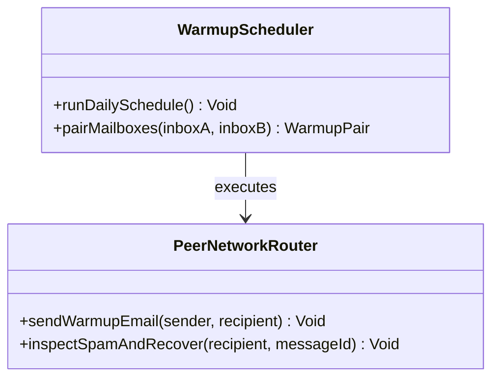
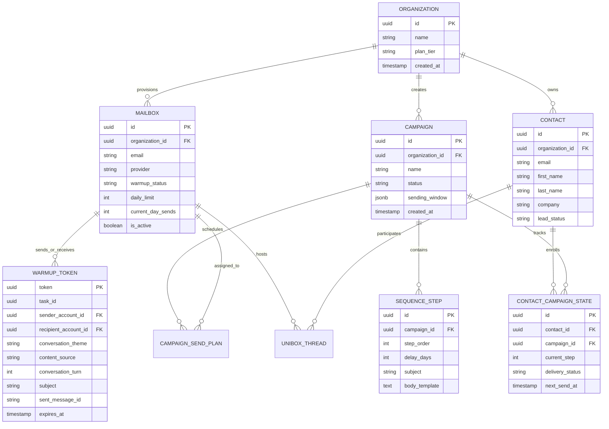
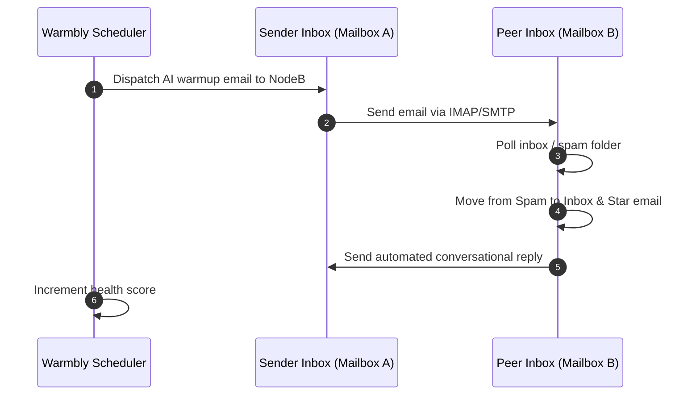

# warmbly - Architecture & Technical Wiki

> **Autonomous Agentic Cold Email Platform, Monitored Peer Warmup Network & Unified Inbox Engine**  
> GitHub: [warmbly/warmbly](https://github.com/warmbly/warmbly) | Stack: Go 1.26 (Gin, pgx/v5, go-redis/v9), NATS JetStream, Apache Kafka, IMAP/SMTP Engines, AWS SES/KMS, React 19 Frontend | License: Apache-2.0

---

## 1. Executive Summary & Value Proposition

**Warmbly** is an open-source, agentic cold email and deliverability platform built in Go and React. Engineered to replace proprietary cold outreach stacks (such as Instantly, Lemlist, and Smartlead), Warmbly runs campaigns directly through the user's existing email accounts (Google Workspace, Microsoft 365, generic SMTP/IMAP) while continuously protecting and improving domain sender reputation through a collaborative, monitored peer-to-peer warmup network.

Unlike basic warm-up tools that rely on throwaway spam accounts, Warmbly establishes a closed-loop network of real, monitored business mailboxes that exchange context-aware, AI-generated multi-turn conversational threads. If a warmup email lands in a recipient's spam folder, the recipient worker autonomously rescues the message, marks it as important, stars it, and moves it to a dedicated folder. This programmatically trains ISP classification algorithms (Gmail Priority Inbox, Microsoft SmartScreen) to treat the sender domain as high-reputation.

### Core Problems Solved
- **Burned Cold Outbound Domains**: Mitigates catastrophic domain blacklisting by executing real peer-to-peer email exchanges, realistic human reading delays, automated spam rescues, and gradual sending ramp-ups.
- **Worker-to-Database Bottlenecks**: Implements a strict control-plane / execution-plane separation where worker nodes communicate exclusively via event streams (NATS JetStream / Kafka), shielding PostgreSQL from connection pool exhaustion.
- **Fragmented Multi-Mailbox Inboxes**: Provides a unified inbox (`unibox`) that synchronizes threads across dozens of disconnected Google Workspace and Outlook mailboxes with sub-second WebSocket updates and AI response drafting.
- **Disconnected Sales CRM Workflows**: Integrates contacts, custom pipeline stages, automated deal updates, and multi-step sequence playbooks with bidirectional syncing to HubSpot, Salesforce, and Clay.
- **AI-Human Collaborative Outreach**: Embeds an official Model Context Protocol (MCP) server and AI agent framework (`ai_inbox_agent.go`), allowing LLMs to review prospect replies, classify sentiment, draft contextual follow-ups, and trigger handoffs.

---

## 2. High-Level System Architecture

Warmbly is architected around a strict decoupled design:
1. **Control Plane (`cmd/backend`, `cmd/consumer`)**: Manages the API gateway, PostgreSQL database, Redis caching/locks, and the central message broker (NATS JetStream or Kafka). All tenant business logic, CRM state, and campaign schedules reside here.
2. **Execution Plane (`cmd/worker`)**: A horizontally scalable fleet of stateless Go workers that consume dispatch jobs from the message bus. Workers execute outbound sends and inbound mailbox synchronizations directly against external email providers (Gmail API, Microsoft Graph API, standard SMTP/IMAP). **Workers never touch the PostgreSQL database directly**, eliminating DB lock contention.

```mermaid
flowchart TD
    subgraph ClientAndIntegrations ["Client Layer & External Ecosystem"]
        WebDashboard["React 19 / TypeScript UI (Vite)"]
        AIAgents["AI Agents (Claude / OpenAI / MCP Clients)"]
        ExternalCRM["CRMs (HubSpot / Salesforce / Webhooks)"]
    end

    subgraph ControlPlane ["Control Plane (Backend Core)"]
        APIGateway["Go Backend API (Gin Engine - cmd/backend)"]
        EventConsumer["Event Consumer & Task Coordinator (cmd/consumer)"]
        AuthService["Auth & WebAuthn / Passkey Provider"]
        CRMState["CRM & Sequence Scheduler Engine"]
        DB[(PostgreSQL 16+ via pgx/v5 - Single Source of Truth)]
        Redis[(Redis 7+ - Distributed Locking & Rate Limits)]
        MessageBus{{"Event Bus (NATS JetStream / Apache Kafka)"}}
    end

    subgraph ExecutionPlane ["Execution Plane (Stateless Worker Fleet)"]
        WorkerPool["Stateless Go Workers (cmd/worker)"]
        IMAPSync["IMAP / Graph Synchronizer (emersion/go-imap)"]
        WarmupRunner["Peer Warmup Engine (Token Verifier & Spam Rescuer)"]
        SMTPDispatcher["Outbound SMTP / Provider Dispatcher"]
    end

    subgraph MailProviders ["External Mailbox Ecosystem"]
        GoogleWS["Google Workspace API (OAuth2)"]
        MSGraph["Microsoft 365 / Graph API (OAuth2)"]
        CustomSMTP["Self-Hosted SMTP / IMAP Servers"]
        ProspectMX["Prospect Inboxes (Destination MX)"]
    end

    WebDashboard -->|REST / WebSocket| APIGateway
    AIAgents -->|Model Context Protocol (MCP)| APIGateway
    ExternalCRM -->|REST Webhooks| APIGateway

    APIGateway --> DB
    APIGateway --> Redis
    APIGateway -->|Publish Dispatch Tasks| MessageBus
    EventConsumer <-->|Subscribe & Re-enqueue| MessageBus
    EventConsumer --> DB

    MessageBus -->|Deliver Task Chunks| WorkerPool
    WorkerPool --> IMAPSync
    WorkerPool --> WarmupRunner
    WorkerPool --> SMTPDispatcher

    SMTPDispatcher -->|Send Cold Outbound| GoogleWS
    SMTPDispatcher -->|Send Cold Outbound| MSGraph
    SMTPDispatcher -->|Send Outbound| CustomSMTP

    GoogleWS -->|Deliver to Prospects| ProspectMX
    MSGraph -->|Deliver to Prospects| ProspectMX

    WarmupRunner <-->|Peer Warmup Exchange| GoogleWS
    WarmupRunner <-->|Peer Warmup Exchange| MSGraph
    IMAPSync <-->|Sync Threads & Rescues| GoogleWS
    IMAPSync <-->|Sync Threads & Rescues| MSGraph

    WorkerPool -->|Emit Execution Events (Opens/Bounces/Replies)| MessageBus
```

---

### 2.1 Core Domain & Service Class Architecture



---

## 3. Technology Stack & Key Dependencies

- **Language & Runtime**: Go 1.26+ (compiled binary with zero runtime overhead).
- **Web Framework**: **Gin** (`github.com/gin-gonic/gin` v1.10.1) with CORS middleware, request binding, and custom error wrappers (`errx`).
- **Database & Storage**:
  - **PostgreSQL 16+**: Connected via `jackc/pgx/v5` utilizing high-concurrency connection pools.
  - **Redis 9+**: Managed via `github.com/redis/go-redis/v9` for rate-limiting sliding windows, token stores, and unibox caching.
  - **AWS S3 / KMS**: For encrypted credential storage and email asset attachments.
- **Message Broker & Queue System**:
  - **NATS JetStream** (`github.com/nats-io/nats.go` v1.52.0) and embedded NATS Server for lightweight, low-latency task queues.
  - **Apache Kafka** (`github.com/confluentinc/confluent-kafka-go/v2`) and Google Cloud Tasks/PubSub for enterprise streaming deployments.
- **Email & Protocol Libraries**:
  - `github.com/emersion/go-imap/v2`: RFC-compliant IMAP client supporting IDLE and fast thread fetching.
  - `github.com/emersion/go-msgauth`: DKIM, SPF, and ARC signature parsing and cryptographic verification.
  - `github.com/emersion/go-sasl`: Authentication protocols for SMTP and IMAP connections.
- **AI & Agentic Capabilities**:
  - Native MCP server implementation (`internal/api/handler/mcp_server.go`).
  - `github.com/openai/openai-go/v2`: LLM-generated realistic warmup conversation threads.

---

## 4. Repository Layout & Key Modules

```
inspire/warmbly/
├── cmd/                              # Executable service entrypoints
│   ├── backend/                      # Main HTTP REST API & WebSocket server
│   ├── consumer/                     # Event bus processor & cron scheduler
│   ├── worker/                       # Distributed email sender & IMAP syncer
│   ├── migrate/                      # Database migration runner (golang-migrate)
│   ├── warmblyctl/                   # Admin CLI tool for cluster ops
│   └── forms/                        # Public lead capture form server
├── internal/                         # Core platform logic
│   ├── api/                          # HTTP controllers, routing, middleware
│   │   ├── handler/                  # Domain handlers (campaign, warmup, unibox, mcp)
│   │   └── routes.go                 # Gin router setup and resource scoping
│   ├── email/                        # IMAP, SMTP, and OAuth2 transport drivers
│   ├── events/                       # Kafka / NATS publisher and subscriber definitions
│   ├── models/                       # Domain data structures (Warmup, Campaign, Mailbox)
│   │   ├── warmup.go                 # Warmup tokens, pools, and action primitives
│   │   ├── campaign.go               # Multi-step sequence structures and send plans
│   │   ├── unibox.go                 # Unified inbox threads and message maps
│   │   └── contact.go                # Lead schema, custom attributes, timeline
│   ├── repository/                   # PostgreSQL pgx queries and transactional stores
│   ├── scheduler/                    # Campaign time-window & jitter calculators
│   └── unibox/                       # Inbound mail parser and thread stitcher
├── web/                              # React 19 single-page application
├── docker-compose.yml                # Full local environment (Postgres, Redis, NATS)
└── Makefile                          # Build, test, and release automation
```

---

## 5. Core Features & Capabilities

### 5.1 Peer-to-Peer Monitored Warmup Network
Warmbly coordinates peer mailboxes to systematically warm domains without generating synthetic footprints:
- **Pool Segmentation**: Mailboxes are segregated into `WarmupPoolFree` and `WarmupPoolPremium` tiers to protect paying customers from bad-actor domains.
- **Cryptographic Warmup Tokens (`WarmupToken`)**: Every warmup send embeds a unique UUID token (`WarmupToken.Token`) and metadata headers (`ConversationTurn`, `ConversationTheme`, `ContentSource: "static" | "ai"`).
- **Automated Mailbox Actions**: Recipient workers periodically poll peer mailboxes and execute deliverability-positive actions:
  - `WarmupActionRescueFromSpam` (`"remove_from_spam"`): Moves misplaced emails from Junk/Spam back into the Primary inbox.
  - `WarmupActionMarkImportant` (`"mark_important"`): Flags the conversation as high-priority.
  - `WarmupActionMarkRead` (`"mark_read"`) & `WarmupActionStar` (`"star"`).
  - `WarmupActionFile` (`"move_to_warmbly"`): Moves messages to a clean folder to keep user inboxes tidy.
- **Multi-Turn Contextual Threads**: Simulates back-and-forth email replies (Turns 1 through 5) using LLM conversational memory, ensuring spam filters observe natural message threading.

### 5.2 Dynamic Sending Schedules & Anti-Bot Jitter
Cold outbound campaigns configured in `models/campaign_send_plan.go` prevent bulk dispatch patterns:
- **Per-Mailbox Daily Caps**: Enforces strict daily limits (e.g., maximum 30 new leads per mailbox per day).
- **Time Window & Timezone Localization**: Senders define operating hours (e.g., Monday-Friday, 9:00 AM - 5:00 PM in the lead's local timezone).
- **Randomized Inter-Send Jitter**: Sends are staggered with randomized delays (e.g., $180 \pm 45$ seconds between consecutive emails) to mimic organic human activity.

### 5.3 Unified Multi-Provider Inbox (`unibox`)
Consolidates incoming replies across hundreds of connected mailboxes:
- Synchronizes inbound mail in near real-time via IMAP IDLE or Microsoft Graph / Google Workspace webhooks.
- Normalizes sender identities, associates replies with existing campaign threads, and triggers automated pipeline updates.
- Emits real-time WebSocket events to browser clients, updating thread statuses and active operator presence instantly.

### 5.4 Automated Bounce & Complaint Quarantine
Protects sender domains from deliverability death spirals:
- Listens to asynchronous bounce notifications via `event_w_bounce.go` and `event_w_complaint.go`.
- Hard bounces (5xx SMTP errors) instantly trigger contact-level quarantine, preventing future sends across all team campaigns.
- Spam complaints trigger an automatic domain-level cooldown, reducing the domain's hourly sending cap until inbox placement stabilizes.

---

## 6. Data Models & Schema Architecture

Warmbly's schema links organizations, mailboxes, contacts, multi-step campaigns, and warmup verification tokens.



### Key Field Descriptions
- `mailbox.provider`: Protocol or vendor driver (`"google"`, `"microsoft"`, or `"smtp_imap"`).
- `warmup_token.content_source`: Identifier indicating whether the email body was generated dynamically (`"ai"`) or picked from a verified prompt template (`"static"`).
- `warmup_token.conversation_turn`: Sequence index in the simulated back-and-forth exchange (0 for initial message, 1+ for follow-up replies).
- `campaign_send_plan.sending_window`: JSON configuration containing days of the week, active hours, and maximum hourly velocity.

---

### 6.1 Comprehensive Database Schema Specification

Warmbly stores connected sender inboxes and peer warmup interactions.

#### Table: `inboxes`
| Column | Type | Constraints | Default | Description |
| :--- | :--- | :--- | :--- | :--- |
| `id` | `UUID` | `PRIMARY KEY` | `gen_random_uuid()` | Mailbox ID |
| `email` | `VARCHAR(255)` | `NOT NULL, UNIQUE` | - | Email account |
| `health_score` | `FLOAT` | `NOT NULL` | `100.0` | Reputation score (0-100) |
| `daily_target` | `INTEGER` | `NOT NULL` | `40` | Target warmup volume |

*Indexes:* `idx_warmbly_email` (`UNIQUE (email)`).

---

## 7. API Architecture, Webhooks & Key Endpoints

| HTTP Method | Endpoint | Purpose | Sample Payload |
| :--- | :--- | :--- | :--- |
| `POST` | `/api/v1/mailboxes` | Connect an email account | `{"email": "alex@outbound.io", "provider": "google", "daily_limit": 40}` |
| `POST` | `/api/v1/campaigns` | Create cold outbound campaign | `{"name": "Q4 SaaS Outreach", "steps": [{"step_order": 1, "subject": "Quick question", "delay_days": 0}]}` |
| `POST` | `/api/v1/contacts/import` | Bulk import prospects | `{"contacts": [{"email": "cto@target.com", "first_name": "Dave", "company": "Acme"}]}` |
| `GET` | `/api/v1/unibox/threads` | Fetch unified conversation list | Query: `?status=needs_reply&limit=25` |
| `POST` | `/api/v1/warmup/dispatch` | Internal worker token assignment | `{"sender_id": "...", "recipient_id": "...", "turn": 2, "theme": "partnership"}` |
| `POST` | `/api/v1/mcp` | Model Context Protocol gateway | JSON-RPC 2.0 tool invocation for AI agent triage |

---

### 7.5 End-to-End Operational Lifecycle Sequence



---

## 8. Strategic Value & Takeaways for MarketingStudio

### Architectural Patterns to Replicate
1. **Control Plane / Execution Plane Decoupling**: Keeping all PostgreSQL transactions strictly inside the control plane (`cmd/backend`) while workers operate via NATS JetStream ensures linear horizontal scalability. MarketingStudio can run dozens of distributed worker containers across geographically dispersed regions without risking database connection saturation.
2. **Deterministic Peer Warmup Feedback Loops**: Warmbly's `WarmupToken` mechanism provides a blueprint for an autonomous deliverability network. When MarketingStudio users opt in, their connected mailboxes can exchange verified peer test emails, automatically rescuing each other from spam folders and guaranteeing high inbox placement.
3. **Multi-Turn AI Conversational Warmup**: Static warmup emails are rapidly detected by machine-learning spam filters. Warmbly's pattern of maintaining a conversation state machine (`conversation_turn` and `conversation_theme`) powered by LLMs creates natural email threads that train spam filters to whitelist the domain.
4. **Native MCP Agent Integration**: By implementing Model Context Protocol endpoints directly into the inbox handler (`mcp_server.go`), external AI agents can autonomously classify replies, handle objection handling, and book calendar invites. MarketingStudio should adopt MCP as the universal standard for AI agent actions across campaigns.
