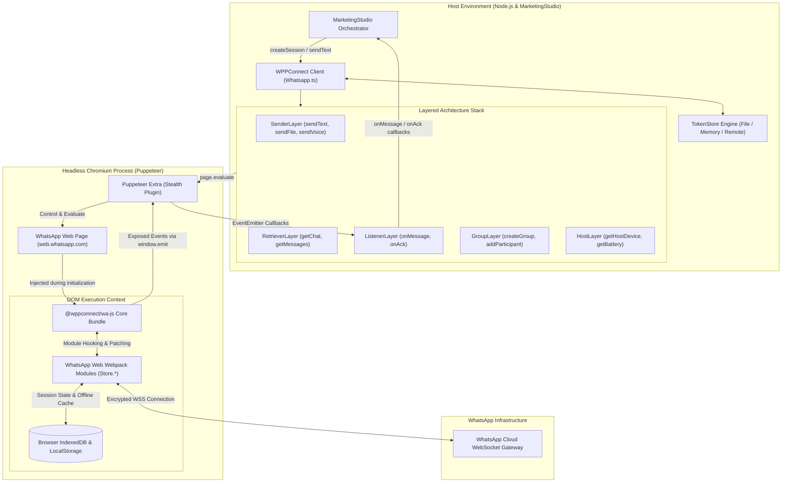
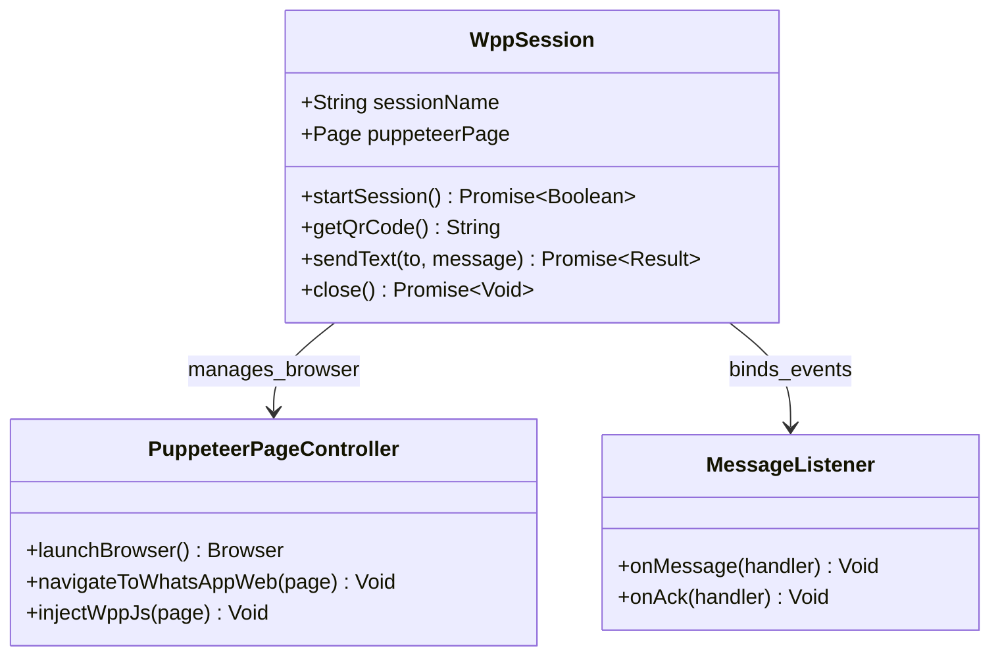
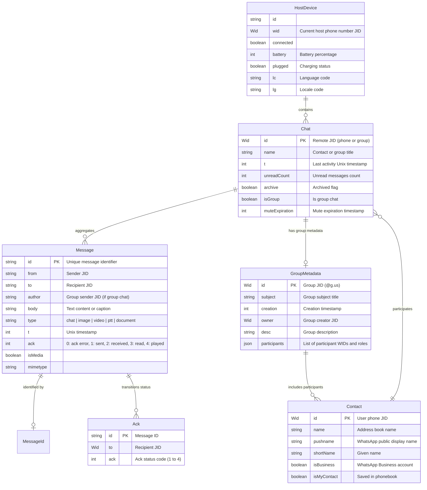
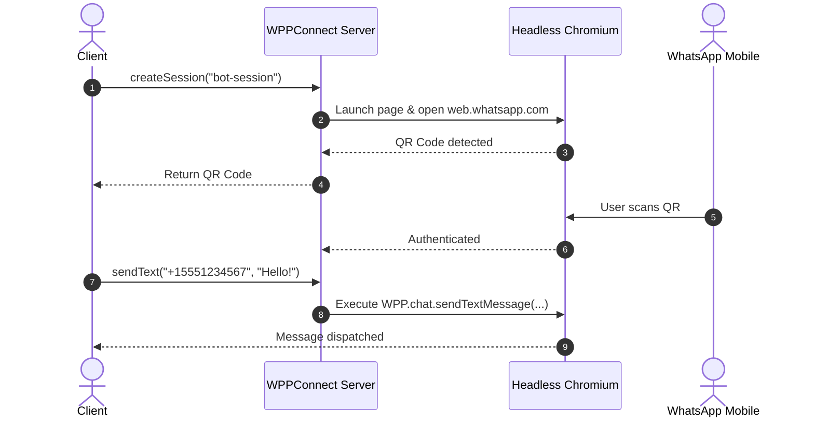

# wppconnect - Architecture & Technical Wiki

> **The Modern Headless-Browser WhatsApp Automation Framework & Injector Engine**  
> GitHub: [wppconnect-team/wppconnect](https://github.com/wppconnect-team/wppconnect.git) | Stack: TypeScript, Node.js, Puppeteer Stealth, @wppconnect/wa-js, Sharp, WebSockets | License: LGPL-3.0-or-later

---

## 1. Executive Summary & Value Proposition

**wppconnect** is an open-source TypeScript framework designed to extract, expose, and automate the internal JavaScript APIs of the official WhatsApp Web client running inside headless Chromium. Unlike protocol-emulation libraries (such as Baileys) that reconstruct binary network stanzas and Noise protocol cryptography from scratch, WPPConnect executes within an actual Chromium browser runtime using Puppeteer. It injects a compiled browser-side API bundle (`@wppconnect/wa-js`) directly into the WhatsApp Web DOM, hooking Meta's private internal React/Webpack modules to invoke functions with 100% official browser fidelity.

### Core Problems Solved
- **Protocol Ban Resilience via DOM Execution**: Emulating WhatsApp's proprietary binary protocol in pure code frequently triggers server-side integrity bans when WhatsApp rolls out undocumented stanza updates. WPPConnect executes real WhatsApp Web web-bundles, making outbound traffic identical to legitimate human browser activity.
- **Access to High-Level Browser Capabilities**: Directly renders canvas graphics, native browser WebRTC voice codecs, client-side encryption, and modern WhatsApp Web UI features (Newsletters, Catalogs, Communities, interactive polls).
- **Extensible Layered Architecture**: Encapsulates browser automation complexity across specialized OOP layers (Sender, Retriever, Listener, Group, Host, Profile, Catalog) that can be easily controlled programmatically.
- **Session Token Management & Token Store Abstraction**: Provides modular token persistence engines (`FileTokenStore`, `MemoryTokenStore`, Redis/S3 capable interfaces) to cache browser localStorage, IndexedDB, and authentication cookies across container restarts.

---

## 2. High-Level System Architecture

WPPConnect operates through a two-tier runtime bridge:
1. **Node.js Orchestration Layer**: Manages the Puppeteer browser lifecycle, anti-detection stealth evasion, session state persistence, and EventEmitter event loops.
2. **In-Browser Execution Layer (`wa-js` / WAPI)**: A Webpack bundle injected into the WhatsApp Web page context. It searches the browser's `window.require` registry for WhatsApp Web internal modules (e.g., `Store.Msg`, `Store.Chat`, `Store.Conn`) and exposes synchronous and asynchronous wrappers directly to Puppeteer via `page.evaluate`.



---

### 2.1 Core Domain & Service Class Architecture



---

## 3. Technology Stack & Key Dependencies

- **Language & Runtime**: TypeScript 5.9+, Node.js 20+ LTS, targeting ES2022.
- **Headless Browser Automation**: 
  - `puppeteer` (v24.x) & `puppeteer-extra` for Chromium lifecycle management.
  - `puppeteer-extra-plugin-stealth`: Masks browser automation indicators (navigator.webdriver, user-agent overrides, chrome runtime spoofing, canvas noise) to evade bot detection.
  - `chrome-launcher` & `lookpath`: Auto-locates installed Chrome/Chromium executables on Linux, macOS, and Windows.
- **In-Browser Injection Engine**: `@wppconnect/wa-js` (v4.7+) and `@wppconnect/wa-version` (pinned compatibility map between WhatsApp Web builds and internal DOM models).
- **Image & Media Engine**: `sharp` (v0.35+) for image compression, thumbnail generation, and animated sticker WebP conversion; `futoin-hkdf` for media key derivation.
- **Logging & Utilities**: `winston` for contextual logging; `qrcode-terminal` and base64 encoders for terminal and UI QR visualization.

---

## 4. Repository Layout & Key Modules

```
inspire/wppconnect/
├── docs/                            # API documentation and architectural guides
├── examples/                        # Sample scripts (basic, express server, multi-session)
├── src/
│   ├── index.ts                     # Public entry point, create() factory method
│   ├── api/
│   │   ├── whatsapp.ts              # Main Whatsapp client class composing all layers
│   │   ├── helpers/                 # Decryption, base64 mime, file download, QR scrapers
│   │   ├── model/                   # TypeScript interfaces (Chat, Message, Contact, etc.)
│   │   │   ├── enum/                # AckType, ChatState, SocketState, MessageType enums
│   │   │   ├── chat.ts              # Chat metadata and state interface
│   │   │   ├── message.ts           # Inbound/outbound message payload interface
│   │   │   ├── contact.ts           # Contact details and profile schema
│   │   │   └── host-device.ts       # Connected device state (battery, connection, me JID)
│   │   └── layers/                  # Inheritance hierarchy of functional layers
│   │       ├── controls.layer.ts    # Browser lifecycle, restarts, evaluate-and-return
│   │       ├── ui.layer.ts          # QR-code scraping, DOM selectors, login state checks
│   │       ├── retriever.layer.ts   # Chat, message, contact, and profile queries
│   │       ├── sender.layer.ts      # Text, file, voice, location, buttons, polls dispatch
│   │       ├── listener.layer.ts    # Message, ack, presence, and call event listeners
│   │       ├── group.layer.ts       # Group creation, admin permissions, invites
│   │       ├── host.layer.ts        # Battery level, host device info, connection state
│   │       ├── profile.layer.ts     # About status, profile picture upload/deletion
│   │       ├── labels.layer.ts      # WhatsApp Business labels assignment and filtering
│   │       ├── catalog.layer.ts     # E-commerce catalog and product dispatch
│   │       ├── newsletter.layer.ts  # WhatsApp Channels / Newsletters integration
│   │       └── community.layer.ts   # WhatsApp Community parent/sub-group coordination
│   ├── controllers/
│   │   ├── initializer.ts           # Session setup, browser spawning, injection pipeline
│   │   ├── browser.ts               # Puppeteer flags, args, and stealth configurations
│   │   └── auth.ts                  # QR-code extraction loop and authentication state machine
│   ├── token-store/                 # Session credential persistence
│   │   ├── fileTokenStore.ts        # Local disk JSON token persistence
│   │   └── memoryTokenStore.ts      # Ephemeral in-memory token store
│   └── utils/                       # Base64 converters, exit traps, file cleaners
└── package.json                     # Dependency definitions and Webpack build steps
```

---

## 5. Core Features & Capabilities

### Layered Object-Oriented Composition
WPPConnect organizes all functionality into a vertical inheritance chain:
`ControlsLayer` $\rightarrow$ `UILayer` $\rightarrow$ `RetrieverLayer` $\rightarrow$ `SenderLayer` $\rightarrow$ `GroupLayer` $\rightarrow$ `HostLayer` $\rightarrow$ `ProfileLayer` $\rightarrow$ `CatalogLayer` $\rightarrow$ `ListenerLayer` $\rightarrow$ `Whatsapp`.
This design ensures strict separation of concerns; high-level callers interact with a unified `Whatsapp` client while internal DOM evaluations remain cleanly partitioned.

### Stealthed Browser Isolation & Anti-Detection
Running automated browsers against WhatsApp Web requires circumventing aggressive client fingerprinting:
- Disables Blink feature flags (`--disable-blink-features=AutomationControlled`).
- Spoofs navigator plugins, screen dimensions, WebGL vendor strings, and languages via `puppeteer-extra-plugin-stealth`.
- Configures custom user data directories (`userDataDir`) allowing IndexedDB and service worker caches to survive across restarts.

### Native In-Browser Media Encryption & Transcoding
Rather than calculating WhatsApp media upload encryption keys on the Node.js server, WPPConnect instructs Chromium to fetch media blobs directly and submit them through WhatsApp Web's native media processing pipeline. Audio tracks are parsed through Web Audio APIs to generate legitimate waveform metadata.

### Real-Time Event Hooking via DOM Callbacks
WPPConnect hooks into WhatsApp's internal event emitters via `@wppconnect/wa-js`:
- Exposes `window.WAPI.onMessage` and `window.WAPI.onAck` into the browser DOM.
- Puppeteer binds a Node.js function via `page.exposeFunction()`, bridging DOM JavaScript events across process boundaries with zero HTTP polling latency.

### Multi-Instance Parallelism
Multiple sessions run side-by-side by spawning isolated Chromium processes or distinct browser contexts with dedicated profile storage paths. Each instance maintains unique token states, proxy connections, and session listeners.

---

## 6. Data Models & Schema Architecture

Because WPPConnect operates as an in-browser automation library rather than an ORM-backed service, its data models reflect the in-memory JavaScript structures exposed by WhatsApp Web's internal store.



### TypeScript Data Structures Breakdown
- **`Wid`**: Specialized WhatsApp ID object containing `{ server: 's.whatsapp.net' | 'g.us', user: '15551234567', _serialized: '15551234567@s.whatsapp.net' }`.
- **`Message`**: Standardized inbound/outbound entity with attributes for message type (`chat`, `audio`, `ptt`, `image`, `video`, `document`, `vcard`, `location`, `poll_creation`), timestamps, and quotes (`quotedMsgObj`).
- **`Ack`**: Enum tracking message transit states:
  - `ACK_ERROR = -1`
  - `ACK_PENDING = 0`
  - `ACK_SERVER = 1` (Sent to WhatsApp servers / Single check)
  - `ACK_DEVICE = 2` (Delivered to recipient phone / Double grey check)
  - `ACK_READ = 3` (Read by recipient / Double blue check)
  - `ACK_PLAYED = 4` (Voice note played / Blue microphone)

---

### 6.1 Comprehensive Database Schema Specification

WPPConnect utilizes an in-memory session registry and file-based/Redis multi-device token storage.

#### Table: `session_tokens`
| Column | Type | Constraints | Default | Description |
| :--- | :--- | :--- | :--- | :--- |
| `session_name` | `VARCHAR(100)` | `PRIMARY KEY` | - | Session identifier |
| `token_data` | `TEXT` | `NOT NULL` | - | Encrypted base64 authentication keys |
| `updated_at` | `TIMESTAMP` | `NOT NULL` | `NOW()` | Token sync timestamp |

*Indexes:* Primary key on `session_name`.

---

## 7. API Architecture, Webhooks & Key Endpoints

WPPConnect provides a programmatic TypeScript/JavaScript API. For HTTP REST deployments, it is wrapped in an Express/NestJS gateway (e.g., `wppconnect-server`).

### 1. Client Initialization & Authentication Loop
```typescript
import * as wppconnect from '@wppconnect-team/wppconnect';

const client = await wppconnect.create({
  session: 'marketing-rep-01',
  catchQR: (base64Qr, asciiQR, attempts, urlCode) => {
    console.log(`[QR ATTEMPT ${attempts}]:`, asciiQR);
    // Push base64Qr to MarketingStudio UI via WebSocket
  },
  statusFind: (statusSession, session) => {
    console.log(`Session ${session} status:`, statusSession);
    // Values: isLogged, notLogged, browserClose, qrReadSuccess, qrReadFail, autocloseCalled
  },
  puppeteerOptions: {
    headless: true,
    args: ['--no-sandbox', '--disable-setuid-sandbox']
  }
});
```

### 2. Message Dispatch Examples

#### Send Text Message with Mentions
```typescript
await client.sendText('15559876543@s.whatsapp.net', 'Hello @15559876543, welcome to MarketingStudio!', {
  detectMentioned: true,
  delay: 1500
});
```

#### Send Rich Media (PDF Document or Image)
```typescript
await client.sendFile(
  '15559876543@s.whatsapp.net',
  'https://assets.marketingstudio.io/docs/proposal-q4.pdf',
  'proposal-q4.pdf',
  'Here is your requested commercial proposal.'
);
```

#### Send Native Recorded Voice Memo (PTT)
```typescript
await client.sendVoice(
  '15559876543@s.whatsapp.net',
  './audio/onboarding-greeting.mp3'
);
```

#### Send Interactive Poll
```typescript
await client.sendPollMessage('15559876543@s.whatsapp.net', 'Which marketing channel delivers your highest ROI?', [
  'WhatsApp Outreach',
  'Cold Email',
  'LinkedIn DMs',
  'SMS Gateway'
], { selectableCount: 1 });
```

### 3. Event Listener Architecture
```typescript
// Incoming Message Listener
client.onMessage(async (message) => {
  if (message.isGroupMsg) return; // Skip group banter

  console.log(`Inbound from ${message.from}: ${message.body}`);
  
  // Forward to MarketingStudio CRM pipeline
  await fetch('https://api.marketingstudio.io/v1/inbound/whatsapp', {
    method: 'POST',
    headers: { 'Content-Type': 'application/json' },
    body: JSON.stringify({
      sender: message.from,
      senderName: message.notifyName,
      content: message.body,
      timestamp: message.t,
      type: message.type
    })
  });
});

// Real-Time Delivery Acknowledgment (Double Check & Read Receipt)
client.onAck(async (ack) => {
  console.log(`Message ${ack.id._serialized} status updated to: ${ack.ack}`);
  // Updates MarketingStudio campaign delivery dashboard
});
```

---

### 7.5 End-to-End Operational Lifecycle Sequence



---

## 8. Strategic Value & Takeaways for MarketingStudio

### Reusable Architectural Patterns
1. **The In-Browser `@wppconnect/wa-js` Injection Pattern**:
   - *Problem*: Pure network protocol implementations (Baileys) require continuous reverse engineering whenever WhatsApp alters its binary protobuf schemas. When a protocol change lands, bots break simultaneously across the globe until library maintainers push a hotfix.
   - *Solution*: WPPConnect loads WhatsApp Web's own client bundle, which auto-updates automatically from WhatsApp's CDN. `@wppconnect/wa-js` hooks stable internal object stores (`Store.Msg`, `Store.Chat`), giving MarketingStudio an ultra-resilient fallback engine for high-value enterprise accounts where connection drops are unacceptable.

2. **Stealth Headless Chromium Profile Orchestration**:
   - *Problem*: Naive Puppeteer automation triggers Cloudflare and Google Bot detectors instantly due to `navigator.webdriver` flags and default viewport signatures.
   - *Solution*: WPPConnect integrates `puppeteer-extra-plugin-stealth` with fine-grained Chromium flag tuning. MarketingStudio can replicate this exact browser profile setup for any browser-based social automation tasks (such as LinkedIn Outreach or Web Scraping).

3. **Separation of Concerns via Functional Layers**:
   - *Problem*: Monolithic WhatsApp clients that bundle browser setup, DOM scraping, audio transcoding, and messaging into a single class become unmaintainable as feature sets grow.
   - *Solution*: WPPConnect's layered inheritance pattern (`RetrieverLayer` $\rightarrow$ `SenderLayer` $\rightarrow$ `ListenerLayer` $\rightarrow$ `Whatsapp`) maintains clear modular boundaries while exposing a single, clean API surface to application code.

### Concrete Convergence Roadmap for MarketingStudio
- **Tier-2 Fallback Gateway**: Integrate WPPConnect alongside Evolution API in a dual-engine architecture. Standard bulk campaigns route through Baileys (low memory footprint), while VIP numbers or complex rich-interactive flows (polls, channel posts, catalogs) route through WPPConnect.
- **Automated Voice Note Sender**: Use WPPConnect's in-browser audio engine to send personalized, human-sounding PTT voice clips to sales prospects during automated follow-up sequences.
- **Real-Time Read-Receipt Attribution**: Utilize `onAck` listeners with `ACK_READ` (code 3) to trigger timely follow-up sequences precisely when a prospect opens an outbound marketing message.
