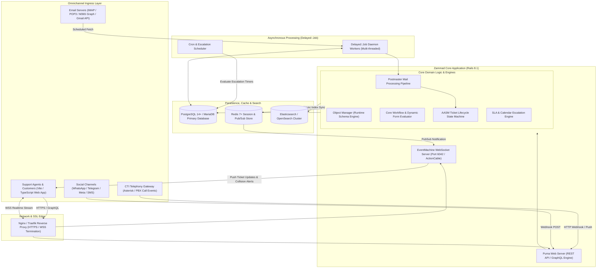
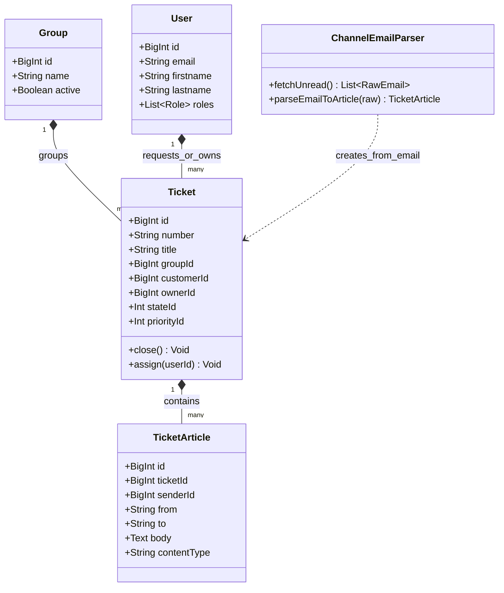
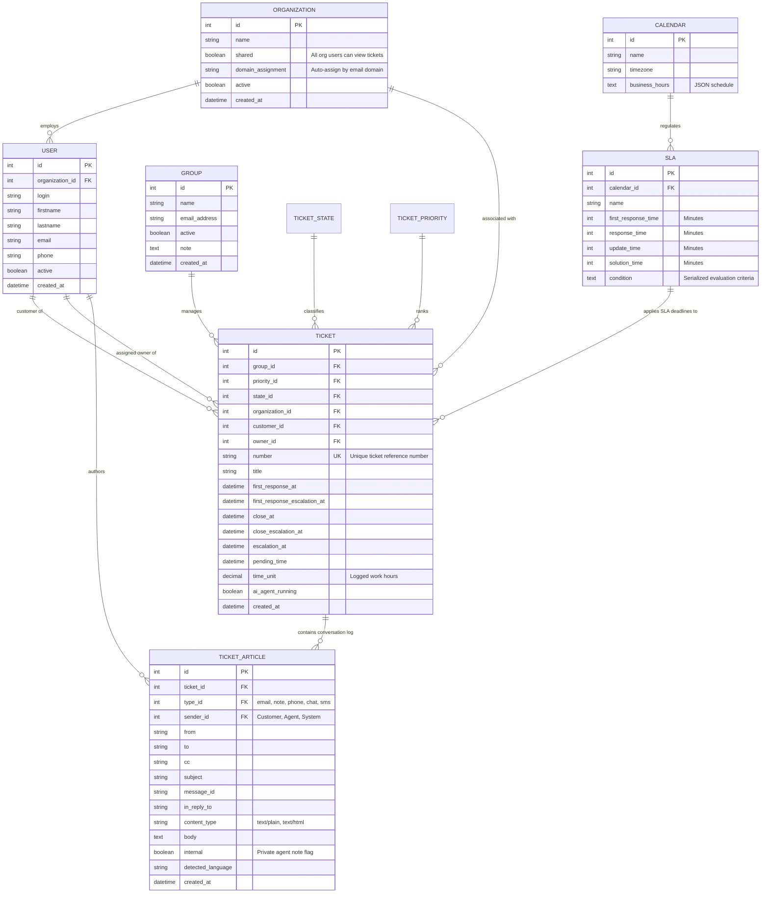
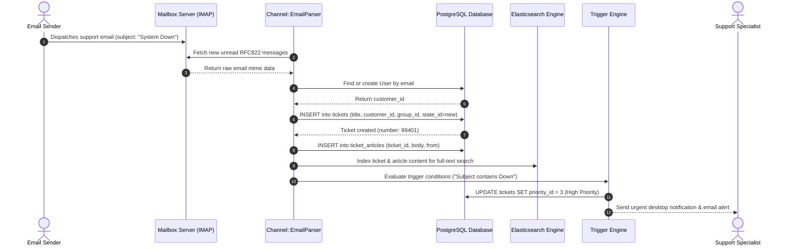

# zammad - Architecture & Technical Wiki

> **Enterprise-Grade Open-Source Helpdesk, Omnichannel Customer Support Platform & ITIL Ticketing System**  
> GitHub: [zammad/zammad](https://github.com/zammad/zammad.git) | Stack: Ruby 3.4, Rails 8.1, PostgreSQL / MySQL, Redis, Elasticsearch / OpenSearch, Vite, TypeScript, GraphQL | License: GNU AGPL v3

---

## 1. Executive Summary & Value Proposition

**Zammad** is a modern, enterprise-grade open-source customer support and ITIL ticketing platform engineered by the creator of OTRS. Built with **Ruby on Rails 8.1** and a reactive TypeScript/Vite frontend, Zammad is architected to handle complex organizational hierarchies, multi-tier SLAs, and high-volume inbound communications spanning Email (POP3/IMAP/Microsoft 365/Google Workspace), Live Chat, Computer Telephony Integration (CTI), WhatsApp, Telegram, Facebook, and Twitter.

Unlike legacy ticket tracking systems with cumbersome page refreshes and static forms, Zammad operates on a high-throughput reactive architecture featuring real-time bi-directional WebSocket synchronization, dynamic schema attribute extensions via an internal **Object Manager**, rule-based workflow orchestration, and native agent collision prevention.

### Core Problems Solved
- **Agent Duplication & Collision Overheads**: Real-time presence indicators and shared draft locks immediately show when another agent is actively typing, editing, or viewing a specific ticket, preventing embarrassing duplicate customer replies.
- **Dynamic Schema Rigidness (Object Manager)**: Eliminates database migration downtime by allowing system administrators to declare dynamic custom fields (text, dropdowns, trees, dates, regex patterns) on Tickets, Users, and Organizations at runtime.
- **Complex Enterprise SLA Orchestration**: Tracks multiple SLA dimensions (First Response, Next Response, Update, and Solution Times) calculated against custom calendar configurations that account for holidays, regional operating hours, and timezones.
- **Multi-Channel Inbound Parsing (Postmaster)**: Employs a sophisticated rule engine that parses raw email headers, SPF/DKIM flags, and regex criteria to dispatch, tag, or silence inbound tickets before agent visibility.
- **Computer Telephony Integration (CTI)**: Out-of-the-box integration with PBX systems (Asterisk, FreePBX, sipgate) to trigger instant caller identification, screen-pop customer history, and link call recordings directly to ticket articles.

---

## 2. High-Level System Architecture

Zammad separates synchronous HTTP request handling, real-time WebSocket state distribution, asynchronous job processing, and full-text search indexing into dedicated subsystems.



### Architectural Lifecycle of an Inbound Communication
1. **Fetch / Webhook Reception**: Inbound emails are fetched by `Delayed::Job` worker threads polling external IMAP/Graph mailboxes, while chat and CTI events arrive via synchronous REST endpoints.
2. **Postmaster Filtering**: Inbound raw MIME messages pass through `Channel::Filter::Postmaster`. Rules evaluate headers (e.g. `X-Spam-Flag`, `List-Id`, sender domain) to set initial priorities, assign groups, or discard automated loop messages.
3. **Ticket & Article Generation**: A new `Ticket` is initialized along with a primary `Ticket::Article`. If the sender email matches an existing `User`, they are linked as `customer_id`; otherwise, a new customer record is automatically provisioned and matched against `organizations` via domain assignment.
4. **SLA Calculation & Escalation Stamping**: The `SLAEvaluator` inspects active SLA rules matching the ticket's group, priority, or customer tier, looks up the assigned `Calendar`, and sets explicit timestamp deadlines (`first_response_escalation_at`, `close_escalation_at`).
5. **Real-time Agent Notification & Search Sync**: The change triggers an event across the internal event bus. The ticket document is enqueued for Elasticsearch ingestion, and an event is published to Redis, broadcasting instant ticket badge increments to all agent browsers subscribed via WebSockets.

---

### 2.1 Core Domain & Service Class Architecture



---

## 3. Technology Stack & Key Dependencies

- **Language & Runtime**: Ruby 3.4.9+, Node.js 20+ (Vite/TypeScript frontend compilation)
- **Application Framework**: Ruby on Rails 8.1.0 (Puma application server)
- **Database & Persistence**:
  - PostgreSQL 14+ (or MySQL 8.0+ / MariaDB 10.5+) via `pg` gem.
  - Active Record with `activerecord-import` for bulk data operations.
- **Real-Time Engine**:
  - `em-websocket` (EventMachine event-driven WebSocket server) paired with Redis Pub/Sub for sub-50ms browser updates.
- **Queue & Background Jobs**:
  - `delayed_job` and `delayed_job_active_record` (thread-safe fork optimized for concurrent database-backed queueing).
- **Search & Analytics**:
  - Elasticsearch 8+ / OpenSearch integration for instantaneous full-text querying across ticket subjects, bodies, raw attachments, and user profiles.
- **Frontend Architecture**:
  - Modern TypeScript single-page application built with Vite, TailwindCSS, and GraphQL (`graphql-ruby` backend).
- **Security & Authorization**:
  - `argon2` for cryptographic password hashing.
  - `pundit` for fine-grained role-based access control across ticket groups and customer organizations.

---

## 4. Repository Layout & Key Modules

```
zammad/
├── app/
│   ├── controllers/                  # Rails REST API & GraphQL Controllers
│   ├── models/                       # Active Record domain models
│   │   ├── ticket/                   # Ticket domain models & concerns
│   │   │   ├── article.rb            # Normalized communication entry (email, note, phone)
│   │   │   ├── escalation.rb         # SLA calculation & escalation logic
│   │   │   ├── merge_history.rb      # Audit trail for merged ticket records
│   │   │   ├── shared_draft_zoom.rb  # Live agent collision & draft locking state
│   │   │   └── time_accounting.rb    # Billable units & time tracking per article
│   │   ├── ticket.rb                 # Core ticket model & associations
│   │   ├── organization.rb           # B2B customer organization model
│   │   ├── user.rb                   # User model (Agents, Customers, Admins)
│   │   ├── group.rb                  # Department / team assignment unit
│   │   ├── sla.rb                    # SLA policy configuration model
│   │   └── object_manager/           # Dynamic custom attributes schema engine
│   ├── services/                     # Business services (AI assistance, macros, CTI)
│   └── jobs/                         # Background job declarations
├── config/
│   ├── routes/                       # Granular modular route definitions
│   │   ├── ticket.rb                 # Ticket, article, macro, and merge endpoints
│   │   ├── channel_email.rb          # Email ingress & mailbox configuration
│   │   ├── cti.rb                    # Telephony CTI call events
│   │   └── sla.rb                    # SLA and calendar routes
│   └── routes.rb                     # Root router loading config/routes/*.rb
├── db/
│   ├── migrate/                      # Database schema migrations
│   └── seeds/                        # System defaults (priorities, states, roles)
├── doc/                              # Architectural documentation & API specifications
└── lib/                              # Core libraries, mail parsers, and external connectors
```

---

## 5. Core Features & Capabilities

### 5.1 Real-Time Agent Collision Prevention & Shared Drafts
Zammad solves agent collisions at the architectural level:
- When an agent opens a ticket (`TicketZoom`), the browser opens a persistent WebSocket connection registered in `Ticket::SharedDraftZoom`.
- Other agents viewing the same ticket immediately receive visual avatar badges displaying *"Agent Sarah is currently viewing this ticket"*.
- If an agent starts drafting a reply, their draft text is periodically synced to the server (`tickets/:id/shared_draft`), preventing conflicting answers and enabling seamless ticket handoffs without lost draft progress.

### 5.2 Dynamic Schema Architecture (Object Manager)
Zammad implements an extensible metadata layer known as the **Object Manager**:
- Administrators can add arbitrary attributes (e.g. `serial_number`, `hardware_type`, `contract_tier`) to the `Ticket`, `User`, or `Organization` models via UI or REST API.
- Zammad's `ObjectManager::Attribute` automatically manages underlying database schema alters or stores structured attributes, dynamically injecting field validations, permissions, and localized labels into the frontend without code redeployment.

### 5.3 Multi-Calendar SLA Engine & Escalation Tracking
Zammad provides SLA compliance tracking:
- **Metrics Covered**: `first_response_time`, `response_time` (subsequent updates), `update_time`, and `solution_time`.
- **Calendar-Aware Business Hours**: Ties SLAs to business calendars (`Calendars`), allowing different groups or customer organizations to have distinct operating hours (e.g., standard 9-to-5 vs. 24/7/365 mission-critical support).
- **Escalation Warnings**: Calculates exact future Unix timestamps (`escalation_at`), giving agents visual warning clocks and enabling automated escalation triggers before deadlines lapse.

### 5.4 Dynamic Core Workflows
Zammad includes a UI workflow orchestration engine:
- Enables conditional form behavior: changing a ticket state to *"Requires RMA"* dynamically makes the *"Return Tracking Number"* field mandatory and hides internal billing fields.
- Rules can be scoped by agent role, customer organization, or incoming channel.

### 5.5 Comprehensive Ticket Merging & Splitting
- **Merge**: Support agents can merge duplicate tickets via `PUT /api/v1/ticket_merge/:source_id/:target_number`. Zammad transfers all `ticket_articles` from the source ticket to the target ticket while appending an immutable audit record in `ticket_merge_histories`.
- **Split**: If a customer replies to an old thread with an entirely unrelated issue, agents can split an individual article into a brand-new ticket with a single click, maintaining historical cross-references.

### 5.6 Automated Macro Actions & Mass Operations
- **Macros**: Agents can trigger composite actions (e.g., assign to Tier 2, set priority to High, change state to Pending, and insert a template reply) via a single keystroke.
- **Mass Updates**: Bulk ticket operations execute asynchronously via `TicketsMassController`, preventing database transaction locks during large batch updates.

---

## 6. Data Models & Schema Architecture

Zammad’s data model centers on the `Ticket`, which acts as the umbrella container for all chronological communications (`Ticket::Article`).



### Core Schema Entity Details
1. **`tickets`**:
   - `number`: Unique, human-friendly identifier generated by pluggable number generators (e.g., date-based `20261024-0012` or sequential).
   - `escalation_at`: Pre-calculated nearest SLA breach timestamp, indexed to allow high-speed cron queries without scanning every ticket row.
   - `time_unit`: Decimal tracking total agent work effort logged across all ticket articles.
2. **`ticket_articles`**:
   - `type_id`: References whether the article arrived as an email, phone call log, live chat transcript, SMS, or internal note.
   - `internal`: Boolean flag ensuring internal notes remain invisible to customer self-service portals.
   - `message_id`: Canonical RFC-822 message identifier used for email threading and deduplication.

---

### 6.1 Comprehensive Database Schema Specification

Zammad runs on PostgreSQL or MySQL with Elasticsearch full-text search indexing and relational ticket auditing.

#### Table: `tickets`
Central customer support tickets tracked by unique alphanumeric numbers.

| Column | Type | Constraints | Default | Description |
| :--- | :--- | :--- | :--- | :--- |
| `id` | `BIGINT` | `PRIMARY KEY AUTO_INCREMENT` | - | Unique internal ticket ID |
| `number` | `VARCHAR(255)` | `NOT NULL, UNIQUE` | - | Customer-facing ticket number (e.g. `20261001`) |
| `title` | `VARCHAR(255)` | `NOT NULL` | - | Ticket subject title |
| `group_id` | `BIGINT` | `NOT NULL, FK -> groups(id)` | - | Department / queue group |
| `customer_id` | `BIGINT` | `NOT NULL, FK -> users(id)` | - | Submitting user profile |
| `owner_id` | `BIGINT` | `NULLABLE, FK -> users(id)` | `NULL` | Assigned agent |
| `state_id` | `INTEGER` | `NOT NULL` | `1` | Ticket state (1=new, 2=open, 3=pending, 4=closed) |
| `priority_id` | `INTEGER` | `NOT NULL` | `2` | Priority (1=low, 2=normal, 3=high) |
| `created_at` | `TIMESTAMP` | `NOT NULL` | `NOW()` | Creation timestamp |

*Indexes:* `idx_tickets_number` (`UNIQUE (number)`), `idx_tickets_customer` (`(customer_id)`).

---

#### Table: `ticket_articles`
Threaded conversational communications within a ticket.

| Column | Type | Constraints | Default | Description |
| :--- | :--- | :--- | :--- | :--- |
| `id` | `BIGINT` | `PRIMARY KEY AUTO_INCREMENT` | - | Unique article ID |
| `ticket_id` | `BIGINT` | `NOT NULL, FK -> tickets(id)` | - | Parent ticket |
| `type_id` | `INTEGER` | `NOT NULL` | `1` | Type (1=email, 2=phone, 3=note, 4=web) |
| `from` | `VARCHAR(255)` | `NOT NULL` | - | Sender email / identity |
| `to` | `VARCHAR(255)` | `NULLABLE` | `NULL` | Recipient email |
| `body` | `TEXT` | `NOT NULL` | - | Article message body |
| `created_at` | `TIMESTAMP` | `NOT NULL` | `NOW()` | Timestamp |

*Indexes:* `idx_articles_ticket` (`(ticket_id)`).

---

## 7. API Architecture, Webhooks & Key Endpoints

Zammad provides a comprehensive, authenticated RESTful API at `/api/v1` along with a GraphQL endpoint.

### Key REST Endpoints

| HTTP Method | Endpoint | Description |
|:---|:---|:---|
| `GET` | `/api/v1/tickets` | List tickets with pagination and filtering |
| `POST` | `/api/v1/tickets` | Create a new ticket with initial article |
| `GET` | `/api/v1/tickets/{id}` | Retrieve ticket details including custom attributes |
| `PUT` | `/api/v1/tickets/{id}` | Update ticket attributes (state, owner, priority, group) |
| `PUT` | `/api/v1/ticket_merge/{source_id}/{target_number}` | Merge source ticket articles into target ticket |
| `POST` | `/api/v1/tickets/mass_macro` | Execute pre-configured macro actions on a ticket array |
| `POST` | `/api/v1/ticket_articles` | Append a new article (public reply or internal note) to a ticket |
| `POST` | `/api/v1/cti` | Inbound telephony caller ID lookup and call event push |

### Sample Request: Create Ticket (`POST /api/v1/tickets`)
```json
{
  "title": "API Gateway 502 Errors in Production",
  "group": "Technical Support",
  "customer": "jane.doe@enterprise.com",
  "priority": "3 high",
  "state": "open",
  "article": {
    "subject": "Intermittent Gateway Failures",
    "body": "Starting at 09:30 UTC, our integration endpoints are failing with HTTP 502 Bad Gateway responses.",
    "type": "email",
    "internal": false
  }
}
```

### Sample Response: Created Ticket Payload
```json
{
  "id": 9184,
  "group_id": 4,
  "priority_id": 3,
  "state_id": 2,
  "organization_id": 42,
  "number": "918420",
  "title": "API Gateway 502 Errors in Production",
  "owner_id": 1,
  "customer_id": 812,
  "first_response_escalation_at": "2026-10-24T12:00:00Z",
  "created_at": "2026-10-24T10:00:00Z",
  "updated_at": "2026-10-24T10:00:00Z"
}
```

### Sample Request: CTI Inbound Call Event (`POST /api/v1/cti`)
```json
{
  "event": "newCall",
  "direction": "in",
  "from": "+14155552671",
  "to": "+18005550199",
  "callId": "call-asterisk-891230"
}
```

---

### 7.5 End-to-End Operational Lifecycle Sequence

The following sequence details how Zammad fetches incoming support emails, indexes them in Elasticsearch, and triggers routing workflows.



---

## 8. Strategic Value & Takeaways for MarketingStudio

### Reusable Architectural Patterns
1. **Dynamic Runtime Schema Extensibility (Object Manager Pattern)**:
   - Zammad's `ObjectManager` demonstrates how an application can allow end-users to add custom fields to core entities without risking schema corruption or deployment friction. MarketingStudio should adopt this pattern for custom Lead, Deal, and Account attributes.
2. **Calendar-Aware SLA Calculation**:
   - Rather than measuring SLAs purely as wall-clock elapsed time, Zammad pre-calculates the exact `escalation_at` timestamp by factoring in corporate calendars, working hours, and holiday schedules. MarketingStudio can use this pattern to track lead response time SLAs across distributed sales teams in different time zones.
3. **Real-Time Collision Detection & Shared Drafts**:
   - Zammad’s implementation of live WebSocket awareness badges and server-synced shared drafts (`Ticket::SharedDraftZoom`) prevents sales representatives from sending conflicting messages or quotes to the same customer.
4. **Normalized Ticket Article Stream**:
   - Storing all communications (inbound email, outbound email, internal team note, phone call record, SMS, chat) inside a single polymorphic `ticket_articles` table provides a clean, unified chronological timeline that simplifies audit logging, timeline rendering, and LLM context extraction.
