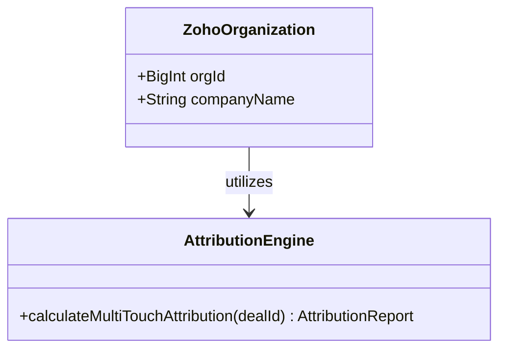
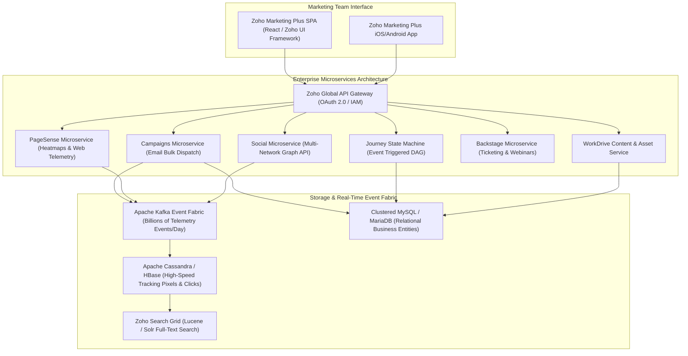
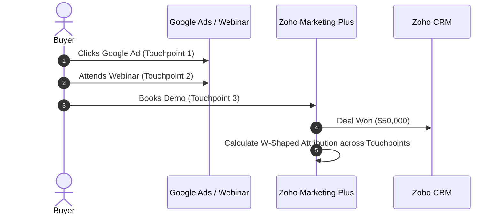

# Zoho Marketing Plus System and Functional Architecture

> Comprehensive technical and functional reverse-engineered reference for **Zoho Marketing Plus**: Zoho's enterprise unified marketing operations platform orchestrating multi-channel campaigns, social publishing, journey automation, web analytics, and brand asset management.

---

## 1. Executive Overview and Market Positioning

**Zoho Marketing Plus** is Zoho's enterprise marketing operating system designed to eliminate the data silos and disjointed toolsets typical of large marketing organizations. Traditionally, enterprise marketing departments operate in fragmented software silos:
- Email Marketing: Mailchimp or Marketo
- Social Media Management: Sprout Social or Hootsuite
- Event & Webinar Management: ON24 or Eventbrite
- Conversion Rate Optimization (CRO): Hotjar, VWO, or Optimizely
- Digital Asset Management (DAM): Brandfolder or Bynder
- Project Management: Asana or Monday.com

Zoho unified these capabilities into a single operational interface by integrating its battle-tested standalone applications (**Zoho Campaigns**, **Zoho Social**, **Zoho PageSense**, **Zoho Backstage**, **Zoho WorkDrive**, and **Zoho Marketing Automation**) under a cohesive **Brand / Workspace** hierarchy with centralized marketing attribution and budget intelligence.

### Core Value Proposition
- **Unified Marketing Operations Workspace**: Manage all creative assets, planning schedules, campaign execution, and performance telemetry under a unified Brand dashboard.
- **Cross-Channel Customer Journeys**: Advanced visual flow canvas triggering personalized touchpoints across Email, SMS, WhatsApp, Web Popups, and Ad Retargeting based on real-time behavior.
- **Enterprise Brand Asset Governance**: Digital Asset Management (DAM) with versioning, brand color palettes, font libraries, and role-based approval workflows for external agencies and internal creators.
- **Closed-Loop Attribution & ROI Analytics**: Connects top-of-funnel marketing activities directly with CRM deals and revenue via bidirectional synchronization with **Zoho CRM**.

---

## 2. Core Entities and Reverse-Engineered Data Model

```
┌────────────────────────────────────────────────────────┐
│                   Organization Account                 │
│      (Enterprise Tenant, SSO, Data Residency, RBAC)    │
└───────────────────────────┬────────────────────────────┘
                            │ 1:N
                            ▼
┌────────────────────────────────────────────────────────┐
│                   Brand / Business Unit                │
│    (Brand Guidelines, Color Tokens, Assets, Teams)     │
└──────┬────────────────────┬────────────────────┬───────┘
       │ 1:N                │ 1:N                │ 1:N
       ▼                    ▼                    ▼
┌──────────────┐     ┌──────────────┐     ┌──────────────┐
│  Marketing   │     │  Engagement  │     │   Digital    │
│  Campaigns   │     │   Journeys   │     │ Asset Library│
│ (Multi-Actv) │     │ (State DAG)  │     │ (WorkDrive)  │
└──────┬───────┘     └──────┬───────┘     └──────────────┘
       │ 1:N                │ 1:N
       ▼                    ▼
┌────────────────────────────────────────────────────────┐
│                  Channel Activities                    │
│   ┌──────────────┬──────────────┬──────────────┐       │
│   │ Email Blast  │  Social Post │ Event/Webinar│       │
│   │ (Campaigns)  │   (Social)   │  (Backstage) │       │
│   └──────────────┴──────────────┴──────────────┘       │
└──────┬─────────────────────────────────────────────────┘
       │ Emits Telemetry
       ▼
┌────────────────────────────────────────────────────────┐
│               Lead & Customer Intelligence             │
│   (Unified Profile, Behavioral Scoring, Touchpoints)   │
└──────┬─────────────────────────────────────────────────┘
       │ Synced Bidirectionally
       ▼
┌────────────────────────────────────────────────────────┐
│              Zoho CRM Pipeline & Revenue Deals         │
└────────────────────────────────────────────────────────┘
```

### Entity Hierarchy Breakdown
1. **Brand:** The top-level operational unit within an organization. Each brand maintains its own team permissions, social profiles, email sender signatures, digital asset repositories, and tracking domains.
2. **Campaign (Parent Activity Container):** An overarching strategic initiative (e.g. "Q4 Enterprise Product Launch") encompassing multiple child activities across different channels.
3. **Activity (Child Execution Unit):** Concrete marketing touchpoints tied to a campaign: an email newsletter, an organic LinkedIn post, a paid Google Ads campaign, a live webinar, or a website CRO experiment.
4. **Journey:** A stateful multi-step customer lifecycle flow that listens for behavioral events and coordinates sequential touchpoints over days or weeks.
5. **Brand Asset:** Media files (logos, guidelines, product photography, video collateral) stored in the underlying WorkDrive repository with access control and revision tracking.

---

### 2.1 Core Domain and Service Class Architecture



---

### 2.2 Comprehensive Database Schema Specification

#### Table: `campaign_touchpoints`
| Column | Type | Constraints | Default | Description |
| :--- | :--- | :--- | :--- | :--- |
| `id` | `BIGINT` | `PRIMARY KEY` | - | Touchpoint ID |
| `lead_id` | `BIGINT` | `NOT NULL` | - | Lead ID |
| `channel` | `VARCHAR(50)` | `NOT NULL` | - | Channel |
| `weight` | `FLOAT` | `NOT NULL` | `1.0` | Attribution weight |

---

## 3. Reverse-Engineered System Architecture & Engineering Blueprint



### 3.1 Technology Stack & Infrastructure
- **Core Runtime & Languages:** Enterprise Java (OpenJDK 17/21), Spring Boot microservices, with legacy high-performance C/C++ native modules in core data routers.
- **Frontend Architecture:** Modern Single Page Applications built with React and Zoho's proprietary **Zia UI design system**, leveraging WebSockets for real-time collaboration.
- **Distributed Data Tier:**
  - **Relational Clustered MySQL / MariaDB:** Stores structured business entities (organizations, brands, campaigns, user permissions, and CRM lead mappings).
  - **Apache Cassandra / HBase:** Ingests high-frequency time-series telemetry (email open pixels, link clicks, website pageviews, heatmap click coordinates).
  - **Apache Kafka:** The asynchronous nervous system streaming events between channel execution services and analytical roll-up engines.
  - **Zoho WorkDrive Cloud Storage:** Enterprise encrypted object storage handling digital assets and video media.

---

## 4. Key Operational Mechanics & Deep Technical Differentiators

### 4.1 Cross-Module Unified Campaign Container
The central architectural innovation of Zoho Marketing Plus is the **Parent Campaign Hierarchy**:
- Rather than forcing marketers to log into Zoho Social to schedule posts and Zoho Campaigns to send emails, Marketing Plus treats both as child executions under a shared parent `campaign_id`.
- Metrics are automatically aggregated across channels: total reach (email subscribers + social impressions + webinar attendees), total spend, and attributed pipeline revenue, providing true **Omnichannel ROI**.

### 4.2 Zia AI & Predictive Marketing Intelligence
Zoho embeds its proprietary AI engine (**Zia**) throughout the marketing lifecycle:
- **Optimal Send Time Prediction**: Analyzes historical recipient interaction timestamps to schedule emails when each specific subscriber is statistically most likely to open their inbox.
- **Content & Sentiment Analysis**: Evaluates email subject lines and social drafts against engagement models to predict open rates and suggest viral hooks.
- **Churn & Conversion Propensity**: Scores customer records based on website visit frequency, email engagement recency, and survey responses to trigger automated retention journeys.

### 4.3 Data Residency & Global Privacy Compliance
Unlike US-centric SaaS platforms, Zoho operates an extensive network of independent data centers across the US, European Union, India, Australia, Japan, and the Middle East:
- Organizations can enforce strict data sovereignty rules, guaranteeing that customer behavioral telemetry and PII never leave their jurisdiction (GDPR, CCPA, and Australian Privacy Principles compliant).

---

## 5. Integration Architecture and API Surface

- **Zoho REST APIs:** Fully documented OAuth 2.0 RESTful endpoints supporting JSON payloads with domain-scoped multi-DC routing (e.g., `marketingplus.zoho.com`, `marketingplus.zoho.eu`, `marketingplus.zoho.in`).
- **Webhooks & Deluge Scripting:** Custom workflow automations can be written in Zoho's native **Deluge scripting language** or connected to external systems via secure HTTP webhooks.
- **Native Zoho Ecosystem Connectors:** Out-of-the-box zero-code bi-directional synchronization with **Zoho CRM**, **Zoho Desk**, **Zoho Books**, and **Zoho Analytics**.

---

### 3.1 End-to-End Operational Lifecycle Sequence



---

## 6. MarketingStudio Convergence & Architectural Takeaways

For **MarketingStudio**, Zoho Marketing Plus demonstrates how to organize enterprise marketing operations cleanly:

1. **Adopt the Parent Campaign / Multi-Activity Model**: Model marketing around strategic campaigns that encapsulate social posts (Postiz), bulk newsletters (Listmonk), and landing page forms (Formbricks) under a unified attribution ID.
2. **Implement Digital Asset Governance**: Provide teams with a central media library containing brand logos, color tokens, and approved templates accessible across all content composers.
3. **Build Closed-Loop Revenue Attribution**: Correlate top-of-funnel campaign clicks directly with Twenty CRM deal closures to calculate true customer acquisition cost (CAC) and marketing ROI.